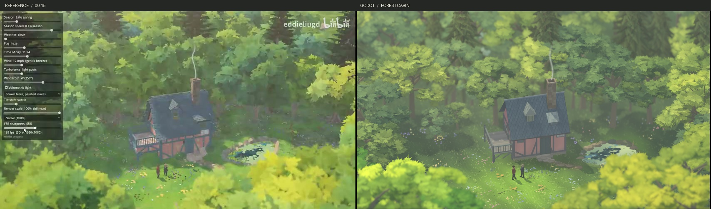

# 温馨林中小屋_复刻实践

晚春的树林围出一小片亮草地。深青色屋顶、粉陶色木筋墙和右侧淡绿小池是画面的三个主色块。两名人物站在门外，近景的亮叶从左右下角伸入，将视线引向屋顶右侧的细烟。



左图为视频 00:15 的原始参考，右图为 Godot 正式主相机的实机成品，保留完整画幅，等比适配后并排展示。对照构图时避开参考左侧天气面板与右上署名。场景来源按视频简介署名为 X 用户 @Botan_cr。B 站发布者 eddieliugd，视频《【AI艺术】太温馨太美了，Godot 里这套会自己长植物的天气系统，做出了我最想住进去的那种小世界》，参考位置 00:15。[参考视频](https://www.bilibili.com/video/BV1dRnU6HE4t/?t=15)

## 先用四个形状定镜头

在空白的 Godot 4.7 Forward+ 工程中新建 Node3D。用米作单位，Y 向上，地面接近 Y=0，镜头从世界 +Z 向树林看。先放一栋带斜坡顶的盒子、一块左平台、右侧的池面和代表两个人的细柱。相机固定后再做叶片与花草。

| 参数 | 起步值 |
| --- | --- |
| 成片尺寸 | 1704 × 960，等比缩放至 854 × 478 并居中补边 |
| Camera3D | 正交投影，Size 18.7 m，位置 (0, 23.395, 26.930)，旋转 (−35.68°, 0°, 0°) |
| 取景中心 | (0, 3.25, −1.12)；小屋放在 (0.13, 0, −0.04)，绕 Y 转 约 13.4° |
| 空地及池塘 | 草地向画面下方延展；池心约在 (7.11, 0.046, 1.53)，水面半径约 2.54 × 1.72 m |
| 两个人物 | 平面坐标 (−1.83, 5.48) 和 (−1.01, 5.22)，分别朝向对方，脚底高度从实际地面取样 |

将预览缩到参考图大小。屋顶横跨约六分之一画宽，烟囱口在右半坡上方、离画面上沿约三分之一；池塘在屋右侧，门前人物之间仍能看到亮草。前景亮叶压住画面下沿，两人和门廊上方的视线保持通畅。

将房屋、森林、地面、小池、人物与烟带分组。每株树的树干和树冠使用同一根部枢轴。将屋墙、屋面、屋面附件、平台和烟囱分件，整屋共用位置和旋转。美工可导出多个独立资产，也可在一个 GLB 中保留命名网格、实例和可编辑变换。草木散布为房屋、人物、门径和池口预留空区。

## 搭半木屋、板岩顶和烟囱

墙体约 4.97 × 4.10 m。屋檐高 2.63 m，屋脊高 5.53 m，屋面横宽 5.70 m。先搭墙、屋顶和石基，再加前立面的灰木立柱、横梁与斜撑。暖粉墙的顶点色可从 `#B47E7A` 到 `#CD918D`；在木柱接缝、墙脚溅水处混入少量灰绿色 `#738080`。灰木筋从 `#646169` 起调。给门做独立板缝和一只小把手，小窗收在檐下，让可读的大块粉墙露出来。

板岩每坡约 15 排、每排约 22 片，奇偶排错半瓦。选深青蓝 `#435869` 与蓝灰 `#667783`，小范围混色；瓦尾做薄薄的缺角和微凸瓦鼻，外沿厚约 0.014 m。用连续几排的浅灰斑表现磨损。屋脊用约 20 节短脊瓦覆盖。左坡附件形成带三角小屋面的老虎窗，右坡附件用**扁平单斜帽和窄窗缝**，宽约 1.1 m，从高端到前檐降约 0.50 m。固定镜头下，二者的高度差应一眼可读。

制作瓦面时，检查底板、瓦片、瓦鼻和坡窗的顶点绕序。在 Blender 中开启面朝向显示，统一朝外；用脚本生成时，逐个多边形做下面的检查，随后按 glTF 约定导出。Godot 的 glTF 导入器会转换引擎所需的绕序。斜射冷色补光应该能照亮向上的瓦面。

```text
几何法线 = cross(顶点1 - 顶点0, 顶点2 - 顶点0)
若 dot(几何法线, 指向坡面外侧的法线) < 0
    反向排列顶点
    同步反向排列每个顶点的颜色、UV 和其他属性
写入指向坡面外侧的单位法线
```

将石烟囱安在主屋前坡，让砖石从瓦面连续露到炉口。烟囱截面约 0.74 × 0.67 m，炉口的世界坐标约为 **(1.700, 7.538, 0.059)**。正面石块逐排错缝，颜色用暖灰、灰褐和少量青苔色；屋瓦相交处加两条窄泛水。烟囱顶由四块压顶石围出凹口，烟道底面比边沿低约 0.16 m。左侧架空平台宽约 2 m，木台面高约 0.91 m，下方留出支柱、斜撑和林地的暗部。门口用宽窄不同的破边踏石错落过渡到地表，低处石片埋入草土。

## 让森林有前后，草地有人走过

| 空间层 | 建模与摆放 | 可用色阶 |
| --- | --- | --- |
| 远林 | 将较高的树排到 Z 约 −27 至 −11 m，树列交错；穿插尖顶云杉，在阔叶后留两处小空隙，透出冷灰绿的远冠 | `#344B45`、`#536F56`、`#91A86A`，远处个别冠团用偏蓝灰的 `#728E89` |
| 屋后与左右林缘 | 树干、侧枝和低树要能在屋脊周围读出来。高树和半高灌木交替，平台上方及烟囱后方留呼吸空间 | `#3A513E`、`#667F4C`、`#A0BA67` |
| 前景叶幕 | 沿左右边缘放多层叶团。左下层较深，右下层更亮、更密，在画面中形成斜向边框。用侧枝改变轮廓，检查树冠没有盖到两个行人 | `#45633C`、`#82A046`、`#D6DB50` |

一株阔叶树可从约 6.7–8.3 m 高的弯树干做起，在不同高度分出约八束侧枝，每束再长出副枝。用长宽不同的扁冠团决定大体积，在亮面叠有脊线的宽叶笔触，在边缘补锯齿状的小叶。做几种冠宽、枝斜和暗面比例不同的母树，实例化时改变旋转、尺度与摆位。树叶粗糙度取 1，漫射采用柔和过渡；在方向光投影处保留少量透光，让林缘树叶间仍看得到空间。云杉用自下而上逐渐缩短的分层枝条建立尖顶，并让部分枝梢从阔叶边缘伸出。

地表可从约 64 × 60 m 的起伏网格开始，在小屋、草地与池岸附近加密。把人站的位置涂亮黄绿，檐下和左林缘涂暗绿。每簇草用宽窄不同的弯叶面片，空地中央压低，林缘和池沿稍高。沿人物、步道边缘和池口分片种蓝紫色及淡黄色小花。由门前往右前方铺一条较短的土径，宽石只放几块，其余以半埋碎石连接，草逐渐长进外缘。

人物高约 1.5 m，以两种站姿区分：一位穿深红短外套，另一位穿灰蓝外套。肩部稍窄、肘部自然弯曲，一只脚略前。头发和帽状的发顶色块先画清楚，再加腰带与靴。对每只靴底的几个顶点分别向下投影到**实际地表三角形**，微调站立高度与脚踝，使靴底轻触草土。用轮廓和投影检查姿态，即使只有约 30 像素高，也应能辨认面对面站着的两个人。

轮廓检查在实际观看尺寸下进行。左侧近叶从画面边缘斜向中央下沉，中央留出的草地允许看清两双靴子。用一支横向伸出的枝条形成局部亮边，枝条下面留深绿阴面。右边的亮叶分别从池前与较高林冠探入，两者之间透出中层树林。深色云杉在阔叶后露出顶梢。远树的小股蓝灰绿透过冠隙，视角改变时应有正常遮挡。

## 做出浅池的暗树影与清水开口

先在草地上压出浅盆，勾出略向右上倾斜的不规则岸线，再铺水面。左岸只让局部石面露出，右岸放稍高的浅色石和挺起的植物。岸边有水草的地方，让草根接到水线。浅岸留黄绿透水区，左半池面画出一组深蓝绿色的树冠倒影，边缘有细枝分叉，中间故意留几道天光。

可用多圈细分水面网格存顶点色，也可用一张绘制色场的纹理。深树影用 `#1C3844` 至 `#35575B`，浅水从 `#729581` 过渡到 `#D4E5A6`，天光小开口偏蓝绿 `#6699A4`。在水流方向加疏密不同的短水平涟漪，浮叶聚成几簇。此处的树影通过绘制水色实现；侧视检查时，池岸、浮叶、岩石有各自的真实高度。

## 在 Godot 里打光和起烟

建立一个 WorldEnvironment、一个暖色主光和一个只照房屋的冷色补光。从下表起调，每次在同一相机观察瓦坡、门前人物和池面。补光通过光照层限定到屋体、板岩、炉口、平台等物件。

| 功能 | Godot 设置 |
| --- | --- |
| 暖太阳 | DirectionalLight3D 旋转约 (−53°, −139°, 0°)，能量 1.10，浅暖色 (1.00, 0.95, 0.79)，角直径 0.52°。开启投影，覆盖距离约 64 m |
| 冷色天光 | 第二盏方向光旋转约 (−50°, 10°, 0°)，颜色 (0.82, 0.80, 0.83)，能量约 0.32；仅照房屋所在的第 2 光照层，关闭其高光和体积雾照明 |
| 环境与空气 | 固定曝光、Linear 色调映射。环境补光 (0.84, 0.88, 0.91)、能量约 0.70。全局空气雾用低饱和灰绿，密度约 0.005；在林下放一块边缘柔化的局部 FogVolume，中心约 (−1, 3.1, −3)，范围 37 × 12 × 28 m，密度约 0.023 |
| 接触阴影与景深 | SSAO 半径约 0.70 m，强度 0.72。景深近端 25.5 m、过渡 9 m，远端 32.9 m、过渡 13 m，模糊量为 0.081。把屋顶烟囱和人物作为焦点，左右近叶可略软 |

在 WorldEnvironment 中开启体积雾，全局体积密度设为 0，由林下椭球 FogVolume 控制实际雾量。参考设置为长度 63 m，局部材质边缘衰减 1.4，雾材质 albedo (0.76, 0.81, 0.74)、emission (0.518, 0.537, 0.553)。观察房后树干是否还能分开，并保持屋顶和池岸可读。

先关景深检查人物脚下的真实接触。阳光下影子应从靴底向画面右下方延伸。宽镜头下若只剩远离人物的躯干投影，检查靴底、腿部和地表是否因 LOD 过度简化。该镜头给两人和地面设置 LOD bias 64，两人使用双面投影。近景虚化只用于软化叶幕边缘。

烟用宽 0.92 m、高 4.60 m 的半透明竖面，中心置于 (1.700, 9.8375, 0.059)，下边缘恰接炉口。着色器用两侧平滑衰减形成软边，按高度缓慢摆动中心线，摆动的起点锁在管口。烟心从约 0.05 m 向上扩至 0.08 m，上段逐渐消失。关闭投影，烟色选淡灰绿。截图时固定烟相位，便于查看烟根是否飘离炉口。

## 给 AI 的分工与交付要求

可用三次独立委托组织制作。每次提供原图中对应的局部裁图和同一个固定机位，要求交回可编辑模型、参数与灰模预览。

1. **房屋。** “制作晚春林间的半木结构小屋，墙宽 4.97 m、深 4.10 m，屋脊高 5.53 m。保留左侧架空木台、前坡右侧石烟囱、一高一矮的屋面窗。用错缝薄板岩、暖粉旧抹灰和灰木筋。拆成墙体、瓦面、窗、烟囱、平台和踏石，给出固定主视角与侧视图。检查瓦面实际绕序和外法线。”
2. **林层与池塘。** “在固定镜头内先摆远林、屋后林缘与两侧近叶，形成亮草地。做有枝干空隙的阔叶树、分层云杉、簇生草花和略倾斜的浅池。池中画出深绿树影、浅岸和天光开口。保持屋顶、人物与池口轮廓可读。”
3. **引擎整合。** “以米为单位导出 GLB，保留网格名、顶点色、法线和实例。若将 sRGB 色板转换为线性数值后写入 COLOR_0，在 Godot 按线性顶点色读取。校准相机、暖主光、局部冷补光、林下雾和烟带，输出固定主视角与旋转侧视图。”

最后在目标观看尺寸检查五处：青瓦能否跟随光源改变亮度，烟柱是否连着炉口，木台下面是否透出林地，两位人物的靴底是否贴地，深色池影之间是否还能辨认浅水。原参考只给出一个视角，背面和遮挡区域可沿用已确定的结构做简洁补全。


## 工程内修改与验证

打开 `examples/cabin/cabin.tscn` 按 F6 运行。鼠标拖动环绕，滚轮缩放，R 恢复主视角。房屋、森林模板、地形与池岸的几何来源为 [generate_cabin.py](../../../examples/cabin/generate_cabin.py)。在线性 COLOR_0 上使用顶点色，导入后由 [apply_pigments.gd](../../../examples/cabin/apply_pigments.gd) 设置材质。树叶的透光和前景色差见 [leaf_light.gdshader](../../../examples/cabin/leaf_light.gdshader)。定制网格前另存可编辑源，生成命令会重写 GLB。

```sh
python3 examples/cabin/generate_cabin.py
godot --headless --path . --import
godot --path . --fixed-fps 60 res://examples/cabin/cabin.tscn -- --capture=res://captures/cabin/final.png
godot --path . --fixed-fps 60 res://examples/cabin/cabin.tscn -- --azimuth=18 --capture=res://captures/cabin/orbit.png
python3 examples/cabin/compare_cabin.py --before captures/cabin/optimization/before.png
```

重建需要 NumPy。对照工具另用 Pillow、SciPy 和 FFmpeg，排除参考面板与署名。面数、独立重建和主侧视截图的指纹保存在[模型与实机核对](../../../captures/cabin/optimization/verification.json)。[完整主视图](../../../captures/cabin/final.png) · [18° 侧视](../../../captures/cabin/orbit.png) · [区域色差](../../../captures/cabin/color_review.json) · [离屏实绘结果](../../../captures/cabin/optimization/measurement.json)
