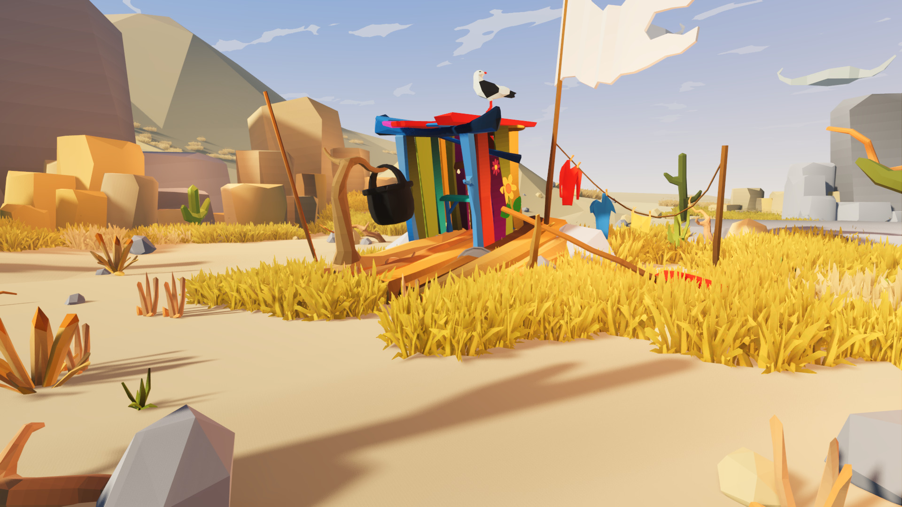

# 低多边形沙漠营地创作计划

以桌面笔记中的 1920 × 1080 展示图作为主镜头，制作可用鼠标环看的 Godot 3D 场景。美术在 Blender 中以米为单位制作，按筏板、棚屋、炊具、挂衣绳、岩组和草甸分别出网格，保留可重建脚本、可编辑源场景及 GLB。

| 阶段 | 制作动作 | 通过条件 |
|---|---|---|
| 镜头与白模 | 用低机位透视对准筏屋。标出屋顶、海鸥、白旗、晾衣杆、谷口和近景石的位置 | 屋顶约处于图宽 42%–59%、图高 21%–28%，筏板延伸到图高约 59%。可见天空与峡谷开口 |
| 生活道具 | 做彩色木板、敞开入口、屋侧花饰、可辨认的海鸥、炊锅吊架、船桨、干衣和破旗 | 正镜头能区分黑锅、红蓝衣物及白旗三个轮廓；侧视有真实厚度 |
| 地貌与植被 | 低面数网格塑造左侧红褐岩壁、远处沙丘、右侧灰岩及浅色通道。草聚成块，筏板和沙路保有清楚边界 | 边框被岩块与植株自然截断，前中后景亮度有差别 |
| 色彩与照明 | 固定沙金、赭石、靛蓝、朱红和柠檬黄色板，太阳照亮草和筏屋，天空靠近地平线转浅 | 屋侧彩板可分，白旗有褶面，阴影使筏板和树枝接地 |
| 导入与复验 | 从源脚本生成 GLB，打开 Godot 场景捕获 16:9 图，按锚点比对并修正，再保存手册 | 默认场景、相机角度、最终 PNG 和再导出的步骤都可以复用 |

本例的参考来自 EmacE Art 的展示图。作者列出的资源包括纹理图集、旗子、晾衣绳、海鸥、木筏和营地示例。本工程用原创网格重建这些视觉元素。记录依据见 [Godot Asset Store 原作品](https://store.godotengine.org/asset/emace-art/raft-on-the-desert-low-poly-desert-pack-for-godot-4/)。
