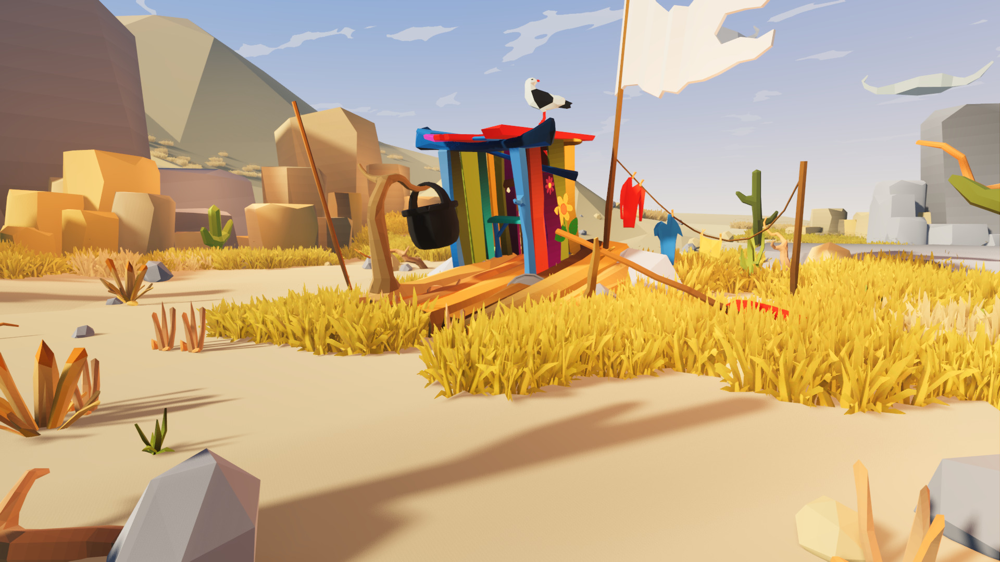
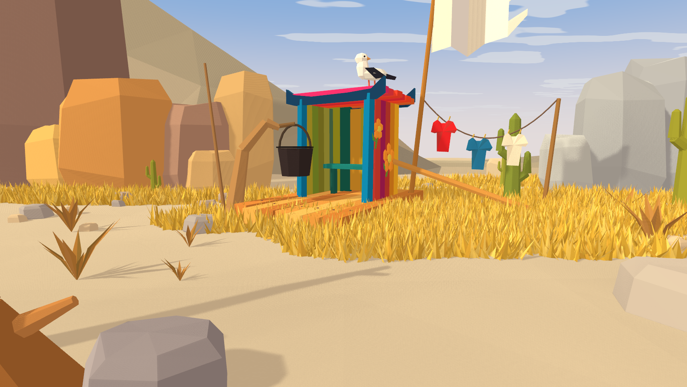

# 彩绘木筏沙漠营地 · 制作手册与复盘

主镜头以一艘搁浅的彩绘木筏为中心。木板的红蓝绿与沙地的低饱和赭黄形成对比。瓦片形的船屋檐口托住海鸥，白旗被画面上缘裁切。弯木挂锅、红蓝衣服和斜桨连成从筏屋左侧走向右边草甸的视觉路线。

| 原参考图 | Godot 最终运行画面 |
|---|---|
|  |  |

原图与原作资产信息来自 [EmacE Art 的 Godot 资源页](https://store.godotengine.org/asset/emace-art/raft-on-the-desert-low-poly-desert-pack-for-godot-4/)。这里的所有模型、草种分布、色彩和云图案均由随项目提供的脚本生成。

## 开始使用

在 Godot 4.7 打开仓库根目录的项目，打开 [desert.tscn](../../../examples/desert/desert.tscn)，按 F6 运行。拖动鼠标可围绕筏屋观察，滚轮缩放，R 恢复主镜头。本案例的运行中快捷键为 4。主图实际输出 1704 × 960，观察图另存于 [右转 15° 的实机截图](../../../captures/desert/orbit.png)。

美术可直接打开 [desert_camp.blend](../../../examples/desert/source/desert_camp.blend)。Outliner 中有按编号命名的 11 个网格。先备份编辑后的源文件再运行 [build_desert.py](../../../examples/desert/source/build_desert.py)，此脚本会用确定的参数重新生成源场景与 [desert_camp.glb](../../../examples/desert/desert_camp.glb)。

## 镜头、地面与尺度

工作单位为米，Godot 以 Y 为上，X 向屏幕右方，+Z 向主相机。建模脚本中的坐标也使用该约定，再写入 Blender 坐标 (x, −z, y)。Blender 采用 Z-up，glTF 导出时启用 Y-up。

相机位于 (0, 1.15, 6.80)，俯角 6.5°，垂直 FOV 为 50°，近远裁剪面为 0.07–78 m。交互绕 (0, 1, 0) 旋转，主相机正视筏屋的前侧和右侧。构图调整先锁相机，观察海鸥和两侧衣杆在画面内的投影，再调整单件资产。

地面由 1.8 m 的格子组成，每格拆为两片三角面。顶点高度在约 ±0.09 m 内变化。左侧远山沿 X 排列不同高度的山脊，后侧填入厚度，近处用五至七边形的岩柱遮住山脚。右岩群采用灰蓝倾向的色板，在暖光下读作淡灰。保留中间的低矮山口和天空。

## 模型制作顺序

| 模型组 | 制作参数与手工调整位置 | 最终 GLB 三角面 |
|---|---|---:|
| 沙地 | 改 build_desert.py 中 height() 和地面格距。草根位置由同一高度函数给出 | 1,914 |
| 山脊和岩组 | 建四圈不等半径截面，围合带倒角的石柱。左侧大石初始尺寸 6 × 8.7 × 4.4 m；右组降低色彩饱和度 | 538 |
| 散石 | 颗粒最长边一般 0.08–0.53 m；左前景石约 0.73 × 0.50 × 0.64 m，轮廓被画面下沿截断 | 2,093 |
| 木筏 | 七根独立木板沿筏的长度排列，单板约 3.64 m，宽 0.307 m，厚 0.24 m。设上下撑板、绳和钉头。筏体朝 Y 轴 −32°，世界 X 横向缩放 0.81，拍摄投影据此校正 | 580 |
| 筏屋和檐口 | 敞开入口、两根蓝柱、金黄/深绿后板、右侧彩板和座椅。屋顶底边向上挑，两端由有厚度的独立檐板构成。板顶的局部 Y 约 2.12 m，最终通过 y′=0.26+0.89(y−0.26) 缩放 | 742 |
| 挂锅、桅杆、船桨 | 弯木分三级收细，锅体采用九边形截面，锅口宽约 0.58 m，提手做九段弧。船桨从 (0.61,0.98,−0.39) 延伸至 (2.88,0.17,0.85)，桨片刷红 | 430 |
| 白旗和晾衣绳 | 旗杆顶高 4.43 m；旗面分片前后起伏，外侧分成两个撕裂尖角。晾衣绳用 18 段近似下垂曲线，垂度 0.68 m。衣物建袖口和内折面，实机能看到红、蓝、米白三件 | 414 |
| 海鸥 | 低面椭球拼身体和头部，独立喙、眼、腿、翅尖。体长约 0.65 m，主体中心靠近 (0.46,2.21,−0.11)；鸟喙朝右，黑色翼片朝相机 | 256 |
| 仙人掌与枯草 | 七边形柱体，主臂从约 53% 高度向外再向上伸。近处主仙人掌高约 1.7 m。枯草从中心向外展开两片折面 | 1,056 |
| 金色草甸 | 六个椭圆区域，种子 41706，每簇 4–6 叶，每叶两片三角面；叶高约 0.09–0.41 m。移除筏屋内部及前景主要沙路上的草 | 49,536 |
| 前景枯枝 | 镜头下缘保留一截较粗枝头；镜头左外缘布置高约 2.35 m 的分枝，让斜影落在裸沙上 | 144 |

共 57,703 个三角面，按最终 GLB 的索引数逐组核对。源脚本另写 [mesh_counts.json](../../../examples/desert/source/mesh_counts.json)。各组目前沿用营地原点，方便整体重导。如果把单件作为独立可拖放的游戏资产交付，先在 Blender 将其原点移到底部接地点，再单独导出。

## 色板、着色与灯光

几何统一使用面角属性 Paint 着色。Blender 中顶点色接 Principled BSDF 的 Base Color，粗糙度 0.97。颜色为 sRGB 的 8 位色样，导出 GLB 时存入线性 COLOR_0。Godot 中通过 [palette_import.gd](../../../examples/desert/palette_import.gd) 开启 vertex_color_use_as_albedo，并保留线性解读。改过颜色后重新导出和导入 GLB。导入配置保存在 [desert_camp.glb.import](../../../examples/desert/desert_camp.glb.import)。

| 用途 | 建模色样 | 比对重点 |
|---|---|---|
| 沙地 | #CBB08F | 地面 shader 以世界坐标加入缓变色和细颗粒，最终颜色还受太阳和环境光影响 |
| 筏板 | #D8873D、#ECAC52、#C87937、#EDB75C | 保持每根板明度变化，船桨边缘可读 |
| 筏屋 | 前柱 #157CAD / #1383B3，檐板 #183E63，屋顶 #F74731 / #EC3170 | 裸露木筏与彩绘木板颜色有区别，内墙暗于外缘 |
| 草 | #DEAA3D、#E7B940、#F6C94B、#CD9F32、#F9D265 | 近处可见单叶的不同折面，远处合成金色块 |
| 岩石 | 暖色 #917266 / #DB9A53，右侧 #B0B2B3 / #A8AAAE | 截面微微错位，岩壁边界保持低面数棱角 |
| 特写小物 | 海鸥 #FFF7E4、翅膀 #292A34，衣服 #F52E30 / #287DA9 | 鸟的深翼在天空前形成剪影，红衣和蓝衣之间留空 |

Godot 内使用一盏方向光，旋转 (−37°, −55°, 0°)，能量 0.86，阴影不透明度 0.83，角直径设置 1.5°。环境光能量 0.67，色调映射为 Linear。天空着色器在地平线与蓝天之间渐变，并通过两层以上噪声生成浅色云片。原作多云天空的具体图案没有可验证的几何数据，当前云片采用同类色调与分布。

## 重新导出和验证

以下命令从项目根目录运行，本次使用 Blender 5.1.2、Godot 4.7 stable 和 macOS Metal Forward+。

```sh
/Applications/Blender.app/Contents/MacOS/Blender --background --factory-startup --python examples/desert/source/build_desert.py
godot --headless --editor --path . --import --quit
godot --path . res://examples/desert/desert.tscn -- --capture=res://captures/desert/final.png
godot --path . res://examples/desert/desert.tscn -- --azimuth=15 --capture=res://captures/desert/orbit.png
```

运行图应能看到彩板、衣物、白旗、海鸥和草甸。导入后出现大面积白面时，检查 GLB 是否有 COLOR_0，再检查导入脚本、材质顶点色开关与材质的颜色空间。离开主相机 15° 后，布片沿绳下垂、锅与提手连接、檐口与屋柱保持实际遮挡。真实渲染需要图形后端，headless 仅用于资源导入。

## 实际对照与复盘

| 轮次 | 实际发现 | 修正与复验 |
|---|---|---|
| 首次导出 | 画面几乎全白；GLB 的 COLOR_0 内已有颜色，Godot 载入后发现顶点色开关为 false | 写入导入脚本并重新导入，读取材质状态确认开关变为 true。保留 [首次运行图](../../../captures/desert/first.png) |
| 首次有色渲染 | 沙地过亮，右下裸沙有两个颜色通道接近饱和；船屋和筏板横向超宽，海鸥偏高，前景石未被裁切 | 收窄筏体、降低屋缘和鸟，重放前景石，降低光强并校正沙色。保留 [调色前图](../../../captures/desert/palette.png) |
| 道具与受光修正 | 右岩偏暖，近景画面中央缺少木枝投影，屋侧花饰读不清 | 右岩向灰蓝调整，加入画外枯枝及较软长影，放大花瓣，缩减前景沙路散石。校正裸沙色以后重新捕获主图和右转图 |

把两张图缩到 852 × 480，在同一矩形 x=536…572、y=453…471 取裸沙 RGB 均值。参考约 (226,199,154)，首轮有色图约 (255,251,171)，最终约 (225,197,153)。这是一个固定局部的颜色对照，其他区域仍需单独观察。参考的草甸更蓬松，岩壁分层与天空云片的轮廓也有差异。右侧小衣物与站在屋顶的海鸥均为几何补全，有限环绕已另行检查。

## 新增筏屋变体的资产委托

如需 AI 辅助出参考图，每次只指定一个物件。筏屋的设计图可写为「同一艘搁浅木筏上的小棚，蓝色前柱、内侧绿板、红色右壁和暖黄檐口。保持敞开入口、挑檐宽度、板条数量。单独生成正、侧、背面，等尺度、中性光、单色背景」。另为黑锅、斜桨和海鸥出图。检查各视图的开口、挂点和枢轴能同时成立，再回 Blender 白模验证。把阴影留给同一盏场景太阳，用主相机复核板缝和衣物边缘在地面上的投影。

## 固定条件下的实绘复验

本机为 Apple M4 Pro，Godot 4.7 / Metal Forward+，视口 1704 × 960，MSAA 4×。离屏测试沿主机位左右各约 8° 扫动相机，每次强制绘制并同步读回完整颜色图。12.0 秒完成 2,843 帧，每帧耗时中位数 3.97 ms、P95 5.09 ms。这组数值用于评估指定视角的绘制与读回开销。[离屏数据](../../../captures/desert/offscreen_benchmark.json)

另一次自动窗口扫动在 30.1 秒内记录 1,034 次真实绘帧和 1,713 次主循环采样。桌面窗口呈现节奏会影响该计数。目标平台的前台交互帧率需要在可见运行窗口复验。[窗口采样](../../../captures/desert/motion.json)
