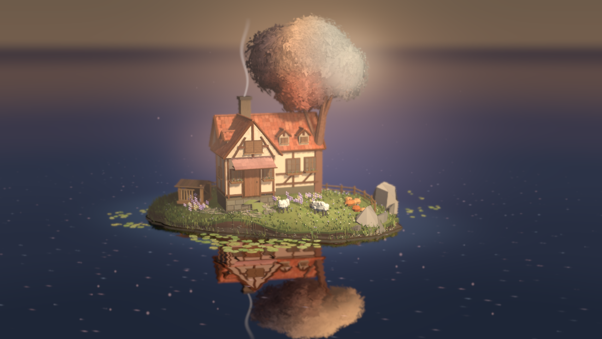
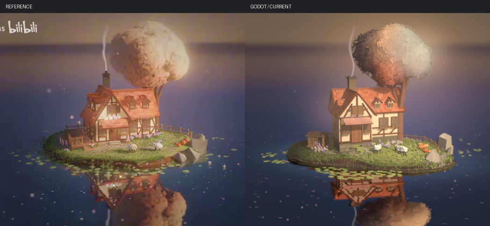

# 暮色湖岛 · 美术制作手册与复盘



画面里有三个彼此叠压的大形。暖树冠在上，木筋红瓦小屋在中间，树与屋的倒影在水线下延伸。先把这三个大形放准，再做窗边花箱、羊毛和树冠边缘的小叶。参考帧来自原笔记标注的 06:20。[参考图](reference.jpg) · [场景](../../../examples/island/island.tscn)

## 从主镜头搭出尺度

在 Godot 4.7 的 Forward+ 工程中打开 `examples/island/island.tscn`，选择 Camera3D 预览。按 F6 运行，拖动鼠标环绕，滚轮缩放，R 恢复主镜头。主视口为 1704 × 960。缩至 852 × 480 与参考图比较时，统一以左上角为原点，避开参考中的水印、鼠标和底部任务栏。

| 镜头设置 | 数值 |
| --- | --- |
| 位置、欧拉角 | (8.92, 8.17, 29.00) m，(−10.83°, 14.46°, 0°) |
| 垂直视野、环绕中心 | 30°，(1.44, 2.44, 0.00) m |
| 远景景深 | CameraAttributesPractical，25 m 开始模糊，过渡 12 m，模糊量 0.022 |

白模阶段只放岛台、屋顶、树冠和水线。参考中的远岸约在 y=67，岛体约在 x=205–563 之间，树顶约在 y=16，前山墙尖约为 (357, 170)。相机锁定后检查突出山墙的**左屋坡**，它决定了前门、左木棚和两扇主坡老虎窗的相对位置。

## 先定岸线和通往门口的小径

从半径约 5.95 × 4.14 m 的不规则椭圆起稿。地表边缘基高约 0.40 m，中心再隆起 0.74 m。边缘处沿轮廓加低幅冲刷起伏，前沿纵深由内向外渐缩，最前端约收回 18%。观察右侧岩石能否破开岸的轮廓，同时检查正面露土带的宽度。近水处用潮湿色压暗，越靠草面越恢复本色。低岸会露出草根和短段土面。

右岸用有棱面的独立岩组，一块靠后直立，另一块向前倾斜，受光面与较暗的破裂面交替。左岸树荫下的草更暗、更密。沿前岸种高低不同的草丛、水草和少量分叉草根，让它们之间露出间断水线。草坪中留出从左木棚至门口的弯路，路中以不规则小卵石铺实，边缘留草。羊脚和门前石块在主机位应能同时看清。

## 搭出有人生活的屋门与木棚

1. 主墙长 4.65 m、深 2.16 m。建模局部坐标中，主檐高程 2.93 m，脊再升 2.02 m。前山墙的脊线与主体垂直，左屋坡和主屋坡都有小窗。整屋绕 Y 轴转 +34°，高度按 `y′ = 0.80y + 1.03` 变换。烟带同步应用房屋变换，保持烟柱从烟囱口引出。
2. 先做灰泥和细木筋，再嵌入窗洞。灰泥基色 `#E1C7A0`、主木筋 `#765032`。山墙在檐下和窗角用连续顶点色插出少量金褐旧痕。窗内压暗，窗棂略亮，加窄窗台、薄木花箱、外垂绿叶和少量淡紫花。门板留纵缝、过梁和小拉手。把图缩回观看尺寸，仍应能分出窗洞和花箱两层。
3. 红陶瓦逐排错开半瓦。按屋深 × 3.65 取排数，按脊长 × 5.6 取每排列数。给每片瓦弧形瓦鼻、浅厚度和轻微色差，屋脊用节段脊瓦衔接。门前用横向单坡雨棚，顶缘为粉陶色，檐缘过渡到暗玫瑰色。侧坡的色彩由受光和檐下遮蔽共同形成。[房体与瓦面材质](../../../examples/island/paint.gdshader)
4. 用一小块与草坡相交的土坎承接门槛。四块薄台石沿土坎嵌入，宽度约 0.96、0.84、0.67、0.43 m，位置略微错开，石缘破碎且偏暗。土坎只伸出门槛 0.61 m。先沿重塑后的真实地表取样，再将每块石头的边角贴回地面；铺地与岸缘至少留出 0.48 m。两侧补细草，使碎石顺着木棚方向接入步道。检查门前是否出现整块笔直、泛亮的斜板，发现后优先降低铺地边缘和草土的高差。
5. 左边木棚采用低矮斜屋顶、暗后墙和木台板。正面左侧留稀疏栏板，右侧留入口，透过木缝能看见棚内短木。两只羊分开摆，近只露后背，远只侧身低头。羊的头、耳、腿和局部毛团独立建模。眼睛和羊毛纹理应服从远处的小轮廓。

## 在一棵树上处理两种叶层

先画左上小峰、中部高顶和右下圆突。脚本用六个有不同深度的椭球限定三束主枝的伸展范围。内部有缩小的体积，外部由 **248 组叶梢**、有折脊的叶片和边缘细叶组成。向阳处在细叶下方加局部连续叶层，让米色亮面具有整片的光感。背光侧留叶间空隙，露出短枝和不规则冠缘。模型分配了独立的树木随机数流，调整树枝时仍可保持小屋和小路的位置。[建模源](../../../examples/island/source/build_island.py)

着色时把各叶片的局部法线与树冠朝外的方向混合。整体法线权重随叶层密度在约 0.56–0.976 间变化。亮区叶片细节更小、更平滑，暗区保留朝向差异和叶间层次，中央下缘加入暖铜色，左灰紫、右米黄。先用相机检查大明暗是否连贯，再检查侧视下的枝叶厚度；过于均匀时先改叶梢分布，过碎时收敛亮区色差。[树冠材质](../../../examples/island/leaves.gdshader)

## 打光，把雾放到需要的深度

| 项目 | 初始设置与调整方法 |
| --- | --- |
| 主光 | Sun 旋转 (−32°, 48°, 0°)，能量 2.0，颜色 `#FFF0DC`，投影不透明度 0.85，光源角直径 1.6°。以主坡亮面、山墙左坡和树冠暗部为三处比对点。 |
| 冠底暖反光 | 在 (4.4, 4.65, 2.55) m 放置 OmniLight3D，色值 (1, 0.905, 0.835)，能量 7.3，范围 8.8 m，衰减 1.5。检查低处叶簇与檐下的暖色，保留左侧深影。 |
| 冷色填光 | 环境色 (0.58, 0.64, 0.75)，能量 0.34，Linear 色调映射，固定曝光。比较屋内暗窗与左岸植物，避免挤成同一块黑色。 |
| 接地 | SSAO 半径 0.70、强度 1.0、直接光影响 0.12。看羊脚、岩缝、门槛和草根。 |
| 全局暮雾与辉光 | 普通雾密度 0.0042，色 `#B39786`。Glow Intensity 0.35、Strength 0.70、高亮阈值 0.45。固定曝光后再调雾。 |
| 局部体积雾 | CanopyHaze 在树冠后侧，中心 (3.0, 7.5, −3.05) m，体积约 5.2 × 5.0 × 7.8 m，密度 0.087。CottageHaze 靠近前檐，中心 (−0.5, 3.7, 1.8) m，约 8.0 × 5.0 × 7.4 m，密度 0.056。分别校准冠缘暖光和屋前空气层，再检查花箱与瓦缘是否保有轮廓。 |
| 空湖 | 远岸暖灰过渡到紫蓝、深蓝湖水。14 个环境亮点与 18 个近水柔光点分布在世界空间。适量留出干净水域。 |

## 湖面与倒影

水线设在 y=0，Reflection 复用同一套网格，建筑镜像的 Y 轴缩放为 **−0.75**，树干与树冠的有效缩放为 −0.68。建筑镜像沿观察方向做局部剪切，紧贴水面的顶点保留水线，高处建筑的倒影向岸内收起最多 0.40 m，树木沿用独立的纵向压缩。观察镜头中的屋坡面积，以及倒影与近岸的遮挡，再从侧面检查屋影和烟带的连接。烟带的建模长度为 4.65 m，经房体变换后约 3.72 m，镜像里使用更低的透明度。睡莲位于水线上，按小群分布；本版导出 98 片，叶缘有开口与轻微起伏，群与群之间留出水面。

先检视倒影的屋脊、烟柱和下缘树叶，再调整水的模糊和颜色。反射 shader 补偿翻转和非均匀缩放后的法线，树叶的暗部保留少量暖色漫射，亮灰泥的反射对比适度压低。水面读取已绘制的场景，施加少量纹理坐标扰动与 mip 过滤，岸旁再加浅水青蓝散射。这样门窗能在倒影里辨认，同时有部分细节被波纹打散。按 18° 环绕图检查倒影与地面的接合。[镜像 shader](../../../examples/island/reflection.gdshader) · [水面 shader](../../../examples/island/water.gdshader) · [侧视图](../../../captures/island/orbit.png)

## 本版源资产统计与重建

当前 GLB 有 **13 个命名网格、108,142 个三角面**。下表来自文件内各网格的 POSITION 三角形统计，水面、局部雾、微尘及倒影的额外绘制另计。

| 网格 | 三角面 | 网格 | 三角面 |
| --- | ---: | --- | ---: |
| TurfAndEarth | 1,088 | BankFoliage | 5,242 |
| CottageWalls | 11,468 | PorchAndGarden | 1,032 |
| OakWood | 1,952 | AutumnOak | 73,617 |
| Meadow | 4,499 | FoxglovesAndWildflowers | 4,320 |
| SlateAndCobbles | 1,914 | Fence | 736 |
| Sheep | 1,332 | LilyPads | 882 |
| ChimneySmoke | 60 | | |

已有模型可直接在 Godot 中运行。要改几何，在合集或独立工程根目录用装有 NumPy 的 Python 3 生成。使用 Blender 手工精修时，先另存工作副本，导出时保留原点、尺寸、网格名、法线和 COLOR_0，以便引擎识别树冠和烟带材质。

```sh
python3 examples/island/source/build_island.py
godot --headless --path . --import
godot --path . --fixed-fps 60 res://examples/island/island.tscn -- --capture=res://captures/island/final.png
godot --path . --fixed-fps 60 res://examples/island/island.tscn -- --azimuth=18 --capture=res://captures/island/orbit.png
```

## 对照成片与上轮记录

上轮已经对齐了房屋朝向和冠体的大形，但从主镜头仍能看出规则的壳状树冠、平整亮白的山墙和突出草面的方台。本版从外壳轮廓继续做到叶梢、局部受光叶层与暗部空隙，将前门的方台改成嵌在草坡里的薄石，并让左木棚露出暗内景。右岸用折面岩石形成高低变化，左岸的阴影和草根加强了岸线连续性。最后用较轻的远景景深、两处局部雾和较长的倒影重新协调房屋、树冠与水线。[上一版成片](../../../captures/island/optimization/round1.png) · [目标参考](reference.jpg)

下表保留 **2026-11-11 当天前一轮**的色彩记录，结束时对应 37,103 面的版本。数值为固定矩形内相应像素 ΔE00 的中位数。草丛或岸线移动会改变该矩形截取的物体，因此还要检查对应局部的图像。

| 色区 | 上轮开始前 ΔE00 | 上轮结束时 ΔE00 |
| --- | ---: | ---: |
| 远湖 | 5.29 | 0.87 |
| 中景湖水 | 6.83 | 1.72 |
| 近湖 | 1.27 | 0.89 |
| 树冠亮面 | 6.88 | 3.60 |
| 树冠中部 | 7.46 | 5.64 |
| 树冠暗面 | 6.53 | 5.36 |
| 草地 | 6.39 | 7.63 |
| 岸下沿 | 12.89 | 14.23 |
| 树倒影右下 | 9.71 | 7.88 |
| 树倒影中部 | 10.04 | 8.78 |

本版视觉验收以同尺寸主镜头为准，再用侧面检查真实几何。门前石阶与草之间应有自然交界，树冠暗面应分出叶片与枝条，镜像烟带应与烟囱连续。参考只有一个机位，背面结构、个别花丛与羊的比例来自单帧推断。当前叶形、瓦片、岸边植物与参考仍有局部差异。

在工程根目录运行 `python3 tools/compare_island.py --before captures/island/optimization/round1.png --output captures/island/color_review_round2.json` 可复验本轮与上一版。依赖为 NumPy、SciPy、Pillow 和 FFmpeg。对照试验固定相机、模型和曝光，每次改灯后等待实际场景更新再截取画面。本轮测量条件与结果见下表之后的记录。

## 本轮主机位复核



固定相机后，将两版实机图和参考缩至 852 × 480。下表用半径尺度 σ=3 像素的高斯平滑保留大块明暗，再取各区域对应像素的 ΔE00 中位数，数值越低表示该区域综合色彩越接近参考。

| 区域 | 上一版 | 本轮 |
| --- | ---: | ---: |
| 树冠 | 7.47 | 5.45 |
| 房屋 | 10.09 | 8.39 |
| 草坡 | 11.43 | 8.60 |
| 水线 | 11.85 | 9.70 |
| 屋影 | 9.73 | 9.37 |
| 树影 | 10.22 | 8.71 |
| 冠旁与屋旁的雾光 | 3.93 | 2.91 |

逐像素观察时，固定的岸下沿小区从 14.23 变为 10.26。前岸的高度和草土交界会改变这块小区所对应的表面。实机画面中树冠右侧的叶团形状、前岸的植被密度和石块切面仍与参考有差别。

在 Apple M4 Pro (Apple9) 的 Metal Forward+ 后端以 1704 × 960、4× MSAA 实绘并同步读回，10.0 秒内完成 1568 帧，单帧中位数 6.42 ms，P95 为 7.00 ms。主视图与 18° 侧视图均从正式入口重新捕获。独立临时目录内重建得到的 GLB 与工程模型逐字节相同。[色差明细](../../../captures/island/color_review_round2.json) · [实绘测量](../../../captures/island/offscreen_round2.json)
