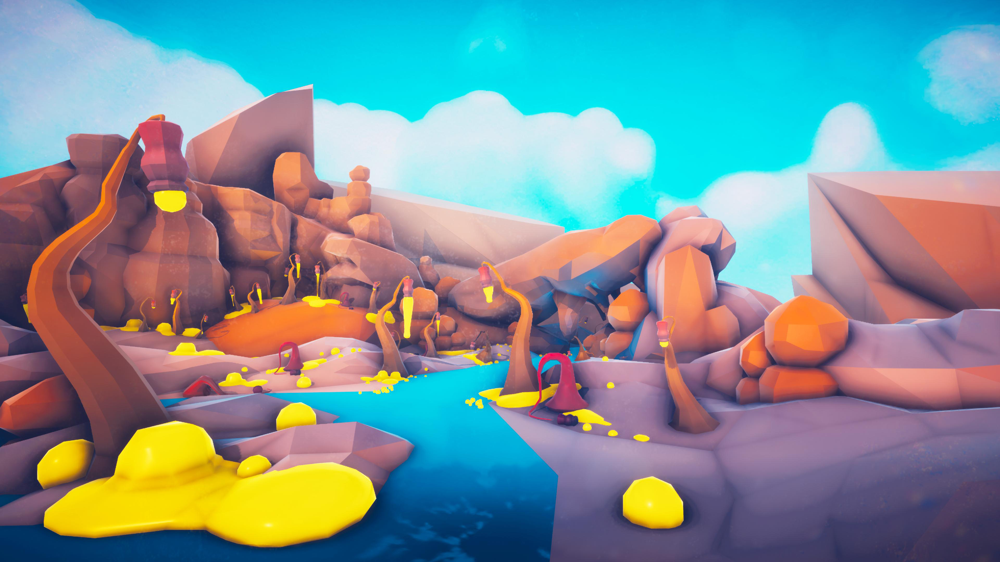
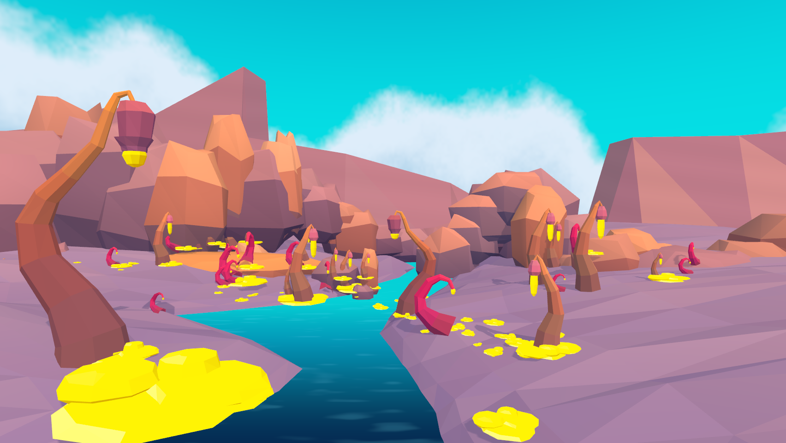

# 奇幻熔岩植物 · 制作手册与复盘

本案例在 Godot 中重建一条异星河谷。相机左侧的弯茎垂灯确定尺度，中央青蓝水道把视线带进远景，暖紫岩壁围住成片的黄色凝结物。对照美术设定使用 EmacE Art 的展示图，模型和着色器取自本工程的制作源。[原作资源页](https://store.godotengine.org/asset/emace-art/lava-plants-free-low-poly-pack/)

| 目标 | Godot 实机 |
| --- | --- |
|  |  |

## 打开与复验

用 Godot 4.7 打开工程根目录的 `project.godot`。打开 `examples/lava/lava.tscn`，在 Camera3D 预览主机位，按 F6 运行。拖动鼠标环绕，滚轮缩放，R 恢复原位。场景根下的 River、LateSun 和 VolcanicGarden 可独立选择。展开 VolcanicGarden 可以移动每一株植物或替换某组岩体。[场景文件](../../../examples/lava/lava.tscn)

1. 在镜头固定的条件下，先搭左前方的一株大植物、中心两岸和远景剪影。在 852 × 480 对比尺寸上，主株灯泡中心约在 (146,171)，左侧峰顶约在 (264,74)。这两个屏幕位置可用来检查景物尺度。
2. 采用米制，Y 朝上，相机位于 (0, 2.7, 8)，向下 2.4°，垂直 FOV 56°。场景以米为单位输出 GLB。左前大株以根部为原点，转动时检查背面的花萼、弯茎接缝和岸坡遮挡。
3. 完成单株后，用同一套材质做细茎滴穗与低矮卷芽，再进行多株布景。位置表保存在 `garden.tscn`。生成脚本按取景射线与实际岸坡/岩壁三角面求交，落地后检查根部是否埋得过深。
4. 运行下面的命令保存主相机和侧转图。主屏为 1704 × 960，截图不包含编辑器叠层。[侧转 15° 的实机图](../../../captures/lava/orbit.png)

```sh
godot --path . examples/lava/lava.tscn -- --capture=res://captures/lava/final.png
godot --path . examples/lava/lava.tscn -- --azimuth=15 --capture=res://captures/lava/orbit.png
```

## 资产规格与建模顺序

资产都在 `examples/lava/assets/`。表中的范围为 GLB 局部包围盒尺寸，顺序为 X × Y × Z，三角面按一份源网格统计。

| 部件 | 实际尺寸（m） | 三角面 | 形体与检查方式 |
| --- | ---: | ---: | --- |
| angler | 2.02 × 4.37 × 1.05 | 332 | 从粗根向上收窄，以七边截面沿弯曲中心线放样。保持下端倾斜、中部弧折和末端下垂，花萼下方露出黄色灯泡 |
| spindle | 0.73 × 2.08 × 0.57 | 236 | 细长滴穗，花头小于主株，黄色核心略微拉长，适合中远景成簇放置 |
| ribbon | 0.85 × 1.31 × 0.53 | 184 | 低矮的玫红卷芽，靠负空间表现钩形，与直立滴穗形成高度差 |
| yellow_pool | 2.37 × 0.45 × 1.86 | 430 | 多个有高度差的熔滴重叠，做成低伏底座与突起；从侧面仍能读出体积 |
| banks | 53.88 × 1.46 × 33.65 | 476 | 先沿相机投影画水道边缘，再向两侧生成略有起伏的紫岩阶地。近岸边低于水线，侧转无缝隙 |
| canyon | 100.06 × 15.36 × 25.83 | 3,360 | 大片山墙先定天际线，中景补叠岩、斜石和橙色矮丘，保持视线通向远处水口 |

这六份网格在场景中实例化 100 次。各组共有四个材质语义名，分别是 `stone`、`warm_wood`、`petal` 和 `lumen`。命名决定导入脚本如何绑定岩面与发光材质。建模时保留足够大的面，岩石边缘用转折面形成轮廓，平面与平滑法线约按 62:38 混合，使岩面能看见折角与渐变。

## 色板、材质与灯光

- 岩面取灰紫、赭紫、暖橘三组。近岸可从 `#9d869e` 到 `#a88fa4`，中景从 `#634d65` 到 `#af7f82`，局部暖岩最高用 `#e4a779`。脚本将美术选定的 sRGB 转成线性 COLOR_0。保留颜色属性、面法线，以及指定材质名。
- 茎部由根部 `#805253` 过渡到细梢 `#e49241`，花萼使用玫紫和暗红分段上色。发光芯的边缘偏金，顶面偏柠檬黄，亮面和侧面随法线变化。用 `glowing_sap.gdshader` 控制黄色面积和内部明暗。
- 主光旋转为 (−44°, 25°, 0°)，能量 1.18，暖色。环境补光为 0.70。水面以世界 Z 距离从前景靛蓝过渡到中远景亮青，水波细纹随世界位置取样。天空来自角度驱动的云层 shader，侧转相机时能看到云带改变方向。
- 在运行相机下依次关闭/打开辉光，检查小黄芯与大熔滴是否仍有内部亮暗。缩小到四分之一尺寸，第一眼应能区分水道、弯茎和岩壁。切换左右侧视图检查植物底部，确认岸边没有悬空或贯穿镜头的薄片。

## 修改与导出

`examples/lava/source/sculpt.py` 可重建全部几何和布景。需要 Python、NumPy。种子 3429 固定布景变化。调整 `make_plants` 里的中心线和半径序列可改变主株，调整 `shore` 中两组岸线采样可改变河床宽度。先另存人工改过的 GLB，再执行以下步骤。[建模源](../../../examples/lava/source/sculpt.py)

```sh
python3 examples/lava/source/sculpt.py
godot --headless --path . --import
```

美工也可在 Blender 导入单个 GLB，按实际比例编辑后以 glTF 2.0 导出。勾选法线和顶点颜色，保留材质名、向上轴转换和根部枢轴。Godot 导入选项中保持本项目的 `material_import.gd`，重新打开单株场景检查 COLOR_0 是否实际参与着色。[材质导入脚本](../../../examples/lava/material_import.gd)

需要新增资产参考时，可从主株裁图派生正、侧、背视图。提示词示例为「同一株异星提灯草，七边截面，宽根部、窄弯梢，暗红分节花萼垂挂黄色短核心。保持钩的朝向与半径、花萼尺寸；中性柔光、单株完整、浅灰背景」。将视图中的高度比例与本表核对，再建模并回到主机位检查。

## 本次迭代与验收

首轮中多个岩体呈白色。检查导入资源发现网格已有 COLOR_0，部分材质的顶点颜色开关仍关闭。修正导入脚本后重导，岩岸、茎和花萼恢复各自色板。保留首轮和色板修正后的原始渲染作为排查范例。[首轮实拍](../../../captures/lava/first.png) · [色板修正](../../../captures/lava/palette_pass.png)

第二轮随机叠岩挡住了水道和许多小株。改为先按参考定位后墙的折线和主要叠岩，再补小石。中景提灯草调整了朝向，小株和凝滴经表面拾取落在真实岸坡上。第三轮按材质名绑定独立岩面与熔滴 shader，调整水由暗到亮的过渡区间。[地形修正](../../../captures/lava/shape_pass.png)

已在 Godot 4.7 Forward+ / Apple M4 Pro 上渲染主镜头和侧转镜头。主株、黄色灯芯、蓝水道、暖紫山墙与三类植株均可辨。原作的岩面转折更柔和，右岸拱形石洞更深，远处云团更圆；目前的中远景小株分布和发光池边缘仍可逐块精修。背面按三维结构补全，验收以所给主视角为准。

## 固定条件下的实绘复验

本机为 Apple M4 Pro，Godot 4.7 / Metal Forward+，视口 1704 × 960，MSAA 4×。离屏测试沿主机位左右各约 8° 扫动相机，每次强制绘制并同步读回完整颜色图。12.0 秒完成 3,520 帧，每帧耗时中位数 3.24 ms、P95 4.03 ms。这组数值用于评估指定视角的绘制与读回开销。[离屏数据](../../../captures/lava/offscreen_benchmark.json)

另一次自动窗口扫动在 30.1 秒内记录 42 次真实绘帧和 1,759 次主循环采样。桌面窗口呈现节奏会影响该计数。目标平台的前台交互帧率需要在可见运行窗口复验。[窗口采样](../../../captures/lava/motion.json)
