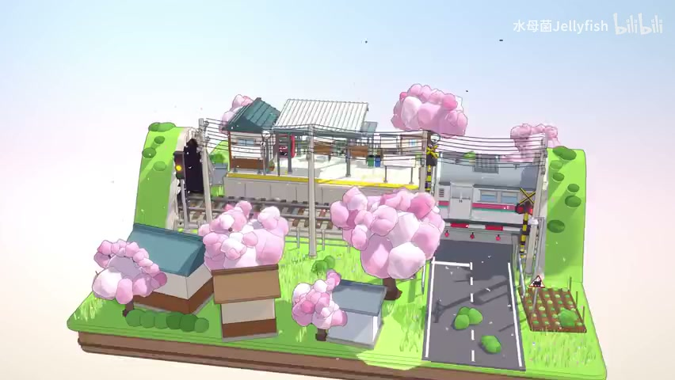

# 三渲二街道：Godot 场景复刻开发计划

编写日期：2026-11-09。实施状态：街景已搭建并完成实机截图。实际做法、重建命令、验收结果及剩余差异见[制作手册与复盘](street/制作手册与复盘.md)。项目根目录：`/Users/tongmeng/Desktop/codes/ai_game/art`。

## 1. 目标与证据边界

**交付目标：在 Godot 中搭建真实可渲染、可检查的 3D 微缩街景，使指定主相机的画面在构图、物体形状、配色、光影和线稿上与下图保持一致。** 不能以“同样是樱花日式街道”替代复刻验收，也不能把目标图铺在相机前当作最终场景。



- 原始笔记：`/Users/tongmeng/Desktop/docs/ai_game/ai_game/美术/三渲二街道.md`。
- 参考视频：[水母菌Jellyfish《AI建模界最高的山》](https://www.bilibili.com/video/BV1Gchw6uE3Z/)，笔记标注参考帧为 `00:05`。
- 目标图：`docs/references/street_target.jpg`，由原笔记附件原样复制，852 × 480。保留原图，不使用 AI 重绘图取代它。
- 现有插件笔记：`/Users/tongmeng/Desktop/docs/ai_game/ai_game/常用工具/`。
- 本次能够读取目标截图与本地笔记；B 站视频正文、简介中的详细 tips 尚未可靠读取，网页抓取返回 412，浏览器访问超时。因此本文不将推测写成作者的制作方法。后续若取得原作者 tips，只补充有证据的内容，并评估是否改变实现，不阻塞截图驱动的搭建。
- 单张图不能确定被遮挡部分、真实焦距、几何拓扑、灯光数或原作 shader。本文对此给出可验证的实现假设；背面采取与可见结构一致的最小补全，不宣称恢复原作源工程。

默认交付是桌面端、主视角优先、支持有限环绕检查的微缩景观。先完成静态复刻，再处理可选动态。角色漫游、经营玩法、大地图、昼夜天气均不进入首版。

## 2. 检索结论与本项目采用的工作流

不存在所有工具通用、能保证一键复刻的 AI 3D 制作标准。结合官方工具文档、Godot/Blender 资产管线与多视角研究，采用以下可复现流程：

**参考分析 → 屏幕空间构图标定 → 白模与相机 → 单资产多视角参考 → 可控建模或图生 3D → 几何清理 → GLB 导入 → Godot 材质与灯光 → 固定截图对比 → 定向修正。**

| 研究结论 | 对本项目的具体影响 | 依据 |
| --- | --- | --- |
| 图生 3D 需要清晰单主体；复杂场景图容易把物体融合 | 不把整张街景交给生成服务直接产出整场景；按资产拆解 | [Meshy Image to 3D](https://docs.meshy.ai/en/webapp/image-to-3d) |
| 多视角需要同一物体、相同颜色和一致照明 | 从一个批准的主设计派生视角，检查结构一致性；不能分别自由生成四张概念图后直接重建 | [Meshy Models](https://docs.meshy.ai/en/api/models)、[SyncDreamer 原论文](https://arxiv.org/abs/2309.03453) |
| 主体、材质、形状风格和技术约束需要写清 | 每类资产使用独立 prompt 和资产规格，减少空泛形容词 | [Meshy Prompting](https://docs.meshy.ai/en/webapp/guides/prompting) |
| 生成结果仍需优化、检查与导出 | AI 输出只作为候选资产，不能跳过拓扑、法线、尺寸和材质检查 | [Meshy Game Assets](https://docs.meshy.ai/en/webapp/guides/use-cases/game-assets) |
| 跨引擎灯光结果不同 | 在 Godot 中重新建立最终灯光；Blender 预览只验几何与材质分区 | [Godot Model Export](https://docs.godotengine.org/en/stable/tutorials/assets_pipeline/importing_3d_scenes/model_export_considerations.html) |

上述来源支持流程原则，不证明某个生成模型能自动达到本场景的精确相似度。以下数量、预算和阈值均为本项目工作目标，不是行业标准或实测结果。

## 3. 视觉规格：必须保持的画面结构

### 3.1 构图与辨识元素

以目标图的屏幕左右为准，不将它们直接当作世界坐标轴。

| 区域 | 必须还原的内容 | 优先级 |
| --- | --- | --- |
| 整体 | 横向画幅；有厚度的矩形草地地台；能看到前侧土层；淡蓝向粉白过渡的背景与较大上方留白 | P0 |
| 右侧 | 深灰道路由前方向后延伸，与铁路相交；白色虚线/路面符号；道路边缘和道口设施 | P0 |
| 中后部 | 铁路横贯画面并有透视方向；轨道、枕木、抬高站台与黄线；后排建筑/站点体块 | P0 |
| 前景 | 左侧青蓝屋顶小屋，中间偏左的棕白建筑，偏右的灰蓝顶小屋；保持遮挡次序与空地比例 | P0 |
| 植被 | 多棵粉色樱花，前中后层次明显；右中部较大的花团树；鲜绿草面与零散灌木 | P0 |
| 天际线 | 电线杆、成束架空线、信号装置；线条密度和走向是主要特征 | P1 |
| 右下 | 小块规则菜地及植株，位置和面积对应目标图 | P1 |
| 局部 | 屋顶瓦线、门窗、红色灯点、警示黄黑条纹、碎石等 | P1/P2 |

P0 是视觉优先级，不是先写所有脚本。可见物体数量和位置在 M0 标注后形成清单；不可凭表格概述随意增加建筑、树、车辆或装饰。截图右上水印不属于场景资产，验收时遮罩忽略。

### 3.2 形状、颜色与线条

- 房屋：体块简洁，屋檐和屋顶有厚度，适度倒角；关键屋顶不能全部用无厚度平面替代。
- 樱花：不规则花团组成树冠；有大小变化、粉白色差、缝隙和树干，避免等大球整齐堆叠、单个大球或写实密叶。
- 草：亮绿底色加稀疏、有方向变化的草簇；不要用高密度写实草淹没道路、树干和房屋底部。
- 色彩：绿、粉、青蓝、米白、棕与深灰形成主要色块；从目标图采样明部/中间色/暗部，而不是只给一个平均色。采样避开水印、抗锯齿边缘与明显压缩噪声。
- 线稿：细、低对比度、偏灰或随材质调整；大轮廓清楚，内部线条有取舍。不能所有三角面都描边，也不能用粗黑轮廓把它改成另一种卡通风格。
- 光影：明亮但能看清花团体积；有方向性投影、屋檐和接地暗部；避免过强 AO、镜面塑料感和大片死黑。

## 4. 工具、插件和替代路线

| 工具 | 采用方式 | 接入与退路 |
| --- | --- | --- |
| Godot 4.x + Forward+ | 最终渲染与场景编辑；优先此渲染器以使用法线缓冲描边 | M0 记录真实安装版本、图形后端和 GPU，固定验证版本；不从其他项目笔记推断本项目环境已通过 |
| Blender + Blender MCP | 优先制作建筑、屋顶、轨道、道口、电线和花团基础形；脚本参数可复现 | MCP 未连接时直接用 Blender Python/批处理完成同一资产，不因 MCP 缺失阻塞 |
| Blender Skills | 制作规范与检查清单，按实际任务读取相关技能 | 它不是生成器，也不改变最终由 Godot 验画的要求 |
| Godot AI | 检查场景树、节点与材质，运行并截图 | 先确认连接到本项目；不可修改其他正在打开的项目。未连接时用文件与 Godot CLI/编辑器 |
| 图像生成工具 | 单资产设计辅助、局部结构补全、多视角候选；保留原图和生成记录 | 执行时使用可用的图像生成工具；此阶段只规划，不调用生成服务 |
| Meshy / Tripo | 可选单资产图生 3D 试验，不作为整场景必需依赖 | 选一个服务做一个样件，记录模型版本与输入规则；没有账号/额度时使用可控建模路线继续 |
| ProtonScatter | 后期草簇/碎石区域散布，种子固定；房屋和主树按构图摆放 | 小场景可直接手摆或自建 MultiMesh；它只解决摆放，不提供正确资产、风或材质 |
| 自定义 Godot shader | 最终卡通受光、花团受光、描边与简易草摆动 | 项目直接持有 shader，参数和截图受控 |
| FlexibleToonShaderGD | 可选受光对照样件，检查版本后复用原理或裁剪 | 不默认直接安装为最终方案，不把色阶 shader 当作完整描边系统 |

首版不接 Terrain3D、TerraBrush、SunshineClouds2、Blanket、雪材质或 REA。此场景地形可用普通网格，背景可用简单渐变；复杂天气与覆盖层不能解决当前相似度缺口。新增插件必须对应已发现的具体缺口，并记录版本/commit、许可、目标机器验证结果。

上游依据：[Blender MCP](https://github.com/ahujasid/mcp-for-blender)、[Godot AI](https://github.com/hi-godot/godot-ai)、[ProtonScatter](https://github.com/HungryProton/scatter)、[FlexibleToonShaderGD](https://github.com/CaptainProton42/FlexibleToonShaderGD)。现有工具笔记仅作为本地经验，不把历史兼容记录当成本项目实测。

## 5. AI 参考图与资产工作流

### 5.1 先建立参考包

1. 保存原始主图、来源、参考时间和尺寸；制作带编号的构图标注图与物体清单。原图不覆盖。
2. 裁出房屋、花树、道口、轨道、草等局部参考；明确哪些区域被遮挡。裁图只是视觉证据，不把裁图边缘截断的部分当作模型真实形状。
3. 建立 `style_guide.md`：形状语言、颜色样本、线宽、材质参数范围、树冠组成和不可新增元素。
4. 如能取得真实其他视角，优先使用；无法取得时，生成的侧/背图一律标为“推测设计”。

### 5.2 多角度参考的生成与检查

按资产生成，不给整条街生成多角度图作为布局真相。

- 先选定单资产主设计，锁定尺寸比例、门窗位置、屋顶形式、材质分区和花团大形。
- 以该主设计和参考裁图为条件，生成同一物体的正、侧、背和三分之四视角；使用近正交、同尺度、同中心、完整主体和简单背景。
- 先做联系表人工检查，正式送入多视角重建时拆成独立图片，不能把带文字和四个物体的联系表当作单个主体上传。
- 多视角的窗口数量、屋檐宽度、树干分叉、花团大形必须相互解释得通；同一视角反复修改不能重新设计整件资产。
- 尽量采用均匀中性照明、无强投影、无景深的输入。最终的阳光和长投影不烘进基础色。模型若将阴影识别为表面颜色，重新处理输入或重做贴图。
- 几何参考和风格参考分开：原图控制风格，校对后的资产视图控制几何；AI 图不能反向推翻截图里清楚可见的结构。
- 服务输入顺序必须按实际接口核对。例如本次查询的 Tripo H2 文档要求四个位置 `[front, left, back, right]`，Meshy 的视图规则不同；不能写一套数组顺序通用于所有服务。[Tripo H2 文档](https://docs.tripo3d.ai/model-generation/multiview-to-model-v2-0-v2-5.html)

多视角一致性检查失败时，直接以 Blender 白模为几何源，渲染其真实多视角辅助设计，或手工完成该资产。不能靠不断扩大 prompt 弥补矛盾视图。

### 5.3 资产分工与初始预算

| 资产组 | 默认生产方式 | 初始预算/控制点 |
| --- | --- | --- |
| 地台、道路、站台、铁路 | 参数化网格/Blender 模块 | 平整关系、路轨交叉和边缘厚度优先；不需要 AI 重建 |
| 房屋与屋顶 | Blender 模块化建模 | 每个房屋实例约 2k–12k 三角面起步，瓦片优先条带/少量几何与贴图组合 |
| 樱花树 | 手工/脚本布局树干与花团，图像 AI 辅助形状；图生 3D 仅做候选对照 | 每树约 2k–10k 三角面起步，按主相机轮廓增减，不追求高面数 |
| 电线杆、道口、信号灯 | 可控模块建模 | 黄黑条纹独立材质/贴图；主要线缆真实管状几何，垂度可调 |
| 草、灌木、石头、菜地 | 少量母资产 + 变体和实例化 | 先看屏幕密度；透明草片与不透明几何草簇做对照 |
| 门窗、招牌、道路标线 | 简单几何或确定性纹理 | 清晰边缘、避免 z-fighting；不依赖生成器写准确文字 |

预算只是起点，验收目标是轮廓和运行成本；三角面按导出后的结果统计。所有关键资产先做灰模，形状通过后才上色。

### 5.4 导入前质量门槛

- 尺寸、轴向和枢轴统一；项目工作尺度先以 1 Godot 单位 = 1 米建立，再通过整体比例匹配，不推断原作真实尺寸。
- 记录资产正面方向，核对 Blender→glTF→Godot 的轴转换，不能把 Blender 的 Z-up 直接当作 Godot 的 Y-up。
- 应用必要变换；避免负缩放；检查非流形异常、重复面、孔洞、悬浮碎片和穿插露底。
- 区分硬边/柔和法线，保留花团柔软体积；导出时明确三角化、法线、必要的切线与 UV。
- AI 输出先移除多余地面和背景，修正畸形屋檐、融合窗框、过密拓扑；不能只做统一 decimate 就宣称完成清理。
- 使用基础色、顶点色或少量材质槽，阴影与描边尽量留给 Godot。法线/粗糙度图按数据纹理处理；基础色按颜色纹理处理。
- 导出 GLB，并制作 Godot 包装场景与外部材质；重导模型后，灯光、材质覆盖和摆放不应丢失。[Godot 导入配置](https://docs.godotengine.org/en/stable/tutorials/assets_pipeline/importing_3d_scenes/import_configuration.html)、[Blender glTF 导出](https://docs.blender.org/manual/en/dev/addons/scene_gltf2.html)

## 6. Prompt 规范与可直接使用的模板

所有调用记录：任务/资产 ID、工具与模型版本、原始参考文件、最终 prompt、可用时的 seed、生成参数、结果路径、选择原因和待修问题。固定 seed 有助于记录，但不保证跨模型/版本复现，也不保证多视角一致。

规格字段：`主体 → 参考角色 → 不变结构 → 形状与色彩 → 相机/照明 → 技术交付 → 检查条件`。提示词描述是意图，不能替代生成后的实测；面数、拓扑、UV、枢轴必须实际检查。

### 6.1 单资产多视角参考模板

```text
任务：为已有资产生成几何参考，不重新设计。
参考 A：原场景裁图，仅控制可见结构、配色和简洁程度。
参考 B：已确定的资产主设计，控制同一物体的身份和几何。
主体：{asset_id / 单栋房屋或单棵樱花}。
必须保持：{屋顶轮廓、门窗数量和位置、长宽高比例、材质分区等逐项列出}。
视角：本次只生成 {front / left / back / right / three_quarter}。
近正交、完整主体居中、与其他视图同尺度，中性均匀照明、简单浅灰背景。
隐藏面只作最小结构补全，不改变参考中可见的一侧。
避免：强烈透视、景深、硬投影、额外建筑/植物、文字标签、画框和水印。
交付：一张独立视图；附上仍然无法从参考确定的结构说明。
```

“附说明”由执行代理记录到资产说明，不要求图像模型在画面中写文字。生成平台若不支持某项参数，不能假装已设置，改为后处理或人工检查。

### 6.2 图生 3D 的简短资产描述示例

```text
A single stylized cherry blossom tree for a miniature Japanese street diorama.
Preserve the supplied reference silhouette: an irregular crown of varied-size
rounded pink flower clusters, visible brown trunk, small gaps between clusters.
Simple clean geometry, soft volume within clusters, separate material regions.
No terrain base, surrounding props, baked directional shadows, or outline shell.
```

仅用于支持文字条件的模式；图生 3D 接口若不接受此类 prompt，靠参考图和正式资产规格控制。房屋不直接照抄树的模板。不得添加“电影级、超写实、复杂磨损”等与参考冲突的方向。

### 6.3 Blender 建模执行模板

```text
制作 {asset_id}，目标是匹配附件裁图；不要加入参考以外的装饰。
尺寸：{宽、深、高}；几何正面：{约定}；枢轴：底部中心。
拆分：{墙体、屋顶、窗框 / 树干、花团}，材质槽命名明确。
形状约束：{关键比例、轮廓和数量}；三角面工作预算：{范围}。
提供可重复运行的建模脚本、源文件、GLB，保留可调参数。
输出主视角及正/侧/背灰模预览，报告实际尺寸、三角面和材质槽。
不要把 Blender 卡通节点效果当成已经能随 GLB 导出的 Godot 材质。
```

### 6.4 Godot 场景执行模板

```text
依据 docs/street.md 的当前里程碑操作当前 art 项目。
保持已锁定的 CaptureCamera、输出尺寸、布局锚点和随机种子。
本次只修正 {例如：右中樱花树的屏幕宽度偏大}。
允许改动：{树冠尺寸与花团布局}；锁定：{相机、曝光、其他资产}。
完成后运行场景，以相同设置输出截图和局部对比，记录修改前后差异。
若视觉门槛未通过，继续处理本项，不能仅以“运行无错误”结案。
```

### 6.5 视觉评审模板

```text
A 是目标截图，B 是 Godot 原始渲染。二者尺寸、裁切和主相机保持固定。
按构图/轮廓、色彩、阴影、线稿、局部细节分别列差异。
每项写：所在区域、可观察证据、可能原因、最小修改、复验方式。
优先列影响最大的五项，不用“更精致”“更有氛围”等不可执行评价。
不能通过重新生成目标图、移动比较裁框或用 AI 润色 B 隐藏差异。
```

## 7. Godot 场景与渲染设计

### 7.1 相机与布局

1. 以目标 852 × 480 比例建立固定输出；正式工作截图用精确 2 倍的 1704 × 960，统一缩小回目标尺寸比较。不得误用近似 16:9 后任意裁切。
2. 测试正交相机和远距离窄 FOV 透视相机。以地台角点、屋顶方向、近远物体比例误差选择，不预先断言截图一定正交。
3. 先调相机投影、俯角、方位、取景范围，再调物体位置；构图通过后保存 `CaptureCamera` 的配置。不得反复用相机补偿错误资产比例。
4. 世界布局采用统一地台尺度；铁路、道路、建筑和树分别可调。镜头外几何也需足够完整以支持投影和有限旋转检查。
5. 捕获相机与交互相机分开；一键恢复捕获视角。动态、随机布局和曝光在对比时锁定。

### 7.2 材质与卡通受光

- 首先用普通低高光材质建立色彩与灯光对照，再测试轻量 toon。参考花团仍有连续体积，不能默认所有表面都切成同样的硬两段。
- 基础材质分为建筑、花团、草/灌木、道路、线缆等类别；共用明暗方向和调色板，但允许不同过渡软硬度。
- 自定义 `light()` 中区分 `N·L` 受光与阴影衰减，正确使用 `ATTENUATION`；阴影边缘软度不能直接靠粗暴量化所有衰减获得。
- 避免把 ALBEDO 重复乘入引擎会再次调制的受光结果；用白球、彩球和投影平面验证后再批量替换材质。
- 可以使用低强度环境补光保持暗部可读，但不让环境光淹没方向光，也不将整场景设为 unshaded 丢掉接地关系。
- 不把 Blender 的 Shader to RGB 等节点自动导出视为可行方案，最终 shader 在 Godot 中实现。[Godot Spatial Shader](https://docs.godotengine.org/en/4.6/tutorials/shaders/shader_reference/spatial_shader.html)

### 7.3 线稿：分阶段选择，不同时堆叠所有效果

先做两个小样：A 为选择性的反向外壳轮廓，B 为屏幕深度/法线描边；在房屋与花团上比较，再决定主方案。只在确有缺口时组合，避免双重黑边。

- 外壳描边：适合主要外轮廓。采用屏幕尺寸补偿或按镜头标定厚度；检查硬边法线造成的开裂、非均匀缩放、重叠花团黑缝。
- 屏幕描边：深度差找遮挡边，法线差补折角；阈值、强度、采样半径独立控制。花团小平面与草簇不应全部产生强线。
- 内部设计线：瓦线、窗框、道路标线由几何或纹理提供，平坦表面上的颜色线不能期待法线检测补齐。
- 初始线宽以目标尺寸约 0.5–1.2 像素试验；在 2 倍捕获尺寸同步缩放。线色从低对比灰开始，以局部裁图验收，不作为固定最终数值。
- 使用法线/粗糙度屏幕纹理时选择 Forward+。透明材质与屏幕缓冲可见性需单独检查；不要默认透明草片会像不透明网格一样参与所有后处理。[屏幕读取说明](https://docs.godotengine.org/en/stable/tutorials/shaders/screen-reading_shaders.html)
- 后处理根据实际 Godot 版本处理 reverse-Z 和深度重建，不能直接复制旧版 clip-space 写法；使用逆投影矩阵，并验证正交/透视两类相机。[官方高级后处理](https://docs.godotengine.org/en/latest/tutorials/shaders/advanced_postprocessing.html)

### 7.4 灯光、投影与环境

按“照明结构 → 颜色 → 阴影软度 → 接触细节 → 后处理”的顺序调整，不能用曝光掩盖错误的投影方向。

1. M0 标注至少三处可读阴影：电线杆/树干的地面投影、屋檐暗部、花团明暗。阴影方向暂按图像估计，不写死未经验证的太阳角度。
2. 一盏 `DirectionalLight3D` 作为主光，调整朝向匹配投影方向和长度；记录最终变换、颜色与能量。方向光的位置不影响照射方向。[DirectionalLight3D](https://docs.godotengine.org/en/stable/classes/class_directionallight3d.html)
3. `WorldEnvironment` 提供受控环境补光；背景渐变与环境照明解耦，避免改背景颜色时意外改变所有材质。
4. 先关闭自动曝光、强 bloom、雾与景深，固定曝光和 tonemap；匹配后如原图确有需要再少量增加。先对照 Linear 与较柔和映射，记录最终选择，避免白屋顶/粉花高光剪裁。
5. 阴影覆盖距离仅覆盖本场景所需范围，比较阴影分辨率与滤波；逐步调 bias/normal bias，兼顾自阴影噪点和物体悬浮。
6. SSAO/烘焙 AO 仅作弱接触补充，选择一种主接触暗部来源，避免材质 AO、SSAO、手绘阴影三重叠加。检查小屋贴地、树根和轨道枕木。
7. 花团用法线和柔和受光形成体积；优先调整花团几何、法线和主光，最后才考虑额外假光，不用大量点光修补全局问题。
8. 生成参考输入中的光照、Blender 检查照明、Godot 最终照明分别记录。最终基础色中不应残留与主光相反的硬阴影。

### 7.5 抗锯齿、草和动态

- 首个基线使用原生分辨率渲染 + MSAA 4× 对照；另留无 AA 与 TAA 样图，比较电线连续性、描边清晰度和移动拖影，不默认开启所有 AA。
- MSAA 主要改善几何边缘，不保证消除后处理线条锯齿；后处理需要独立平滑策略或更高采样分辨率。TAA 可能改善闪烁，也可能让细线模糊，必须动态比较。[Godot 3D AA](https://docs.godotengine.org/en/4.4/tutorials/3d/3d_antialiasing.html)
- 电线用可调垂度曲线生成有截面的网格，屏幕宽度过小才适当艺术化加粗；不要让主要电线长期不足一个像素而断裂。
- 草优先少量不透明草簇；需要透明片时使用适合硬边的 alpha scissor，并比较 alpha antialiasing。避免大量混合透明层导致排序与暗边。[StandardMaterial3D](https://docs.godotengine.org/en/stable/tutorials/3d/standard_material_3d.html)
- 动态只在静态验收后添加：少量花瓣、低幅草摆动、可选道口信号；列车是否制作须以视频/目标帧证据为准，不擅自填入目标图没有的主体。
- 对比模式冻结动画时间、粒子种子和风，必要时关闭粒子；美术截图必须能重复得到。

## 8. 项目组织与交付记录

以下是后续实施目录约定，不表示文件已存在。按场景功能组织，文件使用 snake_case，节点使用 PascalCase；不预置无关的全局管理器。

```text
art/
  project.godot
  docs/
    street.md
    references/street_target.jpg
    street/
      reference_analysis.md
      style_guide.md
      asset_manifest.json
      generation_log.md
      validation.md
  source_art/                  # .gdignore；Blender 源、建模脚本、AI 输入输出
    buildings/
    vegetation/
    railway/
  street/
    street.tscn
    layout/                   # 地台、道路、站台与布局配置
    buildings/                # 每组 GLB、包装场景与材质
    vegetation/
    railway/
    rendering/                # 相机配置、环境、共用 shader 与参数
    capture/                  # 固定截图与复验脚本
  addons/                     # 仅实际采用的插件
  captures/street/
    m1_blockout/
    m2_style_slice/
    m3_full_scene/
    final/
```

`.gitignore` 排除 `.godot/` 和可再生临时缓存；原始设计源置于 `.gdignore` 目录以免被自动导入。GLB 与 Godot 材质保留明确映射；源脚本、种子和人工摆放数据能重建派生网格。资产清单至少包括 ID、来源/参考、生成记录、源文件、GLB、尺寸、三角面、材质槽、版本、许可和验收状态。

## 9. 里程碑、依赖和完成标准

所有门槛由执行者检查并记录，不默认每步停下来等待用户批准。出现账号、付费能力缺失时采用本文已有退路继续，不擅自新增付费依赖。

| 阶段 | 工作与依赖 | 必须交付 | 通过条件 |
| --- | --- | --- | --- |
| M0 参考标定与环境 | 只读检查本机 Godot/Blender/连接状态；解析截图布局、颜色、阴影与线条 | 参考分析、编号图、资产清单、style guide、实际工具版本 | 关键物体与遮挡顺序可追踪；明确事实和推测；至少 12 个稳定屏幕锚点已测量 |
| M1 构图白模 | 依赖 M0；地台、路轨、房屋盒体、树冠占位、两类相机比较 | 可运行白模场景、相机配置、同尺寸叠图 | 地台和主要主体投影位置通过第 10 节构图门槛；暂不以细节遮掩误差 |
| M2 风格样板 | 依赖 M1；一栋前景房屋、一棵大樱花、一根电线杆和一块草；对照材质/描边/AA | 源资产、GLB、可复用材质、A/B 截图和选择理由 | 花团体积、房屋颜色、线宽与接地关系都能匹配局部目标；主渲染路线锁定 |
| M3 全场景复建 | 依赖 M2；补后排建筑、铁路站台、道口、全部树、菜地、电线与细节 | 完整静态场景、布局与资产记录、全景/局部比较 | 所有 P0/P1 可见物体到位；完成第 10 节视觉检查；无明显占位资产 |
| M4 定向美术修正 | 依赖 M3；按差异排序修构图、形状、色彩、阴影和线条 | 逐轮 before/after、差异清单与最终参数 | 未解决的高影响视觉差异为零；不能用平均评分掩盖错误道路/树冠/布局 |
| M5 稳定性与可选动态 | 静态通过后；有限环绕、线条闪烁、性能、重导与重启复现 | 可打开项目、捕获方式、性能记录、最终图与交接说明 | 主视角复现一致；运行无阻断错误；动态不破坏静态基准；性能记录达到目标或明确待修 |

首个实际开发动作是 M0→M1：先搭地台、道路、铁路和主相机。不得直接生成整场景或先大批量生产资产。

## 10. 与目标截图的一致性验收

### 10.1 固定比较条件

- 对比源是 Godot 真实运行画面，隐藏调试 UI、编辑器网格、选中框和 gizmo。禁止图像 AI 润色渲染结果后作为完成证据。
- 使用相同画幅、缩放方式、捕获相机和曝光；只在首次标定允许固定的全图对齐，不逐物体扭曲或每轮重新裁框。
- 保存原始 1704 × 960 渲染与缩至 852 × 480 的对比图；提供并排、50% 叠加与差异热图。
- 目标水印区域不计分；压缩噪声和亚像素抗锯齿不要求逐像素复制。单帧无法确定的隐藏面不参与主视角一致性评分，但需结构合理。
- 每轮只改变一类变量：相机/布局 → 几何轮廓 → 材质配色 → 灯光阴影 → 线稿 → 小细节；保留可回退配置。

### 10.2 量化门槛与人工视觉复核

以下阈值是项目初始验收约定，M0 建立可重复的标注和计算方法；若发现指标失效，记录原因并补充对应视觉证据，不能为了让失败结果过关而随意放宽。

| 检查 | 工作门槛 | 复验方法 |
| --- | --- | --- |
| 画幅与主体位置 | 画幅一致；地台可见角点、道口中心、主要屋脊/树冠中心等至少 12 个锚点，误差中位数 ≤ 图宽 1%，最大值 ≤ 2% | 在目标图预先标注归一化坐标；记录每个锚点误差，不仅输出均值 |
| 主体尺寸和轮廓 | 地台、道路、主要房屋、大樱花的投影包围盒边界误差 ≤ 对应画面轴长 2%；遮挡关系一致 | 叠加轮廓与遮罩；树冠宽高、屋顶角度和道路宽度逐项核对 |
| 主色块 | 指定同类明部/暗部区域的颜色差中位数以 ΔE00 ≤ 8 为初始目标 | 在 sRGB 约定下转 Lab，使用固定 ROI；不采样边缘或用色彩均值掩盖局部偏色 |
| 方向性阴影 | 可读主投影方向差以 ≤ 10° 为目标，长度比误差 ≤ 15%；接地无明显漂浮 | M0 选择清楚的阴影端点；模糊/遮挡影子不硬算，提供局部视觉证据 |
| 线稿 | 主要轮廓宽度、颜色和密度接近；目标尺寸下无普遍粗黑边、三角网格或草地黑噪声 | 固定五处局部裁图，100% 与放大查看；外轮廓和内部设计线分开比较 |
| 细节 | 瓦线、架空线、黄线、警示条纹、道口灯、菜地可辨认且位置正确 | P1 清单逐项核对；不能用额外高频细节补偿主体缺失 |
| 真实 3D | 相机小范围旋转后房屋、树、线缆和投影成立 | 主视角外另存至少左右各一个检查角度；不要求未知背面像未提供的参考 |

这些指标辅助定位问题，不能以某个相似度总分替代人工复核。可补 SSIM/感知指标观察趋势，但错误的物体、布局或风格仍必须返修。若建立加权看板，可用构图/轮廓 40%、配色 20%、光影 15%、线稿 15%、细节 10%；所有 P0 项仍需独立通过。

### 10.3 运行、性能与交付验证

- 在真实图形后端运行，headless 导入/解析通过不能证明 shader、阴影与画面正确。
- 检查 shader/GDScript 错误、丢失资源、法线反转、z-fighting、透明排序、描边裂缝和阴影偏移。
- 固定路径缓慢旋转并观察电线/草/屋顶线是否闪烁；静态与动态 AA 分别评审。
- 工作目标：本机桌面环境下 1704 × 960、预热后稳定场景约 60 FPS，记录至少 30 秒的帧时间与尖峰，并注明 GPU、后端、AA、视角、三角面和 draw calls。不能用编辑器空场景 FPS 代替成品数据。
- 从保存状态重开项目、重新导入一个代表资产，确认材质覆盖、相机与布局仍能恢复；重复捕获检查结果稳定。
- 此阶段不为简单美术参数写镜像式单元测试；仅对确有必要的布局重建、资产导出或捕获工具增加验证。
- 完成时交付真实可打开的项目、最终截图、局部叠图、可重复捕获步骤、资产/工具版本、剩余差异说明。主视觉尚未通过时标记“未完成”，不得仅以可运行结案。

## 11. 主要风险与处置

| 风险信号 | 处置 |
| --- | --- |
| 多视图门窗/树干结构互相矛盾 | 拒收该视图；以批准的主设计或 Blender 几何派生，避免继续堆叠矛盾输入 |
| 生成模型细节很多但像另一栋房子 | 回到轮廓/比例和局部裁图；关键建筑改为模块建模 |
| 粉花变成塑料球或碎石 | 调花团大小节奏、法线与明暗过渡；减高光和不必要折角描边 |
| 两套阴影方向不一致 | 检查基础色中的生成阴影，清除后统一 Godot 光源 |
| 所有物体漂浮或底部发黑 | 先修地面关系与阴影 bias，再控制 AO；不叠加多种假接触阴影 |
| 电线断裂、描边闪烁 | 修屏幕尺寸/网格连续性；对照 AA 与分辨率；单独处理后处理边缘 |
| 背景或曝光一改，全场颜色漂移 | 锁定曝光与色调映射，分离背景和环境照明，重新建立颜色 ROI 对照 |
| 插件升级/服务参数变化 | 固定已验证版本与请求记录，只在有明确收益时升级并重新截图 |
| 单张截图无法推断结构 | 标记假设，优先保持已知主视角；不把推测说成作者事实 |

## 12. 研究与复验入口

检索日期：2026-11-09。优先引用官方文档、项目仓库及论文；`stable/latest/dev` 页面可能变化，实施 M0 应记录实际采用的引擎/插件/模型版本，避免把不同版本 API 混用。

1. [Meshy Image to 3D](https://docs.meshy.ai/en/webapp/image-to-3d)：单主体、均匀照明、近正交参考与多视图约束。
2. [Meshy Models](https://docs.meshy.ai/en/api/models)：几何和纹理多视角是不同输入，颜色/结构一致性要求。
3. [Meshy Prompting](https://docs.meshy.ai/en/webapp/guides/prompting)：主体、材质、风格、技术约束的提示词结构。
4. [Meshy Game Assets](https://docs.meshy.ai/en/webapp/guides/use-cases/game-assets)：生成后处理与游戏资产导出流程。
5. [Tripo Changelog](https://docs.tripo3d.ai/get-started/changelog.html)：单图派生多视图、单视图编辑和后续建模衔接能力；不是本项目已开通功能的证明。
6. [Tripo H2 Multiview](https://docs.tripo3d.ai/model-generation/multiview-to-model-v2-0-v2-5.html)：具体接口的视图顺序与输入规则。
7. [SyncDreamer 论文](https://arxiv.org/abs/2309.03453)与[代码](https://github.com/liuyuan-pal/SyncDreamer)：说明多视角一致性需要专门处理；不作为本机必装重建依赖。
8. [Godot 模型导出](https://docs.godotengine.org/en/stable/tutorials/assets_pipeline/importing_3d_scenes/model_export_considerations.html)、[导入配置](https://docs.godotengine.org/en/stable/tutorials/assets_pipeline/importing_3d_scenes/import_configuration.html)：轴向、三角化、最终照明和资源覆盖。
9. [Blender glTF](https://docs.blender.org/manual/en/dev/addons/scene_gltf2.html)：导出法线、UV、材质与烘焙限制。
10. [Godot Spatial Shader](https://docs.godotengine.org/en/4.6/tutorials/shaders/shader_reference/spatial_shader.html)：自定义受光与阴影衰减输入。
11. [Godot 屏幕读取](https://docs.godotengine.org/en/stable/tutorials/shaders/screen-reading_shaders.html)、[高级后处理](https://docs.godotengine.org/en/latest/tutorials/shaders/advanced_postprocessing.html)：缓冲可用性与深度重建。
12. [Godot DirectionalLight3D](https://docs.godotengine.org/en/stable/classes/class_directionallight3d.html)、[StandardMaterial3D](https://docs.godotengine.org/en/stable/tutorials/3d/standard_material_3d.html)、[3D 抗锯齿](https://docs.godotengine.org/en/4.4/tutorials/3d/3d_antialiasing.html)：投影、透明草与 AA 取舍，实施时对照实际引擎版本。
13. [ProtonScatter](https://github.com/HungryProton/scatter)、[FlexibleToonShaderGD](https://github.com/CaptainProton42/FlexibleToonShaderGD)：散布能力和受光对照候选。

## 13. 后续执行清单

- [x] 读取本地作品记录、目标截图与候选插件笔记。
- [x] 检索 AI 多视角、prompt、资产管线与 Godot 渲染资料。
- [x] 保存目标图并建立本计划。
- [x] M0：实机工具核对、参考测量和资产清单。
- [x] M1：白模、相机与构图标定。
- [x] M2：房屋/樱花/电线/草的风格样板。
- [x] M3：全场景复建。
- [x] M4：截图差异驱动的美术修正。
- [x] M5：运行、复现、性能与交付验证。
