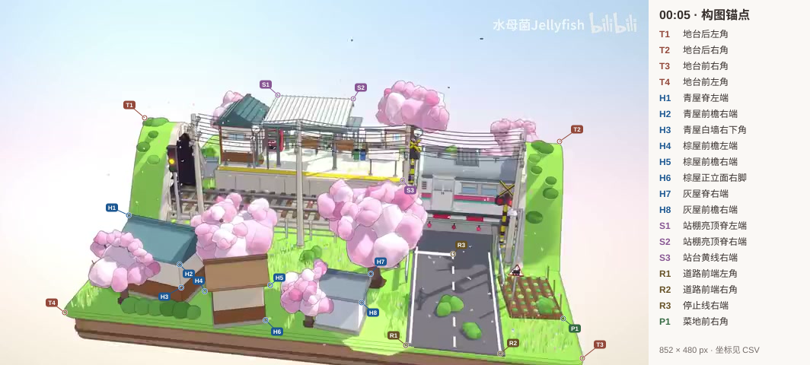

# 街景参考测量

基准是笔记标记为视频 00:05 的 852 × 480 JPEG。[原图](../references/street_target.jpg) 的 SHA-256 为 `c7a5b335419ac28310a5c76dbcffd5dc0d388a5f60bf1925323f81d05d91ebad`。画面上方留白约占五分之一，铁路与站台横贯后半部，道路从右侧前沿一直进入道口，前景建筑、樱花与灌木遮挡了部分地面。土台前沿到画面底边的间距从左向右明显减小。

[锚点数据](reference_anchors.csv) 共 19 个，坐标原点为左上角，x 向右，y 向下，单位是原图像素。归一化列分别除以 852 和 480。数据由原图人工判读，CSV 内的定位误差是估计值。T1 和 T2 部分被地形与树丛覆盖，采用地台边缘延长线交点。H7、S3 靠近遮挡物，边缘判断误差略大。验收时在候选图寻找同一结构，再算像素欧氏距离。

三栋屋的前檐沿屏幕分别向右下、右上、右下延伸。左屋的侧墙和山墙可见，中屋正立面几乎完整，右屋左半被小樱花遮住。参考没有提供绝对长度、真实镜头参数或背面视图。24 × 16 单位地台是本项目的尺度约定。透视和正交候选均应对同一组 T 点拟合，再比较误差。

道路上从约 (558,390) 向 (638,356) 延伸的长暗带给出屏幕斜向约 23°，可见跨度约 87 px。端点与归属物体存在歧义，这里只约束长影在画面里的轴线。道口北侧整片道路比南侧明显暗，可用色样 road_shade 和 asphalt 对照。青屋正立面屋脊、墙与墙裙的明暗层次提供另外两类局部遮蔽证据。固定截图无法唯一恢复光源的世界方位或被遮挡投影的全长。

[颜色测量](reference_colors.csv) 直接读取原图指定中心周围的 5 × 5 区域，分别取 sRGB 三通道中位数。记录的是参考画面经照明和显示后的颜色。比较成片时，先复核两图采样窗口是否在同一表面，再解释色差。水印与天空中的微小压缩斑点不作为内容目标。
