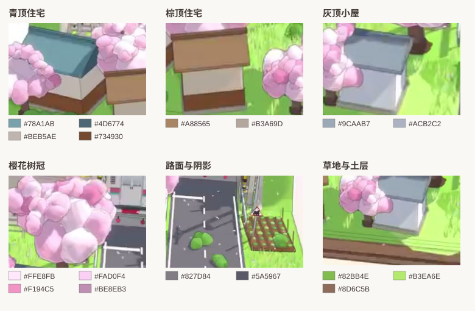

# 春日铁路道口的画面规格

这里的裁图均取自目标 JPEG，色样的确切采样点见[颜色数据](reference_colors.csv)。原始色值用于最终截图对照，在材质中需要保留引擎光照和线性空间转换的余量。

| 部位 | 目标画面与制作约束 |
| --- | --- |
| 青屋 | 坡面中央呈灰青色 #78A1AB，靠脊为 #4D6774。原图 x=216 一列由 y≈294 的暗色过渡到 y≈305 的亮面。坡面中央大部分保持均匀，檐口约 2–3 像素稍暗。灰泥墙 #BEB5AE 和木墙裙 #734930 占据连续色块，面向镜头的墙面没有明显窗格或招牌。 |
| 棕屋、灰屋 | 棕屋坡面 #A88565、立面 #B3A69D；灰顶 #9CAAB7、灰墙 #ACB2C2。保留宽矮立面、低檐、薄底座和独立屋脊。米色墙、木墙裙和基础的分界清楚。 |
| 樱花 | 大花团有粉白亮部 #FFE8FB、粉红 #F194C5 与灰紫暗面 #BE8EB3。前后团块交叠，轮廓有小幅折角与轻线，树冠错层且可见短棕树干。 |
| 草、灌木与土台 | 受光草 #B3EA6E，较暗草 #82BB4E。集中在板面边缘、房屋之间、树下与菜地旁的草叶，应留下可辨认的平涂草地。土层 #8D6C5B，前板能看见顶面草皮下的深浅层。 |
| 轨道和道口 | 站台黄线 #F0EF52 位于后排亮区。电杆竖线、略带垂度的平行电线与窄轨道形成细线节奏；干道口上的白边、虚线和停止线保持清晰。 |
| 光、影与背景 | 路面亮区 #827D84，道口暗区 #5A5967。屋檐、接地和花团下侧各有暗部，主轮廓线为低对比灰色。背景上方 #DCEFFD，左下 #FEF7ED。用固定曝光和实际捕获分辨率验色。 |

P0 的视觉检查以地台、道路、站台、三栋屋和大树的轮廓为准。查看原尺寸的并排图，再放大屋脊、道口线缆、花团遮挡边和道路白线。先调整位置与轮廓，随后复核配色、接地与细线连续性。[锚点图](reference_anchors.svg)
