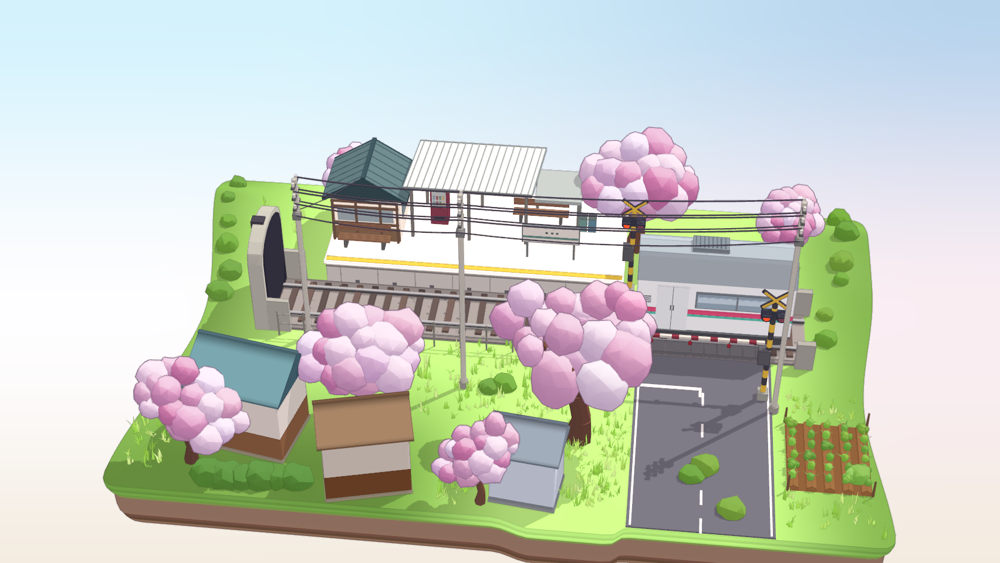

# 春日铁路道口 · 美术制作手册与复盘



打开 `project.godot`，选择 `street/street.tscn` 按 F6，或按 F5 运行项目主场景。文件包含独立的地台、房屋、铁路和樱花模块，在编辑器中可以选中。鼠标拖动环绕，滚轮缩放，R 或 Home 恢复参考镜头。[原画面与开发计划](../street.md)

## 从截图到布局

采用 24 m × 16 m 的地台，原点位于地面中心。X 横向沿铁轨，+Z 朝近景，Y 朝上。四角坐标、道路交叉点与前景屋檐作为摆放依据。19 个图上锚点均以左上为原点，工作分辨率 852 × 480。[锚点标注与原始数据](reference_analysis.md)

地台四角拟合得到的透视相机坐标为 (3.82, 36.17, 40.71)，垂直 FOV 约 19.72°。透视拟合的坐标 RMS 为 1.63 px，正交候选为 24.41 px。复用 `street/rendering/camera_fit.json`，先让地台、横向铁轨和右侧道路占据正确屏幕区域，再摆房屋和树。主机位输出 1704 × 960，缩小一半后与原图对照。[白模实拍](../../captures/street/m1_blockout/main.png)

## 分件、尺寸与色板

| 资产 | 工作规格 | 实际制作方法 |
| --- | --- | --- |
| 草地基座 | 24 × 16 m，带圆角、草皮侧面和褐色分层土壤 | 用 `street/layout/layout.gd` 构网。沿轨道收窄左边缘，在右前留菜地，草皮和土层分别上色 |
| 三栋前景屋 | 青屋约 3.29 × 3.38 × 3.26 m、棕屋 2.88 × 3.11 × 2.54 m、灰屋 2.27 × 2.67 × 2.52 m，均按 X/Y/Z 计 | 两坡屋面、独立檐口、墙裙和地脚。三栋共 288 三角面。把细节集中在屋脊和材料交界面，主视角留大块平墙 |
| 轨道与道口 | 铁轨中心约 z=−1.15，公路中心 x=6.25、宽约 4.4 m | 先铺轨床、枕木和渡板，后搭站棚、车厢、信号灯和落下的栏杆。电线用真实圆截面和可调垂度；屏幕里的微细电线以实拍连续性验收 |
| 草木 | 主樱花树干约落在世界平面 (2.37,4.43)，其余树按截图遮挡关系分层 | 将花团逐个对齐主视角，再分配不同深度。花团使用不规则低面数几何、柔和法线、粉白/鲜粉/灰紫三组色，另加薄外壳线。草和灌木按固定种子合批 |
| 地面标记 | 白边、虚线、停止线、黄站台线分别建模 | 标线略高于地面，检查斜角下的闪烁。保留小石、菜畦分区与道口黑黄条纹的色彩层级 |

土层中段参考显示色约 `#8d6c5b`，青屋屋面约 `#78a1ab`，主樱花明部可到 `#ffe8fb`。这些是目标图上的显示色。先在 Godot 的实际光照下对比，再调资产基础色。更多裁图、像素位置和色样见[画面规格](style_guide.md)。实际模块面数与实例计数见[资产清单](asset_manifest.json)。

## 灯光、材质和线稿

太阳旋转约为 (−58.2°, 129.45°, 0°)，场景环境补光能量为 0.62。用电杆直影的方向校准主光，再从屋檐暗部、道路与站台接地处检查阴影。彩色建筑使用有填充光的自定义材质。花团使用带方向的法线着色和紫灰阴面，并向地面投影。背景的蓝、粉白和米色过渡由天空 shader 单独控制。

固定 MSAA 4×。花团外壳只负责冠缘，轻量深度/法线后处理补遮挡和折角。瓦片、白线、架空线依靠各自几何。分别查看样板中的[有屏幕描边](../../captures/street/m2_style_slice/main.png)和[无屏幕描边](../../captures/street/m2_style_slice/no_screen_lines.png)，判断屋边、花团间隙是否出现双线。

## 改动与重建

1. 前景房屋可直接打开 `street/buildings/source/street_houses.blend`。修改前保存副本。建模源 `street/buildings/source/build_houses.py` 生成三份 GLB。重导后在 `buildings.tscn` 保留根部枢轴、比例和各房的材质覆盖。
2. 模块文件 `street/vegetation/vegetation.gd`、`street/railway/railway.gd`、`street/layout/layout.gd` 分别控制植被、铁路和基座。修改生成参数后，运行 `godot --path . -s street/rebuild_geometry.gd`。此步用图形后端保存 MultiMesh 实例变换。本机曾用 headless 烘焙得到可打开但缺少铁路的场景，改用 Metal 重建后已核对完整车站。
3. 新增房屋时，先把单主体裁图与正、侧、背视图对齐屋顶结构。资产描述示例为「微缩街道单层前景青顶小屋，双坡厚屋檐、米灰墙、棕色墙裙。保持主视角屋脊和檐角位置，近正交中性光输出三视图」。本次几何来自可复现脚本和 Blender 源。
4. 滚动/旋转后按 R，主视角应恢复。用下列命令输出实际帧，并核查道路、樱花和屋顶的轮廓。颜色比较脚本使用 Python、NumPy、SciPy 和 FFmpeg。
   
```sh
godot --path . -- --capture=res://captures/street/final/main.png
python3 street/capture/compare.py captures/street/final/main.png --out captures/street/final/comparison
```

## 迭代与剩余差异

首轮完整场景已能辨认铁路道口，但站房屋顶偏平，前景三栋屋偏窄，花冠偏均匀。锁定相机后，按地台四角和檐角调整房屋尺寸，改站棚坡度、列车腰线与轨边护壁，再将主花团逐个移到参考轮廓内。左侧草坡宽度按多条屏幕扫描线修正，解决了铁轨旁多出一块草地的问题。[首版整景](../../captures/street/m3_full_scene/main.png)

19 个屏幕锚点的中位偏差约为 2.24 px，最大约 7.81 px。[人工标注与验证说明](validation.md)

最终的 13 个固定色区中有 12 个的中位 ΔE00 在 8 以内。道路色区同时包含斜影和白色标线，像素位置偏差使该区仍超出目标。主树的花团轮廓与局部色差尚可看出；站台结构、植株遮挡和电线细节是按单张图补全。比较时用 50% 叠图和 ROI 裁图定位具体差异。[并排图](../../captures/street/final/comparison/side_by_side.png) · [叠图](../../captures/street/final/comparison/overlay_50.png) · [各区域数据](../../captures/street/final/comparison/comparison.json)

两侧 15° 实机图确认地台、房屋、铁轨和树冠具备真实空间关系。场景以静态艺术展示为交付范围，列车和道口停在目标帧状态。[左转](../../captures/street/final/angles/left.png) · [右转](../../captures/street/final/angles/right.png)

## 固定条件下的实绘复验

本机为 Apple M4 Pro，Godot 4.7 / Metal Forward+，视口 1704 × 960，MSAA 4×。离屏测试沿主机位左右各约 8° 扫动相机，每次强制绘制并同步读回完整颜色图。30.0 秒完成 6,619 帧，每帧耗时中位数 4.46 ms、P95 5.09 ms。这组数值用于评估指定视角的绘制与读回开销。[离屏数据](../../captures/street/offscreen_benchmark.json)

另一次自动窗口扫动在 30.1 秒内记录 181 次真实绘帧和 1,759 次主循环采样。桌面窗口呈现节奏会影响该计数。目标平台的前台交互帧率需要在可见运行窗口复验。[窗口采样](../../captures/street/final/motion.json)
