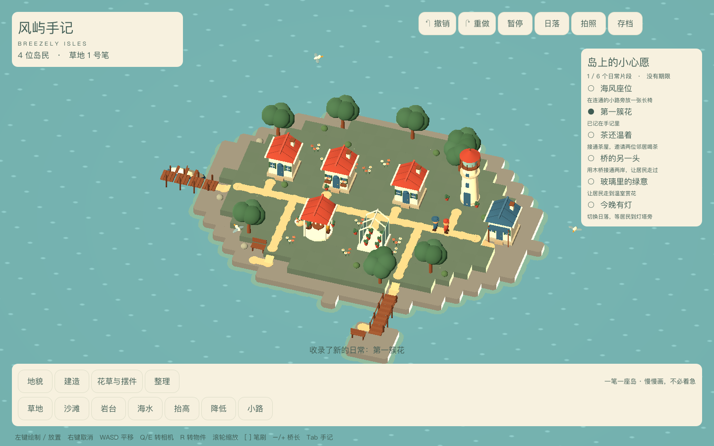
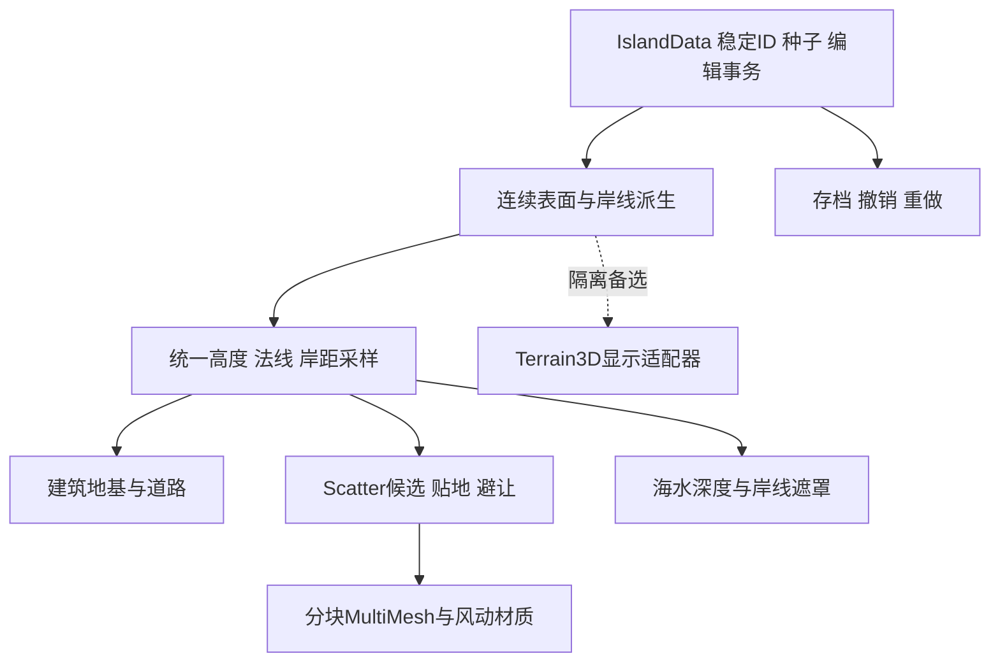

# 美术改良计划：从功能原型到绘本海湾

> v1.0 · 2026-10-29
> 当前基线：`0b65303`，Godot 4.7 stable / Compatibility；参考用户提供的 Brushland 官方预告片约 00:26 画面。
> 本次交付为研究与排期，未下载资产、安装插件、切换渲染器或改写游戏实现。本文是 [开发计划](DEVELOPMENT_PLAN.md) 第11节的执行细则。

## 1. 结论与优先选择

当前版本证明了“能建、有人活动、能保存”，但距离目标画质仍有明显差距。主要原因是**地貌轮廓、植被资产、建筑表面、水面受光与场景构图仍停留在基础几何表现**。继续给同类方块、球体增加数量，或单独换一套后处理，都不能补齐这些层次。

建议路线：**真实资产与统一材质 → 连续地形表面 → 分层植被 → 有深浅与反射的海水 → 光照和镜头校准**。先完成一个约16×16 m、可实际编辑的港湾样板，视觉门槛通过后再替换全岛。第一轮不追求更多建筑种类、天气或大地图。

| 领域 | 主线选择 | 备选与边界 |
| --- | --- | --- |
| 建筑与植被 | 选具体CC0模型包做样板，统一比例、UV、材质与色盘；关键主屋保留定制修形 | 资源包减少基础制作量，不能保证直接得到参考画风 |
| 小岛地形 | 保留自有逻辑格，新增连续表面与岸线适配器 | Terrain3D只做隔离对照；小岛无需先迁移整个地形编辑系统 |
| 散布 | ProtonScatter的稳定候选生成 + 项目贴地/避让 + 分块MultiMesh | 插件不负责草的造型、受光、风与LOD |
| 画质渲染 | 在固定4.7引擎上比较Compatibility与Forward+，倾向以通过样板的Forward+作为画质档 | 保留Compatibility运行入口；不在验证前宣布Metal、M1或Windows已经兼容 |
| 海水 | 先做适合正交浅湾的自有水材质：深浅、双层法线、岸线带、受光与反射 | 第三方水插件只作对照，不把复杂海洋模拟作为首轮依赖 |
| 天空与测试 | 先用Godot内置天空/雾/阴影/抗锯齿，GUT用于回归治理 | SunshineClouds2后置；云、雪插件不解决当前最主要的地貌与植被问题 |

“开源插件”“CC0素材”“免费试用/部分免费资产”分开记录。以下候选的实际下载版本、文件许可与平台效果都需在接入任务中锁定，不把可访问的源码等同于素材可自由分发。

## 2. 画面差距：先修哪一层

参考画面来自 [Brushland官方Steam页](https://store.steampowered.com/app/5163450/Brushland/) 的用户截图；以下是视觉观察，不推断官方实际使用的引擎、插件或着色实现。

| 维度 | 参考画面可见特征 | 当前实现与问题 | 改良方向 / 优先级 |
| --- | --- | --- | --- |
| 地形与岸线 | 起伏草坡、岩体转折、宽窄变化的岸边，视觉上连续 | 每格顶面加直落侧面，海岸沿格边；0.5m台阶很显眼 | 轮廓提取、坡面与岩岸过渡、统一表面采样；最高 |
| 草地 | 低草、较高草束、花与灌木叠出密度和颜色变化 | 地表大片单色，点缀少量花球与灌木 | 四层植被，沿路径退让，坡度/湿度分布，保留空地；最高 |
| 树木 | 叶片/叶簇形成不规则体积，有明暗与疏密 | 球体树冠、规则圆柱树干，近看明显重复 | 替换叶簇资产与树干轮廓，修改叶法线和风动；最高 |
| 建筑 | 瓦片、石墙、木骨架、墙面色差和厚屋檐 | 无纹理的墙与屋顶，立面重复，轮廓过直 | 一栋主屋做倒角/不规则边、瓦/灰泥/石/木材质样板，再扩家族；高 |
| 水 | 岸边与外海颜色不同，有细碎高光、倒影与近岸泡沫 | `unshaded`正弦亮点，压扁球体当白沫，缺少水深和受光 | 深浅吸收、法线、Fresnel、高光、连续岸线泡沫，按成本选择倒影；高 |
| 光照与空间 | 明暗、暖冷和远近分层，柔和接触阴影 | 单色环境光与一盏太阳；近中远的分离不足 | 先锁曝光与色彩，再做天空补光、阴影、轻雾；高 |
| 构图 | 近景水面、中景聚落、背景岩岸；道路融入风景 | 椭圆大平台、均匀排屋、大片空地；多看起来像功能展示台 | 港湾/花园/灯岬按视线组织；用层次而非等距摆放填充；高 |
| 生活与道具 | 船、人物、动物与场所比例协调 | 动作主要为位移/上下浮动，道具仍像基础几何 | 关键坐姿/走路/端茶、少量有故事的摆件；次于场景大形 |
| 界面 | 参考中工具占用画布较少，以缩略图表达类别 | 大文字工具条与常驻清单挤占场景 | 美术样板先隐藏UI比较；之后做紧凑图标栏与折叠手记；中 |

目标改为“**柔和、绘本式、具有自然表面细节的微缩海湾**”。保留海湾、茶屋、温室与灯塔的题材，但不再把低面数、纯色和球形轮廓当作最终美术标准。前一轮AI概念图仅作氛围参考；验收以真实Godot画面为准。

## 3. 必须先修的渲染架构

代码依据：[island_view.gd](../game/art/island_view.gd)、[art_kit.gd](../game/art/art_kit.gd)、[island.gd](../game/island.gd)。

### 3.1 修正合批，才接真实资产

`compact_props()`的合批键只包含颜色、剔除模式、着色模式和粗糙度，未区分贴图、法线、透明、发光、UV和shader参数。接入带贴图的模型后，相似颜色的不同材质可能被错误合并。

另一个明确风险是：非`StandardMaterial3D`表面被跳过，但原网格节点仍被加入删除列表。直接换用带`ShaderMaterial`的草木，可能出现“接入后消失”，并不代表资产或插件无效。

整改要求：

- 合批以**完整材质身份与渲染语义**为边界；不能只按颜色判断可合并。未合并的表面必须原样保留。
- 地形、静态建筑、透明玻璃、风动植被、独立动作各走明确的显示路径。
- 草木按8×8 m空间块组织，测试4×4与8×8的代价；保留局部原点、独立裁剪和LOD，不能将全岛压成一个网格。
- 新资产先验证原样显示，再验证合批后的同机位画面；不能为降低draw calls删掉草层或丢失材质属性。

Godot的MultiMesh按整体包围盒裁剪，远距离分散实例放在同一个MultiMesh会产生额外渲染，因此“分块”与“实例化”一起设计。[官方MultiMesh说明](https://docs.godotengine.org/en/stable/classes/class_multimesh.html)

### 3.2 锁定颜色与材质输入

当前代码存在显式`sRGB → linear`转换，另有顶点色、GLB导出/导入与shader颜色输入。仅凭画面偏灰不能断言某一处就是bug。先做18%灰、草绿、奶油墙、陶红四块色卡，对比直接材质、顶点色、贴图和GLB往返；检查是否重复转换。

在曝光、主光、天空和色彩空间固定后再调色。Albedo使用正确颜色输入；法线、粗糙度、AO和遮罩按数据纹理导入。保留mipmap、透明裁剪与法线导入参数，不能只复制图片文件。

## 4. 地形：保留玩法格，重做可见表面

第一选择是自有小岛表面适配器。64×64逻辑范围和频繁局部编辑，并不自动需要大世界地形系统。

- 按海陆边界提取等值线，先消除锯齿与格子直墙；以约0.25m显示采样为起点，不改1m逻辑格。
- 同级草地连续着色；不同高度在允许区域形成草坡、岩层和沙岸过渡，避免每格都生成通到海底的重复侧壁。
- 原来高差大于一级的不可通行边仍需清楚保留崖口/阻挡；不能把不可达边显示成看似可走的缓坡。
- 2×2建筑地基与入口维持平整；道路、人物脚底、桥头、植被与水深统一调用`sample_surface(xz)`。显示高度变化必须同步消费者，不能只拉网格。
- 更新一笔时，只重建脏块及必要邻边；稳定种子保证取消、撤销和重载后草木不整岛重洗。
- 保留h=0–4、每级0.5m的现行规则。参考中的大高崖若要等尺度实现，需另立高度范围/存档/导航变更，不能悄悄把显示拉高。

Terrain3D的价值是成熟地形显示、材质与LOD；代价是原生扩展、数据映射和平台验证。只有自有样板无法满足连续材质/显示性能，或确定要扩展地形规模时，才进入迁移评审。它不代替地貌构图，也不成为第二份作品数据库。

## 5. 植被：先换资产，再做散布

按可见效果分四层，而非要求复制某个商业草包的内部结构：

| 层 | 内容与初始尺度 | 分布约束 |
| --- | --- | --- |
| 地表底层 | 草/泥/沙低频色差和少量细节纹理 | 消除单色大平台，避免噪点满屏 |
| 短草层 | 约0.06–0.15m，低三角草束 | 覆盖允许草地；路径、地基、码头根部留干净边缘 |
| 中草/花层 | 约0.2–0.4m，数种草丛、野花与方向变化 | 成簇而非均匀点阵；密度随坡度、岸距与场景设计变化 |
| 大形层 | 灌木、叶簇树、岩体与少量高草 | 组织前中后景，保持道路与居民可读 |

每层拥有稳定种子、密度、尺度和埋根偏移；允许层间重叠。ProtonScatter仅提供候选，项目负责贴地、坡度过滤、入口/路网避让、实例分块与版本发布。保留原资产的完整基向量和根部约定。

叶片法线、背面受光、alpha裁剪、mipmap和风动共同验收，不能靠堆数量遮盖纸片感。优先Alpha Scissor/Hash等可控路径做样板，透明混合另测过绘制。远景用较低密度与LOD，不把近景主草层直接删除来“达标”。

## 6. 建筑、材质和生活细节

先做一栋主屋及其海岸/花园附着件：保留当前2×2足印、固定入口和1床位，只替换显示资源。

1. 修形：厚屋檐、轻微不规则墙角、屋顶坡度与烟囱比例；用轮廓减少积木感。
2. 表面：瓦、灰泥、基脚石与木构件明确分材质，统一纹理尺度；目标从单纯纯色转为低对比的手绘表面细节。
3. 材质：用真实CC0纹理作输入，不直接贴上高对比照片；统一色调、法线强度与粗糙度。2K图集作为起点，禁止每个小摆件单独上4K。
4. 家族：主屋样板通过后，再做六种建筑外观与屋顶配色；温室保留玻璃/框架/内部植物层次，茶屋坐点与桌椅一起交付。
5. 生活：优先四个清晰动作——走路、坐下/起身、端茶、赏花；复用基础骨架与动作资源并适配挂点。人物在默认镜头中很小，先保证轮廓、脚底和道具接触，不先堆面部细节。

初期使用外部资产时保留其原件，另产出缩放/改材质/减面后的项目版本。资源替换经稳定资产ID解析，存档继续引用项目定义，不写下载包节点路径。

## 7. 水面、光照与镜头

### 7.1 浅湾水面

首轮移除周期亮点与压扁球体白沫，用连续岸线数据驱动近岸效果：

- 由海底/岸距产生浅青到深蓝渐变，加入低幅度双层法线和柔和高光。
- 泡沫是一条随岸形变化、宽度不均的窄带；按世界坐标采样，编辑岸线后局部更新。
- 先做Fresnel与天空/环境反射；Forward+样板再评估SSR，处理屏幕边缘和遮挡导致的缺失。需要真实镜面倒影时另测平面反射子视口的额外成本。
- 正交相机、近裁剪面、反向Z、主视口与摄影尺寸都要测试，不能直接照搬透视水demo。
- 漂浮物轻摇、船靠岸和倒影时间同源；暂停/减少动态/拍照冻结后不得各自继续跳动。

第一轮用自有shader适配已有岸线数据；大型海洋FFT、侵蚀、水流模拟均后置。

### 7.2 渲染器选择与环境

当前为Compatibility / OpenGL。此前日志中的“OpenGL API … Metal”不等于本项目已测过Godot的Forward+ / Metal。

按 [Godot 4.7渲染器表](https://docs.godotengine.org/en/4.7/tutorials/rendering/renderers.html)，Forward+提供更完整的SSR、CompositorEffects、景深与TAA等能力；Compatibility并非没有所有后处理，该版本表也列有SSAO和Glow支持。具体组合仍需在固定引擎与设备上验证。

推荐在隔离样板比较两条路径：

| 档位候选 | 内容 | 决策规则 |
| --- | --- | --- |
| 画质档：Forward+ | 天空补光、接触阴影、受光水、可控反射、轻雾、合适抗锯齿；摄影可有轻景深 | 同机位比Compatibility确有提升，编辑/摄影/退出与设备预算通过后才采用 |
| 兼容档：Compatibility | 同一批地形与资产，受控反射替代、可用的阴影和后处理 | 保留可运行性和构图；不承诺与画质档逐像素相同 |

不默认叠加SDFGI、体积云、重景深等所有效果。先把天空方向、太阳角度、环境补光、阴影距离/偏移和曝光调好。天空影响受光，即使镜头几乎看不到天空也有价值。[Godot环境说明](https://docs.godotengine.org/en/stable/tutorials/3d/environment_and_post_processing.html)

相机先比较现有45°正交与较低俯角/弱透视样板；选定标准机位后维持编辑拾取、90°旋转与四向读形。不能只选一个好看角度掩盖背面缺失。景深只作摄影点缀，建造时入口、道路与光标必须清晰。

默认正式投影仍是PRD约定的正交；弱透视仅作隔离对照。若最终选择改变投影，必须同步PRD的相机约定并重验拾取、旋转、缩放和摄影，不能将样板选择暗中带入正式交互。

## 8. 可用资产候选与取舍

<!-- ASSETS_RESEARCH_START -->
| ID | 具体资产 / 原作者来源 | 已核实的内容与许可 / 费用边界 | 格式与本项目适配成本（判断） | 建议 |
| --- | --- | --- | --- | --- |
| AS-01 | [Quaternius Medieval Village MegaKit](https://quaternius.com/packs/medievalvillagemegakit.html) | 官网页面列304件、模块化墙/屋顶/门窗/楼梯/藤蔓，素材CC0；免费Standard仅约60–70%，整套Godot工程、自定义shader、全部Blend源是Source档权益，不能写成免费全包 | Standard提供OBJ/FBX/glTF；本项目应抽选模块，按1m角色/门高及2×2占地重组、减室内几何并统一材质。整体住宅直接缩进2m会把门窗与瓦片比例压坏。中等改造成本 | **优先样板**。更接近参考的半木结构和瓦面；2×2适配通过后才采用 |
| AS-02 | [Quaternius Stylized Nature MegaKit](https://quaternius.com/packs/stylizednaturemegakit.html) | 页面列116件含树、花、岩石等，贴图化，素材CC0；免费Standard约60–70%。完整Godot实现、草风线shader、树叶风/风格shader和全部Blend源属于Source档 | OBJ/FBX/glTF；先选一棵冠层树、灌木、花和岩石；材质需在本项目重新校准、处理Alpha/法线/风和LOD。官网写Godot4.3基线不是本机4.7/Metal实测 | **优先样板**。不把“有草模型”当“四层草已完成”，也不把营销截图效果视为免费版保证 |
| AS-03 | [Quaternius Ultimate Stylized Nature Pack](https://quaternius.com/packs/ultimatestylizednature.html) | 官网页面列63件、贴图及法线，CC0，明确可个人与商业使用；该页提供免费包 | FBX/OBJ/glTF/Blend；相对容易形成统一自然物家族；仍需低频调色、纹理导入、风与Alpha测试。不能确认其贴图/模型在本项目镜头下已达到Brushland品质 | **免费备选**。当AS-02免费样本不够统一时二选一，不把两整包混在同一场景 |
| AS-04 | [Kenney Nature Kit](https://kenney.nl/assets/nature-kit) | 官网确认3D、330个文件、CC0且可不捐赠下载；未逐文件核查压缩包格式 | 本轮只确认“3D资源”，具体格式以下载清单复核。几何简洁，适合石头/木桩/小摆件基底；如整体保留强低多边形风格，可能继续拉大与参考的植被质感差距 | **次选/低档素材**。不作为主树冠与主草地的效果对齐方案 |
| AS-05 | [Poly Haven Grey Roof Tiles 02](https://polyhaven.com/a/grey_roof_tiles_02) | 单项页明确CC0；灰色板岩瓦，提供Diffuse/Normal/Roughness/AO等图；不是屋顶模型 | PNG/JPG/EXR贴图；先试1K–2K，选GL法线，降低摄影噪声和过脏苔藓，按屋顶尺度重设UV；保留模型檐口与瓦片轮廓。中等材质整合成本 | **采用候选**。优先解决纯色屋顶；红瓦可另选同库[Clay Roof Tiles 02](https://polyhaven.com/a/clay_roof_tiles_02)作同组替代，不额外引入风格库 |
| AS-06 | [Poly Haven White Plaster 02](https://polyhaven.com/a/white_plaster_02) | 单项页CC0，白灰泥，含Diffuse/Normal/Roughness等通道 | PNG/JPG/EXR；用低强度法线与低频色差补墙面，避免把微观摄影细节原强度铺到小屋；给木梁另分UV/材质。较低成本 | **采用候选**。纹理不会替代木梁结构、门框厚度和接触阴影 |
| AS-07 | [Poly Haven Rocky Terrain 02](https://polyhaven.com/a/rocky_terrain_02) | 单项页CC0，岩草地含Diffuse/Normal/Roughness/Mask/Displacement等；官方标注90m现实覆盖尺度 | PNG/JPG/EXR；只作岩台/土石低频材质输入，先裁选局部、重定尺度与调色。不能把90m航拍式表面无脑平铺到1m格，也不能用位移贴图替代连续崖面网格 | **隔离样板**。不优先整图铺满海岛；如照片感太强，改为项目自制风格化材质 |
| AS-08 | [Quaternius Universal Animation Library](https://quaternius.com/packs/universalanimationlibrary.html) | 官网列120+ humanoid动画、FBX/GLB/Blend、CC0；仍有免费Standard与完整Source层级，不能假设坐姿等所需动作都包含在免费子集 | 骨架/重定向适配要单独排期；当前人物是无骨架分件模型，不能直接接上。先做1位1m角色与走/坐/持物的样板；注意头身比和脚步滑动 | **后置辅助**。可减少动作从零制作，不是本轮场景对齐的首要投入 |
| AS-09 | CGChefs Painterly Grass（用户既有tiny_glade方案）[原作者历史入口](https://cgchefs.gumroad.com/l/painterly_grass_fields_and_meadows) | 本轮原作者入口不可访问；没有核实可重新获取的正式版本、许可或原件/衍生件分发条款。tiny_glade记录为用户提供的本地资产，不等于CC0或本项目可重新分发 | 原项目使用Blender库及四层草；是否能迁入、具体文件格式和纹理导入需按用户持有的合法原件核查。不能从MIT Scatter代码许可推出草模型许可 | **暂不列为开源主路线**。可保留视觉/技术对照；证据齐备前不复制进本仓库，不使用转载下载站 |

上表费用与格式来自原作者页面；免费Standard样本中的具体文件名尚未下载核查，VA01须确认所需模型确实在免费子集中。缺失时用AS-03或自制补齐，不以付费Source档截图包装免费交付。

首轮只取门窗/墙/屋顶模块、一棵主树、一个灌木、两种草簇和一个岩组。AS-01/02是优先比较组合，AS-03是免费自然物后备；最终选定一套一致的自然物家族。AS-05/06先做表面材质对照，AS-07的照片感与大尺度风险较高，不能直接满岛平铺。

[ambientCG官方许可](https://docs.ambientcg.com/license/)确认素材采用CC0，但本轮未核实可直接列入的具体替代瓦片/铺路条目，因此只作次级来源。后续必须写明具体ID与通道。Poly Haven素材的CC0声明见[官方许可](https://polyhaven.com/license)，不因此引入其API或Blender插件依赖。

<!-- ASSETS_RESEARCH_END -->

## 9. Godot插件候选与取舍

<!-- PLUGINS_RESEARCH_START -->
| 候选 | 已核实的上游事实与许可 | 对当前项目的作用 | 决策与未验证边界 |
| --- | --- | --- | --- |
| **Terrain3D** | MIT / C++ GDExtension。v1.0.2-stable release列Godot4.4–4.7；README支持最小64×64m。平台文档称Compatibility从Terrain3D1.0/Godot4.4起支持，1.0.2 stable平台页仍称Metal未支持、未测试。[仓库](https://github.com/TokisanGames/Terrain3D)、[release](https://github.com/TokisanGames/Terrain3D/releases/tag/v1.0.2-stable)、[固定stable平台说明](https://terrain3d.readthedocs.io/en/stable/docs/platforms.html) | 连续地形网格、地形材质及现成显示工具可减少底层工作，但不会自动设计海岸和山体 | **隔离备选**。64m并非尺寸不支持；暂不直接采用的理由是本项目动态涂画、事务、拾取、道路与建筑支撑已有统一源数据，迁移/适配成本需用样板证明。Forward+/Metal二进制与shader需本机重测，不能从tiny_glade外推 |
| **ProtonScatter 4.2.0** | README为Godot4散布工具，`plugin.cfg`版本4.2.0。插件MIT；示例3D模型MIT，但多数演示纹理来自Textures.com，不能单独再分发。[仓库与许可说明](https://github.com/HungryProton/scatter)、[版本文件](https://github.com/HungryProton/scatter/blob/main/addons/proton_scatter/plugin.cfg)；GitHub说明自身为[作者Codeberg镜像](https://codeberg.org/hungryproton/proton_scatter) | 草层、灌木和花簇的稳定候选布局；复杂边缘/负形可用于避让 | **优先做样板**。只复用分布/变换生成层，项目继续负责源高度采样、道路/入口/泊位避让、种子、脏块与MultiMesh发布。没有查到README的完整renderer/Metal矩阵，不能据demo的Forward+配置推断插件只支持Forward+，也不能声称本工程已兼容。不要整个复制带纹理的demo |
| **Boujie Water Shader** | MIT；README称Godot4.1+，列测试环境4.1.1 Win64，demo `project.godot`特征是4.1/Mobile。提供波、泡沫、深度雾/折射和参数资源。[仓库](https://github.com/Chrisknyfe/boujie_water_shader)、[许可](https://github.com/Chrisknyfe/boujie_water_shader/blob/main/LICENSE.md)、[demo配置](https://github.com/Chrisknyfe/boujie_water_shader/blob/main/project.godot) | 岸边深浅、法线、高光和泡沫技术样板，明显比现有均匀点状海面更接近目标 | **水材质候选，不直接替换整片海**。先测试正交相机、4.7的不同深度路径、主视口与摄影。不能把4.1测试写成4.7 / Metal / Compatibility认证；项目仅需要浅湾、岸线与小波，不需要无限远洋系统 |
| **Waterways / `godot4_5_1`分支** | MIT；上游用于Bezier河网、流向/泡沫图，分支工程声明4.5。默认入口与Godot4分支不能混用。[分支](https://github.com/Arnklit/Waterways/tree/godot4_5_1)、[许可](https://github.com/Arnklit/Waterways/blob/godot4_5_1/LICENSE)、[版本配置](https://github.com/Arnklit/Waterways/blob/godot4_5_1/project.godot) | 若未来增加可画河流，流图与河岸工具有用 | **本轮不优先**。当前只要海湾/岸线，河道不是首版范围；本工程4.7、正交与Metal尚未验证。不能因有Godot4分支就写“直接可用” |
| **SunshineClouds2** | MIT；README描述2.7、Compositor实现，2.2说明Apple/Metal支持。上游提交`a73a80b`包含Godot4.7相机修复。[仓库](https://github.com/Bonkahe/SunshineClouds2)、[许可](https://github.com/Bonkahe/SunshineClouds2/blob/main/LICENSE)、[相机修复历史](https://github.com/Bonkahe/SunshineClouds2/commits/main/) | 云层与空气感，可能改善地平线/远景；参考俯视海湾的大部分帧并不直接看天空 | **后置可选**。当前Compatibility不支持CompositorEffects；先有Forward+样板才谈接入。上游Metal/MSAA声明与tiny_glade中MSAA失败、改TAA的本机结果需分开保存。2.7标签不足，需pin含修复的commit；摄影、反射各相机独立历史与资源释放必须重测 |
| **GUT 9.7.1 / godot_4_7** | MIT，许可在`addons/gut/LICENSE.md`。官方README把9.7.1映射4.7.x，而main映射4.6.x。[版本表](https://github.com/bitwes/Gut/blob/main/README.md)、[9.7.1许可](https://github.com/bitwes/Gut/blob/v9.7.1/addons/gut/LICENSE.md) | 增强高度源、稳定种子、撤销、异步发布和生命周期回归，帮助防止新美术破坏作品数据 | **开发期推荐**，不属于视觉效果插件，也不能替代GPU或人工美术验收。可暂保留现有测试，迁移时保证非零用例、负控、错误退出与无旧结果混入 |
| **GodotWater / omicron321** | MIT；README明确只测试过Godot3.0 Windows。[作者仓库](https://github.com/omicron321/GodotWater) | 历史Gerstner水波参考 | **不采用为4.7即插即用插件**。搜索“GodotWater”会命中多个老工程，必须标作者与版本；已有现代候选，无理由先承担旧工程移植成本 |

初始试验可参考已核实的Terrain3D `v1.0.2-stable`、ProtonScatter `4.2.0`、GUT `v9.7.1`；这些仍是候选版本，实际采用时记录完整commit/包哈希。Boujie与Waterways不推定Godot4.7兼容；Sunshine采用时须锁含相机修复的commit，不能只写“2.7”。

**三组隔离对照：** 地形比较自有连续Surface与Terrain3D；散布比较固定候选的接受过滤与真实四层草；水比较自有浅湾shader与Boujie的适用部分。正式工程只接验证过的公开接口，失败时保留旧显示和原因记录。

<!-- PLUGINS_RESEARCH_END -->

## 10. 从 tiny_glade 经验中直接采用什么

依据用户指定的 [PLUGIN_USAGE.md](/Users/tongmeng/Desktop/codes/ai_game/tiny_glade/docs/PLUGIN_USAGE.md)。文档基线是其工程的4.7.2 / Forward+ / Metal，本工程是4.7 / Compatibility；只能借鉴方法，不能复制“已验证”的结论。

| 已有经验 | 本项目执行方式 |
| --- | --- |
| 插件提供能力，作品源归项目 | `IslandData / 稳定ID / 编辑事务`继续权威；Terrain、Scatter和水材质均为派生显示 |
| 草不对先查资产与导入 | 原始草层、基向量、埋根、alpha、法线、纹理导入一起存档；先原样复现再改风格 |
| GDExtension加载不等于导入成功 | 记录原生类型注册、真实渲染、初始化与退出，失败不可只看GDScript日志 |
| 摄影/反射是独立消费者 | 使用Compositor的相机各自拥有尺寸、历史和资源；固定收敛条件后再截图 |
| 动画冻结要同源 | 风、波、鸟、光照与插件时间由项目状态控制，减少动态与拍照一起回归 |
| 纹理文件不等于材质效果 | 与模型同存导入参数、压缩、mipmap和法线标记 |
| MIT插件不覆盖所有demo素材 | 单独核对包内模型/纹理许可，不将Textures.com demo贴图或PainterlyGrass自动当作MIT/CC0 |
| 逻辑通过不能证明画面 | 分开记录功能、GPU画面、人工美术接受与目标设备性能；清旧结果，带失败负控 |
| 固定依赖、最小适配 | 锁tag/commit/下载哈希/许可/本地补丁；适配集中在项目层，不散改vendor源码 |

不迁入雪相关Blanket/puchik，也不为本轮增加天气系统。ProtonScatter当前上游以Codeberg为主、GitHub为镜像；接入时记录真实来源。使用另一工程的代码还需检查该工程自己的复用条件，本次没有复制其vendor、补丁或资产库。

## 11. 执行任务、依赖与工作量

P为程序、A为技术美术/美术，单位人日。以下是新一轮整改的整体工作包估算，覆盖/重做原T06、T14、T23–T26、T29、T31、T34、T38的一部分，**不能机械叠加到旧38/39人日表**。完整原MVP清单、Windows与试玩等未完项仍要另查剩余量。

| ID | 任务 | 依赖 | P | A | 可检查交付 |
| --- | --- | --- | ---: | ---: | --- |
| VA01 | 参考拆解、固定场景/机位/存档、资产来源清单与色盘 | 无 | 1 | 1 | 旧版基线、六个固定视角、候选来源与明确视觉差距 |
| VA02 | 合批/材质分流、色卡与GLB往返校准 | VA01 | 2 | 1 | 贴图/法线/ShaderMaterial不丢失，原样与合批画面对照 |
| VA03 | Compatibility / Forward+与目标设备小样板 | VA01,VA02 | 2 | 1 | 各档真实截图、帧时、编辑与照片结果，确定渲染主线 |
| VA04 | 连续岛面、岸线与统一表面采样 | VA02 | 3 | 1.5 | 岸线样板可画可撤销，地基/道路/脚底与表面一致 |
| VA05 | 选定主屋/树/岩资产、定制修形与材质家族 | VA03 | 2 | 3 | 一栋完整主屋、两树形、岩组及完整导入规格 |
| VA06 | 四层草木、Scatter适配、分块与风/LOD | VA04,VA05 | 2.5 | 3 | 稳定种子、贴地/避让、四向无纸片穿帮、密度对照 |
| VA07 | 浅湾水、岸线泡沫、反射与摄影适配 | VA03,VA04 | 2 | 2 | 正交/四向/近岸水面样板；无球体白沫和周期亮点 |
| VA08 | 天空补光、阴影、雾、曝光与标准镜头 | VA05,VA06,VA07 | 1.5 | 1.5 | 16×16港湾六机位昼/夕与UI隐藏对照，进入视觉门槛 |
| VA09 | 扩六建筑外观与场景三构图、基础居民骨架动作 | VA08 | 2 | 6 | S01/S02/S03统一材质，关键走/坐/端茶/赏花动作，稳定ID映射 |
| VA10 | 正式显示接入、局部更新、撤销/读档/冻结/摄影回归 | VA08；随VA09分批接入 | 3 | 2 | 先做公共适配，最终回归等VA09齐套；历史作品与新显示一致，生命周期/相机状态完整验证 |
| VA11 | 全量压力、四向美术复核与体验验证 | VA10 | 2 | 1.5 | 视觉接受记录、目标硬件报告、未通过项与具体处理 |
| **合计** |  |  | **23** | **23.5** | 不包含未知付费素材费用或完整商业发行工作 |

### 11.1 建议六个相对工作周

没有把“第5周”提交编号当作已经发生的自然工期。以下I1–I6从实际启动整改起算，按1P+1A各每周5日：

| 周次 | 主任务 / 门槛 | 已排 P / A | 周容量余量 P / A |
| --- | --- | --- | --- |
| I1 | VA01–VA03，先解决材质与渲染路径 | 5 / 3 | 0 / 2 |
| I2–I4 | VA04–VA08；I2给第一版对照，I4完成港湾视觉门槛 | 11 / 11 | 4 / 4 |
| I5–I6 | VA09–VA11，扩全岛并完成显示接入与复核 | 7 / 9.5 | 3 / 0.5 |
| **合计** | 6周、每人30日 | **23 / 23.5** | **7 / 6.5** |

I1程序和I5–I6美术接近满载。可将VA09中不依赖最终视觉的资产清理/骨架匹配前拉到I2–I4；已经过去的空闲日不能变成I5–I6的额外产能。末段A仅0.5日余量，晚批返工超过时应延长，不额外塞新功能。骨架来源与导入若不匹配，单独重估VA09，不用“已有动画”直接抵扣适配工作。

VA09和VA10采用分批交接：一组建筑/动作交付即联调，程序先完成公共显示、摄影和事务适配；最后一批齐套后再关VA10，VA11随后做全量复核。若等待整库完成才启动全部接入，I5–I6的两周会被串行依赖挤穿，应延长而非省略回归。

六周是本轮画质整改的容量基线，不是新的完整MVP交付日。I1锁实际版本与样件耗时后复估；I4视觉不通过则继续样板，暂停全库替换。旧10周基线不再用作当前对外承诺，原M3/M4剩余功能与平台验收在I6后按实际缺口重排。

## 12. 验收：把“好看”变成可以对照的结果

### 12.1 固定港湾样板

范围约16×16m，含两间小屋、一段斜坡与岩岸、木码头、小桥、两种树、四层草花、两居民、一只猫和一艘船。必须是真实工程中的可编辑场景，使用玩家同一套显示与保存链。

保留六张固定1920×1080无UI视图：主机位、转90°、建筑近景、岸边近景、全岛远景、日落。另录30秒缓慢转镜头/风水动态，检查静图无法体现的闪烁、透明边与时间历史问题。当前照片尚无独立1080p输出，VA07/VA10补齐后才能按此验收。

每轮输出当前版本/改良版、相同场景ID/相机/时间/密度参数、渲染档与依赖版本；参考截图单独并排，明确场景不同，不以跨场景像素差当作美术接近度。

### 12.2 视觉接受条件

| 检查项 | 必须看到的改善 | 不接受的替代 |
| --- | --- | --- |
| 地貌 | 岸线连续，草坡/岩岸/沙滩有宽度变化，建筑落地可信 | 景深模糊台阶、从单一角度遮挡裂缝 |
| 草树 | 近看有草束和叶簇，远看有密度层次，路径留白 | 把球冠放大、草片数量增加但仍平贴/漂浮 |
| 建筑 | 主屋读出瓦/木/墙/石，材质尺度一致，四向完整 | 纯色盒子只加一张高频照片 |
| 水 | 浅深过渡、柔和受光与岸线泡沫，反射有可信关系 | 平面亮点、周期棋盘斑块或球体串白边 |
| 光与镜头 | 暖冷与前中后景分离，阴影不死黑，编辑入口清晰 | 过曝、重暗角、过度景深遮住问题 |
| 生活融合 | 人物/船/动物接地、座位与手持接触正确 | 模型漂亮但人物悬空、喝茶穿模 |

六项按0–5分记录，附理由；建议平均≥4且无单项<3，并且表中硬缺陷关闭，才进入全岛扩展。评分只是评审工具，**最终美术接受由用户实际看图/体验决定**，不自动等同于已经达到官方水准。先完成具体样板与对照再请求该阶段视觉选择，不提前用泛泛确认阻止准备工作。

### 12.3 功能、GPU与性能分开验收

- 保留AC-01–13：画地/预览取消/50步撤销/外观锁定/路桥码头/居民预约/异常保存/在途撤销，渲染替换不能破坏作品数据。
- 新增失败负控：不同贴图材质不能错误合批；ShaderMaterial不能被删除；过期异步结果不覆盖最新编辑；故意失败测试必须让外层命令非零。
- 原生GPU检查：固定资源实际加载，主/摄影/反射视口一致；减少动态、暂停、日落、重启、退出释放均有证据。带历史缓存的效果先满足已验证收敛条件，不能只等一帧截图。
- 性能沿用原目标：M1/8GB、1080p中档60fps目标、可用30fps档，编辑提交p95<100ms；40建筑/400装饰/12居民/6动物至少5分钟，目标≤350k可见三角面、≤200 draw calls、峰值进程内存<1.5GB、加载<5秒。
- 当前101 draw calls和14.919ms帧时p95来自M4 Pro上的小场景短采样，只是历史基线，不能证明高密度草与Forward+后的表现。shader过绘制、阴影、反射多视口和显存也要看，不能只盯draw calls。

## 13. 资产与插件的接入记录

接入时为每个候选建立lock/来源记录：原作者URL、tag/commit、下载档位与文件名、SHA256、代码许可、模型/贴图许可、原始声明、引擎/渲染器、项目改动与实测证据。当前研究过的候选不写成“已采用”。

原件放外部来源目录，项目适配另存；保留原材质与导入设置供A/B。许可未知、需要购买但未取得、或仅demo可用的部分保持隔离，不进入可分发构建。免费可用不代表不需统一比例、材质、法线与动画。

新资产先映射原清单ID，不因替换来源重复计数；新增草层、材质或LOD源件再作为明确增量补入清单。完整111条当前仍不是“全部完成”，本计划也不把基础GLB替换和生产源件验收混在一起。

## 14. 本轮输出与资料

- 本文及开发计划第11节：下一轮工作的任务、依赖和门槛。
- [当前进度](STATUS.md)：基础可玩已实现，参考级美术尚未验收；此次仅完成改良计划。
- [当前画面与基础资源](BASIC_ART.md)、[历史小场景采样](reports/playable_profile.json)。
- [tiny_glade插件心得](/Users/tongmeng/Desktop/codes/ai_game/tiny_glade/docs/PLUGIN_USAGE.md)：借鉴其源/派生、样板、材质导入、相机状态与验证方法。
- 上文资产和插件表链接到原作者/官方来源；查阅日期均为2026-10-29。上游声明、另一工程实测和本工程实测三个层级明确分开。
