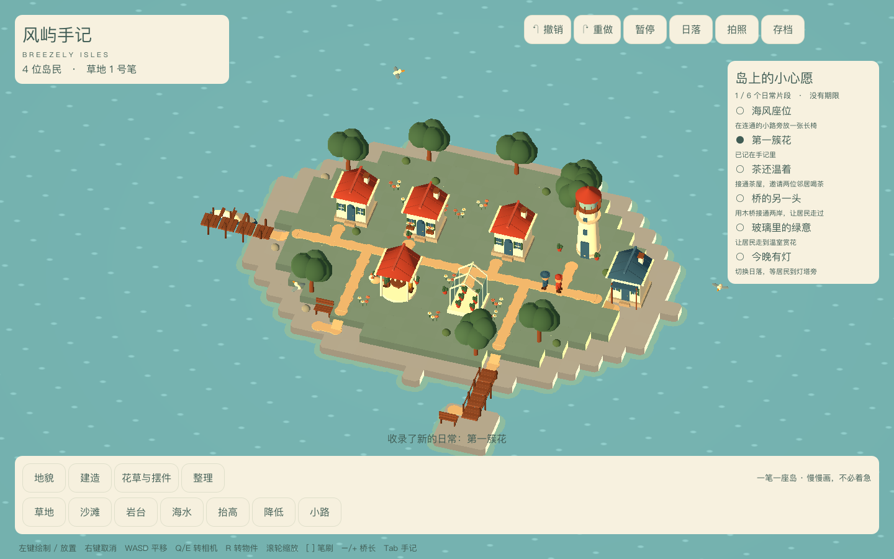

# 基础美术体验版交付

日期：2026-10-28。本次目标是将前三周灰盒推进到可体验的海湾版本。所有截图来自实际运行，没有以概念图替代游戏画面。

## 可体验内容

- 海岛地形、浅海动态、沙滩和近岸白沫；连续小路与高差衔接；有栏杆的木桥、木桩码头和停泊小舟。
- 基础 / 海岸 / 花园居所三外观，温室、茶屋和灯塔；三种屋顶配色，花箱、窗框、百叶、烟囱和门廊。
- 圆冠树、灌木、花圃、海石、盆栽、茶桌椅和海边长椅。
- 四种居民外观，程序行走与活动姿态，茶歇座位；猫与循环飞行的海鸥。
- 奶油纸色中文界面、分类工具、放置预览、可选生活手记、午后 / 日落、无UI照片。
- 两首原创合成音乐、海浪底声和五种短反馈音；声音可关闭。

## 可编辑源与模型

| 设计家族 | 交付文件 | 使用方式 |
| --- | --- | --- |
| 六种建筑外观 | `game/art/models/house_basic.glb`、`house_coast.glb`、`house_garden.glb`、`greenhouse.glb`、`tea.glb`、`lighthouse.glb` | 正常场景引用；切换配色时使用同源生成器生成对应颜色 |
| 长椅、盆栽、树木 | `game/art/models/bench.glb`、`pot.glb`、`tree.glb` | 正常放置引用；背景植物另用共享生成器 |
| 四居民形象 | `game/art/models/resident_0.glb` 至 `resident_3.glb` | 正常居民实例引用；使用程序动作，无共享蒙皮交付声明 |
| 猫、海鸥 | `game/art/models/cat.glb`、`gull.glb` | 已导出与验证；环境实例使用同源生成器，海鸥翼动可独立控制 |
| 全部基础模型源 | [art_kit.gd](../game/art/art_kit.gd) | 几何、材质、比例与组合可编辑；不依赖不可追踪的生成缓存 |
| 模型再生成 | [export_models.gd](../game/art/export_models.gd) | 一次生成全部15个GLB，导入后可在Godot或Blender继续编辑 |
| 声音源 | [make_audio.py](../game/audio/make_audio.py) | 确定性生成WAV；基础试听素材，非最终混音 |

GLB、着色器和可编辑程序属于本次运行时美术交付。它们不等于 PRD 中111条生产资源记录全部完成；原清单继续保留完整制作要求，未将静态人物错误标成已完成共享骨架/蒙皮动画，也没有虚构 `.blend` 原件。

## 玩法与反馈

已有海湾可直接观察居民，空白海面支持完整自由建造。小屋外圈三格花圃触发花园外观，近海触发海岸外观；锁定优先，改变环境不会搬走住户。工具、移动、移除、配色、撤销重做均不消耗资源。

手记六种事件包括家门花园、临海座位、双人喝茶、真实过桥、花圃温室和日落望灯。测试要求相应居民实际完成活动；同时支持目标被删除/移动时释放预约。此版以手记目标面板表达轻愿望，尚未扩展完整的居民对话与个性叙事。

拍照模式冻结居民并隐藏建造界面；退出恢复进入前的暂停状态。照片为当前视口分辨率，默认1440×900，尚未增加独立1920×1080离屏输出选项。

## 验证记录

- `tests/test_world.gd`：绘制、撤销、重做、高度边界、50步历史。
- `tests/test_building.gd`：占用保护、重叠、花园响应与路网断开。
- `tests/test_residents.gd`：入住、保存重载、备份、移除居所与撤销恢复。
- `tests/test_playable.gd`：四居所可达、六种活动事件、手记持久化、损坏文件不修改世界、活动目标删除后取消预约。
- `tests/test_bridge_activity.gd`：指定跨桥路线真实走完并到达另一岸活动点。
- `game/art/verify_assets.gd`：15个GLB均可导入且含网格。
- `tests/test_app.gd`：真实渲染进程中的UI信号、撤销/重做、拍照暂停恢复、安全站位和存档菜单。
- [当前场景采样报告](reports/playable_profile.json)：固定预设海湾的短采样，不是 PRD 全规模场景或目标设备验收。

## 当前边界

当前美术达到基础体验级：比灰盒完整，但仍需更自然的连续岸线、细致的角色动作、温室玻璃与更多道具。模型依赖程序生成源与GLB，未完成全套生产资产拆件、逐项预算与LOD验收。音频只有基础覆盖，尚未补足PRD全部类别；没有承诺Steam发行、Windows兼容或M1/8GB性能已验证。
