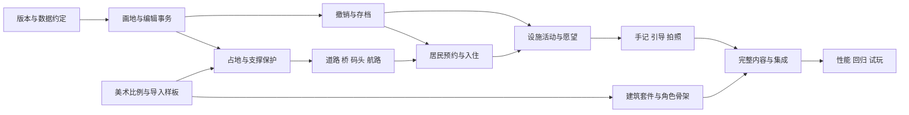

# 《风屿手记》开发计划

> v0.4 · 初排：2026-10-28 · 0.3.0转交候选更新：2026-10-30
> 依据：[游戏 PRD](PRD.md) v0.1、[美术资源清单](art_asset_manifest.csv)。
> 当前状态：美术改良I1–I6与全117条/170份源库已交付；视觉/规格人工接受、绘制数及M1/Windows门槛仍开放。具体见[STATUS](STATUS.md)与[I6报告](art_i6/REPORT.md)。

**当前交付与外部测试按第11.8节执行。** 原T01–T42和十周表保留为初排估算，实际完成状态以STATUS为准；不把资源齐套等同于原MVP全部验收。

## 1. 目标与排期假设

**初始基线：用 10 周完成一个可以持续编辑、保存和拍照的海岛建造 MVP。** 原安排为第3周灰盒闭环、第6周垂直切片、第8周内容冻结、第10周验证。2026-10-29复核后，功能原型已存在，但参考级美术未通过；新增第11节重排优先执行，原周次用于追溯初排。

本计划将 PRD 的 8–10 周粗排展开为 **10 周基线**。它是容量假设，不是已经承诺的发布日期；没有指定开工日，因此使用 W1–W10 相对周次。W1 样板验证后、W3 建岛闭环后各重估一次，实际结果超出容量时更新计划，不通过压缩验收掩盖延期。

| 假设 | 执行约定 |
| --- | --- |
| 人员 | 1 名玩法程序（P）+ 1 名技术美术 / 3D 美术（A），均能稳定投入；策划与测试由两人共同承担 |
| 工作量单位 | 1 人日约 6 小时有效项目投入；每周按 5 个工作日计算，日常评审与基本验证已计入任务 |
| 容量 | 每人 50 人日，共 100 人日；任务估算 P 38、A 39，共 77 人日；余量 P 12、A 11 用于集成、返工与风险 |
| 美术能力 | A 需要能完成低模、材质、基础蒙皮动画与 UI 资源；若动画或 UI 需要外协，在 W1 确认交付窗口并重估容量 |
| 音频 | 首版仍交付 PRD 要求的 4 组环境循环、8 类交互音效、7 类生活音效、2 首音乐；按已授权素材整理或独立外协交付估算，不把原创作曲工时隐含在两人容量中 |
| 技术 | 按 PRD 建议使用 Godot 4.x；确切版本、渲染路径与导入约定在 T01 锁定，当前不预设版本号 |
| 测试设备 | 以 PRD 的 M1 / 8 GB / 1080p 作为性能基线；Windows 对照设备与测试负责人在 W1 确认，不能用未测代替通过 |
| 起点 | 复用已有文档与概念图；111 条 MVP 美术记录均为待制作，概念图不抵扣模型、动画或 UI 的制作工作 |

两个人的余量不能互相视为可替代产能：程序空闲不能直接解决蒙皮动画积压。每周分别检查 P / A 的剩余工作，并按角色调整后续排期。

## 2. 首版范围与完成定义

### 2.1 固定范围

| 方向 | 本轮完成内容 |
| --- | --- |
| 建岛 | 64×64 格、1 m 水平格、0.5 m 高差、h=0–4；海 / 沙 / 草 / 岩地表与花圃覆盖；自动岸缘与合法坡路 |
| 建造 | 全部建筑 2×2 格；四种功能、六种外观；居所外圈 12 格、花圃 ≥3 格触发花园，锁定 > 花园 > 海岸 > 基础 |
| 交通 | 四邻接路网；高差 1 级可连接；桥跨 2–6 水格、码头伸出 2–4 水格，锚点 h=1–2；泊位 1×3 水格，航路通向外海 |
| 生活 | 最多 12 居民，四种共享骨架外观；猫与海鸥合计最多 6 只；来客预约、暂歇恢复、设施活动点与六条愿望 |
| 创作保护 | 支撑格与设施水域保护；移动 / 移除；50 步撤销重做；在途来客、床位与编辑事务一致 |
| 留存与表现 | 六条手记；60 秒自动保存、最近 3 次备份、3 个手动槽；午后 / 日落；无 UI 拍照与本地 PNG 导出 |
| 内容 | 一套海湾资源、S01 / S02 / S03 三个组合构图；111 条 MVP 资源记录、音频与中文文本全部交付 |
| 可用性 | 两种开局、可跳过引导、暂停、音量与减少动画设置；720p / 1080p、100% / 125% / 150% UI 缩放 |

工具开局全部可用，不添加资源经济、强制任务、饥饿、失败或离线惩罚。POST 的 6 条资源，以及联机、工坊、云存档、四季、复杂河流、室内、多层建筑均不进入本轮排期。

### 2.2 什么才算完成

任务完成需要可检查的运行结果或资源源文件；“脚本写完”“模型导出”“没有报错”单独都不足以关闭任务。

1. 对应玩法可在当前集成版本中操作，关联验收用例通过。
2. 非法状态与失败路径有反馈，不损坏已有作品或居民档案。
3. 正式资源通过尺寸、入口 / 活动点、四向观察与预算检查，资产 ID 可追溯。
4. 跨系统任务至少保留一份复现步骤、演示截图 / 录屏或测量结果；缺陷修复有回归记录。
5. 文档、资源状态与实现保持一致；未完成内容明确列为未完成，不以灰盒或概念图替代正式交付。

## 3. 里程碑与阶段门槛

| 里程碑 | 周次 | 可交付结果 | 必须通过的门槛 |
| --- | --- | --- | --- |
| M0 交互灰盒 | W1 | 可打开的工程、相机、地形笔、事务数据、一个正式美术样板 | 可从海面画出小岛并撤销；同笔同格只改变一次；样板尺度与四向外观成立 |
| M1 建岛闭环 | W2–W3 | 路桥码头、三种居所响应、第一位居民、基础存档 | 空屋接路接海后迎客；内湖不迎客；锁定与撤销可用；重载不丢世界；AC-01–06 的对应功能通过 |
| M2 垂直切片 | W4–W6 | 六种正式建筑外观、S01/S02、愿望 → 活动 → 手记、四种居民形象、主要 UI | 建岛 → 活动 → 手记主链路可连续试玩 30 分钟；六愿望端到端验证，灯塔用调试日落入口；动态改路与异步撤销安全；完整拍照流程在 M3 补齐 |
| M3 内容冻结 | W7–W8 | S03、动物、两套光照、拍照、完整 UI / 音频 / 文本与全部 MVP 资源 | 111 条 MVP 资源记录均完成制作、导入与对应检查；不再新增功能或美术种类；完整冒烟通过 |
| M4 验证与交付候选 | W9–W10 | 性能报告、异常与恢复验证、双平台检查、试玩修订、可复现构建 | PRD AC-01–13 全部通过，性能与可用性达到门槛，无存档损坏、作品丢失或流程阻断 |

M0 / M1 / M2 不要求全部美术完成，但不能缺少核心交互反馈；需要灰盒替代时明确标识。M3 才是资源齐套门槛，M4 负责最终质量验证。

### 3.1 关键依赖

以下工作不能倒置：先锁标尺再批量建模；先统一事务与稳定 ID 再做撤销和存档；先有可靠连通与预约再扩居民活动；先验证坐点与骨架再批量动画；先完成单个样板的实际性能验证再扩展透明玻璃和海面细节。

## 4. 十周执行安排

| 周次 | 程序重点 | 美术重点 | 周末必须能演示 |
| --- | --- | --- | --- |
| W1 | 工程基线、世界数据、相机、笔刷、事务与最小撤销 | 岸边 + 基础居所 + 水面样板，单位 / 原点 / 材质导入验证 | 从空海面画岛、取消 / 提交 / 撤销，并能四向看样板 |
| W2 | 占地、入口、小路坡道、桥 / 码头与外海检测 | 基础设施源件、居所套件与海岸 / 花园附件 | 能连出合法路网，非法桥跨、支撑编辑与内湖码头有说明 |
| W3 | 三外观规则、锁定、50 步撤销、来客 / 床位预约、基础保存 | 居所三组合、身体 / 骨架样板、待机 / 走路 | 旅人真正走到空屋；断路、拆屋与重载不破坏档案 |
| W4 | 公共设施活动点、动作预约、六愿望条件与双人茶歇协调 | 温室 / 茶屋 / 灯塔与活动点，座位、茶具和动作对齐 | 两位居民能在茶屋坐下；中途移桥会取消并恢复调度 |
| W5 | 手记、外观详情、工具 UI、暂停与异常状态恢复 | 四套居民外观、共享衣装与主要生活动画；主要 UI 资源 | 一条愿望真实完成并形成持久手记，六建筑可自由建造 |
| W6 | 六愿望全链路、两种开局、引导、提前性能检查 | S01 / S02 组合、核心自然与摆件、首轮画面统一 | 30 分钟垂直切片；记录试玩问题与剩余工时，关闭 M2 |
| W7 | 动物活动、午后 / 日落、拍照、完整设置与存档界面 | 猫 / 海鸥与动作、S03、两套光照与余下摆件 | 拍照可导出无 UI PNG；四种居民、两类动物在同岛活动 |
| W8 | 音频接入、提示文本、错误反馈、内容完整性冒烟 | P1/MVP 项、缩略图、VFX、音频素材整理与场景收尾 | 111 条首版美术记录齐套；三场景与完整功能均可用，冻结内容 |
| W9 | 完整 AC 回归、故障注入、性能分析与优化、双平台检查 | 修复接缝、穿模、排序、材质 / 动画问题并协助性能优化 | 代表性大场景的指标报告，以及每条 AC 的结果与未关闭问题 |
| W10 | 5–8 人试玩、修复阻断与高频问题、最终回归与构建 | 只修影响读形、路径判断与体验的问题，完成资源交付检查 | 可复现候选构建、13 条 AC 记录、试玩结论与已知限制 |

W8 后只接纳缺陷修复、性能优化与达到既定验收所必需的调整；新创意进入后续候选。W9 的完整回归不是首次测试：每个系统在引入时就验证自己的核心规则。

## 5. 可执行任务清单

P / A 为初排预计人日；`0` 表示没有单列的制作投入，不表示无需协作。“依赖”列列出前置任务，资产批次可以并行准备。此表保留原始分解，不能将全部任务视为未开始或已完成；实时记录见STATUS，当前整改任务见第11节VA01–VA11。

### M0 · 建立可验证的基础

| ID | 任务与交付 | 依赖 | P | A | 完成检查 |
| --- | --- | --- | ---: | ---: | --- |
| T01 | 锁引擎版本、渲染路径、目标设备、资产导入样例与工程运行说明 | 无 | 0.5 | 0.5 | 样例工程可重开运行；GLB 尺度与材质正确；确认 Windows 检查窗口、音频来源与美术能力缺口 |
| T02 | 工程目录、输入映射、调试入口与基础构建 | T01 | 0.5 | 0 | 统一文件命名和功能目录；从干净检出能按运行说明启动；不把生成缓存作为源资源 |
| T03 | 世界格 / 稳定 ID / 规则版本与编辑命令数据骨架 | T02 | 1 | 0 | 64×64 数据、h=0–4、花圃覆盖、对象引用可读写；相同输入结果一致 |
| T04 | 正交相机、格拾取、缩放、平移和 90° 旋转 | T02 | 1 | 0 | 四方向拾取一致；UI 点击不落到世界；触控板可用键盘平移 |
| T05 | 地形笔预览 / 提交 / 取消与最小一笔撤销 | T03,T04 | 1.5 | 0 | 三档半径、同笔同格一次、Esc 无修改；提交边界是单事务 |
| T06 | 地形 / 基础居所 / 水面正式样板与导入契约 | T01 | 0 | 4 | 1 m 格、0.5 m 高差、2×2 建筑、材质预算和四向轮廓可检查；通过后才批量制作 |

M0 合计：P 4.5 / A 4.5 人日。

### M1 · 建岛与入住闭环

| ID | 任务与交付 | 依赖 | P | A | 完成检查 |
| --- | --- | --- | ---: | ---: | --- |
| T07 | 建筑 / 摆件占地、入口预留、旋转、移动与移除；支撑 / 水域保护 | T03,T05,T06 | 1 | 0 | 2×2 同高基础、门前格与受保护水域正确；非法预览有原因 |
| T08 | 小路四邻接、高差连接、坡道与连通状态显示 | T07 | 1 | 0 | 高差 0 / 1 / 2 分别验证；不出现对角偷连 |
| T09 | 参数化桥 / 码头、泊位与外海航路检查 | T08 | 1.5 | 0 | 2 / 6 水格桥合法、1 / 7 非法；内湖、异高与占用船路有明确反馈 |
| T10 | 居所三外观、邻接预览、外观锁定与独立配色 | T07 | 1 | 0 | 12 格含角、花圃阈值 3、优先级固定；门与床位不变 |
| T11 | 完整 50 步撤销重做与编辑提交后的派生状态重建 | T07,T09,T10 | 1 | 0 | 混合地形 / 放置 / 移动 / 移除 / 锁定可回放；新编辑清空重做分支 |
| T12 | 居民档案、寻路、单船来客、床位预约与暂歇恢复 | T09,T11 | 2 | 0 | 首次触发 ≤10 秒、最多 12 人含在途；先安置暂歇者；在途撤销房屋后取消旧预约 |
| T13 | 最小可用存档、版本号、完整提交态快照与原子替换 | T03,T11,T12 | 1 | 0 | 可保存并重载世界 / 居民 / 锁定；提前验证在途撤销后保存重载；模拟失败保留上一完整文件 |
| T14 | 基础设施与居所套件正式批次、三居所组合及基础建造 UI 首版 | T06 | 0 | 6 | 入口、桥头、岸缘拼接与资产引用检查通过；工具 / 锁定 / 预览 UI 可用；正式资源逐步替换灰盒 |
| T15 | 居民身体 / 共用骨架及待机、走路样板 | T06 | 0 | 2 | 1 m 人物接地；挂点稳定；与程序移动速度对齐 |
| T16 | M1 联调、灰盒试玩与估算复核 | T12,T13,T14,T15 | 0.5 | 0.5 | 演示从画岛到第一位居民入住、撤销与重载；记录瓶颈与更新后的剩余量 |

M1 合计：P 9 / A 8.5 人日。T14 / T15 可与程序 T07–T13 并行；T12 先用胶囊或简化人物联调，M1 验收时接入正式身体与基础动作。

### M2 · 完成垂直切片

| ID | 任务与交付 | 依赖 | P | A | 完成检查 |
| --- | --- | --- | ---: | ---: | --- |
| T17 | 温室 / 茶屋 / 灯塔活动点、座位预约与行为状态机 | T12,T13 | 1.5 | 0 | 点满则换目标，移除设施释放预约；角色能离开座位恢复散步 |
| T18 | 双人茶歇协调与指定桥过桥事件 | T17 | 1 | 0 | 茶歇同时预约两座位；桥事件绑定具体桥与提出者，不因瞬时计数误完成 |
| T19 | 六条愿望的条件、选取、收起、完成和去重 | T10,T17,T18 | 1.5 | 0 | 最多三条、无期限、目标有效；六种模板均有可复现成功 / 中断流程；灯塔愿望先用调试光照开关验证 |
| T20 | 六条手记、生活缩略截图获取 / 引用与持久化 | T13,T19 | 0.5 | 0 | 收录后改建不撤回；重载不重复弹出，截图数量有上限；先具备内部截图能力，不等待完整拍照界面 |
| T21 | 工具栏、物件详情、邻接解释、锁定、状态与 UI 缩放 | T07,T10 | 2 | 0 | 所有工具可触达；文字与图形共用反馈；按 720p / 1080p、三档缩放检查 |
| T22 | 改地形 / 改路后的站位重投影、预约恢复和异步撤销一致性 | T11,T12,T17,T19,T20 | 2 | 0 | 移桥、删设施、撤销来客房屋再重载，不丢档、不重床、不重复收录 |
| T23 | 温室 / 茶屋 / 灯塔正式建筑、核心自然摆件与活动挂点 | T14 | 0 | 4 | 六外观齐套；坐点、茶具、入口与 2×2 占地一起验收 |
| T24 | 四种居民外观、共享衣装与核心生活动画 | T15 | 0 | 4 | 轮廓有区别；坐下 / 起身 / 喝茶 / 赏花衔接自然；预算含附件 |
| T25 | 主要 UI 图标 / 面板 / 卡片资源与组件样式 | T06 | 0 | 2 | 小尺寸可读；不依赖红绿；使用可伸缩组件，非逐按钮重画 |
| T26 | S01 / S02 正式组合、光照 / 特效首版及出生 / 活动点联调 | T17,T21,T23,T24,T25 | 0.5 | 1.5 | 两个构图共享资源；午后 / 日落预设与调试切换入口、反馈特效首版可用；内部演示地图与玩家起点分开；无遮挡或堵路 |
| T27 | 两种开局、可跳过引导、中文文本与本地化键 | T19,T20,T21 | 1 | 0.5 | 先做后学能自动略过提示；无工具锁；6 愿望、6 手记和日常文本可配置 |
| T28 | 第一轮垂直切片试玩与问题排序 | T22,T26,T27 | 0.5 | 0.5 | 建岛、活动与手记可连续试玩 30 分钟，六愿望在同一集成版本串测；不含 M3 才补齐的拍照脚本末段；给出是否继续扩内容的明确结论 |
| T29 | 提前建立代表性性能场景与采样基线 | T26 | 1 | 0.5 | 固定地图 / 种子 / 相机；记录帧时、提交 p95、内存和加载；瓶颈先定位再优化 |

M2 合计：P 11.5 / A 13 人日。T24、T25 与程序活动 / 愿望系统并行；正式人物与 UI 到位前保留功能灰盒，M2 关闭前全部接入。

### M3 · 内容齐套并冻结

| ID | 任务与交付 | 依赖 | P | A | 完成检查 |
| --- | --- | --- | ---: | ---: | --- |
| T30 | 猫 / 海鸥活动、预设栖息与起落、数量上限 | T17,T24 | 1 | 1.5 | 合计 ≤6；猫接地，海鸥飞 / 起 / 落 / 站顺畅；无饲养系统 |
| T31 | 面向玩家的午后 / 日落切换、无 UI 拍照、冻结居民与 PNG 保存 | T20,T21,T26 | 1 | 1 | 默认 1920×1080 / 当前窗口选项；无水印，失败可重试且不影响世界保存；补齐 PRD 首次 30 分钟脚本末段 |
| T32 | 完整设置、三手动槽 / 三备份、60 秒自动保存及错误界面 | T13,T21,T22 | 1 | 1 | 暂停仍可编辑；所有音量 / 动画 / 缩放设置生效并持久化；只存完整提交态 |
| T33 | 剩余植物 / 摆件 / P1/MVP 动作与本批次资源核对 | T23,T24,T25 | 0 | 2.5 | 本任务负责的剩余资产完成制作、导入与检查；参数变体不重复算模型；111 条全量核对由 T36 执行 |
| T34 | S03、岸缘细节、水面 / 玻璃 / 特效与统一光照联调 | T23,T26,T29,T31 | 0.5 | 1 | h≤4 的台地与灯塔构图成立；两光照下入口可读，透明排序稳定 |
| T35 | 环境 / 交互 / 生活音效、两首音乐与音量衰减 / 限频 | T17,T27,T32 | 1 | 0.5 | 4+8+7+2 类交付齐全；循环接缝、来源授权、静音与并发检查通过 |
| T36 | 内容冻结检查、完整流程冒烟与资源状态核对 | T22,T27,T30,T31,T32,T33,T34,T35 | 0.5 | 0.5 | 全工具、两开局、六愿望、三构图、存取与拍照可演示；留下冻结版本标识 |

M3 合计：P 5 / A 8 人日。音频素材收集与授权核对从 W1 开始，不能拖到 T35 才寻找。T31 先用测试光照，ENV 预设与 S03 在 T34 完成最终联调。

### M4 · 验证、修正与交付候选

| ID | 任务与交付 | 依赖 | P | A | 完成检查 |
| --- | --- | --- | ---: | ---: | --- |
| T37 | 全部 AC 回归、数据不变量与存档故障注入 | T36 | 2 | 0.5 | 逐条保留结果；重点验证 50 步回放、备份恢复、在途撤销与重载 |
| T38 | 代表性场景性能优化与复测 | T29,T36 | 2 | 1 | 使用同一场景与设备前后对比；满足 PRD 预算，不靠隐藏内容降低压力 |
| T39 | macOS / Windows 构建、输入、文件权限与保存路径检查 | T32,T36 | 1 | 0.5 | 两平台能独立运行；启动、重载、截图输出和中文界面无阻断 |
| T40 | 5–8 人无讲解试玩，汇总可用性门槛与高频问题 | T37,T38,T39 | 1 | 1 | 使用 PRD 首次 30 分钟脚本和小样本门槛；有同意记录、观察与问题排序 |
| T41 | 修复阻断 / 高影响缺陷，整理构建说明与交付清单 | T40 | 1.5 | 1.5 | 每个修复有复现和回归；源资源、配置、构建与已知限制可追溯 |
| T42 | 最终回归、MVP 门槛评审与候选版本归档 | T37,T38,T39,T41 | 0.5 | 0.5 | AC-01–13 全过；检查修复后的性能与关键恢复流程；不宣称未测设备兼容 |

M4 合计：P 8 / A 5 人日。T37 是对已有验证的完整回归，不是到 W9 才首次编写核心规则测试。候选版本只作本地 / 测试交付，不自动发布到商店。

### 5.1 分阶段容量核算

| 阶段 | 可用 P / A 人日 | 已排 P / A 人日 | 余量 P / A 人日 | 优先吸收的风险 |
| --- | --- | --- | --- | --- |
| M0 | 5 / 5 | 4.5 / 4.5 | 0.5 / 0.5 | 相机拾取、导入与标尺 |
| M1 | 10 / 10 | 9 / 8.5 | 1 / 1.5 | 路网、撤销、来客预约与模型接缝 |
| M2 | 15 / 15 | 11.5 / 13 | 3.5 / 2 | 双人活动、状态一致性、衣装动画 |
| M3 | 10 / 10 | 5 / 8 | 5 / 2 | 跨系统集成、资源积压与音频接入 |
| M4 | 10 / 10 | 8 / 5 | 2 / 5 | 性能、试玩返工与最终回归 |
| **合计** | **50 / 50** | **38 / 39** | **12 / 11** | 余量保留到实际风险出现，不预先填入新功能 |

任务工时反映当前估算，不替代实际耗时记录。若某阶段提前完成，可在门槛通过后前拉无阻塞任务；余量不得用于跳过测试或把后续功能混进首版。

## 6. 美术与内容交付批次

以 [美术清单](art_asset_manifest.csv) 的稳定 ID 为准，阶段安排见 [美术交付排期](art_delivery_schedule.csv)。该附件只记录排期，不改变原清单的 `planned` 状态；制作进度仍以原清单与任务记录为准。

<!-- ASSET_SCHEDULE_START -->
| 首次可用阶段 | 周次 | 新增记录 / 交付项 | 主要内容与任务 |
| --- | --- | ---: | --- |
| M0 | W1 | 10 / 10 | 地形、墙门屋顶与三种主材质样板；T06 |
| M1 | W2–W3 | 38 / 56 | 补齐地形、路桥码头、三居所、身体骨架与待机走路、基础建造 UI；T14 / T15 |
| M2 | W4–W6 | 42 / 72 | 公共建筑、四居民外观与生活动作、核心摆件、特效、光照、愿望 UI、S01/S02；T23–T26 |
| M3 | W7–W8 | 21 / 23 | 动物与动作、P1/MVP 收尾、完整设置 / 存档 / 拍照 UI、S03；T30–T34 |
| M4 | W9–W10 | 0 / 0 | 不安排新种类首次交付，保留全部资源的修复和最终验收；T37–T42 |

合计 **111 条记录 / 161 个异类交付项**，每条 MVP ID 恰好分配一次，POST 不进入首版。件数跨模型、动画、图标等不同单位，不能称作模型总数。

阶段表示首个可导入联调版本，最终画面与动作可以沿用同一 ID 迭代；M3 要齐套，M4 完成最终回归。基础 UI 在 M1 由 T14 交首版，T25 在 M2 统一皮肤；光照与特效在 M2 的 T26 首次联调，M3 的 T31 / T34 完成拍照与全场景检查。

原清单的 7 条 P1/MVP 记录全部保留：`PROP_013`、`PROP_014` 随 S01 在 M2 交付；`NAT_010`、`PROP_015`、`ANI_014`、`ANI_015`、`ANI_016` 在 M3 交付。资源本身的制作状态尚未改变。
<!-- ASSET_SCHEDULE_END -->

### 6.1 批量制作前的共同契约

- **地形 / 基础设施**：格角与端点约定一致，先做直边、内外角、一步坡道和桥头的接缝样板。每次扩展不重新定义格大小。
- **建筑**：2×2 足印、同一入口位置、门前预留格、四向旋转；三种居所引用共享源件，只换附着件与外观，不改变床位和入口。
- **居民 / 动画**：1 m 身高、共享骨架、手持件挂点与可隐藏身体区；先验收座高 0.35 m、桌高 0.5 m 的坐姿和喝茶，再补全四种外观。
- **UI**：先验证真实中文与最小窗口，后补图标与正式皮肤；素材到位前功能可用，不能因等待图标停掉玩法开发。
- **场景**：S01 / S02 / S03 只引用共享资源；内部演示构图与玩家两种起点分别保存，不把宣传场景直接当开局。
- **音频 / 文本**：W1 确认来源与责任，W6 具备候选文本 / 素材，W8 完成接入；所有声音可静音，文本使用本地化键。

资源由 A 制作并自检，P 做导入与运行联调；只有两者都通过才更新为完成。附件中的阶段表示“首次可用交付”，之后可在预算内修订，不意味着后续阶段不能修正。

## 7. 验证安排与 PRD 追踪

核心规则采用数据层自动验证，视觉、动作、交互和拍照采用场景检查与手动验证。不给低影响样式做镜像实现式测试，把验证投入放在作品安全、确定性与跨系统状态上。

| PRD 验收 | 主要任务 | 首次验证 | 完整 / 最终回归 |
| --- | --- | --- | --- |
| AC-01 地形与一笔事务 | T03,T05,T11 | M0，M1 补齐 | T37,T42 |
| AC-02 占用支撑保护 | T07,T09 | M1 | T37,T42 |
| AC-03 花圃阈值响应 | T10,T11 | M1 | T37,T42 |
| AC-04 优先级与外观锁定 | T10,T11,T13 | M1 | T37,T42 |
| AC-05 外海 / 路网与首次来客 | T09,T12 | M1 | T37,T42 |
| AC-06 桥跨度、高差与堵门 | T07,T08,T09 | M1 | T37,T42 |
| AC-07 活动中断与恢复 | T17,T18,T22 | M2 | T37,T42 |
| AC-08 愿望、手记、暂停与重载 | T19,T20,T22,T32 | M2，M3 补齐设置 | T37,T42 |
| AC-09 50 步混合撤销重做 | T11,T22 | M1，M2 加居民状态 | T37,T42 |
| AC-10 UI 与无 UI 拍照 | T21,T31,T32 | M2，M3 补齐拍照 | T37,T39,T42 |
| AC-11 写入失败与备份恢复 | T13,T32 | M1，M3 补齐备份界面 | T37,T39,T42 |
| AC-12 代表性性能场景 | T29,T38 | M2 建基线 | T38,T42 |
| AC-13 在途来客撤销与重载 | T12,T13,T22 | M1 首测，M2 扩展活动与手记状态 | T37,T42 |

### 7.1 需要保留的关键自动验证

| 风险 | 验证方式 |
| --- | --- |
| 布局不同步 | 固定种子和命令序列，比较提交 / 撤销 / 重做后的世界与对象数据；不比较 NPC 动画帧 |
| 床位重复或丢人 | 每次编辑 / 调度 / 读档后检查居民稳定 ID、唯一居所归属、在途预约与 12 人上限 |
| 规则抖动 | 相同邻接得到相同外观；花圃 2→3→2、同时临海、锁定 / 解锁分别验证 |
| 交通误判 | 高差 0 / 1 / 2、桥跨度 1 / 2 / 6 / 7、内湖 / 外海、桥下与已占用水格分别验证 |
| 存档损坏 | 临时文件写入失败、替换失败、旧版 / 非法数据、备份恢复；原有效存档保持可读 |
| 愿望误完成 | 绑定居民 / 目标 ID；必须收到真实活动完成事件；中断释放预约，重复事件去重 |

### 7.2 性能与可用性门槛

性能使用 PRD 的同一代表性场景：64×64 格，1,200 陆格、约 2,896 水格，40 栋建筑（12 居所）、400 装饰、12 居民、6 动物。记录构建标识、设备、画质、地图 / 种子和固定镜头，至少连续编辑与旋转 5 分钟。

- M1 先检查编辑是否出现明显停顿；M2 记录正式资源下的基线；M4 才作最终性能验收。
- M1 / 8 GB、1080p 中等画质目标 ≥60 fps，另有可接受 30 fps 档；普通一笔提交 p95 <100 ms，预览下一帧可见。
- 可见三角面目标 ≤350k、绘制调用 ≤200、进程峰值内存 <1.5 GB、本地加载 <5 秒。预算只是定位工具，不能以预算达标替代实际流畅度。
- 若无目标设备，性能项保持未验证并明确缺口；先收集证据，不擅自放宽 PRD 门槛。
- 最终邀请 5–8 人按 PRD 脚本试玩；画地摆屋、理解邻接、独立撤销均以 ≥80% 为门槛，至少 4/5 愿意在无奖励提示时继续布置。记录实际人数与分母，不把小样本当市场预测。

## 8. 风险、调整与停止扩展条件

| 触发条件 | 当前处理 | 对后续排期的影响 |
| --- | --- | --- |
| W1 导入比例、岸缘或相机拾取仍不稳定 | 在样板上修正，不批量扩模型；必要时更换地形表现实现 | M1 起点顺延，并重新估算资产返工 |
| W3 路网、撤销或存档有丢数据 / 重复入住 | 优先修事务、ID 与预约，不扩新活动 | M2 进入条件未通过，不能靠更多美术掩盖 |
| W6 双人活动或六愿望无法可靠复现 | 修活动预约与完成事件，保持六模板范围 | 使用程序余量修复；不足则显式延期，不悄悄少交愿望 |
| W6 玩家不理解邻接、撤销或接路 | 优先改提示、预览、入口与反馈 | 调整 UI / 引导投入，暂停额外装饰细节 |
| 美术 / 动画剩余估算超过 A 的剩余容量 | 先控制非必要细节、采用共享件并减少返工；明确所需外协或增加时间 | P 的余量不直接冲抵 A 的缺口；重新给出可行日期 |
| W8 仍缺任何 P1/MVP 记录 | 判断能否按共享资产方案完成；不能则安排延期或提出明确范围变更 | P1/MVP 不是 POST，未改 PRD / 清单前不得自行移出首版 |
| 水面、玻璃或粒子导致性能超标 | 降低透明叠层、共用材质、实例化与低档表现，复测同一压力场景 | 保留功能与实例数，不删压力对象伪造通过 |
| 音乐需要原创、授权素材不可得或外协迟交 | 单列成本、工时与交付责任 | 重新估算；不能默认两个整天的美术余量等于原创作曲交付 |
| W10 仍有作品丢失、无法恢复或主流程阻断 | 候选版本不通过，冻结新增工作并修复 | 延长修复窗口，再执行受影响回归 |

可优先简化的内容是纹理精度、花叶密度、非必要特效强度和重复反馈变化；六建筑外观、六愿望、50 步撤销、保存恢复与全部 MVP 资产记录仍保留。任何数量、功能或验收标准的裁剪都要先形成具体变更，写清省下的工作和体验损失，再同步 PRD、资产清单与本计划。

## 9. 进度跟踪与交付管理

### 9.1 更新方式

任务状态使用“未开始 / 进行中 / 待验收 / 完成 / 阻塞”，每项保留预计剩余人日和证据链接。一个人同一时间优先推进一个主任务；依赖未交付时可以准备样例或灰盒，不能把未集成工作标成完成。

每周一次用当前集成版本演示本周承诺的玩家行为，检查：通过哪些门槛、剩余什么问题、P / A 各剩多少容量、下周有哪些依赖。每天工作结束尽量留可启动版本；出现红色构建或丢档问题先恢复基础可用性。

缺陷按影响排序：作品 / 存档损坏、崩溃与无法继续为阻断；正常操作可复现的错路、重床、愿望误完成为高影响；轻微穿模和不影响操作的视觉问题随后处理。此处缺陷严重程度与资产 P0/P1 制作顺序是两套含义，记录时写明。

### 9.2 每个里程碑应保存的证据

| 交付 | 最低内容 |
| --- | --- |
| 可复现版本 | 构建标识、引擎版本、运行步骤、对应源代码状态与平台 |
| 验收记录 | 任务 ID / AC ID、场景或存档、操作步骤、预期与实际、结果和缺陷引用 |
| 美术记录 | 资产 ID、源件 / 导出件、导入与挂点检查、模型 / 材质预算、当前状态 |
| 性能报告 | 设备、构建、画质、实例规模、帧时 / 提交 p95 / 内存 / 加载、优化前后对照 |
| 试玩记录 | 参与者同意、实际样本数、完成情况、误解与误操作、修订优先级 |
| 交付说明 | 已实现范围、待处理问题、已知限制、存档兼容状态与后续候选 |

上述报告按阶段保存在 `docs/reports/`，当前已有基础版本测试与小场景采样，不能扩大为完整PRD通过。源代码按可独立检查的功能提交，生成缓存与临时构建不混入源资源。测试、画面和性能证据分别记录；此次补充的是改良计划，尚未接入新插件或外部美术。

## 10. 首批启动任务（历史基线）

以下保留最初的启动顺序。第1–5周迭代已有实现，部分正式资产/平台门槛仍未通过；当前下一步按第11节执行，不重新从T01整段启动。

1. **P + A：T01**，锁工程与资产约定、设备与素材来源，把不确定性写入记录。
2. **P：T02 → T03 / T04 → T05**，先做可画可撤销的最小岛屿，不等待完整模型。
3. **A：T06**，完成一段岸边、一栋居所和水面样板，在引擎中共同验收比例与读形。
4. **周末关闭 M0**：用同一构建演示画岛与撤销；更新 T07–T16 的剩余工时后进入建岛闭环。

## 11. 美术改良插入阶段（2026-10-29新增，优先执行）

### 11.1 为什么重排

基础版本的功能、GLB导入和测试通过，仍不足以达到用户提供的Brushland画面效果。当前最明显差距是格子平台/岸线、球形树冠与稀疏地面、无纹理建筑、点状无受光水面及缺少光照层次。先停止扩新建筑种类与天气，完成可对照的港湾样板，再扩全岛。

详细研究、9项具体资产、7项插件、来源/许可/兼容边界、代码审计与完整任务见 [ART_IMPROVEMENT_PLAN.md](ART_IMPROVEMENT_PLAN.md)。研究提交`4d81d6b`之后已启动I1，实际进度见 [I1记录](art_i1/I1_REPORT.md)。以上是I1时点状态；I6已采用Poly Haven材质及自有地形/散布，当前来源见[I6源库说明](art_i6/SOURCES.md)。

### 11.2 选型决定

| 领域 | 先做 | 不直接做 |
| --- | --- | --- |
| 材质与合批 | 先修完整材质身份、ShaderMaterial保留与分块；完成色卡/GLB往返校准 | 不把不同贴图合成同一纯色材质，不让风草在合批时消失 |
| 资产 | Quaternius Medieval Village / Stylized Nature免费Standard做样板，Ultimate Stylized Nature作自然物后备；Poly Haven补瓦、灰泥、岩地输入 | 不假设免费版含Source档Godot工程/风shader，不复制许可未核实的PainterlyGrass |
| 地形 | 自有源格派生连续表面与统一采样，地基/道路/人物同步 | Terrain3D是支持小地图的隔离备选，不以插件原生数据替换作品权威源 |
| 植被 | 真实草树资产、四层结构、ProtonScatter稳定候选、项目贴地避让与分块MultiMesh | 不把散布插件当成草树美术的替代品 |
| 水与光 | 浅湾水材质、连续白沫带；Compatibility / Forward+同机位A/B，确认后选择画质档 | 不直接迁入旧Godot3水工程，不先上体积云、雪或海洋模拟 |
| 验收 | 先16×16m港湾真实画面与人工视觉门槛，再全岛与目标设备性能 | 不用基础逻辑测试或小场景draw calls代替美术接受 |

版本以固定引擎和上游源文件核查为准。Godot4.7的Compatibility也有部分SSAO/Glow能力，不能用过时功能表误判；SSR/Compositor/景深等路径则需单独选择。tiny_glade的4.7.2/Forward+/Metal实测不等于本工程通过。

### 11.3 工作包与容量

| 组 | 任务ID | 可交付成果 | P / A人日 |
| --- | --- | --- | --- |
| 基准与接入准备 | VA01–VA03 | 参考拆解、固定机位/色卡、合批修复、依赖与渲染档样板 | 5 / 3 |
| 港湾画质样板 | VA04–VA08 | 连续地形、主屋/草树、浅湾水与环境，六机位及动态对照 | 11 / 11 |
| 正式替换与复核 | VA09–VA11 | 六建筑外观/三构图/关键角色动作、正式显示接入、回归与性能 | 7 / 9.5 |
| **合计** | **VA01–VA11** | **先局部视觉通过，再扩全岛** | **23 / 23.5** |

按1P+1A建议安排6个相对工作周：I1准备与选型，I2–I4样板，I5–I6扩展与回归。每人30日容量，总余量P7/A6.5日；这不是可跨周搬运的余额，末段A仅0.5日。可前拉独立资产预处理，晚批返工超出则延长。VA09与VA10分批交接，不等待所有素材齐套后才开始适配；未知骨架/平台成本在样板关口重估。

这是整改包整体估算，部分替代原T任务，不能机械叠加到旧38/39人日，也不能从原余量中无依据抹掉。原“10周”不再作为当前完整MVP交付日期；I6结束后仍需按原资源清单和未完功能重估M3/M4。

### 11.4 与原任务的衔接

| 原任务 | 新安排 |
| --- | --- |
| T04 / T07 / T08 / T12 | 保留源格占地与寻路；拾取、地基、道路和人物脚底改用同一派生表面采样。正式投影默认不变，弱透视只做隔离对照 |
| T06 / T14 | 现有原型作基线；正式材质与建筑库由VA02/VA05/VA09补齐 |
| T23 / T24 / T26 | 功能已存在不代表美术完成；以主屋/草树/骨架样板确认后替换三构图 |
| T29 / T38 | 保留历史小场景报告；新增高密度草/水/新渲染档的容量与5分钟测试 |
| T31 / T34 | 摄影补独立1080p、相机状态一致与效果收敛，水/光照按新样板联调 |
| T33 / T36 | 111条原清单不自动改成完成；新增来源映射、导入规格和美术门槛，再谈冻结 |
| T37 / T39 / T40 / T42 | 继续做完整AC、Windows/M1与体验验收；不由另一工程的通过记录代替 |

### 11.5 阶段门槛与记录

1. **G0 接入准备**：色卡、材质/ShaderMaterial保真、许可与固定版本、渲染A/B路径明确。
2. **G1 港湾视觉**：约16×16m场景，主机位/90°/建筑/岸边/远景/日落六视图和30秒动态；地形、草树、材质、水、光、生活融合六项建议平均≥4/5且无单项<3，硬缺陷关闭，再由用户实际看图/体验判断方向。
3. **G2 全岛与质量**：原AC-01–13不回退；插件实际加载、保存/撤销/相机/冻结/退出有证据；PRD完整压力场景与目标设备性能单独通过。

每个整改迭代继续更新STATUS、保存`snapshots`内实际游戏截图并按用户既定约定做Git提交。候选、样板验证、正式采用三种状态分开写；本次不把研究结果计为已接入。

### 11.6 I1执行交接与I2承诺

I1交付代码、固定存档、六机位、颜色/GLB与合批保真测试、同机Compatibility与Forward+/Metal对照。默认仍保留Compatibility；本机小样板不能替代M1/Windows目标设备验证，也不把I1认定为G1美术通过。详细结果与复现入口见 [I1记录](art_i1/I1_REPORT.md)。资产来源清单已建立，实际下载包的免费件、许可副本和哈希在VA05导入前补齐；这项条件保持未决。

**I2主任务是VA04，交付可编辑的连续海岸第一版；美术并行启动VA05：**

| 分工 | 具体成果 | 验收与依赖 |
| --- | --- | --- |
| 程序：VA04，约3日 | 岛面/岸线派生、统一`sample_surface(xz)`，保留1m源格；地基、道路、人物和拾取同步；优先脏块/局部更新和稳定资源复用 | 画/擦/抬高、取消、撤销重做和重载后轮廓可复现；不可通行高差仍可读；两渲染路径实际看图；复测I1整笔重建回退，不能继续每笔重建全岛资产 |
| 美术：VA04，约1.5日 | 16×16m港湾草坡、沙岸、岩岸与道路接头构图 | 同I1六机位首版对照，先消除方格直墙；暂不据单角度截图验收 |
| VA05：程序约2日、美术约3日 | 下载核验首批免费件，主屋、两树形、岩组及瓦/灰泥材质试装，记录尺寸/UV/Alpha/法线/哈希 | 保留2×2足印和入口；新件先原样显示再走合批；程序接入与新表面错位修复共用这2日，超出则顺延VA05，未齐套不标完成 |
| 余量 | 美术小修与交接检查；性能采样计入上述任务 | 约P0/A0.5日，不再承诺本周完成四层草和新水面 |

VA06草木散布依赖VA04表面采样与VA05资产样板；VA07浅湾水依赖VA03渲染路径和VA04岸线数据。I2目标是**第一张地形/资产改善的真实对照图**，G1完整六项视觉门槛仍安排在I4；目标设备、后处理与正式画质档随样板继续验证。

### 11.7 I2–I6交付与下一步（2026-10-30）

I2–I6的美术资源制作和本机显示接入已交付，见[I6报告](art_i6/REPORT.md)。源库覆盖全部117条/170份，含MVP111条/161份；CSV以source_available记录，原规格和接受条件保留。86份显式面数预算、源库加载/哈希与双渲染器回归通过。POST素材提供源件，天气和相框等完整功能未因源件存在而视为完成。

| 后续顺序 | 要关闭的事项 | 验收证据 |
| --- | --- | --- |
| 1：G1人工视觉审阅 | 审阅三构图六角度、近景角色/衣装、30秒动态；逐项检查拼接、穿模、手持与UI缩放 | 用户实际图像/体验意见；未代填六项评分 |
| 2：VA11/G2性能 | 继续减少透明/多材质与跨块实例开销；制作目标硬件画质档 | ≤200绘制数仍待达标；M1/8GB与Windows五分钟实机 |
| 3：原M3/M4功能 | 已有三手动槽/备份的完整故障注入、音效覆盖、按键重绑、独立照片输出和UI缩放 | 对应原AC与无讲解试玩；不能由美术清单替代 |

不再重复开一轮“补齐全部美术源”任务。后续美术工作按审阅发现的具体问题返修，资源存在性、规格接受、视觉接受和目标平台门槛分别记账。

### 11.8 剩余任务R1–R4与可转交交付（2026-10-30）

本机开发和可交接准备集中收尾，保持原PRD验收门槛；用户明确暂不能提供M1/Windows和真人，外部测试改为可转交包与执行步骤。详见[最终交付报告](completion/FINAL_REPORT.md)、[AC矩阵](completion/AC_TRACEABILITY.md)和[执行记录](completion/STATUS.md)。

| 批次 / 原任务 | 本轮交付 | 验证边界 |
| --- | --- | --- |
| R1 / T31、T34、T35 | 持久设置、重绑/冲突、75–150% UI、独立1080p摄影、22个48kHz声音源 | 设置/重启/音频并发/静音、摄影尺寸和UI边界本机通过；听感与易用性待真人 |
| R2 / T37、VA11 | 区域代理/实例、完整材质及法线保护、草层密度、烟与水域缓存、双画质；成品完整5分钟连续编辑 | 1200陆地、40建筑（12居所）、400装饰、12人、6动物的M4 Pro结果单列；M1/Windows不可推断通过 |
| R3 / T38、T36 | 保存3类写故障/16类坏档、3备份/3命名槽、50步混合回放、精确入住原因/内湖、愿望收起、在途/拆桥恢复、单船末段靠泊与偏好、文字/斜纹预览 | 11项规则/恢复+4原生交互通过；30分钟真人及全工具鼠标实操仍在外测表 |
| R4 / T39、T40、T42准备 | 可复现macOS/Windows导出、许可证/哈希、独立资源检查、启动与流畅档、脚本/空表/30分钟试玩脚本 | Windows仅二进制/资源检查，未执行EXE；T40真人与T42最终签收未关闭 |

当前下一阶段由测试者执行：核对包哈希→在M1/8GB和Windows跑中等/流畅各5分钟→按AC-01–13操作与G1图像审阅→5–8人无讲解试玩→按作品丢失/阻断优先修复反馈→复测受影响项后决定最终MVP签收。没有设备和参与者时保留这些门槛为未执行，不重复要求用户提供，也不把空表当作实测。

本轮没有新增POST天气/相框玩法；这些源件与MVP验收分开。美术效果的后续返修依据实际审阅反馈，不再以资源存在性代替参考画面接受。

### 文档入口

- [PRD](PRD.md)：范围、规则、数值与 AC-01–13 的基线。
- [美术资源清单](art_asset_manifest.csv)：制作规格与资源完成状态。
- [美术交付排期](art_delivery_schedule.csv)：每条 MVP 美术记录的首次可用交付阶段。
- [概念图与文档总览](README.md)：现有设计产物。
- [美术改良计划](ART_IMPROVEMENT_PLAN.md)：当前下一轮优先工作、选型证据与视觉验收。
