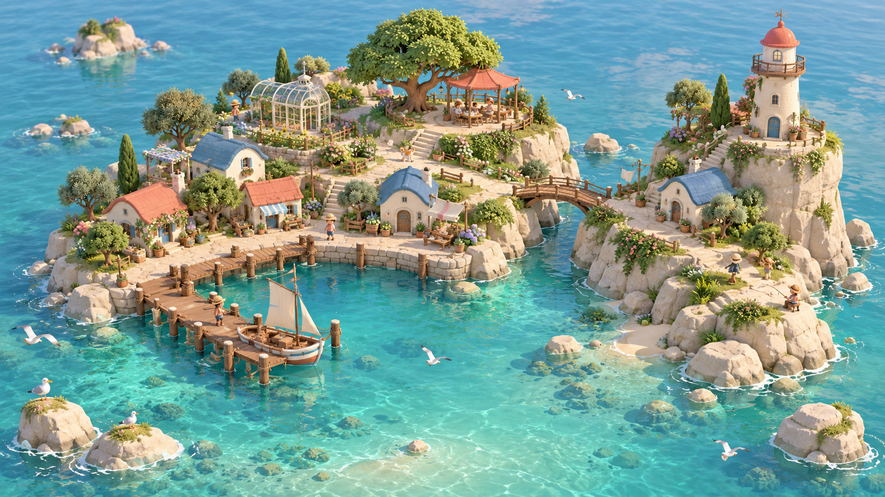
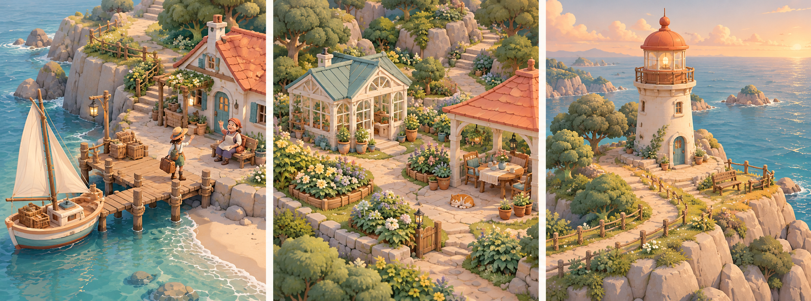
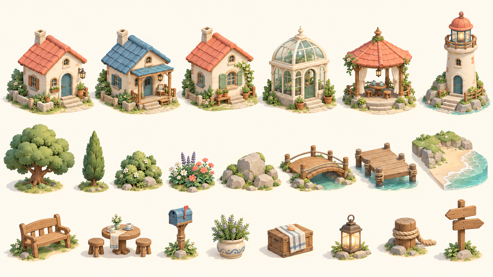
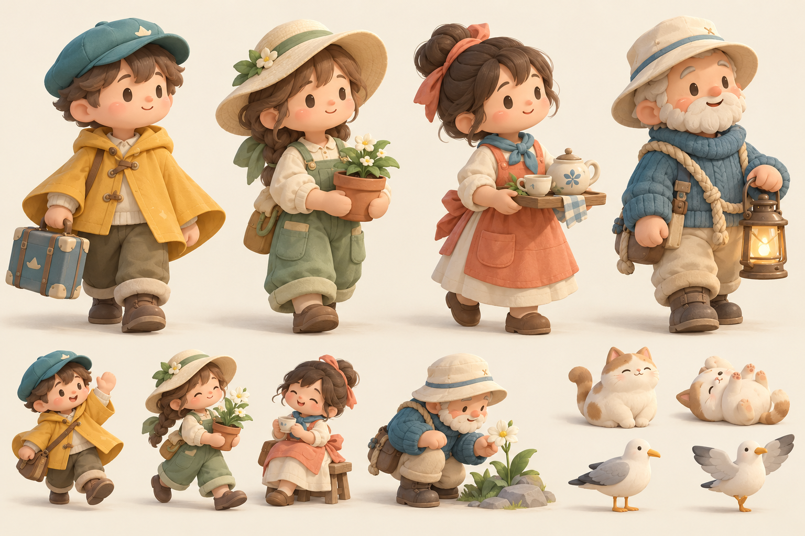

# prompt entry：

设计一个治愈系的建岛游戏，玩法和画风都类似 Brushland（https://store.steampowered.com/app/5163450/Brushland/），并且帮我设计好概念图，场景，道具等美术资源清单，汇总成一个PRD保存在项目docs下面

# 风屿手记 · 设计文档

把海岛当作一本可以涂画的立体手记。用简单的笔刷画出海岸，让小屋随着花园与海风改变模样，再看居民把风景过成日常。

本目录是概念与制作规划交付，日期为 2026-10-28。游戏暂名 **《风屿手记》/ Breezely Isles**；参考 [Brushland](https://store.steampowered.com/app/5163450/Brushland/) 的创作体验，采用原创海湾主题。

## 阅读入口

| 文件 | 内容 |
| --- | --- |
| [art_i1/I1_REPORT.md](art_i1/I1_REPORT.md) | I1固定六机位、颜色/GLB校准、材质合批保真、原生渲染对照与I2交接 |
| [ART_IMPROVEMENT_PLAN.md](ART_IMPROVEMENT_PLAN.md) | 2026-10-29美术改良：参考差距、9项资产/7项插件调研、连续地形/草树/水/光方案、11项任务与视觉门槛 |
| [BASIC_ART.md](BASIC_ART.md) | 当前基础美术、可体验内容、十五个GLB及制作边界 |
| [reports/playable_validation.md](reports/playable_validation.md) | 当前体验版测试、实际画面与性能采样记录 |
| [STATUS.md](STATUS.md) | 三周开发记录、提交、运行方式、截图与未通过验收项 |
| [PRD.md](PRD.md) | 产品定位、完整玩法与边界规则、首次 30 分钟、场景、美术规范、逐项资源清单、开发顺序与验收 |
| [DEVELOPMENT_PLAN.md](DEVELOPMENT_PLAN.md) | 初始42项任务与验收映射；第11节新增美术整改插入阶段，原10周基线不再作为当前交付承诺 |
| [art_delivery_schedule.csv](art_delivery_schedule.csv) | 111 条首版美术记录逐项安排首次交付阶段、关联开发任务与交付原因 |
| [art_asset_manifest.csv](art_asset_manifest.csv) | 便于拆单与跟踪的资源表，含 ID、分类、阶段、优先级、数量、规格、复用与验收 |
| [concepts/prompts.md](concepts/prompts.md) | 四张概念图实际使用的完整提示词，以及转为生产资源时的简化说明 |

## 概念图

四张均使用内置 `image_gen` 生成，原图已保存在本项目，PRD 内也有对应插图。它们是美术方向参考；可运行的模型、动画和 UI 仍为待制作。

### 主岛总览

### 港湾、花园与灯塔场景

### 建筑与道具

### 居民与动物

## 使用清单

`base_count` 是独立基础交付项数；`variant_count` 是额外需要制作的几何或图形变体；两者相加得到 `total_deliverables`。调色、旋转、缩放和游戏内实例不额外算模型。源网格、骨架、组合场景、动画与图标按各自单位统计，不把它们相加称为“模型数”。

`MVP` 表示完整首版；`POST` 表示后续候选；`P0/P1` 表示制作先后。`planned` 表示尚未制作，不能据此认定已有可加载资源。数量汇总以 PRD 第 11 节和 CSV 为准。

清单共 117 条记录：首版 111 条（161 个不同单位的交付项），后续 6 条（9 项）。首版静态源网格为 68 个，六种建筑组合和三个场景构图引用这些源件，不重复算作新模型。
