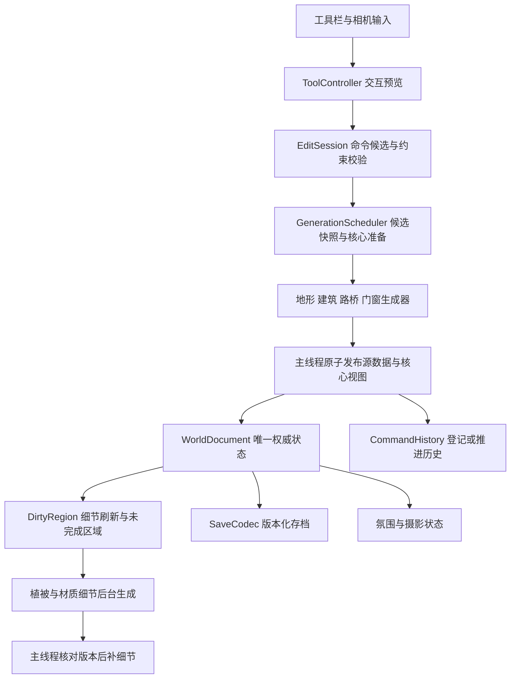

# 风栖小筑 · Godot MVP 开发计划

**版本：v1.0｜规划日期：2026-10-17｜状态：计划待执行**

依据已确认的 [PRD](PRD_风栖小筑.md) 与 [美术资源清单](art/asset_manifest.csv)，第一阶段交付 **一个可编辑、可保存、可拍照的“林间坡地”试玩场景 SCN-01**。本轮确认采用 Godot；原 PRD 中尚未选定的引擎项由本计划具体化，玩法范围保持不变。

本文件给出模块边界、数据契约、Godot 标准、资产工具链、插件选型、任务依赖、12 周里程碑和验收方式。工期按有相关经验的 **4 人全职等效团队**估算，周次从实际开工计算；不是已经开始执行的日历安排。当前仅交付开发计划，不创建工程、不安装插件或升级软件。

## 1. 首阶段交付与范围锁定

### 1.1 玩家最终能做什么

试玩包打开后可选“示范庭园”或“空白地块”，二者加载同一个场景系统及地貌的不同初始数据，不是制作两张地图。玩家能完成：

1. 拖出矩形 / 圆形小屋，调整尺寸和高度，得到山墙 / 圆锥屋顶与贴坡基座。
2. 画石径、生成入口，手放或锁定 3 种门与 2 种窗，放短石阶和木围栏。
3. 调整坡地；在合法缓坡上画一个固定水位浅池，确认放置短直木桥。
4. 单株或笔刷布置 3 树、4 灌草、2 岩石，摆放八类生活道具。
5. 切日间 / 黄昏、风量、新居 / 岁月；植物和晾布轻摆，提灯与窗光联动。
6. 撤销重做至少 50 次提交，使用至少 5 个命名存档、自动保存与 3 份轮替备份。
7. 调整构图、隐藏 UI，导出 1920 × 1080 和 2560 × 1440 截图，再回到编辑。

地块外观约 64 × 64 m，核心可编辑区域约 48 × 48 m。首阶段覆盖清单中 **47 个 P0 资产族、79 个基础交付单元**，其中手工模型类型 21 个；其余包括生成器、材质、图标等，不能统称 79 个模型。音频按 PRD 独立管理。

### 1.2 本阶段边界

SCN-02 茶庭、SCN-03 溪谷、水车、藤蔓、炊烟烟囱、复杂廊檐、露台、风铃、生物、雨雾与季节全部留到后续。概念图里的这些细节不进入本轮生产单。室内、经营、联机、自由建筑布尔、任意屋面并集、流体模拟、角色寻路、Web 发行和 Three.js 游戏端也不进入首阶段。

首发验收以 **Windows x86_64 桌面试玩包**为目标；macOS 用于当前开发和原型回归，是否同时对外提供包在 W2 根据真实设备与导出验证决定。Windows 目标必须在真实 Windows 设备上运行验收，不能用“在 macOS 成功导出”替代。

## 2. 技术与工具决策

### 2.1 已核对环境与版本基线

| 项目 | 本次只读检查结果 | 开工决策 |
| --- | --- | --- |
| 工程 | 目录中已有设计文档和概念图，无 `project.godot` | W1 建根目录 Godot 工程与 Git 基线 |
| Godot | 命令行 `4.7.stable.official.5b4e0cb0f` | 建议 W1 验证并锁定 **4.7.2 stable Standard** 与同版本导出模板；验证前可用现有 4.7 跑样板，不混用版本交付 |
| Blender | `/Applications/Blender.app`，版本 5.1.2 | 用现有 5.1.2 做导出样板，通过后锁定；不为追求新版改变中途管线 |
| Node.js | v25.2.1 | 仅可选工具实验用；若启用 Three.js 工具，另锁受支持的 Node LTS、包版本与 lockfile，运行游戏不依赖 Node |
| Git | 命令可用 | 初始化版本管理、二进制资源策略、分支及检查流程 |
| Godot AI 工具 | 工具已暴露，编辑器会话列表为 0 | 可辅助后续编辑和观察；先打开本工程并核对路径，再认定连接成功 |
| Blender 连接器 | 当前插件目录检索未返回 Blender 项 | 不将其作为排期依赖；官方 Python 脚本和手工建模可完成主链 |

截至规划日期，Godot 官方归档列出 4.7.2 为稳定版，4.8 为 beta；因此本计划不采用预发布版。软件升级尚未执行。版本信息与建议分开登记，开工时再次核对。[Godot 官方归档](https://godotengine.org/download/archive/)

### 2.2 栈与关键取舍

| 领域 | 首选方案 | 原因 / 验证点 |
| --- | --- | --- |
| 游戏逻辑 | 强类型 GDScript + Godot Standard | 降低跨语言构建成本；不先引入 C#、GDExtension 或 ECS |
| 渲染 | Forward+ 首选，W1 同镜头比较 Mobile 后在 W2 冻结 | 默认动态场景；以实际帧时间和画面选型，不将高级后处理设为美术成立前提 |
| 地形 | 小尺寸、自研分块高度场 | 可掌控池岸派生层、保护区、事务撤销与存档；不需要开放世界地形系统 |
| 建筑 | CPU 参数几何 → `ArrayMesh`；少量美术源件实例化 | 连续尺寸和门洞由规则生成；瓦片优先共享纹理与轮廓件，避免每瓦一个节点 |
| 景观 | 路径 / 围栏 / 桥保存控制点或端点；分段生成 | 路面宽度、接地和连接关系可编辑，不把结果烘焙成不可改的大模型 |
| 植被 | 稳定实例数据 + 按空间小块组织的 `MultiMesh` | 避免几百个草簇各自 `_process()`；单株编辑通过 ID 表查实例 |
| UI | 原生 `Control` / `Theme` / `InputMap` | 六类工具、属性卡、存档与摄影界面；不引入网页 UI 层 |
| 数据 | 编辑态 typed 数据对象；只读配置 `Resource`；版本化存档 | 配置、玩家状态、可视缓存分离，避免场景树成为隐式数据库 |
| 运行时撤销 | 命令事务包装原生 `UndoRedo`，只保存数据补丁 | 不将 Godot 编辑器的 `EditorUndoRedoManager` 用于玩家撤销 |
| 正式美术 | Blender + glTF 2.0 / GLB + Godot 材质装配 | 源文件可编辑，导出可复现，美术与运行效果在 Godot 内验收 |
| 形体试验 | Three.js 可选、小范围参数演示 | 适合快速检查体量 / 曲线；不维护第二套建造系统或 Shader |

Godot 官方区分 Forward+、Mobile 与 Compatibility 的特性和性能范围，切换也可能需要调整材质和环境。本项目将性能与视觉对比安排在投入最终材质前，不承诺三种渲染器同时保持一致。[渲染器说明](https://docs.godotengine.org/en/stable/tutorials/rendering/renderers.html)

### 2.3 第一轮必须回答的技术问题

| 原型 | 两周内的实验内容 | 通过条件 | 未通过时的处理 |
| --- | --- | --- | --- |
| SP-01 墙顶与开口 | 矩形墙、圆墙，各嵌方门 / 拱门 / 窗；连续改径改高 | 洞口有厚度与封边；固定门尺寸；低角度无背面亮缝 | 优先改墙分段 / 洞口生成算法；不能用完整墙面贴一张黑门图冒充完成 |
| SP-02 有限组合 | 同朝向矩形侧面贴靠、错落屋顶，圆体相切 | 接触面隐藏、收边完整；不产生任意屋顶并集需求 | 修复算法或延长风险阶段；不默默删除 PRD 里的圆墙与贴靠能力 |
| SP-03 地形与池岸 | 试 0.25 / 0.5 m 采样精度，分块接缝、池域派生层、3 m 基座超限 | 边界无缝；拒绝编辑保持整个旧状态；撤销 / 删池恢复原地形 | 调采样与分块；只允许性能与细节折中，不更改保护规则 |
| SP-04 编辑事务 | 一笔路生成门、一笔地形改基座；取消、撤销、重做 | 每笔一次提交；无数据半提交；远处不重洗 | 先修数据和事务，再扩功能 |
| SP-05 异步重建 | 连续快速拖动，故意让旧任务晚完成 | 旧结果不能覆盖新状态，松手后结果一致 | 限制并发、合并区域、采用更轻预览；不得取消稳定性要求 |
| SP-06 美术导出 | 1 门、1 树、1 晾布、1 道具与共享材质往返 | 尺度、UV、颜色权重、附着点、重导入正确 | 冻结批量美术生产，先修导出脚本 / 导入规则 |

原型必须在导出的程序里运行。W2 评审输出录像、极限参数样例、帧时间和失败清单，不能只交一张静态截图。

## 3. 模块架构与职责

### 3.1 数据流



UI 只发编辑意图；生成器只读快照，不回写玩家源数据；渲染节点可删可重建；保存不读取 GPU 网格来反推建筑参数。依赖组合由场景根节点显式装配，避免模块之间相互寻找全局单例。

### 3.2 模块分工表

| 编号 / 模块 | 负责 | 输入与输出契约 | 明确不负责 | 主责 |
| --- | --- | --- | --- | --- |
| M00 工程与发布 | 版本、设置、导入、构建、许可登记 | toolchain lock → 可运行包与构建信息 | 玩家编辑规则 | TL |
| M01 世界数据 | 文档 schema、稳定 ID、种子、资产目录 | 参数 / ID → typed snapshot 与数据校验 | 场景节点与输入 | TL |
| M02 编辑事务 | 命令、预览、约束、取消、撤销重做 | EditIntent → ValidationResult / ChangeSet | 直接生成网格 | TL / GP |
| M03 工具与相机 | 点选、射线、笔刷、手柄、吸附、相机与焦点 | InputMap / WorldQuery → EditIntent | 绕过事务改 Transform | GP |
| M04 重建调度 | 脏区、依赖顺序、快照、版本淘汰、提交预算 | ChangeSet → 带版本 GeneratedBatch | 改存档源数据 | TL |
| M05 地形与池域 | 用户高度场、派生池底岸带、保护区、采样与碰撞 | TerrainSnapshot → 高度 / 法线 / 网格 / 查询 | 真实流体与地貌扩充 | TL |
| M06 建筑与门窗 | 墙顶基座、有限贴靠、墙洞、门窗附着和待附着 | BuildingSpec / AttachmentSpec → 几何与合法附着点 | 任意布尔、室内、道具移动 | TL |
| M07 路桥阶栏 | 路面、桥头、短阶、围栏开口，发入口候选 | 轮廓 / 端点 + WorldQuery → 结构与 DoorRequest | 自动确认所有桥、长楼梯系统 | GP |
| M08 植被与道具 | 稳定刷植、擦除、手放实例、表面吸附与编辑 | InstanceRecord / 笔画 → 实例数据与分块视图 | 经营、寻路、生长模拟 | GP / ART |
| M09 风格与环境 | 共享材质、岁月、两档光、风、水波、受控提灯与声音 | EnvironmentSpec → shader / light / audio 参数 | 改建筑与植被布局 | TA_QA |
| M10 界面与引导 | 六类工具、属性、存档、提示、缩放、重绑 | 当前工具 / 选中 ID / 状态 → UI；动作回到 M02 | 管几何与源数据生命周期 | GP / ART |
| M11 存档与摄影 | 编解码、恢复、命名、截图、构图与导出目录 | WorldDocument / CameraState → 文件与验证结果 | 将撤销历史永久化、云同步 | GP |
| M12 美术管线 | Blender 源件、导出、导入包装、校验、资源登记 | asset_id + 源文件 → 已验证 GLB / TSCN / 材质 | 游戏端建筑算法 | ART / TA_QA |
| M13 场景与质量 | SCN-01 数据模板、压力布局、回归、玩家测试 | 已验收模块 / 资源 → 可编辑模板与试玩证据 | 制作 P1/P2 场景 | TA_QA / 全员 |

角色：TL 技术负责人；GP 交互与工具程序；ART 环境美术；TA_QA 技术美术兼测试 / 制作。表中双角色表示协作，任务表中每项只设一个主责并统计一次人天。

### 3.3 跨模块接口草案

下表定义语义，不是已实现 API；W1 用类型声明与最小样例锁定，之后变更同时更新调用方和回归。

| 契约 | 最小字段 / 方法 | 关键约定 |
| --- | --- | --- |
| `WorldDocument` | schema_version、generator_version、revision、world_seed、terrain、pool、buildings、paths、bridges、attachments、instances、environment、camera_bookmarks | 不含 Node / Mesh / 文件句柄；对象稳定 ID 与 ResourceUID 分开 |
| `AssetDefinition` | asset_id、family_id、packed_scene、footprint、bounds、surface_tags、attach_slots、material_slots、wind_profile | PRD 资产族对应运行目录；同一个 family 可有多个结构组件，不靠文件名推断玩法 |
| `EditCommand` | command_id、base_revision、validate(context)、apply(document)、revert(document) | apply / revert 用数据补丁；一笔拖拽就是一个命令，预览不入历史 |
| `ValidationResult` | valid、reason_code、conflict_ids、legal_preview、affected_region | 原因码由 UI 翻译成短文案；拒绝不改变源数据 |
| `ChangeSet` | changed_ids、before / after_bounds、height_patch、attachment_updates、revision | 脏区覆盖移动前后范围及必要邻域；既有手放物件只按明确规则更新接地高度 |
| `WorldQuery` | sample_height、sample_normal、raycast_target、query_bounds、is_protected、get_attachment_surface | 运行逻辑使用权威数据 / 最新完成快照；不因碰撞网格暂未提交而校验到旧地形 |
| `GenerationRequest` | scene_epoch、request_id、base_revision、candidate_id / source_revision、stage、target_ids / chunk_ids、immutable_snapshot | 区分提交前核心准备与提交后细节刷新；快照只传值数据；任务不能访问活动场景树或共享可变材质 |
| `GeneratedBatch` | 同一任务标识、mesh_arrays、instance_transforms、collision_data、warnings | 主线程再次验版本；过期批次丢弃；依赖结果以一致版本提交 |

实例记录至少含 object_id、asset_id、transform、seed、source（manual / brush / generated）、lock_flags、parent_id、attachment_slot 和 placement_state。主动删父建筑时保留手工门窗的变换与参数、清空活动父引用，转入待附着列表；禁止悬空坏引用。

W2 的最小编解码器随每个模块新增源字段同步扩展，并加入 roundtrip 样例；W5 所有灰模功能的数据都能保存和重建。W8 的完整存档任务负责容器校验、迁移、备份与产品界面收口，不是到 W8 才第一次实现保存。

## 4. Godot 工程标准

### 4.1 计划中的目录与场景

以下目录在真正开工时创建，本次不生成空工程骨架。

```text
tiny_glade/
├── project.godot
├── app/                         # 启动、场景装配、服务注入
│   ├── app_root.tscn
│   └── boot.gd
├── core/
│   ├── world_document/          # schema、ID、数据校验
│   ├── editing/                 # 命令、补丁、约束契约
│   ├── generation/              # 调度、快照、提交队列
│   └── asset_catalog/           # AssetDefinition 与目录
├── features/
│   ├── camera/
│   ├── terrain/
│   ├── buildings/               # 自有场景、脚本、资源配置及测试样板
│   ├── paths_and_bridges/
│   ├── foliage/
│   ├── props/
│   ├── environment/
│   ├── save_and_load/
│   └── photography/
├── ui/                         # 工具栏、属性卡、存档与摄影UI，各自成模块
├── levels/forest_slope/         # playground.tscn + 示例/空布局源数据
├── assets/                     # 跨模块共享的正式导出资源，按建筑/自然/道具等归类
├── art_source/                 # .gdignore；Blender、分层贴图等源文件
├── tools/                      # .gdignore；离线导出/资源校验/可选threejs实验
├── addons/                     # 固定版本第三方插件与项目自有编辑器导入工具
├── tests/                      # 单元、集成、固定样例与压力场景
├── docs/                       # .gdignore；本计划、PRD、证据记录
└── builds/                     # .gdignore；Git忽略的本地导出物
```

代码按功能聚合，不建立一个包含所有逻辑的 `scripts/`。`assets/` 仅容纳共享运行资源，不把功能脚本混进去。每个功能的私有配置与场景放回该功能目录。[Godot 项目组织与 `.gdignore`](https://docs.godotengine.org/en/stable/tutorials/best_practices/project_organization.html)

`Playground` 场景根装配 `WorldSession`、`WorldView`、`CameraRig`、`ToolController`、`EnvironmentRoot` 和 `CanvasLayer`。`WorldView` 下分地形、建筑、路桥、植被、道具子根；不按每片叶、每块瓦创建独立节点。Autoload 初始只考虑设置、资产目录与跨场景音频等确有生命周期需求的服务；世界数据、命令历史和生成器属于当前会话，不设十几个全局 Manager。

### 4.2 代码、节点与资源

| 标准 | 项目要求 |
| --- | --- |
| 命名 | 文件 / 目录 / 变量 / 方法 `snake_case`；类与节点 `PascalCase`；信号过去式 `snake_case`；私有成员 `_` 前缀 |
| 文本 | GDScript UTF-8 无 BOM、LF、Tab 缩进、建议 100 列以内；CSV 为兼容中文表格可单独使用 BOM |
| 类型 | 公共接口、导出字段、集合元素尽量显式类型；启用未类型声明警告；新写核心代码不接受未说明的类型 / 空引用警告 |
| 引用 | 场景私有节点用 `%SceneUniqueName` 或显式导出引用；跨功能由父节点注入，不硬编码长节点路径 |
| 通信 | 场景内部直接信号；跨模块发有类型的数据变化；MVP 不先引入全局事件总线 |
| 资源 | `.tres` 配置只读；需要实例独立状态时复制对应 Resource，不修改共享材质造成全场串色；高频变化优先实例参数 |
| 输入 | 用 InputMap；离散工具事件由 `_unhandled_input()` 处理；UI 接收事件后不穿透建造；连续相机运动可逐帧积分 |
| 更新 | 静止对象关闭无用 `_process()`；风用共享 shader 参数；几何只在输入数据变化时重建 |
| 碰撞 | 分层区分地形、可选建筑 / 道具、辅助交互；水面默认不阻挡选中；简单道具用简化形状，不默认全体三角网格碰撞 |
| 错误 | 面向玩家给出恢复提示；日志记录 command_id / object_id / revision；不静默清空存档或替换成新地块 |

这些命名与文本约定参考官方 GDScript 风格指南；类型、模块边界和警告门槛属于本项目的附加开发标准。[GDScript 风格指南](https://docs.godotengine.org/en/stable/tutorials/scripting/gdscript/gdscript_styleguide.html)

### 4.3 Git、导入与构建

- 提交 `.tscn`、`.tres`、脚本、shader、`project.godot`、导入设置 sidecar 和 `.gd.uid`；忽略 `.godot/` 缓存、临时文件、导出包和本机设置。
- `.blend`、大贴图、GLB 等二进制按团队仓库能力启用 Git LFS，保留锁文件约定；源文件有版本、不能只留在某个人电脑里。不要把所有小 JSON / 文本场景放 LFS。
- `docs/`、`art_source/`、`tools/`、`builds/` 加 `.gdignore`，不等同 Git 忽略；它们仍按需版本管理。
- 编辑器导入资源用持久 UID / 显式路径，玩家对象用项目生成的稳定 ID；不能把 Godot 资源 UID 当作某一把浇水壶实例的 ID。
- 一项任务一个小分支 / 一次可评审提交，避免多人同时修改主场景与同一 `.blend`。SCN-01 布局与底层系统分开提交。
- 建议新增 `toolchain.lock.json` 记录引擎、导出模板、Blender、插件 tag / commit / license、导出脚本版本和材质契约版本；升级先在分支跑代表样本与回归。
- 导出配置在工程中可复现；签名、证书和密钥单独管理。Windows 对外包的签名、macOS 公证在确定分发渠道时单列，不假装在本次计划里已经完成。

### 4.4 持续检查与参考命令

开工后按“导入 / 引擎解析 → 代码风格 → 规则和集成测试 → 资源校验 → release 导出 → 目标机冒烟”的顺序执行。CI 可先用仓库脚本在本机重现，再接入托管运行器；美术、渲染与真实设备性能测试不能用无显示的 headless 成功替代。

以下是工程和依赖建立后的参考命令，**本轮没有执行**；CI 中的 `godot` 要解析到锁定的同一二进制。GUT 命令选项在 W1 以 9.7.1 的帮助输出核验。

```bash
godot --headless --path . --editor --import
gdformat --check app core features ui
gdlint app core features ui
godot --headless --path . -s addons/gut/gut_cmdln.gd -gdir=res://tests -ginclude_subdirs -gexit
godot --headless --path . --export-release "Windows Desktop" builds/windows/windhaven_diorama.exe
```

W1 还需实现项目自己的资产目录校验命令，核对 ID、P0 完整性、导入件、材质槽和依赖；它不冒用不存在的官方检查器。测试阶段必须实际发现并运行测试，零用例或关键用例全 pending 不能算通过。每次导出保留引擎版本、提交号、测试摘要与包校验值。[Godot 命令行](https://docs.godotengine.org/en/stable/tutorials/editor/command_line_tutorial.html)、[GUT 命令行](https://gut.readthedocs.io/en/latest/Command-Line.html)

## 5. 运行时编辑、确定性与性能实现

### 5.1 一笔编辑如何落地

**开始手势 → 复制受影响数据用于预览 → 校验整体候选 → 准备核心几何与碰撞 → 原子发布源数据、依附更新与核心视图 → 入撤销历史 → 局部补细节。** Esc 取消只丢预览；校验或核心生成失败不提交、不入历史，继续保留上一合法状态；不能先改一半地形再通知玩家桥不合法。

仅同一手势中的预览候选可互相淘汰。松手后进入 `PendingCommit` 并保留该笔命令；MVP 只允许一个待提交事务，完成前工具明确显示“正在完成上一笔”，暂不接受下一笔建造手势，相机仍可操作。撤销 / 载档意图按串行入口处理；Esc 可明确取消尚未发布的候选，不能静默丢掉已松手命令。后续若支持排队，必须在前笔发布后重基下一候选。

准备任务带 base_revision 和 candidate_id，发布前再次确认仍是当前候选。核心数据与资源可分帧准备；暂存节点脱离活动世界或保持碰撞禁用，不能只设 `visible=false`。准备成功才统一切换源数据、视图与碰撞；拾取与约束查询绑定同一已发布 revision。保存只取最近已发布 revision。W1 先用最小局部样例验证事务，重型几何从 W2 起按测量迁至后台；不以多线程先行代替规则正确性。

`UndoRedo` 作为私有运行时历史容器，由 `CommandHistory` 适配并持有可预读的命令元信息。初次核心发布成功后以 `commit_action(false)` 登记，避免默认再次执行 do。撤销 / 重做也先准备目标状态核心批次，成功后才调用容器的 undo / redo；其同步回调只发布已准备的数据补丁与核心批次，随后推进历史。失败、过期或取消不移动历史游标，不把已释放 Node 的引用塞进历史。外部只能调用包装层的 request_undo / request_redo，不能直接访问原生容器。

历史至少 50 笔；大范围笔刷存受影响高度差量 / 必要检查点，记录内存上限并与 2 GB 目标一起测量。编辑器批量摆资产工具的撤销另用 `EditorUndoRedoManager`，两种历史互不混用。[UndoRedo 官方说明](https://docs.godotengine.org/en/stable/classes/class_undoredo.html)

### 5.2 重建顺序与快照

数据求值分为可稳定复用的阶段：用户地形 + 池域派生层 → 建筑支撑与外壳 → 路径桥头 / 门候选 → 门窗开口 → 自动细节与实例 → 可视提交。路径生门、门洞改墙存在回写风险，因此门请求先在命令求值阶段归并到候选数据，再对确定的开口布局生成最终墙体；生成器之间不循环修改源数据。

将约 64 m 地块先试分为 8 m 小块；采样精度在 SP-03 决定。移动对象的脏区取前后包围盒并扩展算法需要的邻域，边缘法线共享采样，避免接缝。独立树、草簇和道具的种子由 world_seed + object_id + generator_version 稳定派生；禁止依赖线程完成顺序、场景遍历顺序或全场 RNG 调用次数。随机种子与必要状态记录在源数据中。

工作线程仅计算独立数组、位置和几何数据；SceneTree、Mesh / 材质实例装配、渲染和碰撞提交由主线程分预算完成。快照 immutable；请求记录 scene_epoch 与版本。卸载场景、撤销或新编辑后，旧结果即使晚到也不能提交。首版先采用保守的“文档 revision 不匹配则丢弃并合并重排”，测出吞吐问题后才细化对象版本，不先造复杂并发框架。[线程安全边界](https://docs.godotengine.org/en/stable/tutorials/performance/thread_safe_apis.html)

首版先限制一个运行任务与一个合并待执行请求。同一小块只保留最新候选，但**被淘汰任务尚未成功发布的脏区必须合并到下一请求**，不能只处理最后一次鼠标动作而漏掉前面的变化。已运行任务通过版本淘汰而不是假设能强行取消。给算法循环设置上限。主线程准备初始预算建议 2–4 ms / 帧，实测再调；核心事务准备完再整体切换；不在每帧创建大量碰撞体。退出 / 换档时先断开提交目标、递增 epoch，并有序收尾任务。

### 5.3 各生成器具体实现任务

| 系统 | MVP 实现方法 | 必须验证的边界 |
| --- | --- | --- |
| 高度场 | 保存用户高度差量，池底岸带作为派生覆盖层；刷子预览与提交共用约束 | 分块接缝、最大坡高、建筑与池域保护、删除恢复 |
| 墙与开口 | 在局部墙面坐标中划分合法面片，按开口重建内外面与洞侧；圆墙按弧段映射 | 门不拉伸、圆墙洞厚、同轴贴靠接缝；不依赖运行时通用 CSG 布尔 |
| 屋顶 | 参数化山墙 / 圆锥轮廓，材质重复与少量边件控制密度 | 最小 / 最大尺寸不翻面；瓦片方向与檐口封闭 |
| 石基 | 用固定地坪与地形采样生成可见基座、边角收边与短支撑 | 超过 3 m 时整个候选编辑失败，地形 / 基座一起保留旧状态 |
| 路径 | 存样条 / 折线控制点，重采样生成带状路面及可控石块装饰 | 转角、交叉、坡面、建筑内部隐藏、入口请求去重 |
| 池岸 | 一个闭合池域；按 PRD 固定首次水位、深度、岸带与最窄宽度 | 坡差 >0.6 m 拒绝；普通地形刷保护；建筑双向 0.5 m 排斥 |
| 木桥 | 确认后创建可编辑两端点桥记录，伸缩桥面与护栏 | 跨度 1.5–6 m / 高差 ≤0.5 m；失效桥保留并标记；重算不自动拉向别岸 |
| 阶栏 | 短石阶根据高差给步数；围栏沿段布柱并为路径留开口 | 石阶高差 0.15–0.9 m；转角、端盖、洞口不堆重复构件 |
| 植被 | 按小块抖动网格 + 独立种子候选，结合间距与保护区筛选；实例 ID 与 MultiMesh 索引分开 | 擦除可撤销；局部变化不重排远处；选中反馈不用为全场草创建碰撞体 |
| 道具 | 八类统一放置协议、简化碰撞、地面 / 指定表面附着 | 茶盘整组、晾架含布、提灯亮灭；未实现 P1 露台时不暴露其摆放目标 |

`ArrayMesh` / `SurfaceTool` 等属于 Godot 原生程序几何路径；本项目优先直接生成数组，并把艺术结构问题留在样板阶段解决。[程序几何概览](https://docs.godotengine.org/en/stable/tutorials/3d/procedural_geometry/index.html)

门洞样板采用受限轮廓的立面条带 / 区间切分。不要假设把多边形裁切返回的所有环分别三角化，就能得到带洞墙面：洞环可能被重新填满；二维三角化与三维墙面映射也必须统一正反面绕序。SP-01 加入最小半径圆墙上的圆拱门、圆窗、洞口侧壁与内衬专项检查。[Geometry2D](https://docs.godotengine.org/en/stable/classes/class_geometry2d.html)、[ArrayMesh](https://docs.godotengine.org/en/stable/classes/class_arraymesh.html)

`MultiMesh` 不代表免费解决所有可见性与编辑问题：本计划按空间块和资产类分组，维护稳定 object_id → instance_index 映射；删除可交换槽位但同步映射；世界状态存储实际实例数据，不把 GPU buffer 当作存档。[MultiMesh 优化说明](https://docs.godotengine.org/en/stable/tutorials/performance/using_multimesh.html)

### 5.4 性能与画面约束

首版不依赖运行时烘焙 GI、全场黑描边或强景深。先完成共享手绘材质、柔和定向光、环境色、局部发光和轻风；可选 SSAO 等效果在渲染器冻结与预算允许后再加。玩家修改结构不能要求重新离线烘焙才能看到正确结果。

最多约 4 盏近景提灯启用受控局部实时光，其余保留发光外观；玻璃、池水和叶片控制透明层叠。正常静止时没有几何生成任务。压力场景使用 PRD 的 24 体块、80 树、800 灌草 / 岩石实例、120 道具、1 池、2 桥，不把示范庭园堆到压力密度。

## 6. 风格化 3D 美术工具链

### 6.1 工具分工

| 工具 | 本阶段用途 | 不交给它的工作 | 是否阻塞试玩 |
| --- | --- | --- | --- |
| Blender 5.1.2 | 正式低模、UV、顶点颜色、材质色块、简化层级、插槽空物体；Geometry Nodes 用于离线源件变体 | 不在 Blender 中做一张不可编辑整图来替代游戏建造 | 是，正式资产主链 |
| Blender Python | 导出所选资产族、批量命名 / 变换 / 材质槽校验、输出 sidecar | 不依赖个人点击步骤才能复现导出 | 是，最小自动化 |
| Three.js | 可选尺寸 / 屋顶轮廓 / 参数滑杆试验，快速向程序与美术解释形体 | 不运行游戏、不建立第二场景存档、不承担 Godot 材质效果 | 否，可完全跳过 |
| Godot | 最终材质、shader 风、水波、两档光、运行时生成、碰撞、交互和性能 | 不把编辑器临时调色变成未登记源资产 | 是，最终验收环境 |
| 图像工具 | 既有概念图作美术参考；必要时辅助纹理草稿，再清理为可平铺素材 | 不将概念 PNG 当模型 / UV 图集直接计为完成 | 否，本轮已有概念图足够启动 |

**主链：概念与尺寸卡 → Blender 源件 → 批量 GLB / 贴图 → Godot 导入包装 → 样板场景 → SCN-01。** 同一资源只确定一个权威源文件。如果某次 Three.js 实验被采用，先在 Blender 完成尺度、UV、法线与材质槽修订，归档为正式 `.blend`；试验 JS 和中间 GLB 留在工具目录，不与正式源件同时作为日后独立维护入口。

Three.js 若启用，只做一个有明确结束条件的短实验：用 1–2 个工作日比较屋顶轮廓 / 参数可读性，导出样例并记录公式后结束；其时间占用技术美术原型预算。不能为了用上 Three.js 再开发一套网页建造器。

### 6.2 建筑程序资产与手工资产的交界

墙、顶、基座、阶栏、路径桥的 **连续尺寸逻辑在 Godot**。Blender 交付门窗、端帽、屋脊、檐边截面、木柱样件、石材样件与共享材质参考等源件；这些可作为生成器内部组件，不另抬高 PRD 资产族数量。视觉上需要更多变化时优先用参数和重组，不新增一整栋不可改房屋。

自然与生活资产按清单制作：3 树、4 灌草、2 岩石、8 道具；其中绿篱是复用灌木材质的可拉伸规则，不要求再造大量叶模型。晾布为预制形态 + 顶点权重摆动，不做布料物理。茶盘、壶和两杯按整体资产交付。提灯包含发光遮罩、挂点与局部灯锚点。

### 6.3 源文件与导出契约

| 项目 | 约定 / 校验 |
| --- | --- |
| 尺度与坐标 | 1 m 标尺 + 1 m 门宽样板；Blender 使用自身坐标，由 glTF 导出器转换到 Godot Y-up；不再手工重复旋转 90° |
| 变换与原点 | 应用正比例尺度与旋转，无负缩放；道具 / 植被接地中心；墙件连接基准；桥含两端标记 |
| 导出组织 | 每个资产族一个源 `.blend` 或明确命名 collection；导出只选目标集合，不带工作相机、灯、隐藏草稿 |
| 格式 | 默认 GLB 做网格交换；贴图及 Godot 材质按共享目录管理；是否嵌图统一由导出配置决定，避免每个 GLB 重复一套 2K 图 |
| Geometry Nodes | 需要导出的实例先实例实现 / 转成可验证网格；节点图保留在源件；节点程序不随 GLB 变成 Godot 运行时逻辑 |
| 材质槽 | 使用受控语义如 plaster / wood / tile / stone / foliage / cloth / metal / emissive，由 Godot 导入映射至共享材质或其参数实例 |
| 风权重 | 源件命名 `wind_mask`，显式导出为 `COLOR_0`：R 摆幅、G 细摆、B 预留、A=1；根部 / 布挂点 R/G=0；导出回归检查实际灰阶，不能占同一通道再烘 AO，也不把权重乘到 Albedo / 透明度 |
| 材质效果 | Blender 节点网络只作源端预览；烘焙需要保留的大色块，Godot 重建风 / 岁月 / 水波效果，不承诺 Shader 自动迁移 |
| LOD | 树至少有一个简化表示；源端手工层级或 Godot 导入自动 LOD 二选一为主，避免双重简化；以轮廓与闪烁验收 |
| 碰撞 | 手工放置物用简化盒 / 凸形，建筑交互按建筑边界数据判断；不从树叶卡片生成三角碰撞 |
| 插槽 | 门窗、灯、茶盘等需要的附着点用命名空物体 + sidecar 显式登记；导入后检查位置 / 朝向，不假设任意 metadata 自动可用 |
| Sidecar | asset_id、源文件、导出脚本版本、尺寸包围盒、材质槽、插槽、风权重语义、LOD / 碰撞策略、作者 / 来源 |
| 包装场景 | 导入 GLB 与行为包装 `.tscn` 分开；脚本 / 灯 / 碰撞加在包装层，重导出不得覆盖手工玩法配置 |

风动树冠、草簇与晾布的包围盒要包含最大摆幅，防止顶点动画超出静态 AABB 后在画面边缘消失。运行时生成建筑不因 GLB 自动 LOD 设置而获得简化层级，需要生成器自己控制分段。贴图以 Base Color 色彩纹理与粗糙度 / 遮罩 / 法线等数据纹理分开配置，避免错误颜色转换破坏风权重和材质参数。

Godot 支持 glTF 及 Blender 资产工作流；直接导入 `.blend` 会涉及 Blender 导出过程和机器依赖。本项目选择显式 GLB 交付，使运行工程与持续构建无需安装 Blender，也可使用统一的导出结果。[Godot 可用 3D 格式](https://docs.godotengine.org/en/stable/tutorials/assets_pipeline/importing_3d_scenes/available_formats.html)

### 6.4 美术生产批次

| 批次 | 目标周 | 交付 | 放量条件 |
| --- | --- | --- | --- |
| A 样板 | W1–2 | 1 墙 / 顶规则样例、1 门、1 树、1 道具、晾布风权重样例，共用材质小样 | 旋转观察、重导入、两档光、风权重验证通过 |
| B 建筑套件 | W3–5 | 三门两窗与墙顶基座 / 短阶 / 围栏艺术规范 | 尺寸极值和贴靠接缝先过，再抛光表面 |
| C 庭园套件 | W4–7 | 八生活道具、三树四灌草二岩石、共享植被图集 | 默认镜头可辨；简化层级、材质共享与原点通过 |
| D 氛围与 UI | W5–8 | 两档光、风、水、岁月、图标 / 面板 / 色卡与声音 | 实际运行画面与可交互模型一起评审 |
| E 场景 | W7–8 | 可编辑 SCN-01 布局、空布局、推荐镜头、模板缩略图 | 只使用 P0；可以拆改，不把截图当场景完成 |
| F 集成返修 | W9–12 | 接缝、轮廓、比例、LOD、过绘与交互遮挡修复 | 实测定位问题后返修，不再新增主题资产 |

各类三角形、贴图和材质预算直接使用 PRD 第 10 节，不在开发计划中另设一套冲突数字。完整 P0 → 模块 → 任务对应表见附录 B；原清单中的状态仍是待制作。

## 7. 插件与扩展选型

### 7.1 先区分四种工具

Godot 编辑器插件、游戏运行时依赖、Blender / Three.js 工具包、AI 连接器是不同类别。编辑器能摆好草，不等于导出的游戏支持刷草与撤销；MCP 能操作节点，不等于玩法已实现；插件代码许可也不自动覆盖其演示模型和贴图。

本轮只默认引入一个测试框架和轻量代码检查工具，其余扩展按下面条件评估。**下表是研究与选型结果，尚未安装或在本项目验证。**

### 7.2 Godot 与开发工具矩阵

| 候选 | 类型 / 许可 | 查证结果 | 本项目决定 | 引入验收与替代 |
| --- | --- | --- | --- | --- |
| [GUT](https://github.com/bitwes/Gut) | 测试插件 / MIT | 官方矩阵列 9.7.1（godot_4_7 分支）适配 4.7.x | **采用候选，W1 固定 9.7.1 的具体 tag / commit 后验证**；用于事务、几何参数、约束、编解码和集成 | headless 可跑失败退出码；不进发布依赖；与 Godot AI 自带测试入口不混为同一框架 |
| [gdtoolkit](https://github.com/Scony/godot-gdscript-toolkit) | CLI lint / format，MIT | 提供 gdlint / gdformat，声明支持 Godot 4 系列 | **采用候选**，W1 以 4.7 代表脚本锁可用发行版本；第三方工具兼容不能替代引擎解析 | `gdformat --check` 与 gdlint 不改源码通过；新语法误报先记录并局部处理，不能绕过 Godot 错误 |
| [GdUnit4](https://github.com/godot-gdunit-labs/gdUnit4) | 另一测试框架 / MIT | 官方提供 Godot 版本矩阵与场景测试能力 | **备选，不与 GUT 并装** | 仅 GUT 兼容验证失败时对比迁移；4.7.2 具体兼容需实测，不推断矩阵未列版本 |
| [Terrain3D](https://github.com/TokisanGames/Terrain3D) | C++ GDExtension 地形 / MIT | 提供地形雕刻、材质、植被等；涉及原生平台二进制 | **MVP 不引入**；自研小高度场为主 | 只有 SP-03 失败才安排限时评估：运行时编辑 API、池岸保护、源数据撤销、保存和 Win/mac 二进制全部测；不是安装即替换 |
| [ProtonScatter](https://github.com/HungryProton/scatter) | 程序散布扩展 / MIT，演示素材另查许可 | 官方仓库描述为 Godot 4 散布工具，当前仓库亦指向上游镜像 | **仅候选制作工具，不作为玩家刷植依赖** | 若用于外围树幕，导出稳定 transform / asset_id 数据；无法脱离插件回放就不用；玩家手工优先与撤销仍由 M08 实现 |
| 项目自有 Asset Pipeline | `EditorImportPlugin` / 导出校验等编辑工具 | 原生扩展机制；具体实现属项目任务 | **采用最小功能集**：材质映射、插槽与资源验证 | 缺标签直接报明确错误；重导出不覆盖包装层；不先做复杂资产管理器 |
| Godot AI MCP 工具 | 编辑 / 观察辅助；分发许可未在本轮核实 | 当前可用工具暴露了场景、材质、运行、截图等能力；本次连接会话为 0 | **可选辅助，非游戏运行依赖** | 连接后先核对 project_path / engine version；每次操作后保存、运行与检查证据；不随试玩包分发未知许可工具 |
| Godot Git 编辑器插件 | 编辑辅助，具体插件需另锁版本 / 许可 | 本轮没有形成必需性 | **不用，使用外部 Git CLI** | 省去原生编辑器插件兼容面；不影响版本管理要求 |

GUT 版本与许可依据其官方仓库；Terrain3D、Scatter 的可用功能也只依据作者仓库，不把社区推荐当本项目测试结果。[GUT 兼容矩阵](https://github.com/bitwes/Gut)、[Terrain3D 官方仓库](https://github.com/TokisanGames/Terrain3D)、[Scatter 官方仓库](https://github.com/HungryProton/scatter)

### 7.3 资产制作侧

| 工具 / 扩展 | 决策 |
| --- | --- |
| Blender 原生 Geometry Nodes / UV / Texture Paint / Python | 优先使用；适合低模与离线变体，不新增运行依赖 |
| Blender glTF 2.0 导出器 | 主链；W1 固定一套导出预设与代表样本，验证颜色属性、实例实现、材质槽及重导入 |
| Three.js `GLTFExporter` | 仅当启用形体实验时使用；不导出 Three.js Shader / 交互代码作为游戏功能 |
| [Sapling Tree Gen](https://extensions.blender.org/add-ons/sapling-tree-gen/versions/) | 可选树干起形；目录 0.3.7 声明 Blender 4.4+、GPL-3.0-or-later，且 limited support；5.1.2 尚未实测，不依赖其动画。失败时用基础建模 / Geometry Nodes 完成三树 |
| [MCP for Blender](https://github.com/ahujasid/mcp-for-blender) | 社区辅助工具，MIT；原 blender-mcp 作者仓库现名。上游声明 Blender 3+ 不等于 5.1.2 已验证；当前未连接，不列交付依赖。与 `.blend` 直导不是同一功能 |
| [Material Maker](https://github.com/RodZill4/material-maker) | 可选独立材质制作工具，仓库默认 MIT；导出贴图后进主链，不将整个工具装进游戏；Blender 原生绘制已够用时不额外引入 |
| 大型地形、角色、对话、任务或库存插件 | 与当前范围无关，不引入 |

Blender 与 Three.js 的具体导出能力、限制和候选扩展证据见附录 D。当前已有概念图足够开展样板，无需先采购额外内容包或引入新订阅。

### 7.4 插件准入门槛

每个引入项至少记录：来源、tag / commit、许可、维护者、目标引擎 / 工具版本、平台、是否进入导出包、最小兼容样例、移除方案。W2 版本冻结后不随手升级；新插件须能减少一个已识别的工作包，并通过现有回归。没有明确收益的插件保持不启用。

## 8. 存档、设置与摄影实现计划

世界存档以版本化 schema 编解码至 `user://` 下的项目目录；内存中使用 typed 数据，磁盘采用**单个版本化容器文件**，同时包含元信息、实例记录与压缩高度差量。容器头登记格式版本、revision、数据长度与校验值，整份按一个 revision 验证与轮替，避免 JSON 与高度文件分别替换后混代。稳定 ID / seed 使用字符串或显式无损格式，避免 JSON 数字精度或浮点舍入破坏 64 位标识。资产目录路径不直接暴露为玩家资源选择。

每次写档先从某个已提交 revision 建完整快照；完整容器写到同一文件系统的临时文件，完成并验证后再替换当前档，按整文件保留 3 份有效备份。中断导致当前档缺失或无效时，扫描并验证备份，不能混拼文件片段。测试模拟进程中断、磁盘写失败、未知资源 ID 和新旧格式不兼容。损坏缓存可重建；缺资产时报告原 ID 并保留数据，不能静默吞掉玩家物件。W2 前做最小保存 / 重载，W5 做完整字段，W10 做恢复与迁移门槛，不拖到收尾。

自动保存遵守 PRD：编辑空闲 60 秒且有未保存提交时触发，不在每次鼠标移动保存；生成任务尚未完成也可保存已提交源数据，加载后重建派生结果。用户设置（快捷键、UI 缩放、音量、减少动态）与作品分离，可用独立配置文件；退出 / 载档时明确处理未保存修改。

摄影模式保存相机变换、视角、光线与风 / 动态冻结状态；截图用独立可配置输出尺寸的视口或等效原生路径，隐藏工具层，不改变窗口 UI 缩放来凑分辨率。等待渲染完成再取图；路径、权限、失败重试和文件名清洗都写进验收。返回编辑必须恢复选中状态与相机语义，不误提交构图变化为建筑操作。

跨场景资源加载采用后台请求与状态轮询，确认完成后再取结果，不在拖动期间同步加载大 GLB。[Godot 后台加载说明](https://docs.godotengine.org/en/stable/tutorials/io/background_loading.html)

## 9. 里程碑、依赖与人力

### 9.1 12 周交付节奏

| 里程碑 | 时间 | 必交付物 | 放行门槛 |
| --- | --- | --- | --- |
| M0 启动与基线 | W1 | 锁版本、工程标准、Git、GUT / lint 样例、GLB 样板；首个 Windows 空场景导出并实机启动 | 新环境可复现导入和启动；不依赖编辑器才能运行 |
| M1 风险通过 | W2 | SP-01~06 录像 / 数据、最小命令历史、早期存读档、渲染器与导出决策 | 圆墙门洞、有限贴靠、池岸派生地形、稳定重建有可行实现；失败项有明确返工范围 |
| M2 灰模闭环 | W3–5 | 全部核心工具灰模版、地形池桥 / 门窗规则、刷植摆物、锁定、事务与完整存档字段 | 能从空布局完成 15 分钟核心流程；AC-01~08 与 AC-13~14 有回归版本 |
| M3 视觉切片 | W6–8 | P0 模型与生成器集成、SCN-01 正式布局、两档光、风、水、岁月、基础声音素材与 UI | 可绕看、可拆改；没有靠 P1 道具才成立的构图；默认镜头达到样板标准；实拍模板缩略图在 W9 补齐，声音最终接线与 47 族完整验收在 M4 |
| M4 功能冻结 | W9–10 | 多存档 / 备份恢复、摄影、UI 缩放 / 重绑 / 减少动态、性能、完整引导与全部 47 族资源验收 | AC-01~14 全部有证据；保存和撤销严重缺陷为 0；不再加功能 |
| M5 试玩候选 | W11–12 | 10 人测试、缺陷关闭、固定压力报告、许可与干净机运行、最终试玩包 | PRD 体验门槛与性能门槛达到或明确列出未达项；未达不标记完成 |

每周至少产出一个能运行的内部包；W1 的空包不是 MVP 完成。W5 后持续用真实交互与正式资源替换灰模，不能 W8 才首次把美术导进游戏。W1–2 的门窗和材质起形是可回退源件工作；样板通过后才放量和记正式验收。T067 的 W10 末用于招募、准备与试测，正式十人记录须使用 M4 冻结后的包；冻结延迟则正式测试顺延。

### 9.2 关键路径与并行边界

关键路径为：**版本与导出 → 世界数据 / 事务 → 地形查询与建筑开口 → 跨系统约束 → 全流程保存 / 撤销 → 正式资源集成 → 性能与试玩验收**。

美术可在 W1 做样板，接口冻结后批量制作；UI 可以先用假数据卡片，但接入时所有动作必须走命令。相机、声音、导出与资产验证不必等待最终建筑算法。池塘与地形不能由两个人各自保存一套不相通高度；路径与门窗必须共享开口请求协议，不能到 W5 才临时拼接。

每天用短集成检查确认接口变化；每周演示一个玩家可感知的完整动作。超过 3 人日的任务要有中间可运行结果或继续拆分。视觉 / 几何算法工作以样例与极限尺寸为讨论对象，不只写“完成建筑模块”。

### 9.3 工作量与容量

详细任务表见 [mvp_backlog.csv](planning/mvp_backlog.csv)，状态初始全部为待开始。人天是净执行估算，不把插件存在当作已经省掉的工作量；并行任务也按唯一主责计时。下面的统计与附录 A 由任务表汇总。

<!-- BACKLOG_SUMMARY_START -->
基线共 **74 项任务，净执行估算 183 人日**；总容量 240 人日，保留 **57 人日（23.75%）**未分配容量。全部任务初始状态为“待开始”。

| 角色 | 任务数 | 净执行人日 | 12周容量 | 剩余容量 |
| --- | ---: | ---: | ---: | ---: |
| TL | 17 | 46 | 60 | 14 |
| GP | 20 | 51 | 60 | 9 |
| ART | 17 | 45 | 60 | 15 |
| TA_QA | 20 | 41 | 60 | 19 |

任务表共 170 条显式前置关系，已检查无依赖环、结束后才能启动的工序顺序，以及每人每天 / 每周不重叠。资产唯一生产映射覆盖 47/47，AC 覆盖 14/14。表中 WxxDx 表示相对工作周与第几个工作日，跨周区间按每周五天累计。T001 与 T002 的版本基线关键子步在 W1D1 内先后完成；T067 的正式测试另受 T066 完成的阶段条件约束。

| 周次 | TL | GP | ART | TA_QA | 合计 / 20人日 |
| --- | ---: | ---: | ---: | ---: | ---: |
| W1 | 5 | 5 | 5 | 5 | 20 / 20 |
| W2 | 5 | 5 | 5 | 5 | 20 / 20 |
| W3 | 5 | 5 | 5 | 5 | 20 / 20 |
| W4 | 5 | 5 | 5 | 4 | 19 / 20 |
| W5 | 4 | 4 | 5 | 1 | 14 / 20 |
| W6 | 5 | 5 | 5 | 4 | 19 / 20 |
| W7 | 5 | 5 | 4 | 2 | 16 / 20 |
| W8 | 5 | 5 | 5 | 2 | 17 / 20 |
| W9 | 0 | 5 | 1 | 5 | 11 / 20 |
| W10 | 4 | 5 | 0 | 4 | 13 / 20 |
| W11 | 3 | 0 | 4 | 1 | 8 / 20 |
| W12 | 0 | 2 | 1 | 3 | 6 / 20 |

前四周两名程序均满负荷，美术前六周满负荷，前两周全组没有额外空档。后段余量不能消除前段风险：W2 样板未通过时，要重排后续里程碑并使用返工容量，不能宣称总人日有余量就仍能按原 W5 放行。
<!-- BACKLOG_SUMMARY_END -->

4 人 × 12 周 × 5 工作日 = **240 人日容量**。执行估算之外的剩余容量用于联调、评审、返工、设备与发行问题，不提前填满新功能。角色容量还需按周检查，不能只用总人天相除得出一定能 12 周完成。

若仅 3 人或兼职：保留相同 MVP 验收范围，重排交付日期，优先把音频和少量模型交给外部支持；12 周不自动成立。若仅 1 人，按实际技能与投入另估，不把四人的并行进度直接套用。圆墙、撤销、存档或 8 道具数量的任何削减都需要明确范围变更，不能在执行中自行当作省时选项。

## 10. 测试、性能与交付门槛

### 10.1 测试分层

| 层级 | 重点 | 何时执行 |
| --- | --- | --- |
| 纯数据单元 | 尺寸范围、池岸排斥、门请求去重、ID / 种子、补丁 apply/revert、存档 codec | 修改相关规则即跑；不为材质每个颜色写重复测试 |
| 集成固定样例 | 路接墙、删路锁门、坡地下刷、池桥失效、手工优先、删除父对象、快速拖动与旧任务晚到 | 每次修改生成 / 事务 / 附着模块后 |
| 资源导入 | 尺寸、原点、法线、材质槽、颜色属性、插槽、重导入和包装层 | 每个正式资源与导出脚本变更后 |
| 界面 / 输入 | 焦点、文本框快捷键、UI 150%、无中键替代、纯鼠标流程、减少动态 | 每个工具接入后，W10 完整回归 |
| 存档故障 | 中断、备份恢复、无效父引用、未知资产、缓存损坏、连续十次读写 | W2 起渐进建立；M4 必须全部通过 |
| 实机体验 | 10 名首次玩家：3 分钟屋门路径、15 分钟截图、无经营理解 | W11 正式测；W5 可先做 2–3 人试测纠错 |
| 导出包 | 干净机启动、资源无缺失、user:// 写入、截图路径、工具插件不随包泄露 | W1 空包起持续执行；M5 记录最终包校验值 |

AC-01~14 的定义直接采用 PRD 第 14 节，任务对应见附录 C。新增工程验收：陈旧任务不得覆盖新状态；保存稳定 ID 不失真；重新导入不丢包装配置；卸载场景后无后台回调访问释放对象。

### 10.2 性能采集规范

W1 登记基准 Windows 设备 CPU / GPU / RAM、驱动、分辨率、渲染器与画质；macOS 开发机另记，结果不混算。测试使用导出 release 包，关闭编辑器与调试统计的非必要影响，预热后按同一脚本采集 60 秒；记录 CPU / GPU 帧时间、p95、最大尖峰、内存、可见三角形、材质与绘制调用。

门槛沿用 PRD：1080p 中画质目标 60 fps、p95 ≤20 ms；局部详细重建 p95 ≤150 ms；大笔地形详细结果目标 ≤500 ms 且输入阻塞不超过 100 ms；加载 ≤5 秒；保存界面不冻结超过 100 ms；20 分钟编辑常驻内存暂定 ≤2 GB。基准设备未锁定前，这些数字是目标，不能写成已经测得。

优化按测量排序：减少无用重建 → 调整局部提交 → 减叶片过绘 / 阴影与灯 → 调实例密度 / LOD → 算法或底层实现。自研 GDExtension 只有明确 CPU 热点且 GDScript 方案优化不足时另做 spike，不在首版先背原生编译链。

### 10.3 完成定义

某任务“代码写完”不等于完成；至少要可在目标场景运行、通过对应回归、有验收证据、无已知破坏存档 / 撤销的缺陷，并更新任务状态。某资源必须有源文件、正式导出件、sidecar、Godot 包装 / 材质引用与导入验证，才从待制作改已验收。

MVP 最终交付目录建议包括：Windows 试玩包、版本与校验信息、操作说明 / 已知问题、许可清单、默认场景与样例存档、性能报告、AC 结果和试玩反馈。没有真实 Windows 机器证据、关键规则不稳或恢复失败时，发布门槛保持未通过；排期延长也不能用概念图或编辑器截图代替。

## 11. 风险、降复杂度与决策时点

| 风险 | 发现时点 / 信号 | 处理 |
| --- | --- | --- |
| 任意自由几何拖垮进度 | W2 门洞 / 贴靠算法依赖大量特殊情况 | 保持 PRD 限定的组合，使用局部墙面分段；复杂布尔仍不加入 |
| 池域与用户地形不可逆 | W2 删池 / 撤销后高度有漂移 | 明确用户层与派生层，不直接写坏原地形 |
| 多模块都修改同一状态 | W3 接路引起远处实例重洗或门来回生成 | 收敛命令求值与唯一文档；禁止生成器回写源状态 |
| 美术无法复现概念方向 | W2 样板只有固定镜头成立 | 先调大轮廓、比例和光，不增加材质噪点；样板过前不批量 |
| 插件兼容花费超出收益 | W1 测试框架 / 导出扩展与版本冲突 | 采用最小依赖；备用方案在接口外替换，不侵入存档协议 |
| 渲染过绘 / 动态灯超预算 | W6 首批树和提灯压力测恶化 | 按小块实例、减少透明层、限制灯，保持艺术方向 |
| 角色超载 | 每周任务需求超过 5 人日 | 提前移至余量周或跨角色分工；按角色容量重排，不能只看总估时 |
| Three.js / AI 工具成为新产品 | 工具开发占用核心闭环时间 | 保留短实验上限；无明确资产 / 算法产出就停用，回主链 |

允许的复杂度控制包括减少逐瓦几何、使用统一材质遮罩、用预制风形变、选择更简单水面、减少示范场景密度。不得借优化之名默默移除 PRD 的核心工具、手工保护、撤销 / 恢复和已经承诺的 P0 资源。

## 12. 开工顺序与前五个工作日

| 日次 | TL | GP | ART | TA_QA | 当日可看结果 |
| --- | --- | --- | --- | --- | --- |
| D1 | 引擎 / 渲染 / schema 初稿 | 根场景、InputMap、相机 | 门 / 小屋尺寸卡与灰模 | 导出模板、GUT / lint、基准机登记 | 能打开空场景与检查版本 |
| D2 | 命令事务与最小文档 | 点选 / 拖体块预览 | 门、道具、树样板源件 | GLB 导出 / 材质槽校验 | 鼠标能拖一个可取消体块 |
| D3 | 墙 / 顶与开口实验 | 提交 / 删除 / 撤销 UI | 首批材质色块与晾布权重 | Godot 导入、两档光小样 | 一次拖动一次撤销；样件可绕看 |
| D4 | 圆墙洞口、侧面贴靠实验 | 路径点和桥头编辑骨架 | 修比例、UV、连接端 | 风 shader 与导出往返 | 曲墙 / 门洞风险演示 |
| D5 | 高度场 / 派生池岸原型准备 | 最小存读档与交互串联 | 样板评审，不开全量生产 | Windows 包运行检查、证据与缺陷 | 第一个可启动的内部包与风险清单 |

此表表示协作顺序，不承诺所有正式算法一周完成；D1–D5 的探索成果在 W2 继续通过 SP-01~06。第一周结束必须有可运行包，第二周结束必须有明确技术放行结论。

## 附录 A · 详细开发任务

任务表包含唯一 ID、主责、人天、依赖、资产与 AC 映射、交付物和完成定义。CSV 是跟踪源；以下摘要同步自该表，实际执行时更新两处。

<!-- BACKLOG_TABLE_START -->
| ID / 阶段 | 时间 | 工作包 / 主责 / 人日 | 前置 | 交付物 | 完成定义 |
| --- | --- | --- | --- | --- | --- |
| T001 · M0 | W01D1–W01D2 | **创建 Godot 工程并导出可打开空场景**<br>工程与导出 · GP · 2人日 | — | 功能目录工程、InputMap、导出配置、Windows 空场景包 | 同日开工先由 TL 完成 T002 的版本基线关键子步，再按锁定版本创建工程，余下规范登记并行；提交文本场景/资源与 UID，忽略 .godot/缓存；无密钥入库；干净检出可导入；W01 导出的包能独立打开、显示 3D 空地并正常退出。 |
| T002 · M0 | W01D1–W01D1 | **锁定工具版本、范围与模块契约**<br>工程规范 · TL · 1人日 | — | 版本锁文件、模块边界、ADR 与代码评审清单 | 记录 Godot 补丁版/导出模板/Blender/可选 Three.js 与插件精确版本和许可证；冻结 SCN-01、P0 47 族；明确功能目录、snake_case、PascalCase 节点、%唯一节点、类型化 GDScript、源资源与生成缓存分离规范。 |
| T003 · M1 | W01D1–W01D2 | **验证 Blender→GLB→Godot 顶点风权重**<br>技术风险 · TA_QA · 2人日 | — | 导入样板：叶片/树干/挂布、顶点 COLOR.R 权重与日志 | 实机确认轴向/单位/原点/材质槽/顶点色经 GLB 保留；根与挂点固定；风 0 和减少动态完全静止；记录 Blender 导出和 Godot 导入预设；不把样板计正式模型。 |
| T004 · M1 | W01D1–W01D4 | **建立风格色板、尺度与 Blender 源资产样板**<br>美术样板 · ART · 4人日 | — | 实时风格样板、比例尺和可编辑源文件模板 | 按原创暖色手绘块面建立日/暮色审核图；1 m 比例、原点、应用变换、UV/材质槽、命名与 GLB 导出规范；Blender 为主生产源，Three.js 仅可选几何验证，不形成第二套真源。 |
| T005 · M1 | W01D2–W01D3 | **建立可保存源数据与稳定身份**<br>世界数据 · TL · 2人日 | T002 | WorldDocument/实体 ID/独立种子/来源模型及最小单容器 codec | 数据层不依赖场景节点；明确建筑、路径、池塘、门窗、植被、道具、环境与构图模型；最小 codec 先支持矩形体块、种子和少量高度差量同一容器读写，供 T009 重启往返样板；完整格式和迁移后续由 T051/T055 扩展。 |
| T006 · M1 | W01D3–W01D4 | **实现轨道相机、平移缩放与地面拾取**<br>相机输入 · GP · 2人日 | T001 | 编辑相机与输入路由 | 鼠标旋转/平移/缩放有边界；UI 捕获不透传世界；地面拾取稳定；可从默认镜头恢复；避免大俯仰与近裁切穿地。 |
| T007 · M1 | W01D3–W01D4 | **锁定基准机、渲染路线与可选插件采用表**<br>渲染样板 · TA_QA · 2人日 | T003 | 基准硬件/驱动/1080p 画质档、实时样板和插件 ADR | 记录实际设备；优先验证 Forward+ 的日暮色、叶片透明和水；兼容路线仅失败时降级；固定插件版本/许可证；没有通过样板的插件不成为生产依赖。 |
| T008 · M1 | W01D4–W02D1 | **验证平墙与曲墙开洞及合法贴靠**<br>技术风险 · TL · 3人日 | T005 | 风险样板：三种门洞、两种窗洞、曲墙、同朝向贴靠 | 方/拱/圆开口有厚度和暗部封闭；圆墙开口随弧度对齐；矩形仅同朝向侧面贴靠、圆体仅相切/分离；不用任意运行时布尔作为承诺；记录最小半径、边距和失败预览。 |
| T009 · M1 | W01D5–W02D2 | **验证运行时命令、预览、历史及早期存读档**<br>技术风险 · GP · 3人日 | T006 / T005 | Runtime CommandBus、50 步历史及最小单容器重启往返样板 | 三人天包含早期存读档：用 T005 codec 保存矩形体块/种子/少量高度差量，重启再加载后源数据一致；使用运行时 UndoRedo，首次登记 commit_action(false)；准备成功才发布；PendingCommit 串行；覆盖跨工具取消和连续松手；完整存档可靠性由 T051/T055 扩展。 |
| T010 · M2 | W01D5–W02D2 | **制作三种静态门和暗部内衬**<br>门模型 · ART · 3人日 | T004 | P0 生产：BLD-05/06/07 三个模型及 Blender 源文件 | 蜂蜜木板/圆拱/嵌玻璃三轮廓可辨；框厚与墙厚对齐；标准尺寸不拉伸；法线/底面/暗部内衬完整；GLB 与源文件一一对应，最终材质在统一导入审计验收。 |
| T074 · M0 | W01D5–W01D5 | **接通 GUT、lint 与 headless 最小 CI**<br>工程质量 · TA_QA · 1人日 | T002 / T001 | GUT 9.7.1、lint 配置、headless 导入与测试 CI 任务 | W01 安装并锁定 GUT 9.7.1 与 lint 工具版本；干净检出执行 headless 导入、脚本 lint 和最小纯数据测试；任一失败返回非零退出码；注入一个失败断言验证流水线会红，再恢复通过；日志能定位错误且不依赖编辑器手工点击。 |
| T011 · M1 | W02D1–W02D3 | **生产四种建筑道具手绘基础材质**<br>材质 · TA_QA · 3人日 | T007 / T004 | P0 生产：MAT-02 灰泥/木/赤陶瓦/灰石四基础材质 | 1K–2K 源纹理与 Godot 实例一致；新居/岁月两档苔色与粗糙度参数可切；陶器/金属复用色与粗糙度实例；日暮色统一，无照片拼贴感。 |
| T012 · M1 | W02D2–W02D3 | **验证玩家地形与池岸派生层可撤销**<br>技术风险 · TL · 2人日 | T005 | 地形分层和池岸重建风险样板 | 源高度、玩家编辑、池底/岸带分别保存；画池/改岸/删池/撤销可恢复精确源数据；非法坡差和基座越界整笔拒绝；建筑和池共用边界校验接口。 |
| T014 · M1 | W02D3–W02D5 | **接通通用工具、选择与灰模批量实例编辑**<br>编辑框架 · GP · 3人日 | T009 | 统一 Tool 状态机、简化手柄和灰模道具/刷植工具 | 选择/移动/旋转/有限缩放/复制/删除可操作；预览不写正式数据；手工实例受保护；灰模笔刷有稳定种子与一次拖动一次事务；单工具取消不影响相机。 |
| T015 · M2 | W02D3–W02D4 | **制作方窗与圆窗及窗光遮罩**<br>窗模型 · ART · 2人日 | T010 | P0 生产：BLD-08/09 两个模型和发光遮罩 | 窗框厚度可读；圆窗轮廓完整；内衬封闭无背面漏光；遮罩与静态暗窗兼容；矩墙和圆墙样板均可安装。 |
| T013 · M1 | W02D4–W02D5 | **生产草土坡地与湿岸混合材质**<br>材质 · TA_QA · 2人日 | T011 | P0 生产：MAT-01 地形混合材质与 2K 来源 | 草/土/湿岸过渡可控；坡度和刷子混合自然；分块边界无色差；平铺重复受控；日暮色不过荧光绿。 |
| T016 · M1 | W02D4–W02D5 | **完成运行时编辑事务最小闭环**<br>技术风险 · TL · 2人日 | T012 / T009 | M1 风险报告及提交/取消/拒绝样板 | 先校验并准备核心派生结果，成功才原子发布源数据/可视状态/历史；松手一次提交一次撤销；失败保留旧图旧模型且不入历史；同一手势新预览可淘汰旧预览；松手后 PendingCommit 串行后续手势，不丢上一笔提交。 |
| T017 · M2 | W02D5–W03D3 | **制作阔叶树、针叶树与果树**<br>树木模型 · ART · 4人日 | T004 / T003 | P0 生产：NAT-01/02/03 三树及 LOD 源网格 | 轮廓彼此明确；共享图集预留区；根部风权重为零；果实为同模型少量点缀；三角形预算符合 PRD；常用四向镜头无大片透明排序瑕疵。 |
| T018 · M2 | W03D1–W03D2 | **生产叶草花树皮共享图集**<br>植被贴图 · TA_QA · 2人日 | T011 / T004 | P0 生产：MAT-03 2K 图集与分层源文件 | 采用样板锁定的 UV 区；透明扩色无白边；叶面笔触一致；LOD 色调不突变；树/灌草/盆栽共用，不产生额外贴图族。 |
| T019 · M2 | W03D1–W03D4 | **生产矩形圆墙及山墙圆锥屋顶生成器**<br>建筑生成 · TL · 4人日 | T016 / T008 | P0 生产：BLD-01/02/03/04 四个生成器与参数测试场景 | 尺寸和檐高范围符合 PRD；墙顶封口、法线、UV 密度稳定；开口真实留洞；门不随墙拉伸；屋面仅单体和错落贴靠；不合法穿插不提交。 |
| T020 · M2 | W03D1–W03D3 | **完成撤销重做、批量编辑与恢复入口**<br>编辑历史 · GP · 3人日 | T016 / T014 | 至少 50 次提交历史、恢复默认与待附着面板 | 多对象或一笔刷是一条历史；拒绝动作不占历史；撤销/重做恢复依附和派生状态；删除父对象后门窗可从列表重新附着；内存上限和历史清理有策略。 |
| T021 · M2 | W03D3–W03D4 | **生产静水材质与基础轻涟漪**<br>水材质 · TA_QA · 2人日 | T013 / T012 | P0 生产：MAT-04 浅池静水材质 | 仅静水及全局轻微涟漪；浅岸可读、水色克制；测透明开销；无局部环形涟漪包、流向演出或物理流体依赖。 |
| T022 · M2 | W03D4–W04D1 | **生产可编辑石径及地面投影**<br>路径 · GP · 3人日 | T020 / T012 | P0 生产：ENV-03 笔刷/曲线路径与交汇规则 | 宽度可调、坡面贴地、交汇连续；独立种子复现碎石；穿屋只显示外侧段；水域止步；路径修改发出局部依赖事件；灰模高度场接口可替换正式后端。 |
| T023 · M2 | W03D4–W04D2 | **制作三灌草源模型及两种岩石**<br>灌草与岩石 · ART · 4人日 | T017 | P0 生产：NAT-04/05/06/08/09 五个源模型 | 蕨/花草/低灌木共用图集且贴坡；苔石/扁石六面完整并区别轮廓；根部权重为零；四向观察无明显十字片；绿篱由 NAT-07 生成器复用灌木，不多计手工模型。 |
| T024 · M2 | W03D5–W04D1 | **生产坡地石基与木构收边**<br>建筑支撑 · TL · 2人日 | T019 / T012 | P0 生产：BLD-19 生成器与附着点 | 地坪水平固定；石基和短支撑接地；保护入口净空；地形使可见基座超过 3 m 时整笔拒绝；地形撤销同步恢复支撑。 |
| T025 · M2 | W03D5–W04D1 | **生产共享风场与植被晾布轻摆**<br>环境动势 · TA_QA · 2人日 | T003 / T017 / T018 | P0 生产：FX-03 风向/风量/分材质摆幅规则 | 统一风量 0–1；对象相位由稳定 ID 决定；根与挂点固定；零风和减少动态完全停止；布只预制形变；最终晾布通过后续导入审计接入。 |
| T026 · M2 | W04D2–W04D4 | **实现路径生门、手放开口与锁定**<br>门窗联动 · GP · 3人日 | T022 / T019 / T010 / T015 | 路径入口候选器与三门两窗编辑交互 | 端点距墙≤0.6 m 且高差≤0.45 m 才生门；门距<1.2 m 复用；手放/锁定优先；删最后供门路径在提交时移除自动门；手动改过转手工；开口冲突只预览合法位置。 |
| T027 · M2 | W04D2–W04D4 | **生产日间黄昏及受控窗灯联动**<br>环境光照 · TA_QA · 3人日 | T025 / T021 / T011 | P0 生产：FX-01/02 两光照天空调色预设 | 平滑切换；暗部屋形和材质层次可辨；窗光/自动提灯联动；仅最近最多四盏实时局部灯，其余发光；无完整昼夜模拟。 |
| T028 · M2 | W04D2–W04D5 | **生产分块高度场与地形工具后端**<br>地形 · TL · 4人日 | T024 / T012 | P0 生产：ENV-01 有限高度场、升降/平滑/恢复接口 | 64 m 地块、48 m 编辑核心；边缘无裂缝；刷子整笔差量可撤销；固定地坪、池域岸带和边界保护生效；接地对象只更新受影响块。 |
| T029 · M2 | W04D3–W04D4 | **制作木长凳与信箱**<br>生活道具 · ART · 2人日 | T004 | P0 生产：PROP-01/02 两件源模型及支撑面标记 | 长凳坐面磨损和支撑面可读；信箱轮廓区别于提灯；底脚接地；共享木材；不含真实品牌地址；尺寸符合小屋尺度。 |
| T030 · M2 | W04D5–W05D1 | **生产木围栏、转角和路径开口**<br>围栏 · GP · 2人日 | T022 / T012 | P0 生产：BLD-11 连续拖绘围栏生成器 | 可闭合；柱杆转角不叠穿；端头封闭且贴地；路径相交生成开口；参数变化可撤销；基于已冻结高度采样接口，正式地形和木材接入不改变控制点。 |
| T031 · M2 | W04D5–W05D2 | **制作盆栽及带布晾衣架**<br>生活道具 · ART · 3人日 | T029 / T003 | P0 生产：PROP-03/04 两件组合源模型 | 盆与植物合并、土面封闭；晾架含绳与两块布仅计一件；布自然下垂且挂点零权重；图案原创；不引入实时布料物理。 |
| T032 · M2 | W05D1–W05D2 | **生产单池域轮廓、池底与岸带**<br>池塘 · TL · 2人日 | T028 / T012 | P0 生产：ENV-02 单水平浅池和派生地形层 | 首笔中心地面减 0.15 m 固定水位；原坡差≤0.6 m、最窄 2 m、离边界 2 m；池深约 0.45 m/岸带约 0.75 m；普通刷不动池岸；删池恢复玩家地形；冲突拒绝整笔。 |
| T033 · M2 | W05D2–W05D2 | **生产有限高差短阶与入口建议**<br>短石阶 · GP · 1人日 | T024 / T028 / T026 | P0 生产：BLD-10 短石阶生成器和高度提示 | 高差 0.15–0.9 m、宽 0.8–2 m，单步约 0.15–0.2 m；两端接地、无断踏步；超界保留合法结果并提示调整地形；不生成长阶或多层楼梯。 |
| T034 · M2 | W05D3–W05D4 | **制作木箱与浇水壶**<br>生活道具 · ART · 2人日 | T031 | P0 生产：PROP-05/06 两件源模型及木箱支撑面 | 木箱六面完整、堆叠接地；浇水壶嘴和把手可读；金属低反光；复用材质实例，不新增材质族；三角形预算符合 PRD。 |
| T035 · M2 | W05D3–W05D4 | **生产短直木桥与失效桥头提示**<br>桥梁 · GP · 2人日 | T032 / T022 | P0 生产：ENV-04 桥面/支撑/桥头编辑生成器 | 仅 1.5–6 m 短直跨且桥头高差≤0.5 m；玩家确认才放桥；桥面高于水；改岸失效保留并标记；撤销同时恢复岸线和桥头；不得静默删除。 |
| T036 · M2 | W05D3–W05D4 | **统一冲突校验与依附恢复规则**<br>世界约束 · TL · 2人日 | T032 / T026 / T030 | 建筑/池岸双向校验器、手工优先和待附着恢复入口 | 移动/扩缩建筑或改池岸不会移动隐藏删除手工内容；0.5 m 池外安全带双向一致；删父建筑清空活动父 ID 并保留门窗原变换；撤销和重新附着均可恢复。 |
| T037 · M2 | W05D5–W05D5 | **验收第五周灰模建造与回退闭环**<br>阶段验收 · TA_QA · 1人日 | T036 / T035 / T033 / T020 / T026 | M2 灰模包、固定回归样本与风险清单 | 用占位材质可完成建屋→画路生门→改坡→画池放桥→刷植摆物→50 步撤销；含非法编辑拒绝与待附着恢复；本阶段实例可灰模，不能以正式资源未接入跳过数据保障。 |
| T038 · M3 | W05D5–W06D1 | **制作茶盘组合与可点亮提灯**<br>生活道具 · ART · 2人日 | T034 | P0 生产：PROP-07/08 两件组合源模型与光源锚点 | 茶盘含壶和两杯整组摆放、近景内壁完整；提灯挂点/底座/光源锚点一致；有发光遮罩且亮灭可辨；不依赖额外室内家具系统。 |
| T039 · M3 | W06D1–W06D4 | **生产分类刷植、擦除与密度规则**<br>植被工具 · GP · 4人日 | T037 / T014 / T023 / T017 | P0 生产：NAT-15 单株/分类笔刷/擦除/密度工具 | 复用三树四灌草两岩石；树与灌草独立密度；种子/尺度/朝向可复现；自动植被避入口约 0.5 m；手放植物不被删除；密度提示与整笔撤销生效。 |
| T040 · M3 | W06D1–W06D4 | **实现局部失效图与后台生成队列**<br>派生重建 · TL · 4人日 | T036 / T037 | 分块脏区、版本令牌、纯数据 WorkerThreadPool 与主线程应用器 | 线程只计算快照和网格数组；节点/资源提交留主线程；同手势预览以版本令牌淘汰，已松手提交进入 PendingCommit 屏障串行，不因后续输入被取消；核心派生准备成功才原子发布，装饰可延迟；未影响对象 ID/种子不变；应用按帧预算拆分。 |
| T041 · M3 | W06D1–W06D2 | **生产中文面板主题与缩放排版组件**<br>UI 主题 · TA_QA · 2人日 | T037 | P0 生产：UI-07 底栏/属性/存档/提示/摄影主题及字体授权 | 中文字体授权明确；100%–150% 留出排版余量；状态焦点与纯鼠标入口可辨；与 ART 后续图标/卡片组合，不另制 P1 开场插画。 |
| T042 · M3 | W06D2–W06D3 | **制作木石收边、阶踏和围栏源片**<br>建筑源套件 · ART · 2人日 | T004 / T011 | 生成器使用的共用木石源片与接缝样板 | 提供立柱、横杆、角柱、基座拼片、木构和踏步截面；原点/端点契约一致；只作为既有三生成器输入，不额外统计新资产族；在最小/最大参数上无接缝闪烁。 |
| T043 · M3 | W06D3–W06D4 | **整理六个声音族并完成授权及循环处理**<br>音频资源 · TA_QA · 2人日 | T041 | AUD-01 至 AUD-06 音频、源链接和许可登记 | 林间底噪一循环、风两层、浅池一局部循环、木石草九短音、UI 三短音；一首稀疏器乐可关闭；优先合法可商用素材，原创委托另核预算；统一响度和无缝循环；音乐非原型阻塞。 |
| T044 · M3 | W06D4–W07D1 | **制作十六工具图标与四类编辑反馈**<br>UI 图形 · ART · 3人日 | T004 | P0 生产：UI-01 十六图标、UI-02 四图形及可编辑源文件 | 64/128 像素可辨；四反馈为选中/吸附/尺寸/不可放置；选中和悬停状态有规范；昼夜可读且不只靠颜色；状态不多计变体。 |
| T045 · M3 | W06D5–W07D2 | **接通八类道具、支撑面与提灯控制**<br>道具工具 · GP · 3人日 | T039 / T038 / T031 / T029 / T034 | 八道具资源目录、接地/表面吸附与提灯参数面板 | 可移动旋转缩放复制；茶盘支持长凳或木箱支撑面；地形变动保持 XZ/旋转并跟随接地，锁高则保留；提灯开/关/自动与发光/实时光分离；最多四近景灯。 |
| T046 · M3 | W06D5–W07D2 | **整合正式开口与木石套件并修接缝**<br>建筑生成 · TL · 3人日 | T040 / T010 / T015 / T042 / T011 | 正式材质建筑生成回归样板 | 最小/最大尺寸与常用镜头无透底黑缝；五种开口完整接入；曲墙不挤压门框；接触墙隐藏和收边正确；源模型与生成器生产数量不重复统计。 |
| T047 · M3 | W07D2–W07D3 | **制作十二张材质色板选择卡**<br>UI 图形 · ART · 2人日 | T044 / T011 / T013 / T018 / T021 | P0 生产：UI-04 十二卡及可编辑源文件 | 96 像素缩略图与实机场景色板近似；覆盖灰泥/木/瓦/石/植被；当前选中明确；调色参数不新增材质资产。 |
| T048 · M3 | W07D3–W07D4 | **生产可拉伸绿篱与端帽规则**<br>植被生成 · TL · 2人日 | T023 / T039 | P0 生产：NAT-07 绿篱长度/转角/端帽生成器 | 复用灌木图集；短段封口、长段不拉花、转角自然；稳定种子与擦除/撤销接入；不新增绿篱源模型或额外变体计数。 |
| T049 · M3 | W07D3–W07D4 | **统一正式 GLB、材质与碰撞拾取包装**<br>资源集成 · TA_QA · 2人日 | T038 / T031 / T010 / T015 / T042 / T039 / T025 / T027 | 导入预设、继承包装场景和资源预算台账 | 不直接修改重导入可覆盖的 GLB 场景；交互挂点/拾取代理在包装场景；风权重/材质槽/碰撞/原点正确；共享材质和 MultiMesh 按空间分组；重导入后交互不丢。 |
| T050 · M3 | W07D3–W07D5 | **接通底栏、属性卡与反馈图形**<br>UI · GP · 3人日 | T041 / T044 / T045 | 完整核心工具 UI、属性卡、错误原因和撤销入口 | 纯鼠标能建屋、画路、改地形、池桥、刷植、摆物；手柄和吸附标志有非颜色编码；色板采用已冻结资源接口，正式缩略图在视觉验收前接入；提示不遮主景；不展示 P1 工具或未制作模板。 |
| T051 · M3 | W07D5–W08D2 | **实现版本化快照、迁移边界与引用校验**<br>存档数据 · TL · 3人日 | T040 / T005 | 版本化单容器存档 DTO、源数据重建与完整性校验器 | 同一容器包含元信息、源参数、压缩高度数据、手工覆盖和校验字段；种子重载一致；待附着无无效活动父引用；不支持版本提示且不覆盖原文件；损坏生成缓存可丢弃重建。 |
| T052 · M3 | W07D5–W08D3 | **搭建林间坡地示范模板与空布局**<br>试玩场景 · ART · 4人日 | T046 / T048 / T045 / T027 / T049 | P0 生产：SCN-01 可编辑布局、两推荐镜头及同场景空布局 | 含矩形/圆形屋、浅池、短桥、围栏短阶、三树四灌草两岩石及八道具示例；全部可编辑；保留留白与外围树幕；空布局只清用户内容，不新增地貌和资产包。 |
| T053 · M3 | W08D1–W08D2 | **实现 UI 缩放、快捷键重绑和减少动态**<br>用户设置 · GP · 2人日 | T050 / T025 / T027 | 本地用户设置、重绑入口与恢复默认 | 100%–150% UI 不截断；快捷键冲突可恢复；景深可关闭；减少动态使植物和布完全停止并覆盖场景预设；风为 0 静止；设置跨启动保存。 |
| T054 · M3 | W08D3–W08D5 | **优化生成缓存与局部网格成本**<br>性能 · TL · 3人日 | T040 / T046 / T049 | 生成与网格应用剖析、缓存和批次优化 | 记录局部编辑及大笔刷 CPU 分解；限制全场重建；共享静态网格/材质；取消队列无泄漏；测量与暂定 150 ms/500 ms 编辑目标的差距。 |
| T055 · M3 | W08D3–W08D5 | **完成多存档、自动保存及中断恢复**<br>存读档 · GP · 3人日 | T051 / T050 | 至少五个命名存档、三轮替备份与单容器原子写入流程 | 手动保存、60 s 无操作后自动保存、退出保存提示；元信息与压缩高度同一容器，完整写临时容器后替换，不采用多文件分别替换；失败不损原档；载入前校验/恢复备份；标题/缩略图/氛围/构图完整恢复；长任务不冻结输入。 |
| T056 · M3 | W08D4–W08D5 | **审核模型 LOD、轮廓与源文件交付**<br>资源优化 · ART · 2人日 | T052 / T049 | 已制作模型的 LOD/法线/UV/原点/源文件审核记录 | 不重复计算模型生产；近远镜头切换不变色或破坏轮廓；透明扩色无白边；清理负缩放和冗余材质；模型与纹理预算逐项可查。 |
| T057 · M3 | W08D4–W08D5 | **验收第八周可转动实时视觉切片**<br>阶段验收 · TA_QA · 2人日 | T052 / T049 / T050 / T027 | M3 日/暮色推荐镜头、自由相机录像和核心视觉资源审核 | SCN-01 核心三维生成、模型、材质、植被道具及环境可见且可编辑；近远四向无漏面接缝/白边；风/岁月/提灯可切；关闭景深仍可辨；UI-06 实机缩略图在 W09 拍摄，47 族完整验收随 M4 冻结；W08 不以概念图替代实机。 |
| T058 · M4 | W09D1–W09D3 | **构建固定压力场景并测编辑与内存**<br>性能验收 · TA_QA · 3人日 | T057 / T054 / T056 / T055 | 压力存档、操作脚本、帧时间/CPU/内存原始报告 | 1080p 中档：24 体块/80 树/800 灌草岩石/120 道具/1 池/2 桥；60 s p95≤20 ms 为暂定目标；局部≤150 ms、大改≤500 ms、输入阻塞≤100 ms；加载≤5 s、常驻≤2 GB 暂定；未达标记录降密度复测。 |
| T059 · M4 | W09D1–W09D3 | **完成摄影模式、构图与图片输出**<br>摄影 · GP · 3人日 | T055 / T053 | 摄影相机、构图列表、1080p/2K PNG 导出 | 摄影隐藏工具轮廓和 UI；可冻结动态；输出 1920×1080 和 2560×1440；可选本地目录、作品名与时间命名；失败可重试；返回编辑相机和源数据不变；构图写入存档。 |
| T060 · M4 | W09D1–W09D1 | **从实机场景拍摄模板缩略图**<br>UI 图形 · ART · 1人日 | T052 / T057 | P0 生产：UI-06 512×288 实机模板缩略图 | 来自实际 SCN-01 推荐镜头；展示内容可在试玩中编辑；无 P1 资源；存档列表可读；后续用户缩略图可替换。 |
| T061 · M4 | W09D4–W09D5 | **复测核心生成、稳定随机与五十步历史**<br>组合回归 · TA_QA · 2人日 | T058 / T037 / T055 | AC-01 至 AC-08 逐项证据和缺陷单 | 含边界尺寸、删路锁门、手窗避让、3 m 石基、失效桥恢复、20 手工物件和远处植被一致；20 min 混合编辑+50 次撤销重做无消失或无效引用。 |
| T062 · M4 | W09D4–W09D5 | **完成模板入口、空布局入口与可跳过提示**<br>首次体验 · GP · 2人日 | T059 / T052 / T060 | SCN-01 示范/同场景空布局双入口与一句话提示 | 空白入口复用 SCN-01 地形和外围树幕，不新增场景；全部工具可用；提示可跳过；存档覆盖需明确选择；未存作品离开前提示；15 分钟体验脚本可走通。 |
| T063 · M4 | W10D1–W10D2 | **接通环境层、摆放声和音量设置**<br>音频 · GP · 2人日 | T043 / T062 | AUD-01 至 AUD-06 最小声音族与三类音量控制 | 风两层平滑混合；池声局部可听；木/石/草各三短变体、UI 三短音；笔刷限频；音乐可关闭且不阻塞核心；首播不爆音；来源与许可证完整；不做 P1 风铃。 |
| T064 · M4 | W10D1–W10D2 | **复测存档中断、摄影、设置和池岸冲突**<br>持久化与可用性回归 · TA_QA · 2人日 | T061 / T059 / T053 / T062 | AC-09 至 AC-14 证据、坏档/中断注入样本与截图 | 连续十次读写和模拟中断能恢复最近有效备份；两尺寸图片可打开且无 UI；150% UI/重绑/减少动态可用；坡差/岸带保护/双向池屋安全/锁窗冲突均拒绝整笔。 |
| T065 · M4 | W10D1–W10D4 | **修复跨系统事务、几何与性能缺陷**<br>缺陷修复 · TL · 4人日 | T061 / T058 / T051 | 核心系统缺陷修复及失败样本回归 | 只处理已复现 P0 缺陷；补必要边界测试；修复后重跑关联用例；功能冻结前无丢数据、错误提交或失效引用阻塞项。 |
| T066 · M4 | W10D3–W10D5 | **修复输入、存档、摄影和 UI 阻塞缺陷**<br>缺陷修复 · GP · 3人日 | T064 / T063 | M4 功能冻结包与回归记录 | 仅修复已复现缺陷；所有 P0 工具和入口冻结；关键流程无软锁；崩溃/丢档/截图失败有复测；不将 W11 反馈扩充成新功能。 |
| T067 · M5 | W10D4–W11D1 | **组织十名首次玩家试玩并归纳反馈**<br>体验测试 · TA_QA · 3人日 | T064 / T063 | 十人记录、完成时间/求助/截图和问题排序 | W10D4–D5 招募/准备/试测，W11D1 正式十人记录须使用 T066 完成的 M4 冻结包；冻结延迟则正式测试顺延，冻结前反馈不充作最终验收；测试者无建模前置；记录 3 min 建有门屋顶路径、15 min 主动截图、无需经营理解，目标≥8/10、≥7/10、≥8/10；报告实测结果。 |
| T068 · M5 | W11D2–W11D5 | **按试玩反馈修复遮挡、尺度和视觉问题**<br>美术修复 · ART · 4人日 | T067 / T056 | 视觉缺陷修复及同镜头前后对照 | 优先入口可读、手柄遮挡、对象辨识、接地和日暮色平衡；不新增资源族和变体；所有更新重导入并保留模型契约。 |
| T069 · M5 | W11D3–W11D5 | **处理试玩反馈中的核心阻塞缺陷**<br>发行稳定性 · TL · 3人日 | T067 / T065 | 候选版核心修复与已知问题列表 | 基于真实反馈排序；每项有重现、修复和回归记录；新增需求不进入 MVP；阻塞项清零或重新判定放行日期；保留未启用的容量缓冲。 |
| T070 · M5 | W12D1–W12D1 | **核对四十七族资产与最终场景版本**<br>美术交付 · ART · 1人日 | T068 / T060 | P0 47 族验收清单、源文件与截图记录 | 按 asset_manifest 逐一确认 47 族/79 基础交付单元；生成器/材质/图标按原清单计数；不把实例或概念图当模型；许可证和缺失引用检查完成。 |
| T071 · M5 | W12D1–W12D2 | **复验修复与候选版放行条件**<br>发行回归 · TA_QA · 2人日 | T069 / T068 / T066 / T067 | 候选版完整回归、性能复核与放行记录 | 每个 AC 有通过证据或明确阻塞；相同压力样本复核性能和内存；保存/撤销/崩溃阻塞清零；若未通过则延后包，不把未做项改标完成。 |
| T072 · M5 | W12D3–W12D4 | **制作可离线试玩的 Windows 候选包**<br>试玩导出 · GP · 2人日 | T071 / T070 / T069 / T066 | 版本号/哈希/许可证/操作说明/已知问题及 Windows ZIP | 使用已锁定导出模板；干净检出重导出成功；真实 Windows 环境首次运行、输入、存档路径和图片目录可用；包不含源文件缓存/密钥；报告与版本哈希一致；不把 macOS 支持列为放行承诺。 |
| T073 · M5 | W12D5–W12D5 | **在真实 Windows 环境完成最终包冒烟**<br>候选包验收 · TA_QA · 1人日 | T072 / T071 / T070 | M5 第十二周候选试玩包验收记录及下一轮决策输入 | 从最终 ZIP 全新解压运行；进示范/空布局、建改、保存重启、摄影、退出完整通过；核对包哈希和许可证；列明已知问题与基准机；MVP 以此记录通过，不等同商业发售。 |
<!-- BACKLOG_TABLE_END -->

## 附录 B · 47 个 MVP 资产的生产任务映射

每个资产族有唯一生产主任务，后续集成 / 测试任务可继续关联同一 ID，不重复计算新增资产数量。

<!-- ASSET_TASKS_START -->
主任务负责核心算法或源件生产，完成后仍需满足依赖接入、T049 导入审计及相关集成回归；T057 审核核心视觉，M4 收齐包括模板缩略图的全部资源，T070 再核对最终包版本。原美术清单的状态不会因本计划生成而自动更改。

| 资产 ID | 资源 / 类型 | 基础件 | 正式生产任务 | 计划段 / 主责 |
| --- | --- | ---: | --- | --- |
| ENV-01 | 林间坡地生成器<br>程序化生成器 | 1 | T028 | W04D2–W04D5 · TL |
| ENV-02 | 池塘轮廓与岸线生成器<br>程序化生成器 | 1 | T032 | W05D1–W05D2 · TL |
| ENV-03 | 地面石径生成器<br>程序化生成器 | 1 | T022 | W03D4–W04D1 · GP |
| ENV-04 | 木桥生成器<br>程序化生成器 | 1 | T035 | W05D3–W05D4 · GP |
| BLD-01 | 矩形墙体生成器<br>程序化生成器 | 1 | T019 | W03D1–W03D4 · TL |
| BLD-02 | 圆形墙体生成器<br>程序化生成器 | 1 | T019 | W03D1–W03D4 · TL |
| BLD-03 | 山墙屋顶生成器<br>程序化生成器 | 1 | T019 | W03D1–W03D4 · TL |
| BLD-04 | 圆锥屋顶生成器<br>程序化生成器 | 1 | T019 | W03D1–W03D4 · TL |
| BLD-05 | 蜂蜜木板门<br>手工模型 | 1 | T010 | W01D5–W02D2 · ART |
| BLD-06 | 圆拱木门<br>手工模型 | 1 | T010 | W01D5–W02D2 · ART |
| BLD-07 | 嵌玻璃木门<br>手工模型 | 1 | T010 | W01D5–W02D2 · ART |
| BLD-08 | 方形深窗<br>手工模型 | 1 | T015 | W02D3–W02D4 · ART |
| BLD-09 | 圆形小窗<br>手工模型 | 1 | T015 | W02D3–W02D4 · ART |
| BLD-10 | 短石阶生成器<br>程序化生成器 | 1 | T033 | W05D2–W05D2 · GP |
| BLD-11 | 木围栏与开口生成器<br>程序化生成器 | 1 | T030 | W04D5–W05D1 · GP |
| BLD-19 | 坡地石基与木构收边生成器<br>程序化生成器 | 1 | T024 | W03D5–W04D1 · TL |
| NAT-01 | 阔叶树<br>手工模型 | 1 | T017 | W02D5–W03D3 · ART |
| NAT-02 | 针叶树<br>手工模型 | 1 | T017 | W02D5–W03D3 · ART |
| NAT-03 | 果树<br>手工模型 | 1 | T017 | W02D5–W03D3 · ART |
| NAT-04 | 林下蕨<br>手工模型 | 1 | T023 | W03D4–W04D2 · ART |
| NAT-05 | 野花草簇<br>手工模型 | 1 | T023 | W03D4–W04D2 · ART |
| NAT-06 | 低矮灌木<br>手工模型 | 1 | T023 | W03D4–W04D2 · ART |
| NAT-07 | 可拉伸绿篱<br>程序化生成器 | 1 | T048 | W07D3–W07D4 · TL |
| NAT-08 | 苔石<br>手工模型 | 1 | T023 | W03D4–W04D2 · ART |
| NAT-09 | 扁石<br>手工模型 | 1 | T023 | W03D4–W04D2 · ART |
| NAT-15 | 植被笔刷与局部散布规则<br>程序化生成器 | 1 | T039 | W06D1–W06D4 · GP |
| PROP-01 | 木长凳<br>手工模型 | 1 | T029 | W04D3–W04D4 · ART |
| PROP-02 | 信箱<br>手工模型 | 1 | T029 | W04D3–W04D4 · ART |
| PROP-03 | 陶盆栽<br>手工模型 | 1 | T031 | W04D5–W05D2 · ART |
| PROP-04 | 晾衣架（含布）<br>手工模型 | 1 | T031 | W04D5–W05D2 · ART |
| PROP-05 | 木箱<br>手工模型 | 1 | T034 | W05D3–W05D4 · ART |
| PROP-06 | 浇水壶<br>手工模型 | 1 | T034 | W05D3–W05D4 · ART |
| PROP-07 | 茶盘茶具组合<br>手工模型 | 1 | T038 | W05D5–W06D1 · ART |
| PROP-08 | 可点亮提灯<br>手工模型 | 1 | T038 | W05D5–W06D1 · ART |
| MAT-01 | 草土坡地混合材质<br>材质 | 1 | T013 | W02D4–W02D5 · TA_QA |
| MAT-02 | 建筑与道具手绘材质库<br>材质 | 4 | T011 | W02D1–W02D3 · TA_QA |
| MAT-03 | 植被手绘共享图集<br>贴图 | 1 | T018 | W03D1–W03D2 · TA_QA |
| MAT-04 | 静水与溪水共享材质<br>材质 | 1 | T021 | W03D3–W03D4 · TA_QA |
| FX-01 | 柔和日光预设<br>FX | 1 | T027 | W04D2–W04D4 · TA_QA |
| FX-02 | 蜂蜜色黄昏预设<br>FX | 1 | T027 | W04D2–W04D4 · TA_QA |
| FX-03 | 轻风环境动势<br>动画 | 1 | T025 | W03D5–W04D1 · TA_QA |
| SCN-01 | 林间坡地搭景模板<br>场景模板 | 1 | T052 | W07D5–W08D3 · ART |
| UI-01 | 建造工具图标集<br>UI | 16 | T044 | W06D4–W07D1 · ART |
| UI-02 | 操作反馈图形集<br>UI | 4 | T044 | W06D4–W07D1 · ART |
| UI-04 | 色板与材质选择卡<br>UI | 12 | T047 | W07D2–W07D3 · ART |
| UI-06 | 林间坡地模板缩略图<br>UI | 1 | T060 | W09D1–W09D1 · ART |
| UI-07 | 基础面板与中文排版组件<br>UI | 1 | T041 | W06D1–W06D2 · TA_QA |
<!-- ASSET_TASKS_END -->

## 附录 C · PRD 验收追踪

<!-- ACCEPTANCE_TASKS_START -->
| PRD ID | 验收内容与预期 | 对应功能 / 测试任务 |
| --- | --- | --- |
| AC-01 | **新地块拖出矩形 / 圆形小屋，各改三次大小和高度**<br>墙、顶、基座连续更新；无明显裂缝；门尺寸不拉伸 | T008, T010, T015, T019, T024, T037, T042, T046, T049, T052, T054, T057, T061, T065, T068, T071 |
| AC-02 | **路径接墙、删路、重新画路、锁门后再删路**<br>自动门按规则出现 / 移除；锁门保留；全程可撤销 | T022, T026, T030, T033, T037, T061, T071 |
| AC-03 | **手放窗后让路径尝试在同位置生成门**<br>窗不被覆盖，显示合法候选；无双开口穿插 | T008, T010, T015, T026, T036, T037, T046, T061, T065, T071 |
| AC-04 | **建筑下刷坡、抬土、降低至 3 m 基座边界，再继续降低**<br>地坪稳定、基座接地、入口受保护；超界整笔不提交，地形与基座共同保留原态 | T012, T013, T016, T022, T024, T028, T033, T037, T042, T046, T054, T058, T061, T065, T069, T071 |
| AC-05 | **池塘两岸放桥，调整岸线直到桥失效，再撤销**<br>桥可见且标记问题；撤销同时恢复岸线与桥头 | T021, T032, T035, T037, T052, T061, T065, T071 |
| AC-06 | **放 20 个手工道具，再在附近刷草和调整房屋**<br>未受影响手工物件的 ID、XZ、旋转不变；自动草避入口 | T014, T020, T023, T029, T031, T034, T036, T037, T038, T039, T040, T045, T048, T049, T052, T057, T058, T061, T068, T071 |
| AC-07 | **修改一棵树附近内容，比较远处植被**<br>远处实例种子、位置和朝向不改变 | T005, T014, T017, T018, T023, T037, T039, T040, T048, T054, T058, T061, T065, T071 |
| AC-08 | **完成 50 次混合动作，再逐步撤销重做，包含删父建筑**<br>事务边界一致；手放门窗可进入有恢复入口的待附着状态，无无效活动父引用或数据丢失；最终状态可复现 | T005, T009, T016, T020, T026, T030, T035, T036, T037, T039, T040, T045, T051, T058, T061, T065, T066, T069, T071 |
| AC-09 | **存档重启、载入、再保存；模拟写入中断**<br>有效存档内容一致；中断时可从轮替备份恢复 | T005, T009, T051, T055, T058, T064, T066, T069, T071, T073 |
| AC-10 | **两档光线 / 风量 / 岁月来回切换**<br>原建筑参数不变；无实例重洗；减少动态能停布和植被摆动 | T003, T011, T015, T017, T018, T023, T025, T027, T031, T038, T045, T047, T049, T052, T053, T057, T063, T064, T066, T068, T071 |
| AC-11 | **UI 150%、更改快捷键、关闭景深、纯鼠标建一间房**<br>无关键信息截断；不依赖不可见快捷键；物件仍然可辨 | T006, T014, T041, T044, T047, T050, T053, T057, T062, T063, T064, T066, T067, T068, T071, T073 |
| AC-12 | **摄影隐藏 UI、输出 1080p 和 2K，再返回编辑**<br>无工具轮廓；图片可打开；相机与作品数据不变 | T059, T060, T062, T064, T066, T067, T071, T073 |
| AC-13 | **在坡差超过 0.6 m 处画池，随后用地形刷覆盖有效池域与岸带**<br>不合法画池不提交；普通地形刷不改变有效池底与岸带；删除池域后恢复玩家地形 | T012, T013, T016, T021, T028, T032, T037, T064, T065, T071 |
| AC-14 | **将房屋移到池边、将池岸推向房屋、将屋体扩到茶盘上、缩墙挤出锁窗**<br>两种编辑方向使用同一边界；冲突时保留原态并高亮原因；手工内容无移动、隐藏或丢失 | T012, T016, T032, T036, T037, T064, T065, T069, T071 |
<!-- ACCEPTANCE_TASKS_END -->

## 附录 D · 工具资料与研究证据

资料查阅日期均为 2026-10-17。官方文档说明工具能力，本项目的采用 / 不采用、性能预算与时间安排是基于当前需求的工程判断，不能视为厂商兼容保证。上文已就关键决策给出近旁链接，以下补充制作侧与原生接口的入口。

| 资料 | 已核实能力 / 在本计划中的使用 |
| --- | --- |
| [Blender glTF 2.0 手册](https://docs.blender.org/manual/en/latest/addons/import_export/scene_gltf2.html) | 几何、材质与数据交换的导出配置参考；具体以本机固定版本样板验证 |
| [Khronos glTF-Blender-IO 参数定义](https://github.com/KhronosGroup/glTF-Blender-IO/blob/main/addons/io_scene_gltf2/__init__.py) | Geometry Nodes 实例导出仍有实验选项；颜色属性有导出策略。本项目固化源件并显式验证 `COLOR_0`，不依赖默认隐式行为 |
| [Godot 3D 导入配置](https://docs.godotengine.org/en/stable/tutorials/assets_pipeline/importing_3d_scenes/import_configuration.html) | 材质、纹理与导入处理的项目配置；用于建立稳定包装层与共享材质映射 |
| [Godot 导入节点类型定制](https://docs.godotengine.org/en/stable/tutorials/assets_pipeline/importing_3d_scenes/node_type_customization.html) | 导入可用命名约定处理碰撞等；本项目优先在包装层显式建立简化拾取形状 |
| [Godot Mesh LOD](https://docs.godotengine.org/en/stable/tutorials/3d/mesh_lod.html) | 导入资产的简化层级参考；逐族验收风权重和树冠轮廓，不默认自动简化总能保持美术 |
| [Three.js GLTFExporter](https://threejs.org/docs/pages/GLTFExporter.html) | 官方 addon 可输出 glTF / GLB；用于可选单向形体实验，不迁移网页交互和 shader |
| [Three.js 许可证](https://github.com/mrdoob/three.js/blob/dev/LICENSE) | MIT；若启用工具，将具体版本和许可一起归档 |
| [Blender 许可证说明](https://www.blender.org/about/license/) | 软件本身 GPL 与创作成果使用权分开；自制模型不因使用 Blender 自动成为 GPL |
| [Sapling 版本页](https://extensions.blender.org/add-ons/sapling-tree-gen/versions/) | 树干起形备选的版本、支持范围与许可依据；具体工具链兼容仍待实验 |
| [MCP for Blender](https://github.com/ahujasid/mcp-for-blender) | 第三方辅助建模 / 批处理候选；不是本次已安装或已连接的能力 |
| [Material Maker](https://github.com/RodZill4/material-maker) | 独立纹理工具备选；无须成为游戏运行依赖 |
| [Godot 导出工程](https://docs.godotengine.org/en/stable/tutorials/export/exporting_projects.html) | 固定引擎与导出模板、导出预设及目标包的实施依据 |

本计划参考本地 `godot-project-foundations` 的功能分组、命名、资源和版本管理原则，以及 `godot-procedural-generation` 的种子隔离、后台数据计算、主线程提交原则。参考脚本只作为设计样例，未复制进工程；MVP 没有角色 AI，因此不增加导航烘焙。也不因为样例存在而引入全局事件总线、池化或开放世界生成器。
