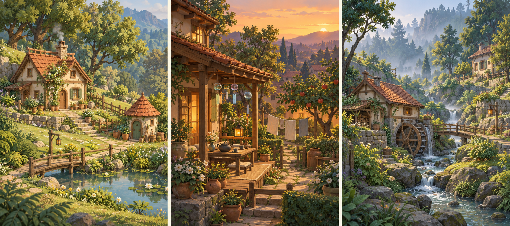
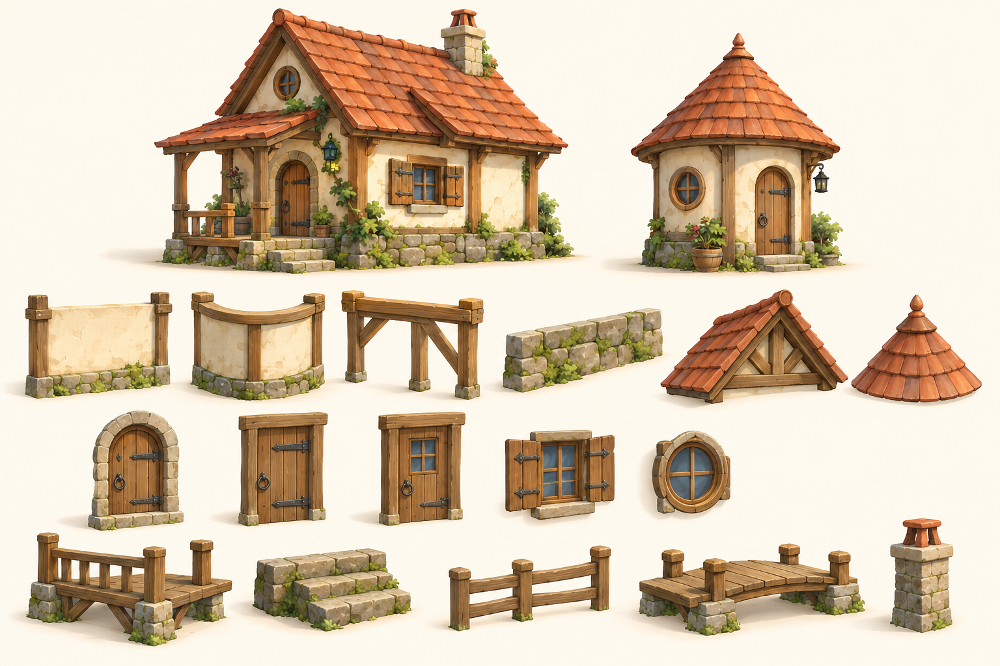
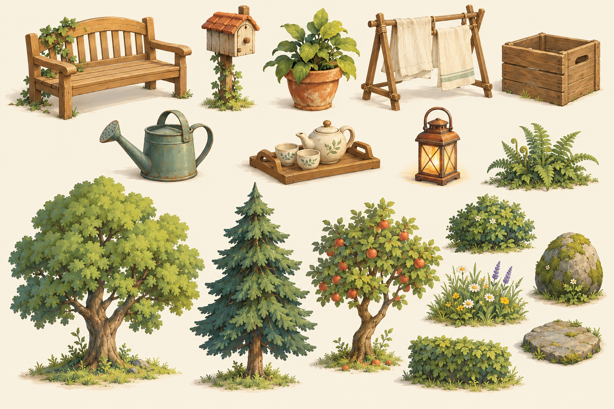

# 风栖小筑 · 产品需求文档

**Windhaven Diorama / 设计稿 v0.1 / 2026-10-17**

> 在一小片森林里，随手画出一座屋子，让风、草木与生活的痕迹，把它变成想住进去的地方。

本文将用户提出的“吉卜力风格、玩法与画风类似《林间小世界 / Tiny Glade》”落成一个原创的、可供小团队启动原型的游戏方案。交付包括产品设计、系统规则、美术规范、四张概念图、场景方案和逐项资源清单。所有功能、预算与工期均为**待验证的设计目标**；设计启动时项目目录为空，未发现游戏代码、引擎配置或既有美术。本文和概念图不代表功能已经实现。

| 项目 | 决策 |
| --- | --- |
| 暂定名称 | 风栖小筑 / Windhaven Diorama，名称在立项前另行检索 |
| 类型 | 单人、离线、3D、无网格微缩庭园建造沙盒 |
| 核心体验 | 自由塑形 → 系统补细节 → 布置生活 → 调光赏景 → 拍照与继续修改 |
| 玩家 | 喜欢治愈建造、庭院布置、动画场景与截图分享的玩家；不要求建筑知识 |
| 使用场景 | 一次 15–40 分钟；也允许打开几分钟，只添一盏灯或调整一棵树 |
| 平台假设 | PC 鼠标键盘优先，Windows 首发目标；macOS 在原型验证后决定同步支持 |
| 产品形态 | 建议买断、内容完整；定价与发行预算不在本轮确定 |
| 开发假设 | 3–5 人独立团队，先做 12 周可玩切片，再决定完整产品范围 |
| 引擎 | 未选定；Godot 4.x 可列入候选，需先验证运行时建筑生成、渲染与导出，不先承诺平台性能 |

## 1. 产品定位与参考边界

### 1.1 我们要交付的感受

玩家拖出体块时，就已经像一座好看的房子；把石径画到墙边时，门自然出现；地面升起时，房脚长出合适的基座。随后玩家用盆栽、晾衣、茶具和暖灯，把“建筑”变成“某个人正在生活的地方”。作品可以随时改变，系统负责把变化收拾得妥帖。

《Tiny Glade》的官方介绍明确包含无网格建造、程序化细节、路径与门的联动，以及无经营、战斗和失败压力的定位。本项目借鉴这些体验原则，进一步把主题转向山野木屋、庭院生活和风吹草木的日常感。[参考：Tiny Glade 官方商店介绍](https://store.steampowered.com/app/2198150/Tiny_Glade/)（查阅：2026-10-17）。后文均为本项目设计提案，不是对参考游戏功能的继续转述。

### 1.2 四个设计支柱

| 支柱 | 产品约束 | 玩家看得见的结果 |
| --- | --- | --- |
| 一笔就好看 | 先给可靠默认值，再允许精调 | 拉体块即有屋顶、收边、基座；无需先搭脚手架 |
| 细节会回应 | 修改只影响附近，且反应有因果 | 路径接近外墙生成门；坡地改变基座；风推动叶片和布 |
| 生活小于叙事 | 用物件暗示生活，不强迫任务 | 门口有信箱，廊下有茶，黄昏有灯；没有必须照顾的人物 |
| 留白也是作品 | 克制信息与装饰密度 | 草地、阴影和空地保留呼吸感；不靠铺满物件才显得完成 |

### 1.3 原创识别点

| 方向 | 本作的具体选择 | 首版实现边界 |
| --- | --- | --- |
| 建筑语汇 | 苔石基座、奶油灰泥、蜂蜜木构、赤陶瓦、轻微不规则的宽檐 | 一套统一建筑语言，不同时制作多种文明风格 |
| “风”可被看见 | 统一风向下，树冠、草、晾布以不同节奏摆动 | 一套全场风参数；风铃联动声音放到 P1 |
| “岁月”可被拨动 | 同一庭园从整洁新居变为略有苔痕的旧居 | 新居 / 岁月两档外观，切换基础材质参数；藤蔓生长为 P1 |
| 生活构图 | 八类日常道具围绕门口、廊下、池边形成生活角落 | 玩家放置；提供位置提示，不自动替玩家塞满物品 |
| 作品表达 | 只改变风、光线和岁月，就能拍出不同心境 | 日间 / 黄昏、风量、取景；雨雾和四季为 P2 |

“吉卜力风格”在本项目内拆解为手绘色块、温暖自然光、被使用过的材料、克制的奇想和普通生活的美感。角色、地标、故事、标识和具体镜头采用原创设计。美术审核按这些可执行特征评估。

## 2. 玩家需求与成功标准

| 玩家需求 | 对应设计 | 原型验证目标 |
| --- | --- | --- |
| 我不会建模，也想造一间漂亮小屋 | 少工具、参数护栏、自动屋顶与门窗 | 10 名首次体验者中至少 8 名在 3 分钟内独立完成“有门、有屋顶、有路径”的小屋 |
| 我想放松，不想算产能 | 所有首版物件可直接使用，无货币、饥饿和任务倒计时 | 10 人中至少 8 人不需要解释即可理解“随意搭建，无需经营” |
| 改完之后别把我之前摆的东西弄乱 | 手动优先、局部重算、稳定种子、可撤销 | 核心编辑回归用例中，未受影响区域的对象 ID 与摆放不变 |
| 想拍到像动画背景一样的画面 | 有限而统一的材质、取景、两档光线、隐藏 UI | 15 分钟内至少 7/10 人主动保存一张自己满意的截图 |
| 小场景也值得反复摆弄 | 风、光线、材质岁月与生活布置互相组合 | 访谈记录至少两种自发修改动机；不以数值留存代替体验判断 |

以上为设计验收门槛，**不是已获得的测试结果**。邀请无建模经验者参与；记录完成时间、误操作、求助次数及截图，避免只向熟悉设计工具的成员测试。

## 3. 玩法结构

### 3.1 核心循环

**选一块空地 → 拖一间小屋 → 画路与池塘 → 种树和摆物 → 调整风与黄昏 → 拍照 → 回到作品继续改。**

即时奖励来自“系统懂了我想画什么”的小惊喜，长期动机来自作品表达与构图探索。首版不设计解锁科技树、收集货币、强制每日任务或完成度分数。

### 3.2 第一段 15 分钟体验脚本

| 时间 | 玩家动作 | 系统回应 | 体验目的 |
| --- | --- | --- | --- |
| 0:00–0:30 | 进入“林间坡地”，拖动视角 | 草叶轻动、自然声起，底栏只突出“小屋” | 先建立安静的空间感 |
| 0:30–3:00 | 拖出矩形小屋，抬高檐口 | 屋顶、基座与屋檐自动适配，预览即成品 | 第一次动作就得到值得保留的东西 |
| 3:00–5:00 | 把石径画到外墙，放一扇窗 | 临路位置出现门；窗吸附可用墙面 | 发现建造规则，而非阅读说明书 |
| 5:00–8:00 | 用植被笔刷种一小片蕨和野花 | 同种植物出现尺度、朝向变化，自动避让入口 | 从“搭完房子”转向“构图” |
| 8:00–11:00 | 放长凳、茶盘、灯；画浅池与桥 | 接地吸附、提灯柔光，桥连接两岸 | 塑造生活痕迹与视觉焦点 |
| 11:00–13:00 | 调成黄昏、拨大一点风 | 窗光变暖，草木晾布响应；屋顶轮廓仍清晰 | 让同一作品出现另一种情绪 |
| 13:00–15:00 | 进入取景模式，保存照片 | UI 隐藏、保存构图和图片，回到编辑时位置不变 | 形成一个小而完整的创作闭环 |

教程仅在首次操作提供一句话提示；可全部跳过，不锁工具、不要求完成目标。空白地块和示范模板都能进入；示范模板直接可编辑。

### 3.3 自由度与体量

- 单地块外观范围约 64 × 64 m，可编辑核心区域约 48 × 48 m；外围树幕负责收景，不扩展成开放世界。
- 建筑是可从外部观赏的实体。MVP 支持矩形与圆形体块、连续高度、有限贴靠组合；不做可进入室内和楼层家具。
- 默认尺寸控制在小屋尺度：矩形边长 3–12 m，圆形半径 1.5–6 m，檐高 2.4–7.2 m；高度表达约一到两层，窗的位置随外墙变化。
- 连续绘制与调整，不暴露网格；可选 0.25 m 吸附仅作辅助。约束用于保证结构可生成，轮廓和取景保留自由度。
- 一切核心工具从进入场景就可用；容量接近预算时显示温和提示，继续编辑前可主动降低植被密度。

## 4. 功能范围与优先级

**MVP** 指本轮 12 周切片必须证明的完整体验；**P1** 指切片通过后优先扩充；**P2** 指更远期方向，不进入首轮承诺。清单中的优先级也按此定义。

| 系统 | MVP：P0 | P1 | P2 |
| --- | --- | --- | --- |
| 地块与地形 | 林间坡地，升降 / 平滑 / 恢复，有限坡高 | 地块尺寸与更多地表笔刷 | 溪谷地貌、梯田、洞口等另立技术验证 |
| 建筑 | 矩形 / 圆形体块，山墙 / 圆锥顶，连续檐高，石基与木构收边、短石阶、木围栏 | 更丰富组合规则、露台雨棚、烟囱与屋顶形式 | 自由屋顶编辑、复杂建筑群 |
| 门窗 | 3 门、2 窗；门随路生成，可手工调整与锁定 | 花窗、挑窗、门口生活组合 | 大规模风格包 |
| 路径与水 | 石径、单一水平浅池、短直木桥 | 更多路面与桥型 | 连续溪流、水车演出；不默认做真实流体 |
| 植被 | 3 树、4 灌草、2 岩石；刷植、擦除、密度控制 | 藤蔓、垂挂植物、花色扩展 | 季节替换与更丰富群落 |
| 日常道具 | 八类生活道具，移动 / 旋转 / 缩放 / 复制 | 风铃、静态睡猫、更多庭院小景 | 更丰富环境生物与互动演出 |
| 环境 | 日间 / 黄昏，风量，新居 / 岁月外观；草木晾布轻摆、基础水波 | 烟囱炊烟、风铃声随风、程序小鸟、更多光线 | 雨、雾、季节、溪流演出 |
| 编辑保障 | 撤销重做、删选、复制、局部重算、恢复默认 | 可复用组合、框选、作品模板库 | 更深参数编辑 |
| 保存与摄影 | 本地多存档、自动保存、1080p / 2K 截图、构图保存 | 高分辨率截图、更多相机参数 | 游戏内作品社区、云同步、创意工坊需单独立项 |
| 输入与 UI | 鼠标键盘、快捷键可修改、UI 缩放、减少动态 | 手柄与完整本地化 | 移动端 / 主机另外评估 |

明确不进入 MVP：资源采集、经营生产链、居民 AI、战斗、生存、多人联机、室内装修、真实结构受力、真实流体、完整四季、账号、在线社区和付费商城。

## 5. 建造系统详细规则

### 5.1 通用编辑原则

1. **编辑基础参数，生成可视结果。** 地块种子、体块轮廓、路径、实例位置和手动覆盖是可保存的源数据；瓦片、基座拼片等是可重建结果。
2. **手工优先于自动。** 手放门窗、道具和植被不会被装饰算法悄悄替换；自动实例带来源标签。
3. **预览即时，重建局部。** 拖动时显示简化但不闪烁的预览；松手后完成附近细节。单次拖动只记为一次撤销。
4. **随机可复现。** 每个对象有稳定 ID 与独立种子；移动一扇窗不让整片森林重新洗牌。
5. **错误容易恢复。** 删除有撤销；覆盖存档需明确选择；生成失败保留上一个合法结果并提示“可在这里贴靠”。

建筑移动、扩缩或改高若会吞入已有手放道具、使锁定门窗失去合法墙面，或侵入池域安全边界，本次操作不提交：保留原态，高亮冲突对象，并提示先移动物件、解锁开口或调整池岸。系统不为完成这笔编辑而移动、隐藏或删除手工内容。主动删除父建筑是明确例外，按待附着流程处理。

### 5.2 体块、屋顶与组合

| 输入 / 条件 | 生成规则 | 约束与反馈 |
| --- | --- | --- |
| 拖动矩形底面 | 生成矩形墙体、山墙顶、墙角木构、基座 | 默认 5 × 6 m、檐高 3 m；比例变化时屋顶坡度保持在美术范围内 |
| 拖动圆形底面 | 生成圆墙与圆锥顶 | 默认半径 2.2 m；门窗沿圆周分布，不强行拼接平直窗框 |
| 拉高或压低檐口 | 墙体、柱、窗位置与屋顶同步调整 | 不把门拉伸成高门；开口使用标准尺寸并重排 |
| 同朝向矩形侧面贴靠 | 保留两个可编辑体块，隐藏接触面，生成收边 | MVP 只保证侧面贴靠；默认屋顶错落，避免需要任意屋面布尔切割 |
| 任意体块穿插、跨体块叠放 | 提供最近合法贴靠位置的预览 | MVP 不支持任意并集或任意悬挑；松手不破坏已有作品 |
| 圆形靠近矩形 / 圆形 | 支持相切与小间距布局 | 保持独立屋顶与基座；复杂连廊为后续内容 |
| 删除体块 | 删除其自动墙顶基座；手放道具保留 | 手放门窗保存变换与参数，清空活动父引用，进入“待重新附着”列表；可重新放置或一键撤销，避免静默丢失 |

建筑限制是首版范围选择，不应宣传为已具备 Tiny Glade 同等程度的结构组合能力。首轮技术验证必须优先证明“画体块、改高度、贴靠、改坡地”四件事在目标镜头下自然可信。

### 5.3 路径 × 门窗

| 条件 | 规则 | 删除 / 冲突策略 |
| --- | --- | --- |
| 路径端点在外墙 0.6 m 内，地面与入口高差 ≤0.45 m | 在最近合法墙段创建一扇自动门并接通小段入口 | 窗框、墙角保留最小边距；候选位置不可用则只预览，不挤掉手放窗 |
| 路径穿过实心房屋 | 在首次接触外墙处结束可见路面，生成入口 | 不生成穿过室内的可见走廊；远端路径仍可作为外侧独立段保留 |
| 多条路径请求同一段墙 | 门间距不足 1.2 m 时复用最近门 | 不反复生成相邻小门；新建顺序不改变已锁定的门 |
| 外墙已有手放门 | 优先接入手放门 | 自动门退让；手放内容不被删除 |
| 删除供门的最后一段路径 | 自动门延迟到本次编辑提交时移除 | 玩家已手动编辑或锁定的门转为手工门并保留 |
| 入口高差 >0.45 m | 显示短石阶建议与入口高度提示 | 短阶支持0.15–0.9 m高差；更高时调整地形，不自动刷出多层楼梯 |
| 手放窗与门重叠 | 显示最近可用位置的吸附预览 | 保留先前状态，可关闭吸附；仍不允许开口彼此穿插 |

### 5.4 地形 × 建筑 × 道具

| 条件 | 规则 | 验收要点 |
| --- | --- | --- |
| 建筑底面位于坡地 | 从水平室内地坪向下生成石基，必要处加木柱视觉支撑 | 不悬空、不把整栋房屋沿坡倾斜 |
| 地形在建筑下面升高 | 固定建筑地坪；限制地形穿入地板与入口净空 | 刷子预览显示受保护范围；不跳动地坪 |
| 地形降低 | 基座向下延伸，局部岩石重新接地 | 若会超过 3 m 可见基座高度，本次整笔地形操作不提交，保留旧地形与基座并提示降屋或缓坡；MVP 不生成巨塔支撑 |
| 地形改变已摆道具的支撑面 | 地面物件跟随接地高度，保持 XZ 位置和旋转 | 手放高度锁定时不跟随；落点无效则标记而不删除 |
| 门口 / 桥头 / 台阶落脚处刷植被 | 自动草簇避让约 0.5 m 通行带 | 手放植物允许玩家自行调整，不被系统擦除 |
| 撤销一笔地形 | 恢复地形源数据及受影响依附关系 | 邻近路径、基座和植被一起回到编辑前状态 |

### 5.5 水体 × 路径 × 桥

MVP 每地块只有一个可编辑浅池域，多次绘制用于修改同一闭合岸线。首次画池取落笔中心地面高度减 0.15 m 为水位，此后水位固定；仅接受候选池域原地面高差不超过 0.6 m 的区域。最窄水域为 2 m，池底约低于水面 0.45 m，沿岸约 0.75 m 过渡到至少高于水面 0.1 m 的岸面。池域和岸带是可撤销的派生地形层，删除池塘后恢复玩家地形。

普通地形刷不改变池底与岸带，预览显示其保护范围；岸线由池塘工具修改。改岸会产生漫溢、悬水、穿建筑、吞入手放道具，或超出可编辑边界时，本笔池岸修改不提交并保留上一合法结果。建筑放置、平移和扩缩也检查同一池域安全边界（池岸外再留 0.5 m）；两个方向使用同一校验器。水面为浅层视觉，不模拟水量、河速、侵蚀或水位互通。上述尺寸经池塘样板验证后可整体调整。

| 条件 | 规则 | 边界处理 |
| --- | --- | --- |
| 绘制池塘 | 按首次采样固定水位，生成派生池底与岸带 | 池域至少距可编辑边界 2 m；最窄水域 2 m；无合法轮廓时不提交 |
| 路径经过水面 | 路径在两岸止步，提供木桥预览 | 玩家确认放桥才改变结果，避免一笔路生成大量桥 |
| 两岸距离 1.5–6 m，桥头高差 ≤0.5 m | 短直木桥沿连线伸缩，桥面略高于水面 | 连续拖动桥头，预览可通行宽度；不做弧桥或多跨桥 |
| 超出长度 / 高差范围 | 保留原桥，显示可连接范围 | 引导改岸线或改地形；不生成急坡桥 |
| 池岸改动使桥失效 | 桥保留并标记“调整桥头”，关掉无效吸附 | 不静默移除；一次撤销同时恢复岸线与桥状态 |
| 画池碰建筑，或建筑移动 / 扩缩碰池 | 共用池岸外 0.5 m 安全边界；冲突编辑不提交并标出原因 | 手放道具同样受保护；MVP 不做水下建筑与水上房屋，水车场景为 P2 |

### 5.6 自动装饰与重算顺序

重算依赖顺序为：**地形 / 池岸 → 建筑支撑与外壳 → 路径桥头 → 门窗 → 自动草木与材质细节 → 光影与 FX**。同一次编辑将依赖变化合并提交，避免门和草来回闪烁。

自动内容仅包括基座拼片、木构收边、少量墙脚苔色、植被笔刷的随机实例和连接处碎石。日常道具全部由玩家放置。自动细节可调密度；随机结果锁定在对象 ID 上；未受影响对象不重生成。P1 才增加藤蔓锚点、生活组合预设和更丰富的边角装饰。

**自动生成时的排序：手工锁定 → 建筑轮廓 / 通行净空 → 手工未锁定 → 自动门窗 → 自动装饰。** 这个排序只决定自动结果如何避让；新编辑若与已有手工内容或水域结构冲突，按第 5.1 节保留原态。手工未锁定也不会为了自动装饰而被移动。锁定不代表允许结构穿模。

## 6. 庭园、道具与自然回应

### 6.1 植被工具

点击放单株；拖动刷成小片；滚轮调半径；按住擦除键只移除当前类别。树、灌草、岩石使用不同密度与间距，不允许一个大笔刷瞬间塞满高树。相同植被通过尺寸、朝向、色相的小幅变化形成自然感，而非每棵都独立建模。

默认随机范围建议：树尺度 0.85–1.15，灌草 0.75–1.25，水平旋转 0–360°，色相变化保持在同一调色板。手动单株可锁定参数。数值需经艺术原型调整，以不显重复、不破坏轮廓为准。

### 6.2 首版八类生活道具

| 道具 | 建议摆放 | 可见故事 | 最小交互 |
| --- | --- | --- | --- |
| 木长凳 | 门口、树荫或池边 | 有人会在这里停留 | 接地、转向、复制 |
| 信箱 | 石径与院门交接处 | 房子与外界有联系 | 放置、转向 |
| 陶盆栽 | 门槛两侧、廊下 | 有人在照顾植物 | 接地或吸附廊面 |
| 晾衣架（含布） | 房侧空地 | 日常生活正在发生 | 放置；布随风轻动，可减少动态 |
| 木箱 | 墙角、廊下 | 储物与使用痕迹 | 放置、复制、有限缩放 |
| 浇水壶 | 盆栽旁、矮台边 | 刚结束的一次照料 | 放置、转向 |
| 茶盘茶具组合 | 长凳旁或廊面 | 一个安静的下午 | 整组放置；不拆成独立室内物件系统 |
| 可点亮提灯 | 门边、凳旁、桥头 | 黄昏仍然温暖 | 开 / 关 / 随光线自动亮；发光与局部照明分开控制 |

### 6.3 环境控制

- **日间 / 黄昏：** 两组经过构图校准的光照预设，短暂平滑过渡；窗光和自动提灯根据预设联动，不做 24 小时生存昼夜。
- **风量：** 0–1 连续参数，所有植物共享风向与低频节奏，不同材质有不同摆幅；0 为静止。截图可冻结动态。
- **新居 / 岁月：** 全场两档材质参数控制苔色、灰泥污痕和木色；不是随在线时长增长，也不需要维护修理。
- **声音：** 森林底噪、叶声、轻水声、木石摆放声；独立音量与静音。默认留白，不让每个道具都持续发声。
- **生物：** 首版不依赖生物。P1 可做静态睡猫与程序小鸟点缀；不做路径寻找、饥饿或领养系统。

## 7. 操作与界面

### 7.1 桌面默认输入

| 操作 | 默认输入 | 说明 |
| --- | --- | --- |
| 选择 / 放置 / 绘制 | 鼠标左键 / 拖动 | 拖动中的预览与完成结果保持一致 |
| 平移相机 | 鼠标中键拖动 | 提供无中键替代绑定 |
| 环绕相机 | 鼠标右键拖动 | 不与删除共用；释放后不弹出多余菜单 |
| 缩放相机 | 滚轮 | 对准光标附近缩放，限制穿入地面 |
| 调整笔刷尺寸 | 调整键 + 滚轮 | 配合屏幕直径预览，可重绑 |
| 旋转物件 | Q / E；拖旋转手柄 | 常规 15° 步进，精细键连续调整 |
| 临时关闭吸附 | Alt | 界面显示当前状态 |
| 删除 / 撤销 / 重做 | Delete / Ctrl或Cmd+Z / Ctrl或Cmd+Shift+Z | 删除支持撤销；文本输入框内不触发场景操作 |
| 复制 | Ctrl或Cmd+D | 保留可编辑参数、创建新 ID 与种子 |
| 取消预览 | Esc | 第一次取消工具动作，第二次返回选择工具 |
| 取景模式 | P | UI 中同时提供清晰按钮 |

输入方案在原型中验证；快捷键都能改，鼠标悬停提供说明，不能仅靠键盘提示完成流程。

### 7.2 界面布局草案

```text
┌──────────────────────────────────────────────────────────────┐
│ 风栖小筑 · 林间坡地     保存状态             撤销 重做  设置 │
│                                                              │
│                   尽量完整的庭园视野                         │
│                                                              │
│                                             轻量属性卡       │
│                                             屋顶 / 木色      │
│                                             高度 / 锁定      │
│                                                              │
│              小屋  道路  池水  草木  生活  氛围      [取景] │
│         当前工具缩略图 + 一句操作提示；不常用参数按需展开    │
└──────────────────────────────────────────────────────────────┘
```

工具栏常驻六类工具，当前类展开小图卡。选中对象才出现属性卡，空地点击收起。颜色来自实际材质样片；图标需要同时有文字。摄影模式可以完全隐藏 UI，不残留编辑轮廓。

界面采用暖米色半透明面板、深墨绿文字和少量琥珀选中态。正文与图标对比清晰，支持 100%–150% UI 缩放、减少动态、关闭景深、相机灵敏度和反向设置。音效或颜色都不是唯一反馈渠道。

## 8. 美术方向与概念图

### 8.1 视觉目标

**远看是会想走进去的手绘背景，近看是能理解如何搭出来的微缩模型。** 保留 3D 场景的连续转动和可编辑性，使用简化形体与笔触色块建立动画质感。

| 维度 | 规范 | 审核问题 |
| --- | --- | --- |
| 形体 | 大轮廓圆润但有结构；屋顶略不对称；边角轻倒角 | 缩到 25% 时是否能区分主屋、树和路？ |
| 比例 | 小屋低矮、檐口宽、门窗略放大；道具适度夸张以便俯视辨认 | 不放人物时，尺度是否仍一致？ |
| 颜色 | 低饱和底色，暖屋冷林；亮色控制在局部 | 是否把所有叶片都染成同一种荧光绿？ |
| 材质 | 以大色块和局部手绘变化区分灰泥、木、瓦、苔石 | 缩远后是否仍可辨材质，而非只剩噪点？ |
| 光 | 柔软阴影、叶隙光感、保留暗部颜色 | 黄昏屋顶和入口是否仍可读？ |
| 描边 | 默认不用全场黑轮廓；必要时用局部色边强调结构 | 轮廓是否过硬，像贴纸堆叠？ |
| 动态 | 低频、轻幅度，允许静止 | 是否存在所有草叶同相摆动的机械感？ |
| 镜头 | 默认俯角约 35°，中等透视；不依赖强景深掩盖画面 | 关闭景深后是否仍然成立？ |

建议基准色：奶油灰泥 `#E9DEC5`、鼠尾草 `#899B71`、深林 `#405D4C`、赤陶 `#B66F52`、蜂蜜木 `#AA8055`、苔石 `#92988B`、池水 `#709B9A`、灯光 `#F2C878`。色值用于统一沟通，不作为所有光照下的最终屏幕像素标准。

### 8.2 C01 · 主视觉：林间的一间家


用途：对齐整体气质、默认镜头和视觉目标。主屋为矩形山墙顶，圆形小屋体现第二种体块；石径、静水池、短木桥和八类生活道具属于 MVP，复杂连接与攀附装饰按后文范围对照处理。树幕只框住庭园，不要求制作可自由漫游的远山森林。

审核重点：主屋是否清晰；屋顶是否有稳定的大色块；路径是否通往入口；池水是否形成第二视觉焦点；留白是否足够。图像是美术目标，不要求首版逐像素复现。

### 8.3 C02 · 三场景方向板



从左到右依次为首版林间坡地、P1 风铃茶庭、P2 溪谷水车。三者共享灰泥、蜂蜜木、赤陶瓦和苔石语言。中右画面的新道具与新地貌不能因进入概念图而自动进入 MVP。

### 8.4 C03 · 建筑套件方向板



用于指导轮廓、材料和模块接缝。上方组合体是复用示范，不额外计为整栋建筑模型。墙、屋顶和基座需要适配可变尺寸；不应把图里的每一块墙都做成只能固定尺寸摆放的静态房屋。具体建模件数以资源清单为准。

### 8.5 C04 · 生活道具与自然套件



用于校准道具辨识度、俯视尺度与植被密度。茶具作为一组交付，晾布与晾衣架作为同一资产族的子件；植被要能用少量源模型产生可控变化。概念图不是透明切图、贴图图集或最终游戏模型。

**图示与首版范围对照：** C01/C03 中的攀墙藤、炊烟烟囱、复杂廊檐、连廊与露台是美术方向探索，对应 P1 或更远期组合能力。MVP 用独立或侧面贴靠的简单体块、普通石基与短石阶完成近似构图。C04 道具上的攀附叶可在首版移除；基础物件不依赖藤蔓生成器。图中出现不等于首版已承诺制作。

完整生成提示词与工具记录见 [概念图生成记录](art/prompts/concept_prompts.md)。四张图由内置图像生成工具新生成；最终美术应经过建模、材质、接缝、镜头与性能检验。

## 9. 场景设计方案

### 9.1 SCN-01 · 林间坡地 / MVP

**体验词：第一次拥有自己的小屋。**

一片约 64 × 64 m 的林间空地，中心可编辑区域约 48 × 48 m。地面缓坡从后高向前低，初始高差约 2 m；后侧树幕遮住边界，左侧留出日光入口，前景用低草和扁石避免遮挡。默认空白地块只放少量外围植被，示范版则复用相同资产搭好小屋庭园。

示范构图：主屋在中后景，入口朝前偏左；石径从前景弯向门口；浅池和短木桥在前右；左侧树下放凳与茶盘；晾衣位于房侧而非堵门；提灯连接入口与池边。玩家可拆改所有核心区内容。

| 项目 | 配置 |
| --- | --- |
| 地貌 | 缓坡草地、两处低岩、一个可编辑浅池 |
| 建筑 | 一栋矩形主屋 + 一栋圆形小屋；示范体块均可编辑 |
| 植被 | 阔叶、针叶、果树，蕨 / 低灌 / 野花 / 绿篱，苔石与扁石 |
| 道具 | 八类 MVP 道具各至少展示一次，但留有空地 |
| 光线 | 日间为默认，黄昏作为第二种构图 |
| 功能验证 | 画屋、路径门、坡地基座、池桥、摆物、保存与拍照全流程 |
| 资源复用 | 除地块模板外不增加独立整屋模型或“场景专用树” |

### 9.2 SCN-02 · 风铃茶庭 / P1

**体验词：风吹过，有人在这里喝过茶。**

复用坡地地貌，把空间收紧为小院。主屋廊下、矮篱、果树和晾布构成围合；通过茶桌、风铃和少量垂挂植物建立新主题。中心留一块不铺满的草地；黄昏灯窗与廊檐构成框景。无需引入新地形算法或居民系统。

新增重点是风铃模型与声音联动、廊架变化、茶桌和垂挂植物；睡猫可以作为静态小景。先验证物件组合可读，再考虑增加动画。该模板不能成为制作大量重复茶具模型的理由。

### 9.3 SCN-03 · 溪谷水车 / P2

**体验词：被森林慢慢包围的旧磨坊。**

前景短木桥跨过窄溪，水车贴着矮屋侧墙，后景以苔石挡墙形成两级高差。低饱和晨光和薄雾把视线收在屋顶与水车轮廓上。溪流采用可控视觉演出优先，不把真实水动力作为效果前提。

需要单独验证溪流路径、水面拼接、岸线过渡、水车转动与水声位置。新增的水车、挡墙、溪岸石、晨雾和新地貌均是 P2；在本次切片中只交付设计与概念方向。

### 9.4 场景统一验收

三个模板都必须能回到源数据编辑；同套木、瓦、灰泥在不同光线下保持身份；入口和路径在默认镜头下清晰；前景不以高树遮挡工具操作；关闭 FX 后场景仍成立。场景模板是已有资源的摆放与参数集合，不是新增一套完整资产包。

## 10. 美术生产规范

### 10.1 坐标、模块和命名

- 建议 1 单位 = 1 m；整套资产采用统一向上轴与导出转换约定，选引擎后锁定并提供测试样件。
- 门建议净宽约 1 m、高约 2 m；层高参考 3 m；栏杆约 0.8–1 m。固定道具的尺度以门和长凳作为基准。
- 建筑模块原点在底部连接基准；单株植被与生活道具原点在接地中心；桥使用两端连接标记，门窗使用墙面附着标记。
- 文件使用 `snake_case`，示例 `prop_watering_can_a.glb`、`mat_plaster_warm`、`tree_broadleaf_a`；资源表的 `asset_id` 在源文件备注与导出登记中保留。
- 源模型、导出模型、贴图与引擎装配资源分层保存；建议后续使用 `art_source/` 与引擎内 `assets/`。本轮文档和概念图仅放在 `docs/`，避免误作运行时资产。

### 10.2 建议预算（原型后修订）

| 类别 | 建议 LOD0 三角形预算 | 贴图 / 材质策略 | 验收重点 |
| --- | --- | --- | --- |
| 可变建筑生成结果 | 单个体块约 3k–10k，不含独立道具 | 木 / 灰泥 / 瓦 / 石共享材质库；瓦片远景转简化表现 | 极小极大尺寸均无明显裂缝、拉伸和悬空 |
| 独立小道具 | 100–2,500；茶盘组合可到 2.6k | 同类共享图集，默认 512–1k 源贴图 | 俯视可认，轮廓不靠法线贴图才能成立 |
| 树 | 每株 1.5k–4k，至少一个简化层级 | 共用叶片图集，控制透明层叠；树干独立木色 | 远近切换不跳大轮廓，风动不脱枝 |
| 灌草 | 每簇 50–500 | 共享图集，可用裁切；尽量减少全透明叠层 | 密度上去后仍有留白，不闪烁 |
| 岩石 | 100–1k | 石材共享，局部苔色通过遮罩或色参数 | 接地自然，底面不露明显空洞 |
| 环境 FX | 按屏幕覆盖与透明叠层评估，不只数粒子 | 烟、叶、水波分别可关闭 | 黄昏不泛白；在默认视角不过度抢注意力 |
| UI | 图标 64/128 px 源规格，文字独立渲染 | 图标可矢量源；字体确认中文与授权 | 100% 和 150% 缩放都清晰 |

贴图以 Base Color 的手绘变化为主，法线和粗糙度适度使用；避免为每个同类道具建立独立 2K 材质。建议单个可见场景不超过约 16 组主材质，具体合批与显存预算以引擎原型测量为准。概念图中的复杂笔触不直接等于需要同等密度的模型。

### 10.3 交付与验收流程

**灰模尺寸 → 套件轮廓 → 基础材质 → 默认镜头验证 → 交互生成测试 → LOD / 导出 → 场景验收。**

每个资源要有可编辑源文件、可导入导出件、命名和原点记录、必要贴图与使用说明。先完成“一个体块 + 一扇门 + 一株树 + 一组道具”的样板，锁定比例、光线和材质再批量生产。程序生成器还必须交付参数范围、种子行为、异常边界与示例。

共用验收：无缺失纹理、无负缩放残留、无意外背面、接缝稳定、接地正确；不同光线下颜色统一；目标镜头可辨；LOD 不破坏轮廓；UI 与字体授权登记完整。概念阶段记录为“待制作”，不把一张方向板记为模型完成。

## 11. 资源清单与统计口径

逐项资源清单完整收录于本文附录，也单独提供 [asset_manifest.csv](art/asset_manifest.csv)，可直接用于排期与外包拆单。CSV 使用 UTF-8 BOM，方便中文表格软件打开。

| 字段 | 定义 |
| --- | --- |
| `asset_id` | 稳定唯一资源 ID，需求、源文件与导出件可互相追踪 |
| `category` / `name_zh` | 分类与中文资产族名称 |
| `priority` / `mvp` | P0/P1/P2；是否属于首版切片 |
| `quantity` | 独立基础交付单元数；生成器的一套逻辑算一件，不是它生成的墙砖数 |
| `variant_count` | 在基础交付之外计划制作的额外变体；不计随机摆放和程序化组合结果 |
| `production_type` | 程序化生成器、手工模型、材质、贴图、FX、UI、动画或场景模板 |
| `scene_usage` | 场景使用关系；跨场景表示共享，不重复计数 |
| `technical_spec` | 尺寸、预算、参数或接口要求，均为前期建议 |
| `dependency` | 依赖 ID 或约定；需按依赖先完成共用样板 |
| `acceptance_criteria` | 单资源验收条件 |
| `status` | 当前制作状态，本轮均为待制作 |

资源表统计的是**资产族与基础交付单元**，不能把生成器、模型、UI 套件、场景模板简单相加后称作“模型数量”。文档自带的四张概念图属于前期设计交付，不算已完成运行时资产。变体、人天与导出文件数量也不能互相替代。

<!-- ASSET_SUMMARY_START -->
当前规划 **87 个资产族，其中 MVP 47 个、P1 27 个、P2 13 个**。基础交付单元合计 121，额外变体 32；MVP 基础交付单元 79，额外变体 0。所有游戏内资源状态为“待制作”。

其中明确标记为“手工模型”的基础交付件为 36 个，MVP 为 21 个；动画包中的小鸟模型等按组合包验收，不应将此数字作为全部三维源文件数量。四张概念图已生成，另计为前期美术设计附件。

| 类别 | 资产族 | MVP 族 | 基础交付单元 | 额外变体 |
| --- | ---: | ---: | ---: | ---: |
| 地形水体路径 | 9 | 4 | 9 | 0 |
| 建筑模块 | 19 | 12 | 19 | 2 |
| 自然植被 | 15 | 10 | 15 | 8 |
| 生活道具 | 16 | 8 | 16 | 9 |
| 材质贴图 | 6 | 4 | 9 | 4 |
| 光照FX动画 | 10 | 3 | 10 | 7 |
| 场景模板 | 3 | 1 | 3 | 0 |
| UI | 9 | 5 | 40 | 2 |
| **合计** | **87** | **47** | **121** | **32** |
<!-- ASSET_SUMMARY_END -->

## 12. 音频需求

音频与美术表分开管理，以避免模型数量混入声音交付。首版建议下列素材族；均需可商用来源与授权记录。

| 编号 | 声音族 | 最小交付 | 规则 |
| --- | --- | --- | --- |
| AUD-01 | 林间环境 | 1 条可无缝循环立体声底噪 | 不依赖高音量营造氛围，不含持续抢耳鸟叫 |
| AUD-02 | 叶与风 | 2 档风层，可平滑混合 | 随风量变化，风为零时仍保留必要环境底噪 |
| AUD-03 | 浅池水声 | 1 条低强度局部循环 | 只在池边明显，不制作河流急水效果 |
| AUD-04 | 木 / 石 / 草摆放与删除 | 每类 3 个短变体，共 9 个 | 拖动笔刷限频，不每帧触发 |
| AUD-05 | UI 点击、确认、撤销 | 3 个短音 | 低侵入，和世界物件声音可区分 |
| AUD-06 | 音乐 | 1 首约 2–3 分钟稀疏器乐，可选择关闭 | 大段留白，不照搬参考作品旋律；非原型阻塞项 |
| AUD-P1 | 风铃 | 一组短音与风量触发规则 | 触发限频，避免强风时持续密集响铃 |

## 13. 技术约束与存档

### 13.1 原型实现方向

地形使用有限高度场；路径与池岸保存可编辑轮廓；建筑将输入体块转为墙、屋顶、基座和附着点；草木与石材以共享资源实例化。是否用运行时网格、样条、分块或其他方式由技术样板验证，不在无引擎项目里预设完整架构。

重点先验证局部重建与稳定随机，而非做整张地图的复杂生成。后台生成若被使用，旧结果必须持续可见；编辑顺序和生成结果可复现；连续修改取消过时任务，避免晚到结果覆盖新编辑。

### 13.2 建议存档最小结构

| 数据 | 内容 | 恢复要求 |
| --- | --- | --- |
| 元信息 | 格式版本、地块 ID、标题、创建 / 修改时间、缩略图引用 | 版本不支持时给出可理解提示，不覆盖原文件 |
| 地块 | 地块种子、基础地形参数、编辑笔画 / 高度差量 | 不依赖当前随机调用次数 |
| 建筑 | 对象 ID、体块参数、位置、材质、屋顶、种子 | 重新生成结果与原存档一致 |
| 连接 | 路径 / 池岸控制点、固定水位、桥头、附着父 ID | 删除父对象时清空活动父 ID，并保留原变换和来源记录供重新附着；读取时不留下无效活动引用 |
| 实例 | 道具 / 植被资源 ID、变换、来源、手工覆盖、锁定状态 | 手放与自动实例能够区分 |
| 氛围 | 光线预设、风量、岁月档、声音偏好 | 减少动态是用户设置，可覆盖场景预设 |
| 摄影 | 相机位置、目标点、视角、构图列表 | 不因退出摄影模式丢失构图 |

MVP 至少支持 5 个命名存档，手动保存、60 秒无操作间隔后的自动保存，以及退出前保存提示。自动保存保留 3 份轮替备份；采用临时文件写完再替换的方式，模拟中断后可恢复最近有效版本。生成缓存损坏时能从源数据重建。云同步另行评估。

撤销至少覆盖最近 50 次提交操作；大笔刷或多对象动作作为一次事务。撤销历史不要求跨启动保留，但保存后的作品状态不能丢失。截图在用户可选择的本地目录输出，文件名包含作品名与时间，失败时明确提示并允许重试。

### 13.3 性能测试场景与门槛

下述是**计划中的测试预算**。验收机尚未锁定，原型阶段先记录可用开发机型号，随后选定固定基准机，避免把未知硬件上的数字写成承诺。

| 测项 | 统一压力场景 / 条件 | 暂定门槛 |
| --- | --- | --- |
| 流畅性 | 1080p 中等画质；24 建筑体块、80 树、800 灌草 / 岩石实例、120 道具、1 池、2 桥 | 目标 60 fps；测 60 秒帧时间，p95 ≤20 ms；若基准机未达标，先降密度与效果后复测 |
| 编辑响应 | 上述场景移动单体块、改门窗、刷一笔草 | 光标 / 轮廓下一帧响应；局部详细结果 p95 ≤150 ms；超过时保持旧图并显示轻量生成提示 |
| 大范围修改 | 上述场景一笔改变较大地形 | 不阻塞输入超过 100 ms；详细结果目标 500 ms 内完成，取消过时结果 |
| 加载与保存 | 同一压力存档，已完成首次资源导入 | 加载 ≤5 s，保存界面不冻结超过 100 ms；分解 CPU / 磁盘耗时 |
| 内存 | 同一压力存档，编辑 20 分钟 | 暂定进程常驻 ≤2 GB；无随撤销 / 重做无限增长趋势 |
| 稳定性 | 20 分钟混合编辑 + 50 次撤销重做 + 连续 10 次读写 | 无崩溃、无对象消失、无无效引用、无不可恢复存档 |

压力场景为了验证容量，不表示默认示范场景应该堆到这个密度。首轮报告保留原始帧时间、硬件、画质与操作脚本，才能比较优化前后效果。

## 14. 验收用例

| 编号 | 操作 / 前提 | 必须得到的结果 |
| --- | --- | --- |
| AC-01 | 新地块拖出矩形 / 圆形小屋，各改三次大小和高度 | 墙、顶、基座连续更新；无明显裂缝；门尺寸不拉伸 |
| AC-02 | 路径接墙、删路、重新画路、锁门后再删路 | 自动门按规则出现 / 移除；锁门保留；全程可撤销 |
| AC-03 | 手放窗后让路径尝试在同位置生成门 | 窗不被覆盖，显示合法候选；无双开口穿插 |
| AC-04 | 建筑下刷坡、抬土、降低至 3 m 基座边界，再继续降低 | 地坪稳定、基座接地、入口受保护；超界整笔不提交，地形与基座共同保留原态 |
| AC-05 | 池塘两岸放桥，调整岸线直到桥失效，再撤销 | 桥可见且标记问题；撤销同时恢复岸线与桥头 |
| AC-06 | 放 20 个手工道具，再在附近刷草和调整房屋 | 未受影响手工物件的 ID、XZ、旋转不变；自动草避入口 |
| AC-07 | 修改一棵树附近内容，比较远处植被 | 远处实例种子、位置和朝向不改变 |
| AC-08 | 完成 50 次混合动作，再逐步撤销重做，包含删父建筑 | 事务边界一致；手放门窗可进入有恢复入口的待附着状态，无无效活动父引用或数据丢失；最终状态可复现 |
| AC-09 | 存档重启、载入、再保存；模拟写入中断 | 有效存档内容一致；中断时可从轮替备份恢复 |
| AC-10 | 两档光线 / 风量 / 岁月来回切换 | 原建筑参数不变；无实例重洗；减少动态能停布和植被摆动 |
| AC-11 | UI 150%、更改快捷键、关闭景深、纯鼠标建一间房 | 无关键信息截断；不依赖不可见快捷键；物件仍然可辨 |
| AC-12 | 摄影隐藏 UI、输出 1080p 和 2K，再返回编辑 | 无工具轮廓；图片可打开；相机与作品数据不变 |
| AC-13 | 在坡差超过 0.6 m 处画池，随后用地形刷覆盖有效池域与岸带 | 不合法画池不提交；普通地形刷不改变有效池底与岸带；删除池域后恢复玩家地形 |
| AC-14 | 将房屋移到池边、将池岸推向房屋、将屋体扩到茶盘上、缩墙挤出锁窗 | 两种编辑方向使用同一边界；冲突时保留原态并高亮原因；手工内容无移动、隐藏或丢失 |

采用少量固定回归场景覆盖系统组合，不为每个材质颜色写同构测试。体验目标和性能目标必须另外实测，截图漂亮不能代替编辑稳定性。

## 15. 制作排期与人力假设

### 15.1 12 周切片建议

| 阶段 | 周次 | 核心产物 | 通过门槛 |
| --- | --- | --- | --- |
| 风险原型 | 1–2 | 体块 / 屋顶 / 基座、路径生门、局部重建、统一镜头样板 | 至少一间房能顺畅编辑；最大风险组合有明确可行路径 |
| 建造闭环 | 3–5 | 地形、池桥、植被笔刷、手工锁定、撤销、早期存档 | AC-01 至 AC-08 关键路径可演示；不依赖最终贴图 |
| 美术切片 | 6–8 | 建筑正式套件、八道具、三树四灌草二岩石、两档光线、声音 | 林间坡地达到视觉样板；资源按清单逐项验收 |
| 完整体验 | 9–10 | 摄影、多存档、教程提示、UI 缩放、快捷键、性能优化 | 15 分钟体验闭环完整，压力场景可测 |
| 测试与决策 | 11–12 | 10 人体验测试、回归、性能报告、下一轮范围 | 验收缺口和美术成本明确；决定继续、缩范围或重做核心 |

前提是团队具备 3D 技术与风格化美术经验，且程序生成器风险在前两周受控。12 周是切片估算，不是完整商业产品发售日期。若路径 / 地形 / 建筑联动不稳定，优先推迟装饰数量和 P1，不压缩撤销、存档与交互可靠性。

### 15.2 角色分工

建议 1 名技术负责人负责建筑生成与数据；1 名玩法 / 工具程序负责编辑、相机、UI 与存档；1 名环境美术负责套件、植被和场景；1 名技术美术或兼任负责材质、风、FX 与性能；策划 / 制作人负责体验、资源跟踪和测试。3 人团队需兼岗，音频可外包，装饰扩充顺延。

不要从资源表的条目数量直接推导人天。生成器要按系统复杂度估算；基础模型按样板实测产能估算；场景模板按搭景与测试估算；每类预留一次返工与跨系统集成时间。

## 16. 风险与取舍

| 风险 | 早期信号 | 处理与取舍 |
| --- | --- | --- |
| 程序建筑范围过大 | 不规则组合需要大量特例、交界常穿模 | MVP 保留矩形 / 圆形与贴靠，不承诺任意布尔和复杂屋顶 |
| 概念图很好看，实时画面不成立 | 只有固定镜头或重景深才能看 | 用实际可转动的样板验收；先锁材料大色块和轮廓 |
| 自动化破坏玩家作品 | 改路导致远处草木重洗，手放物件移动 | 稳定 ID、局部种子、手工优先、事务撤销作为基础功能 |
| 美术资源膨胀 | 每个场景都索要新树新墙新屋 | SCN-02 以复用为主；SCN-03 明确 P2；变化优先来自组合 |
| 留存被误解为要加经营 | 体验反馈“做完不知道干什么” | 先补模板、构图、摄影和可见的修改空间，再验证创作动机 |
| 风格缺少自身身份 | 评审只讨论像哪部电影 | 用灰泥木构 + 苔石坡地 + 风与生活道具建立一致识别点 |
| 小物和透明叶片拖慢性能 | 默认镜头帧时间随装饰快速上升 | 控密度、共享材质、简化层级与透明叠层；先测再扩充 |

## 17. 下一步立项决策

默认按本文进入“林间坡地”切片即可，不需要先补全三个场景。首轮只需锁定实际团队、人力与预算、引擎与验收机、建筑组合上限、材质样板和命名。样板通过后再将附录里的 P0 资源分配负责人和估时；P1/P2 保持候选池。

本轮完成的是产品与美术前期方案。可直接进入开发的下一份输入应是：可转动的建筑样板、路径门联动原型、带尺寸与接缝标准的模块文件，以及固定压力场景的测量记录。

## 附录 A · 完整美术资源清单

下表与 CSV 对应。基础数与额外变体数分开；生成结果与实例数量不计入交付件数。制作类型、技术规格、依赖、验收与状态逐项列出，供拆单时直接核对。

<!-- ASSET_TABLE_START -->
所有条目当前状态均为 **待制作**。`基础 + 变体` 仅指计划交付量；所有技术规格都是建议预算，待原型验证。场景列中的多场景共享不重复计数。

### 地形水体路径

| ID | 资源与制作类型 | 阶段 | 基础 + 变体 | 技术规格与验收 | 依赖 / 使用场景 |
| --- | --- | --- | ---: | --- | --- |
| ENV-01 | **林间坡地生成器**<br>程序化生成器 | P0 · MVP | 1 + 0 | **规格：**建议预算（待原型验证）：1套可雕刻坡地网格与草土混合规则；地块分块与LOD由原型确认；交付参数规范和测试种子<br>**验收：**平整、抬高、压低操作均可撤销；边缘无裂缝；种子重载外观一致 | MAT-01<br>SCN-01/SCN-02/SCN-03 |
| ENV-02 | **池塘轮廓与岸线生成器**<br>程序化生成器 | P0 · MVP | 1 + 0 | **规格：**建议预算（待原型验证）：1套闭合单池域与派生池底/岸带；首次水位为中心地面减0.15m，池深约0.45m，最窄2m，候选原地面坡差≤0.6m；普通地形刷保护池域，详见PRD 5.5；不做流体<br>**验收：**岸边无悬水或漫溢；建筑与池域双向检查0.5m安全边界；冲突笔画不提交；删池恢复玩家地形；编辑可撤销 | ENV-01 / MAT-04<br>SCN-01/SCN-02/SCN-03 |
| ENV-03 | **地面石径生成器**<br>程序化生成器 | P0 · MVP | 1 + 0 | **规格：**建议预算（待原型验证）：1套地面笔刷/曲线路径；复用建筑石材材质；近景单块石头建议≤300三角形<br>**验收：**路径宽度可调；坡面贴地；相交处连续；随机石块结果可由种子复现 | ENV-01 / MAT-02<br>SCN-01/SCN-02/SCN-03 |
| ENV-04 | **木桥生成器**<br>程序化生成器 | P0 · MVP | 1 + 0 | **规格：**建议预算（待原型验证）：1套短跨桥面、桥墩与两端过渡规则；整桥建议≤8000三角形；复用木材材质<br>**验收：**桥跨池塘无断板；端点贴岸；调宽调长时栏杆与桥墩连续 | ENV-01 / ENV-02 / MAT-02<br>SCN-01/SCN-02/SCN-03 |
| ENV-05 | **溪流曲线与流向生成器**<br>程序化生成器 | P2 | 1 + 0 | **规格：**建议预算（待原型验证）：1套曲线水道、岸线和视觉流向参数；先验证分段水面方案，不承诺物理流体<br>**验收：**水流贴图方向顺水道；弯道无明显接缝；水车处可配置落水位置 | ENV-01 / MAT-04<br>SCN-03 |
| ENV-06 | **梯田台地生成器**<br>程序化生成器 | P2 | 1 + 0 | **规格：**建议预算（待原型验证）：1套层级台地轮廓与护坡规则；LOD及块数由原型确认<br>**验收：**台地层级可调；石径及楼梯能接合；存档后无高度漂移 | ENV-01 / MAT-01<br>SCN-03 |
| ENV-07 | **溪谷崖壁生成器**<br>程序化生成器 | P2 | 1 + 0 | **规格：**建议预算（待原型验证）：1套带苔斑的低矮岩壁分段规则；可用模块复用；单段建议≤5000三角形<br>**验收：**端部封闭；侧视不露背面；与坡地过渡自然且可编辑 | ENV-01 / MAT-02 / MAT-05<br>SCN-03 |
| ENV-08 | **沿岸木栈道生成器**<br>程序化生成器 | P1 | 1 + 0 | **规格：**建议预算（待原型验证）：1套木栈道曲线和支撑规则；与木桥共享木材和端点逻辑<br>**验收：**转角、坡段及端头完整；与围栏开口对接无穿插 | ENV-04 / MAT-02<br>SCN-02/SCN-03 |
| ENV-09 | **池岸碎石与草边散布规则**<br>程序化生成器 | P1 | 1 + 0 | **规格：**建议预算（待原型验证）：1套密度、避让和随机种子规则；复用NAT-04/NAT-05/NAT-08/NAT-09，不新增模型<br>**验收：**岸边不形成等距重复；避让门口、桥端与石径；散布实例可删除 | ENV-02 / NAT-04 / NAT-05 / NAT-08 / NAT-09<br>SCN-01/SCN-02/SCN-03 |

### 建筑模块

| ID | 资源与制作类型 | 阶段 | 基础 + 变体 | 技术规格与验收 | 依赖 / 使用场景 |
| --- | --- | --- | ---: | --- | --- |
| BLD-01 | **矩形墙体生成器**<br>程序化生成器 | P0 · MVP | 1 + 0 | **规格：**建议预算（待原型验证）：1套矩形轮廓挤出与墙角规则；墙高和边长可编辑；主体建议≤6000三角形，完整体块约3k–10k<br>**验收：**拉伸不拉花；仅支持同朝向侧面贴靠并隐藏接触面、生成收边；不支持任意穿插并集；门窗开洞不露背面 | MAT-02 / BLD-19<br>SCN-01/SCN-02/SCN-03 |
| BLD-02 | **圆形墙体生成器**<br>程序化生成器 | P0 · MVP | 1 + 0 | **规格：**建议预算（待原型验证）：1套圆形轮廓与弧墙规则；分段密度随半径调整；主体建议≤6000三角形<br>**验收：**变径时圆弧平滑；可吸附门窗；只支持与其他体块相切或分离，不承诺相交布尔合并 | MAT-02 / BLD-19<br>SCN-01/SCN-02/SCN-03 |
| BLD-03 | **山墙屋顶生成器**<br>程序化生成器 | P0 · MVP | 1 + 0 | **规格：**建议预算（待原型验证）：1套山墙顶、檐口与屋脊规则；使用赤陶瓦材质；建议单屋顶≤4000三角形；只保证单体与错落贴靠屋面<br>**验收：**屋顶随墙体变化；屋脊封口完整；低斜角与高斜角均不露缝 | BLD-01 / MAT-02<br>SCN-01/SCN-02/SCN-03 |
| BLD-04 | **圆锥屋顶生成器**<br>程序化生成器 | P0 · MVP | 1 + 0 | **规格：**建议预算（待原型验证）：1套圆锥顶、环形檐口与顶帽规则；屋檐厚度明确；建议单屋顶≤4000三角形<br>**验收：**缩放后顶帽不翻面；瓦片方向正确；与圆墙同心；MVP不做偏心顶或任意屋面布尔 | BLD-02 / MAT-02<br>SCN-01/SCN-02/SCN-03 |
| BLD-05 | **蜂蜜木板门**<br>手工模型 | P0 · MVP | 1 + 0 | **规格：**建议预算（待原型验证）：1个基础门模型含门框；建议≤2000三角形；共享材质；颜色参数不计额外变体<br>**验收：**矩形和圆形墙均能嵌入；门框对齐墙厚；门槛贴地 | BLD-01 / BLD-02 / MAT-02<br>SCN-01/SCN-02/SCN-03 |
| BLD-06 | **圆拱木门**<br>手工模型 | P0 · MVP | 1 + 0 | **规格：**建议预算（待原型验证）：1个圆拱门模型含门框；建议≤2500三角形；与普通木门轮廓明确区分<br>**验收：**拱顶无穿墙；远景轮廓可辨；开口边缘无黑缝 | BLD-01 / BLD-02 / MAT-02<br>SCN-01/SCN-02/SCN-03 |
| BLD-07 | **嵌玻璃木门**<br>手工模型 | P0 · MVP | 1 + 0 | **规格：**建议预算（待原型验证）：1个嵌小玻璃木门模型含门框与暗部内衬；建议≤2500三角形；MVP门扇静态，不做室内<br>**验收：**玻璃与木框轮廓清楚；常用镜头不闪烁；墙洞封闭，门框不随墙宽拉伸 | BLD-01 / BLD-02 / MAT-02<br>SCN-01/SCN-02/SCN-03 |
| BLD-08 | **方形深窗**<br>手工模型 | P0 · MVP | 1 + 0 | **规格：**建议预算（待原型验证）：1个方窗模型含窗框与简化暗部内衬；建议≤1800三角形；包含黄昏窗光发光遮罩，无需模拟室内<br>**验收：**窗框有可读厚度；墙内暗部遮蔽完整；可调高低位置 | BLD-01 / BLD-02 / MAT-02<br>SCN-01/SCN-02/SCN-03 |
| BLD-09 | **圆形小窗**<br>手工模型 | P0 · MVP | 1 + 0 | **规格：**建议预算（待原型验证）：1个圆窗模型含窗框与暗部内衬；建议≤1600三角形；包含黄昏窗光发光遮罩，无需模拟室内<br>**验收：**圆形轮廓无明显折线；可用于圆墙与山墙；无背面漏光 | BLD-01 / BLD-02 / MAT-02<br>SCN-01/SCN-02/SCN-03 |
| BLD-10 | **短石阶生成器**<br>程序化生成器 | P0 · MVP | 1 + 0 | **规格：**建议预算（待原型验证）：1套短石阶与两端接地规则；高差0.15–0.9m、宽0.8–2m，单步约0.15–0.2m；复用石材材质，不含长楼梯和扶手系统<br>**验收：**坡脚和顶端均落地；改变高度后踏步不断裂；超出0.9m高差时保留合法预览并提示调整地形 | ENV-01 / MAT-02<br>SCN-01/SCN-02/SCN-03 |
| BLD-11 | **木围栏与开口生成器**<br>程序化生成器 | P0 · MVP | 1 + 0 | **规格：**建议预算（待原型验证）：1套立柱、横杆、角柱及门口开口规则；每米建议≤1000三角形<br>**验收：**连续拖绘可闭合；转角不重叠；路径经过处可生成开口 | ENV-01 / MAT-02<br>SCN-01/SCN-02/SCN-03 |
| BLD-12 | **矮石烟囱**<br>手工模型 | P1 | 1 + 1 | **规格：**建议预算（待原型验证）：1个基础烟囱加1个弯颈额外变体；建议每个≤2500三角形；共享石材<br>**验收：**随屋顶坡度嵌入；底座封口；顶部预留FX-05烟雾锚点 | BLD-03 / BLD-04 / MAT-02<br>SCN-01/SCN-02/SCN-03 |
| BLD-13 | **木露台生成器**<br>程序化生成器 | P1 | 1 + 0 | **规格：**建议预算（待原型验证）：1套露台边框、地板与栏杆连接规则；复用木桥/木围栏逻辑<br>**验收：**露台与门槛同高；角落和台阶口无多余栏杆；支撑可见 | ENV-04 / BLD-11 / MAT-02<br>SCN-02/SCN-03 |
| BLD-14 | **轻木雨棚生成器**<br>程序化生成器 | P1 | 1 + 0 | **规格：**建议预算（待原型验证）：1套小雨棚顶面、檐口与撑杆规则；与主屋材质共用<br>**验收：**宽度拉伸不出现悬空支杆；屋面朝向与排水方向可读 | BLD-01 / BLD-03 / MAT-02<br>SCN-02/SCN-03 |
| BLD-15 | **弧形瓦屋顶生成器**<br>程序化生成器 | P1 | 1 + 0 | **规格：**建议预算（待原型验证）：1套轻微弧形屋面规则；控制曲率，保持朴素乡野建筑语言<br>**验收：**曲率变化不自相交；与山墙顶建筑可相邻组合；不复刻特定作品建筑 | BLD-01 / MAT-02<br>SCN-02/SCN-03 |
| BLD-16 | **架空木柱脚生成器**<br>程序化生成器 | P1 | 1 + 0 | **规格：**建议预算（待原型验证）：1套坡地柱脚、斜撑与底座规则；建议每组≤3000三角形<br>**验收：**柱脚触地；坡上柱长自动适配；斜撑连接点无悬空 | ENV-01 / BLD-01 / MAT-02<br>SCN-02/SCN-03 |
| BLD-17 | **水车房附属结构套件**<br>程序化生成器 | P2 | 1 + 0 | **规格：**建议预算（待原型验证）：1套轮轴座、侧棚与引水口连接规则；复用已有墙顶材质，不交付独立整屋复制包<br>**验收：**与水车轴心同高；棚体可拆；生成房屋仍可用基础工具编辑 | BLD-01 / BLD-03 / BLD-14 / ENV-05<br>SCN-03 |
| BLD-18 | **木水车与转动组件**<br>手工模型 | P2 | 1 + 1 | **规格：**建议预算（待原型验证）：1个基础水车组件加1个不同轮缘额外变体；建议每个≤12000三角形；转动轴明确<br>**验收：**转轴固定无偏摆；转速可参数化；叶片不穿过水车房 | BLD-17 / ENV-05 / MAT-02<br>SCN-03 |
| BLD-19 | **坡地石基与木构收边生成器**<br>程序化生成器 | P0 · MVP | 1 + 0 | **规格：**建议预算（待原型验证）：1套水平地坪向坡地延伸的石基、短支撑及木构边条规则；建议基座可见高差≤3m；包含稳定附着点<br>**验收：**地形变化不抬地坪；石基和短支撑接地；保护门口净空；若基座将超过3m则整笔地形操作不提交，同时保留旧地形与基座 | ENV-01 / MAT-02<br>SCN-01/SCN-02/SCN-03 |

### 自然植被

| ID | 资源与制作类型 | 阶段 | 基础 + 变体 | 技术规格与验收 | 依赖 / 使用场景 |
| --- | --- | --- | ---: | --- | --- |
| NAT-01 | **阔叶树**<br>手工模型 | P0 · MVP | 1 + 0 | **规格：**建议预算（待原型验证）：1种基础树形；建议LOD0≤4000三角形；树干及叶簇使用共享图集；缩放不计变体<br>**验收：**主枝轮廓清楚；树冠有明暗层；常用视角无大片透明排序瑕疵 | MAT-03<br>SCN-01/SCN-02/SCN-03 |
| NAT-02 | **针叶树**<br>手工模型 | P0 · MVP | 1 + 0 | **规格：**建议预算（待原型验证）：1种基础树形；建议LOD0≤3500三角形；共享图集；随机旋转不计变体<br>**验收：**与阔叶树轮廓明确区分；低镜头能读出层次；树底不露空片 | MAT-03<br>SCN-01/SCN-02/SCN-03 |
| NAT-03 | **果树**<br>手工模型 | P0 · MVP | 1 + 0 | **规格：**建议预算（待原型验证）：1种基础果树；建议LOD0≤4000三角形；果实为同模型组件，不另计资产数量<br>**验收：**果实为少量暖色点缀；近景不显等距排列；与小屋尺度协调 | MAT-03<br>SCN-01/SCN-02/SCN-03 |
| NAT-04 | **林下蕨**<br>手工模型 | P0 · MVP | 1 + 0 | **规格：**建议预算（待原型验证）：1种蕨簇；建议LOD0≤500三角形；共享植被图集<br>**验收：**羽状轮廓可读；底部贴坡；从四个方向看均无明显十字片感 | MAT-03<br>SCN-01/SCN-02/SCN-03 |
| NAT-05 | **野花草簇**<br>手工模型 | P0 · MVP | 1 + 0 | **规格：**建议预算（待原型验证）：1种混合花草簇；建议LOD0≤450三角形；颜色通过材质参数变化，不计额外变体<br>**验收：**稀疏花色不抢建筑焦点；缩远无明显闪烁；摆放底部不悬空 | MAT-03<br>SCN-01/SCN-02/SCN-03 |
| NAT-06 | **低矮灌木**<br>手工模型 | P0 · MVP | 1 + 0 | **规格：**建议预算（待原型验证）：1种圆润灌木；建议LOD0≤500三角形；共享植被图集<br>**验收：**体积紧凑；树叶光照与树木一致；与围栏并排不出现硬切穿插 | MAT-03<br>SCN-01/SCN-02/SCN-03 |
| NAT-07 | **可拉伸绿篱**<br>程序化生成器 | P0 · MVP | 1 + 0 | **规格：**建议预算（待原型验证）：1套绿篱长度与端帽规则；复用灌木叶色和图集；参数变化不计额外模型<br>**验收：**短段有完整端头；连续拉伸不拉花；转角有自然接合 | NAT-06 / MAT-03<br>SCN-01/SCN-02/SCN-03 |
| NAT-08 | **苔石**<br>手工模型 | P0 · MVP | 1 + 0 | **规格：**建议预算（待原型验证）：1种圆钝苔石；建议LOD0≤1000三角形；复用石材与苔色参数<br>**验收：**石体有重心；苔面主要朝上；旋转时不露未完成底面 | MAT-02<br>SCN-01/SCN-02/SCN-03 |
| NAT-09 | **扁石**<br>手工模型 | P0 · MVP | 1 + 0 | **规格：**建议预算（待原型验证）：1种扁平石；建议LOD0≤800三角形；兼作池岸点缀，石径仍由ENV-03生成<br>**验收：**与苔石轮廓有差异；可低角度堆叠；贴地无明显阴影断层 | MAT-02<br>SCN-01/SCN-02/SCN-03 |
| NAT-10 | **墙面藤蔓**<br>程序化生成器 | P1 | 1 + 2 | **规格：**建议预算（待原型验证）：1套藤蔓贴墙规则加2种额外叶形图案；共享植被材质<br>**验收：**避让门窗；长度可编辑；背面不离墙悬浮 | BLD-01 / BLD-02 / MAT-03<br>SCN-02/SCN-03 |
| NAT-11 | **睡莲**<br>手工模型 | P1 | 1 + 1 | **规格：**建议预算（待原型验证）：1个基础叶花组合加1个仅叶额外变体；建议每个≤800三角形<br>**验收：**自动贴水面；微摆幅度克制；不遮挡整片水面 | ENV-02 / MAT-03<br>SCN-02/SCN-03 |
| NAT-12 | **蘑菇簇**<br>手工模型 | P1 | 1 + 2 | **规格：**建议预算（待原型验证）：1个基础簇加2个不同轮廓额外变体；建议每个≤900三角形<br>**验收：**无既有角色特征；色彩低饱和；缩远仍能读到圆帽形 | MAT-03<br>SCN-01/SCN-02/SCN-03 |
| NAT-13 | **岸边芦苇**<br>手工模型 | P2 | 1 + 1 | **规格：**建议预算（待原型验证）：1个基础苇簇加1个低矮额外变体；建议每个≤1200三角形<br>**验收：**水岸根部自然；随风不穿崖壁；远景透明层数受控 | ENV-05 / MAT-03<br>SCN-03 |
| NAT-14 | **倒木与残桩**<br>手工模型 | P1 | 1 + 2 | **规格：**建议预算（待原型验证）：1个基础倒木加2个残桩/枝杈额外变体；建议每个≤3000三角形<br>**验收：**断面手绘纹理统一；避让主路径；可任意旋转摆放 | MAT-02<br>SCN-01/SCN-02/SCN-03 |
| NAT-15 | **植被笔刷与局部散布规则**<br>程序化生成器 | P0 · MVP | 1 + 0 | **规格：**建议预算（待原型验证）：1套单株/刷植/擦除/密度与稳定种子规则；复用3树4灌草2岩石，不新增源模型；避让路径和入口<br>**验收：**一笔可撤销；草与树间距独立；局部编辑不洗牌远处实例；手放实例不被自动删除 | ENV-01 / NAT-01 / NAT-02 / NAT-03 / NAT-04 / NAT-05 / NAT-06 / NAT-07 / NAT-08 / NAT-09<br>SCN-01/SCN-02/SCN-03 |

### 生活道具

| ID | 资源与制作类型 | 阶段 | 基础 + 变体 | 技术规格与验收 | 依赖 / 使用场景 |
| --- | --- | --- | ---: | --- | --- |
| PROP-01 | **木长凳**<br>手工模型 | P0 · MVP | 1 + 0 | **规格：**建议预算（待原型验证）：1件可独立摆放道具；建议≤1800三角形；共享木材<br>**验收：**坐面有手工磨损；落地点明确；可放桥边和门口 | MAT-02<br>SCN-01/SCN-02/SCN-03 |
| PROP-02 | **信箱**<br>手工模型 | P0 · MVP | 1 + 0 | **规格：**建议预算（待原型验证）：1件含立柱信箱；建议≤1500三角形；不附加可识别真实地址或品牌<br>**验收：**箱门与投信口可读；立柱贴地；远景轮廓区别于提灯 | MAT-02<br>SCN-01/SCN-02/SCN-03 |
| PROP-03 | **陶盆栽**<br>手工模型 | P0 · MVP | 1 + 0 | **规格：**建议预算（待原型验证）：1件盆与植物合并组合；建议≤1800三角形；植物使用共享图集<br>**验收：**盆体有厚度；土面封闭；可放地面和露台边缘 | MAT-02 / MAT-03<br>SCN-01/SCN-02/SCN-03 |
| PROP-04 | **晾衣架（含布）**<br>手工模型 | P0 · MVP | 1 + 0 | **规格：**建议预算（待原型验证）：1件木架、绳与2块布组成的基础道具；建议≤2500三角形；布含顶点权重，由FX-03驱动轻摆，不做实时布料物理<br>**验收：**布料自然下垂；不使用真实品牌图案；含布组合仅计1件基础道具 | MAT-02 / FX-03<br>SCN-01/SCN-02/SCN-03 |
| PROP-05 | **木箱**<br>手工模型 | P0 · MVP | 1 + 0 | **规格：**建议预算（待原型验证）：1件封闭木箱；建议≤1200三角形；共享木材；堆叠摆放不另计模型<br>**验收：**木条边缘可读；六面完整；堆叠无明显悬空 | MAT-02<br>SCN-01/SCN-02/SCN-03 |
| PROP-06 | **浇水壶**<br>手工模型 | P0 · MVP | 1 + 0 | **规格：**建议预算（待原型验证）：1件低饱和金属浇水壶；建议≤1800三角形；使用建筑材质库的可调粗糙度实例<br>**验收：**壶嘴和把手轮廓完整；无强镜面高光；地面放置稳定 | MAT-02<br>SCN-01/SCN-02/SCN-03 |
| PROP-07 | **茶盘茶具组合**<br>手工模型 | P0 · MVP | 1 + 0 | **规格：**建议预算（待原型验证）：1件托盘、茶壶与2杯组成的摆设组合；建议≤2600三角形；按整组计1个基础交付件<br>**验收：**杯壶比例可信；近景内壁完整；可放长凳旁或露台 | MAT-02<br>SCN-01/SCN-02/SCN-03 |
| PROP-08 | **可点亮提灯**<br>手工模型 | P0 · MVP | 1 + 0 | **规格：**建议预算（待原型验证）：1件提灯含挂点与发光遮罩；建议≤2000三角形；点亮使用可开关发光参数和受控暖光<br>**验收：**亮灭两状态明确；黄昏不过曝；手柄、底座与光源锚点一致 | MAT-02 / FX-02<br>SCN-01/SCN-02/SCN-03 |
| PROP-09 | **玻璃风铃**<br>手工模型 | P1 | 1 + 2 | **规格：**建议预算（待原型验证）：1个基础玻璃风铃加2种铃片额外变体；建议每个≤900三角形；摆动锚点明确；玻璃只用克制半透明或染色表现<br>**验收：**悬挂点贴合檐口；摆动不穿柱；图案原创且远景不过密 | MAT-02 / FX-03<br>SCN-02/SCN-03 |
| PROP-10 | **茶庭布帘**<br>手工模型 | P1 | 1 + 2 | **规格：**建议预算（待原型验证）：1个基础布帘加2种图案额外变体；建议每个≤1200三角形；手绘图案含在本交付件<br>**验收：**布帘可挂门头；底摆不挡主要门窗；图案不含现有商标 | MAT-02<br>SCN-02/SCN-03 |
| PROP-11 | **书籍与编篮组合**<br>手工模型 | P1 | 1 + 1 | **规格：**建议预算（待原型验证）：1件基础书篮组合加1件不同摆法额外变体；建议每件≤1800三角形<br>**验收：**书脊无需可读文字；远景块面清楚；组合可整体搬动 | MAT-02<br>SCN-02/SCN-03 |
| PROP-12 | **陶罐组合**<br>手工模型 | P1 | 1 + 2 | **规格：**建议预算（待原型验证）：1件基础双罐组合加2件不同外形额外变体；建议每件≤1800三角形<br>**验收：**陶色与赤陶瓦区分；罐口内壁完整；摆放不穿地 | MAT-02<br>SCN-01/SCN-02/SCN-03 |
| PROP-13 | **石水槽**<br>手工模型 | P2 | 1 + 1 | **规格：**建议预算（待原型验证）：1个基础石槽加1个木槽额外变体；建议每个≤2500三角形；配水面仍复用MAT-04<br>**验收：**槽口有厚度；进出水点可配置；无物理水量模拟依赖 | MAT-02 / MAT-04<br>SCN-03 |
| PROP-14 | **木轮小推车**<br>手工模型 | P2 | 1 + 1 | **规格：**建议预算（待原型验证）：1个空车基础模型加1个载物额外变体；建议每个≤4000三角形；MVP不包含此项<br>**验收：**车轮接地；把手可读；载物组合无明显穿插 | MAT-02<br>SCN-03 |
| PROP-15 | **茶庭矮茶桌**<br>手工模型 | P1 | 1 + 0 | **规格：**建议预算（待原型验证）：1件可独立摆放木茶桌；建议≤1800三角形；桌面有茶盘附着面；不新增家具系统<br>**验收：**与长凳和茶盘尺度协调；四脚接地；道具吸附桌面不穿插 | MAT-02<br>SCN-02/SCN-03 |
| PROP-16 | **垂挂盆栽**<br>手工模型 | P1 | 1 + 0 | **规格：**建议预算（待原型验证）：1件挂盆与垂叶组合；建议≤2000三角形；复用植被图集与陶色；挂点明确<br>**验收：**悬挂不离檐；垂叶不遮入口；静止与轻风状态都可读 | MAT-02 / MAT-03 / BLD-14<br>SCN-02/SCN-03 |

### 材质贴图

| ID | 资源与制作类型 | 阶段 | 基础 + 变体 | 技术规格与验收 | 依赖 / 使用场景 |
| --- | --- | --- | ---: | --- | --- |
| MAT-01 | **草土坡地混合材质**<br>材质 | P0 · MVP | 1 + 0 | **规格：**建议预算（待原型验证）：1套可调草/土/湿岸混合材质；建议2K纹理来源；混合参数与色板统一<br>**验收：**坡度与笔刷混合自然；平铺重复受控；日光和黄昏均不偏荧光绿 | 无<br>SCN-01/SCN-02/SCN-03 |
| MAT-02 | **建筑与道具手绘材质库**<br>材质 | P0 · MVP | 4 + 0 | **规格：**建议预算（待原型验证）：4个独立基础材质：米灰泥、蜂蜜木、赤陶瓦、灰石；每个建议1K至2K；调色和粗糙度实例不计新变体；含新居/岁月两档色参数与基础苔色遮罩，不包含P1几何藤蔓和独立贴花包；金属/陶器由共享色与粗糙度实例表达<br>**验收：**明度层次统一；缩放不产生明显纹理拉伸；风格朴素温暖且无照片拼贴感 | 无<br>SCN-01/SCN-02/SCN-03 |
| MAT-03 | **植被手绘共享图集**<br>贴图 | P0 · MVP | 1 + 0 | **规格：**建议预算（待原型验证）：1套共享2K图集含叶、草、花与树皮区域；透明边扩色；原始分层源文件随交付<br>**验收：**图集无白边；叶面笔触一致；LOD切换不出现明显色差 | 无<br>SCN-01/SCN-02/SCN-03 |
| MAT-04 | **静水与溪水共享材质**<br>材质 | P0 · MVP | 1 + 0 | **规格：**建议预算（待原型验证）：1套水面材质；MVP启用静水与轻微涟漪；P2才启用流向；建议屏幕透明开销由原型测量<br>**验收：**浅岸可读；水色不过饱和；静水涟漪稳定；不承诺物理折射或流体模拟 | 无<br>SCN-01/SCN-02/SCN-03 |
| MAT-05 | **苔藓与风化贴花集**<br>贴图 | P1 | 1 + 4 | **规格：**建议预算（待原型验证）：1个基础苔斑贴花加4个额外风化图案；建议共享1K图集；与模型纹理分别交付<br>**验收：**不同朝向下不漂浮；不盖住门窗轮廓；贴花重复不显等距 | MAT-02<br>SCN-01/SCN-02/SCN-03 |
| MAT-06 | **雨后湿润材质扩展**<br>材质 | P2 | 1 + 0 | **规格：**建议预算（待原型验证）：1套湿润参数与积水遮罩扩展；复用基础贴图；建议额外纹理≤1张1K<br>**验收：**雨停后可平滑回干；材质保留手绘感；屋檐下与露天地面差异合理 | MAT-01 / MAT-02 / MAT-04<br>SCN-03 |

### 光照FX动画

| ID | 资源与制作类型 | 阶段 | 基础 + 变体 | 技术规格与验收 | 依赖 / 使用场景 |
| --- | --- | --- | ---: | --- | --- |
| FX-01 | **柔和日光预设**<br>FX | P0 · MVP | 1 + 0 | **规格：**建议预算（待原型验证）：1套日间光照、天空色与调色预设；阴影距离、质量和曝光以目标设备原型确认<br>**验收：**朝阳面和背阴面层次清楚；绿色不过曝；材质色相保持统一 | MAT-01 / MAT-02 / MAT-03<br>SCN-01/SCN-02/SCN-03 |
| FX-02 | **蜂蜜色黄昏预设**<br>FX | P0 · MVP | 1 + 0 | **规格：**建议预算（待原型验证）：1套黄昏光照、天空色与调色预设；支持与日光平滑切换；不包含完整昼夜模拟；门窗用发光遮罩，最多4盏近景提灯启用局部实时灯，其余仅发光<br>**验收：**暗部保留屋形；暖光与天空冷色分离；提灯亮度可读且无闪变 | FX-01<br>SCN-01/SCN-02/SCN-03 |
| FX-03 | **轻风环境动势**<br>动画 | P0 · MVP | 1 + 0 | **规格：**建议预算（待原型验证）：1套树冠、草簇与晾布的统一轻摆规则；复用顶点权重与全场风量0–1；布只做预制形变，不做实时布料物理<br>**验收：**植物根部与晾布挂点固定；材质摆幅有差异；风为0或减少动态开启时完全停止；无统一同相机械摆动 | MAT-03 / NAT-01 / NAT-02 / NAT-03 / NAT-04 / NAT-05 / NAT-06<br>SCN-01/SCN-02/SCN-03 |
| FX-04 | **池水局部环形涟漪**<br>FX | P1 | 1 + 1 | **规格：**建议预算（待原型验证）：1个基础局部涟漪效果加1个弱扰动额外变体；与MAT-04的全局轻涟漪分工明确<br>**验收：**环纹淡入淡出；靠岸无硬裁切；多实例时透明叠加受控 | ENV-02 / MAT-04<br>SCN-02/SCN-03 |
| FX-05 | **炊烟**<br>FX | P1 | 1 + 1 | **规格：**建议预算（待原型验证）：1个基础低速炊烟加1个细烟额外变体；建议单发射器峰值≤24粒子<br>**验收：**烟自烟囱锚点发出；不突然消失；摄影静帧可暂停 | BLD-12<br>SCN-01/SCN-02/SCN-03 |
| FX-06 | **庭园萤火虫**<br>FX | P1 | 1 + 1 | **规格：**建议预算（待原型验证）：1个基础萤火群加1个稀疏额外变体；建议单簇≤16个光点，不逐个配置实时灯<br>**验收：**黄昏可辨且不抢焦点；与水面和草丛避让；亮度变化柔和 | FX-02<br>SCN-02/SCN-03 |
| FX-07 | **原创小鸟与程序活动**<br>动画 | P1 | 1 + 1 | **规格：**建议预算（待原型验证）：1个简化小鸟模型及停栖/啄食/短飞程序动作包，加1个额外羽色变体；建议模型≤1800三角形<br>**验收：**鸟不穿建筑；停栖点可验证；动作可被摄影暂停；不引入喂养或需求系统 | NAT-01 / NAT-02 / BLD-11<br>SCN-01/SCN-02/SCN-03 |
| FX-08 | **睡姿静态猫**<br>手工模型 | P1 | 1 + 1 | **规格：**建议预算（待原型验证）：1个原创蜷睡猫模型加1个额外花色变体；建议≤5000三角形；仅静态3D睡姿<br>**验收：**轮廓柔和且原创；无行走/跟随/养成承诺；可放长凳或木露台 | MAT-02<br>SCN-02/SCN-03 |
| FX-09 | **细雨与屋檐滴水**<br>FX | P2 | 1 + 1 | **规格：**建议预算（待原型验证）：1套细雨和檐口滴水效果加1个雨势额外变体；粒子预算与透明开销由原型确认<br>**验收：**雨线不遮住工具反馈；檐口滴水位置合理；摄影可暂停或关闭 | BLD-03 / BLD-04 / MAT-06<br>SCN-03 |
| FX-10 | **溪谷低雾**<br>FX | P2 | 1 + 1 | **规格：**建议预算（待原型验证）：1个基础低雾效果加1个薄雾额外变体；优先验证低成本分层雾方案<br>**验收：**山谷层次可读；近景不泛白；切换镜头无明显雾片穿帮 | ENV-05 / ENV-07<br>SCN-03 |

### 场景模板

| ID | 资源与制作类型 | 阶段 | 基础 + 变体 | 技术规格与验收 | 依赖 / 使用场景 |
| --- | --- | --- | ---: | --- | --- |
| SCN-01 | **林间坡地搭景模板**<br>场景模板 | P0 · MVP | 1 + 0 | **规格：**建议预算（待原型验证）：1套可编辑布局预设、2个推荐镜头和日/黄昏调用；复用P0资产，不另计整套模型包<br>**验收：**含矩形小屋、圆形小屋、短桥、浅池与8件生活道具示例；不含P1藤蔓、炊烟、露台及雨棚；全部组件可编辑 | ENV-01 / ENV-02 / ENV-03 / ENV-04 / BLD-01 / BLD-02 / BLD-03 / BLD-04 / BLD-05 / BLD-06 / BLD-07 / BLD-08 / BLD-09 / BLD-10 / BLD-11 / BLD-19 / NAT-01 / NAT-02 / NAT-03 / NAT-04 / NAT-05 / NAT-06 / NAT-07 / NAT-08 / NAT-09 / NAT-15 / PROP-01 / PROP-02 / PROP-03 / PROP-04 / PROP-05 / PROP-06 / PROP-07 / PROP-08 / FX-01 / FX-02 / FX-03<br>SCN-01 |
| SCN-02 | **风铃茶庭搭景模板**<br>场景模板 | P1 | 1 + 0 | **规格：**建议预算（待原型验证）：1套茶庭布局预设与2个推荐镜头；继续使用林间坡地，不新增地貌或重复模型包<br>**验收：**茶庭、布帘、风铃及睡猫形成主景；复用素材清晰；所有建筑仍可用基础工具调整 | SCN-01 / BLD-13 / BLD-14 / PROP-09 / PROP-10 / NAT-10 / NAT-11 / FX-06 / FX-08 / PROP-15 / PROP-16<br>SCN-02 |
| SCN-03 | **溪谷水车搭景模板**<br>场景模板 | P2 | 1 + 0 | **规格：**建议预算（待原型验证）：1套溪谷水车布局预设与3个推荐镜头；新地貌依赖单列ENV-05/06/07，场景本身不含新独立模型包<br>**验收：**主水车与台地溪谷有清楚视线；雨雾可关闭；地图中资源可追溯到独立资产ID | ENV-05 / ENV-06 / ENV-07 / BLD-17 / BLD-18 / NAT-13 / PROP-13 / PROP-14 / FX-09 / FX-10<br>SCN-03 |

### UI

| ID | 资源与制作类型 | 阶段 | 基础 + 变体 | 技术规格与验收 | 依赖 / 使用场景 |
| --- | --- | --- | ---: | --- | --- |
| UI-01 | **建造工具图标集**<br>UI | P0 · MVP | 16 + 0 | **规格：**建议预算（待原型验证）：16个独立基础图标，覆盖建造、地形、路径、水、植被、道具、删除、撤销/重做、保存、摄影等；建议每个64/128像素双尺寸<br>**验收：**小尺寸可辨；含选中/悬停状态规则；图标交付计16件，不将状态计额外变体 | 无<br>SCN-01/SCN-02/SCN-03 |
| UI-02 | **操作反馈图形集**<br>UI | P0 · MVP | 4 + 0 | **规格：**建议预算（待原型验证）：4个独立基础图形：选中轮廓、吸附点、尺寸手柄、不可放置反馈；建议使用程序线形或可缩放源文件<br>**验收：**不只靠颜色表达状态；白天与黄昏都清楚；不会被物体完全遮住 | 无<br>SCN-01/SCN-02/SCN-03 |
| UI-03 | **摄影边框与留白印记**<br>UI | P1 | 3 + 1 | **规格：**建议预算（待原型验证）：3个独立基础摄影边框，加1个额外素色变体；建议输出透明PNG和可编辑源文件<br>**验收：**边框不遮主景；无既有IP图案；支持开关和透明导出 | 无<br>SCN-01/SCN-02/SCN-03 |
| UI-04 | **色板与材质选择卡**<br>UI | P0 · MVP | 12 + 0 | **规格：**建议预算（待原型验证）：12张独立基础选择卡，覆盖既定灰泥/木/瓦/石/植被色板；建议96像素缩略图；不计为新材质<br>**验收：**缩略图与场景颜色近似；当前选择明确；调色不改变资源计数 | MAT-01 / MAT-02 / MAT-03 / MAT-04<br>SCN-01/SCN-02/SCN-03 |
| UI-05 | **开场与空白地块插画**<br>贴图 | P1 | 1 + 1 | **规格：**建议预算（待原型验证）：1张基础开场插画加1张空白地块额外构图；建议2560×1440分层源文件；不直接充当游戏场景资产<br>**验收：**原创林间小屋主题；留出标题区；与游戏实际可做内容一致 | 无<br>SCN-01/SCN-02/SCN-03 |
| UI-06 | **林间坡地模板缩略图**<br>UI | P0 · MVP | 1 + 0 | **规格：**建议预算（待原型验证）：1张林间坡地模板基础缩略图；建议512×288；从实际模板推荐镜头拍摄，不重新绘制不实内容<br>**验收：**与实际模板匹配；在存档和模板选择界面可辨；支持被用户作品缩略图替换 | SCN-01<br>SCN-01 |
| UI-07 | **基础面板与中文排版组件**<br>UI | P0 · MVP | 1 + 0 | **规格：**建议预算（待原型验证）：1套底栏、属性卡、存读档列表、提示和摄影控制面板；含中文字体选择及授权记录；按一套组件交付<br>**验收：**100%–150%缩放不截断；纯鼠标可完成核心流程；文字清晰；减少动态和重绑入口可见 | 无<br>SCN-01/SCN-02/SCN-03 |
| UI-08 | **风铃茶庭模板缩略图**<br>UI | P1 | 1 + 0 | **规格：**建议预算（待原型验证）：1张基础缩略图，建议512×288；随P1模板交付<br>**验收：**与实际茶庭镜头一致；未制作前不作为可用模板展示 | SCN-02<br>SCN-02 |
| UI-09 | **溪谷水车模板缩略图**<br>UI | P2 | 1 + 0 | **规格：**建议预算（待原型验证）：1张基础缩略图，建议512×288；随P2模板交付<br>**验收：**与实际溪谷镜头一致；未制作前不作为可用模板展示 | SCN-03<br>SCN-03 |
<!-- ASSET_TABLE_END -->

## 附录 B · 交付索引

- [主视觉](art/concepts/01_key_visual.png)
- [三场景方向板](art/concepts/02_scene_board.png)
- [建筑套件方向板](art/concepts/03_architecture_kit.png)
- [道具与自然方向板](art/concepts/04_props_nature.png)
- [概念图提示词与生成记录](art/prompts/concept_prompts.md)
- [可编辑美术资源清单 CSV](art/asset_manifest.csv)

文档事实参考限于第 1 节已链接的 Tiny Glade 官方产品介绍；其余为本项目原创设计、范围假设或待验证指标。资源优先级、概念图与功能冲突时，以第 4–6 节的 MVP 范围为准，再同步修订清单。
