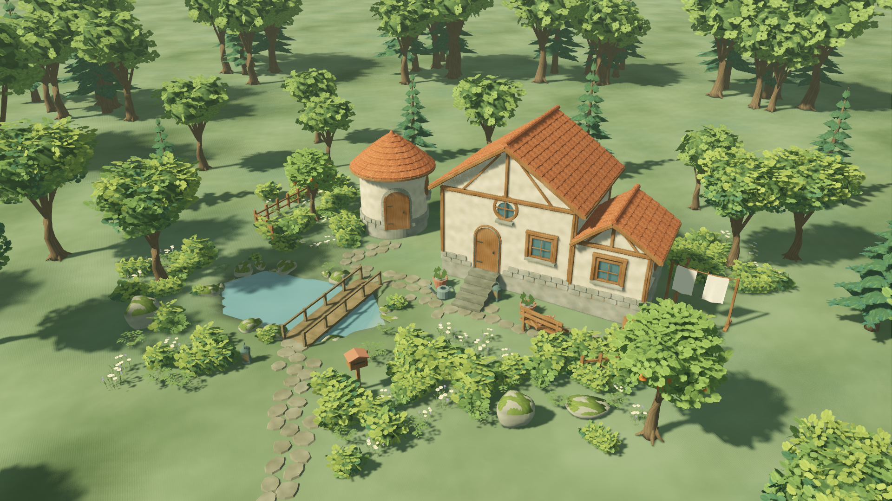

# ART-01 · 暖色手绘林间样板

用户批准在 W10 前进行美术返工。本轮将默认试玩切换到 `app/art_root.tscn` / `0.9.1-art01`，
沿用既有源文档、工具、历史和存档。原 W09 仍可从 `v0.9.0-w09` 重现。
本页交付的是可编辑实时样板；概念风格是否达到预期，由用户视觉复核，技术门槛不代替美术判断。

## 画面

[近景](visuals/near.png) · [暮色](visuals/dusk.png) · [背面](visuals/back.png) · [低角度](visuals/low.png) · [远景](visuals/far.png) · [360°实机环绕](visuals/orbit.mp4)

[返工前W09画面](visuals/before.png) 使用旧默认构图；本轮调整了推荐相机与布局，因此这是风格前后记录，不是逐像素同镜头回归。

## 完成内容

- 矩形/圆屋由真实开洞墙体派生：暖灰泥、圆角木构、灰石基座、带厚度的叠瓦、弧形瓦唇与脊瓦。每栋合并成墙/瓦/木/石4件，门窗继续用正式源件。
- 主屋、低翼屋与圆屋形成高低错落。高屋保留跨过低翼的屋檐；接触侧逐面裁剪，独立视角可拆改。
- 三树及显式LOD、蕨、野花、灌木和两种岩石共11个 Blender 源件/GLB，复用 NAT-01–09 语义；NAT-07绿篱复用新灌木。
- 1K手绘材质9张、2K植物图集、奶油灰泥/陶瓦/蜂蜜木/苔灰石/鼠尾草地面；原始画稿与节点库可重建。
- 不规则石路、断续石块与植物池岸、原有生活物件、暖日光/冷阴影和轻雾；开启TAA，摄影沿用相同抗锯齿并等待收敛。
- 源20棵外围树仍可选择拆改；128棵ENV树及全部最大冠幅位于核心外。池岸由池源派生，移动/删除池后刷新。
- 同树所有高低角色及空间批次共享LOD判断中心，修复临界距离裸露多面内部树冠；新模型拾取体覆盖实际树冠。
- 真实异步读档也走美术纯数据生成器，旧作品和新作品都保留新石路；池岸缓存包含世界种子。
- UI模板图取自 Godot 实际摄影，已有用户缩略图继续优先。

## 模块和源件

| 内容 | 位置 |
| --- | --- |
| 入口、材质/加载接入 | `app/art_boot.gd`、`features/art_direction/` |
| 可编辑样板源 | `levels/forest_slope/art_layout.gd` |
| 建筑几何 | `features/art_direction/cottage_art.gd`、`architecture/cottage_mesh.gd` |
| 自然资产源/契约/审计 | `art_source/art_pass_01/nature/` |
| 原画材质/Blender节点库/哈希 | `art_source/art_pass_01/materials/` |
| 实机模板图源 | `art_source/art_pass_01/ui/` |
| 重建命令 | `tools/art/build_art_foliage.py`、`build_art_materials.py`、`build_art_thumbnail.gd` |

Blender5.1.2 → GLB → Godot4.7.2为正式链；GUT9.7.1与既有工具锁定不变，没有新增运行时插件。
Three.js仍是可选轮廓试验工具，本轮真实模型和着色均在正式链完成。
所有新画稿/几何为项目原创；47族P0语义不因替换模型或增加LOD重复计数。批准PRD和原清单未覆写。

## 验证

详见 [测试契约](TEST_PLAN.md)、本目录 JSON / automated 日志及视觉记录。
自动回归 **491项/12757断言**（446历史+45美术），0失败/0跳过；每周与美术跨进程重启及故意失败负控通过。
原生Metal额外重跑11项catalog，GPU批次姿态/相位/包围盒读回通过。Blender11源重开、11GLB/预算/哈希、9图材质库、46+11项目源审计均通过。
摄影1920×1080、2560×1440、512×288可解码；源/相机/选择/轮廓恢复与失败重试通过；日暮、低机位、四向及100/150%入口已看图。
14秒/420帧/1280×720真实环绕约360.96°，无离线场景替换。

本机Apple M4 Pro/20GPU/48GB，Forward+/Metal/TAA；实际渲染目标PNG头确认为1920×1080，2秒预热后采样60秒墙钟：

| 场景 | 帧p95 | 提交最慢 | 进程RSS峰值 |
| --- | ---: | ---: | ---: |
| 示范静止 | 8.333ms | 0.000ms | 738.41MiB |
| 示范20笔编辑 | 8.333ms | 160.859ms | 783.62MiB |
| 24建筑/1000实例20笔编辑 | 10.417ms | 232.203ms | 874.09MiB |

帧p95≤20ms、RSS≤2GiB在此机通过；**局部编辑≤150ms仍未通过**，继续交W10/T065。
GPU时间计数不可用，以上不是最低配置/Windows验收。容量沿用W09同一24体块/1000实例源。

macOS最终ZIP全新目录解压后真实启动、保存与缩略图编码通过；测试框架和测试源未入包，Windows PE x86_64仅验证导出格式。
包清单与SHA256见 `art_pass_01_exports.json`。首次新包整次冒烟曾耗39.4秒，未单独记录那次首帧；
最终本机已热驱动缓存的一次首帧见导出JSON（约2.5秒），不把它称为全新设备冷启动门槛通过。
`6656ba3` 的 Git archive 全新检出、不复用 `.godot`，累计491项与所有重启/故意失败负控再次通过。
最终标签 `v0.9.1-art01` 包含该实现及后续纯文档验证归档，未改变运行代码。

## 仍开放

局部编辑150ms目标保留为W10/T065缺陷；美术返工没有将性能采集成功改写为目标全部通过。
Windows真实设备、最低配置、真人试玩和用户视觉认可均单独待验。
当前主屋背面与生活细节仍比概念图简化；藤蔓、复杂雨棚/露台、烟囱炊烟保留P1，不计本轮完成。
