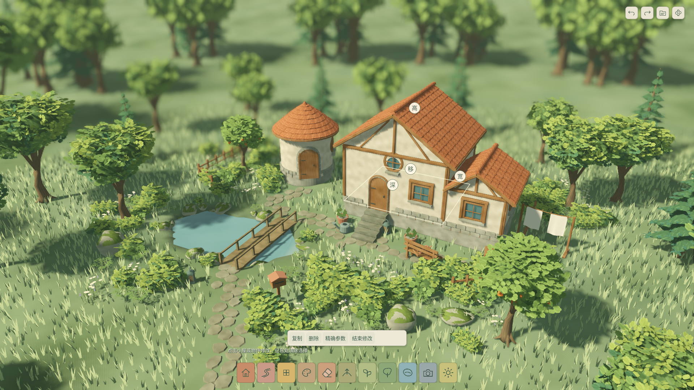

# UX-02 · 像画图一样建造，直接在对象上修改

2026-10-22，版本 `0.11.1-ux02`。按用户“PRD写完后直接继续开发”执行。交互PRD先在 `f8c1e82` 提交，再实现默认入口 `app/simple_root.tscn`，沿用已接受的美术、柔焦和动态草。

## 使用方式

1. 点底部建筑/石径/花草等卡片后直接在场景画；上方只出现紧凑同类选项。精确表单通过“更多参数”主动打开。
2. 默认浏览时左键对象，或任何工具下右键点对象，显示白色就地手柄。拖动“高/宽/深/移”，松手生效；圆屋仅显示联动直径。
3. 手放道具/植物有“移/转/大小”手柄。操作条可复制、删除、打开精确参数和结束修改。复制是跟随鼠标的预览，左键放下、右键/Esc取消。
4. 橡皮点删一个房屋或手放物件，可撤销；擦除刷植另有按钮。池域/路径/结构的明确删除入口仍在精确参数中，没有新增任意裁剪能力。
5. 门窗直接指向目标房屋墙面，自动识别父屋；短桥/短阶的合法拖绘松手即提交，无需再确认。
6. Mac双指移动旋转、捏合缩放、Option+左键平移保持；鼠标右键短按选对象，拖动只转相机。UI命中和拖动释放到工具栏会拦截/取消，不误提交。

参考资料、原版截图/官方动态图链接、指定视频的可核实范围在 [调查记录](../../research/tiny_glade_interaction_2026-10-22.md)。V1视频抓取返回412，原生浏览器能读页面但视频帧捕获黑屏；没有声称已逐帧看完。原版的自由屋顶、分组任意旋转、逐对象染色和可移动地形块没有冒充本次实现。

## 模块与源数据

- `features/direct_edit/direct_edit_data.gd`：纯候选变换与复制；源状态分离，复制新ID/种子，去除重复附着身份；保留世界完整校验。
- `direct_camera.gd`：在相机消费右键释放之前区分6px短按/拖动；最大离开距离避免移出再移回误选。历史相机脚本不变。
- `direct_handles.gd`：随相机投影的32逻辑像素就地手柄、局部轮廓；拖动时隐藏其他手柄。
- `simple_hud.gd`：11类底栏/紧凑工具条、独立刷径/地表草密度、按需精确表单和操作条。橡皮SVG为本项目原创矢量源，不取用原版资源。
- `simple_playground.gd`：通过既有预览/异步队列/一次性提交与50步历史发布；照片与存读档复用原管线，无schema修改。

W01–W11、ART及UI/Meadow旧场景保持独立回归。当前Godot默认入口变更不要求迁移正式五槽存档。QA均使用独立目录，不能使用正式作品测试。

验证命令、逐项映射见 [TEST_PLAN.md](TEST_PLAN.md)。完整结果见下表及 [delivery.json](delivery.json)，未关闭门槛见 [KNOWN_ISSUES.md](KNOWN_ISSUES.md)。

## 最终验证结果

实现/修复版本 `7b0b68a` 经Git archive检出，不复用导入缓存；文档与UID元数据随后归档，交付标签 `v0.11.1-ux02`。功能门禁通过，M4/M5仍未批准。

| 项目 | 结果 |
| --- | --- |
| 累计自动回归 | 579项Godot、16,299条断言，另6项Python；0失败、0跳过；负控制生效 |
| 本次新增 | 26项 / 377条断言；格式、lint、资源契约与历史测试均通过 |
| 原生输入 | 11项断言全真：真实Input分派点选、拖转、GUI手柄、一次提交/撤销、150%布局及摄影恢复 |
| 摄影 | 1080p/1440p实际PNG解码；复核无UI、手柄和选择轮廓 |
| 满容量60秒 | 24屋/1000源实例，45%动态草、有选中手柄；帧p95 11.494ms，主回调最大45.751ms，RSS峰值948.73MiB |
| 编辑延迟 | 提交p95/最大277.353ms，**150ms目标未通过** |
| 本机文件隔离 | 原生验证前后正式作品/偏好哈希一致 |
| 导出 | Windows x86_64 PE检查通过；macOS实际解包运行，保存/缩略图/11卡新入口/资源打包检查通过 |
| 启动 | 空缓存回归结束后串行导出复测首绘2.710s；并行CPU负载期间35.955s。保留两次记录，不据此关闭全新设备冷启动门槛 |

原始回归XML、去ANSI日志、clean receipt、原生事件报告及性能帧样本均在 [evidence/](evidence/)。构建哈希记录在 [delivery.json](delivery.json)，本目录文件哈希在 [checksums.json](checksums.json)。Windows实机、最低配置、人工触摸板/听音、远端CI和十人首次试玩没有用本机自动化替代。

## 实机截图

以下来自本项目最终修复版本，不是原版游戏参考图。已复核工具小条、对象就地手柄和摄影隐藏；原版参考图单独保留在调查文档。

[紧凑建筑工具条](evidence/build.png) · [花草150%与两个独立滑杆](evidence/plants_150.png) · [手柄150%](evidence/handles_150.png) · [1080p摄影输出](evidence/photo_1920x1080.png)

本机试玩包：`builds/ux_02/macos/windhaven_ux_02.zip` 与 `builds/ux_02/windows/windhaven_ux_02.exe`。包和缓存不进Git；直接在Godot按F5运行默认新入口即可，旧周场景保留回归基准。
