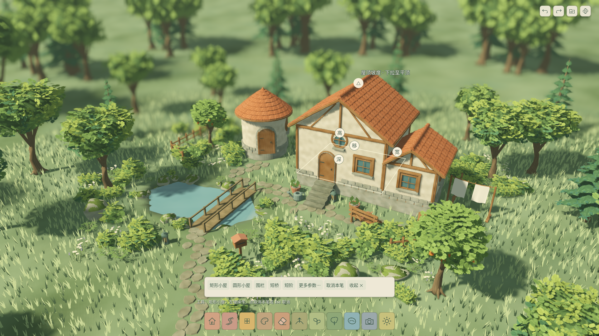

# UX-03 · 悬停引导与建筑表面拖拽

2026-10-22，`0.11.2-ux03`。用户明确要求鼠标移到房屋不同部位即显示修改引导，补齐屋顶、门窗和桥梁编辑。设计补充在PRD附录D，默认入口 `app/hover_root.tscn`；UX-02及历史周场景保留回归。

## 现在怎么修改

1. 把光标移到小屋，不必先右键选择。屋顶显示△引导，墙面显示宽/深/高/移动，白色说明随命中部位变化。
2. 按住对应白色手柄拖动，松手完成；右键、Esc或失焦取消。每笔一次撤销，点击但不拖不会产生历史。
3. 屋顶△上下拉调整山墙/圆锥高度，下拉到底为平顶，向上恢复坡顶。房屋墙高与屋顶高度独立。
4. 指向门或窗，显示沿墙移动、宽和高；窗可上下移，门保持接地。支持圆墙附着，非法洞口间距/墙角/接触墙改动整笔拒绝。自动路径门实际编辑后转为手工门并分配稳定身份。
5. 指向木桥或短阶，拖◆两端点、整段移动和宽度。桥头必须在合法岸上，跨度/高差规则保留；失败不覆盖原作品。
6. 手放道具继续支持移动/转向/大小；选中后的复制/删除条保留。门窗和结构没有接入旧“精确参数/复制”表单，这两入口禁用，避免显示错误对象。
7. 悬停不切换当前创建工具，按手柄才进入修改；Option+左键平移、双指旋转/捏合和右键拖转相机保持。相机拖动、摄影、模态窗口、忙碌时隐藏手柄。

## 实现要点

- `surface_picker.gd`：以可见墙、门窗洞口、三角屋面和桥面源边界求最近射线命中；道具复用实际wrapper碰撞界限。屋顶容差0.2%避免脊线缝隙。
- `surface_edit_data.gd`：稳定身份解析、窗沿墙/圆周移动、结构端点和屋顶纯候选变换，完整源校验及结构转换规则。
- `surface_handles.gd`：32逻辑像素手柄和就地说明；门窗/道具局部引导区域保持，使鼠标能慢慢移到洞口外的手柄。GUI事件用局部到视口变换取按下坐标。
- `hover_playground.gd`：沿用预览队列、原子发布和历史；悬停采用输入事件坐标并按指针/相机/源版本变化重新命中，不在静止时每帧扫描源。
- `RoofProfile`：所有生成与美术共享可选 `roof_rise`，旧作品默认比例不变，复制和存档保留新高度。外壳、山墙封口、瓦面和相邻檐口统一求值；平顶同样生成厚度封边。

未修改Blender源件或生成脚本，未新增第三方插件/模型；本轮不宣称实现任意屋面布尔、自由屋脊、城垛或原版全部造型系统。已知150ms、全新设备启动、Windows/低配机、人工触摸板、十人试玩门槛继续独立开放。

最终验证及截图归档在下方；命令与覆盖见 [TEST_PLAN.md](TEST_PLAN.md)，范围限制见 [KNOWN_ISSUES.md](KNOWN_ISSUES.md)。

## 验证与交付

代码 `176f9ec` 通过Git archive空导入缓存累计验证；文档随后归档，交付标签 `v0.11.2-ux03`。功能通过不代表M4/M5通过。

| 项目 | 最终结果 |
| --- | --- |
| 累计回归 | 609项Godot / 16,679条断言，另6项Python；0失败、0跳过，负控制生效 |
| 本次新增 | 30项 / 380条断言；包括慢移到窗口外手柄、复制后目标、自动门重排及窗型边界 |
| 原生交互 | 24项全真，真实Input→GUI分派：屋顶升高/平顶、窗宽、门高、桥头、原状态撤销、UI150%、摄影隐藏/恢复 |
| 满容量60秒 | 24屋/1000源实例、45%草、有选择手柄；帧p95 11.667ms、主回调最大53.079ms、RSS峰值953.86MiB |
| 编辑提交 | p95/最大 241.525ms；150ms目标仍未通过 |
| 文件隔离 | 原生验证前后正式存档/偏好哈希未变 |
| 导出 | macOS解包运行/保存/缩略图/新入口/资源检查通过；Windows x86_64 PE格式通过，Windows实机未测 |
| macOS首绘 | 3.240秒；有既有主机/驱动缓存，不代替全新设备冷启动 |

完整机器回执见 [delivery.json](delivery.json)，XML、日志、输入报告、帧样本和包哈希在 [evidence/](evidence/)，本目录文件哈希见 [checksums.json](checksums.json)。实际首次玩家0/10，Windows/最低配置、人工触摸板/听音、远端CI及M4/M5继续开放。

## 本项目原生截图

[下拉变为平顶](evidence/roof_flat.png) · [窗口引导](evidence/hover_window.png) · [门的移动/宽高](evidence/hover_door.png) · [桥的两端/宽度](evidence/hover_bridge.png) · [UI150%](evidence/hover_150.png) · [摄影返回](evidence/photo_return.png)

停止旧试玩，打开 `app/hover_root.tscn` 按F6，或重新打开工程后F5。不要在旧周场景上F6判断新版。当前本机包 `builds/ux_03/macos/windhaven_ux_03.zip`、`builds/ux_03/windows/windhaven_ux_03.exe`；包、缓存和作品不进Git。
