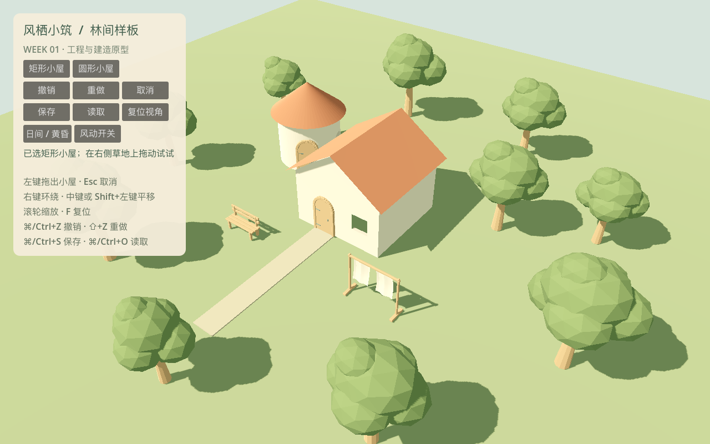
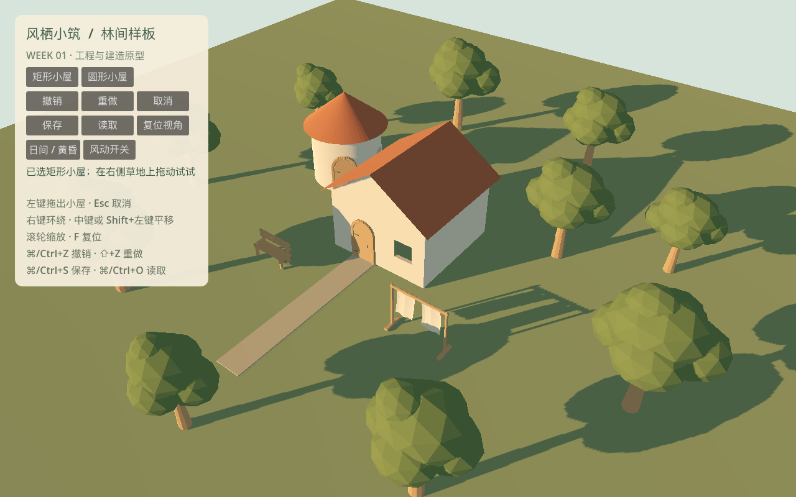

# W01 · 工程基线与技术样板验收

日期：2026-10-18。对应开发计划 T001–T010 的第一周部分和 T074。
本次已制作可运行、可拖建、可撤销与保存的 Godot 工程；Windows 可见运行尚未验收，
因此 W01 平台放行仍有一项外部门槛，不能视为完整 MVP 或全部资产已完成。

## 交付与任务追踪

| 任务 | 本次交付 / 证据 | 状态与剩余工作 |
| --- | --- | --- |
| T001 | 功能目录、InputMap、文本场景/UID、Windows x86_64 EXE 与 macOS ZIP；导出包去掉 GUT/测试源码，macOS 在空目录可见启动并退出 | 本机完成；Windows 真机待验收 |
| T002 | Git、AGENTS.md、精确工具锁、许可证、下述模块契约与工程决定 | 完成 |
| T003 | Blender 叶片/树干/挂布→GLB COLOR_0、Godot 导入与实际 GPU 风效比较 | 完成本机样板；Windows GPU 随 T001 补验 |
| T004 | 1m 源文件模板、暖色尺度样板、日/暮色截图、UV/插槽/材质命名 | W01 样板完成；正式手绘表面仍按 T011 等后续任务制作 |
| T005 | WorldDocument、稳定 ID/独立种子、height_deltas 和最小单容器 codec；损坏字段在建网格前拒绝 | W01 最小协议完成；完整字段引用/迁移属于 T051 |
| T006 | 环绕/平移/缩放/复位、地面拾取、真实鼠标拖建和工具条不透传测试 | 完成本机路径；Windows 鼠标行为待实机复验 |
| T007 | 记录 M4 Pro 基线、两渲染器 1080p 小场景采样、依赖采用表 | 初步路线完成；Windows 最低配置、透明叶片/水面专项尚待补齐，未作最终性能放行 |
| T008 | 平/曲墙三类真实洞口、0.18m 内外壳与侧壁、几何射线验证；矩形侧贴与圆体相切数据约束 | 进行中（计划跨 W02）；接触墙消隐、部分侧贴收边、边界反馈与极限组合法仍需 W02 完成 |
| T009 | Preview→PendingCommit→Idle、准备成功后发布、50 步撤销重做、分支截断、失败回滚、两进程保存重载 | W01 风险样板通过（计划跨 W02）；尚无工作线程调度/陈旧任务淘汰与跨系统混合编辑 |
| T010 | BLD-05/06/07 三门 `.blend`、GLB、暗内衬、墙面插槽、尺度/导入测试；样板显示木板/拱门 | 源模型完成（计划跨 W02）；完整门框/曲墙不挤压、材质细化、正式集成继续后续任务 |
| T074 | 42 项 GUT、lint、格式、资源校验、重启、必失败断言控制；Ubuntu/Windows CI 配置 | 本地完成；远程 CI 尚未运行 |

## 实际运行画面

以下图片来自锁定引擎的真实视口，不是概念图。地面、树冠和房屋表面是 W01 块面样板，
不是最终的“林间坡地”美术交付。石径是静态样板，不具备路径生门功能。

## 工程决定与模块契约

### ADR-W01-01：唯一世界源数据与派生视图

`core/world_document/WorldDocument` 只保存 Dictionary/Array/数值/字符串/布尔等可序列化值，
不保存 Node、Mesh、材质和实例显示索引。建筑含稳定 id、独立 seed、shape、position、size、yaw、
openings、source、locked；其他系统预留独立集合。世界种子使用字符串，避免 JSON 大整数损失。
实体 ID 从世界种子和分配序号派生；取消预览不消耗正式序号，重载后继续分配。

`core/editing/EditSession` 是会话内事务入口，负责预览、校验、准备、发布与历史。
`prepare(snapshot) -> {ok, meshes...}` 必须先成功，再发布源数据与视图；失败不消耗历史。
`state_published(snapshot, prepared)` 通知组合根更新视图。undo/redo 也先准备并验证，
生成失败不能先移动历史游标。历史上限 50 条，当前采用完整小快照；W02 后续调度器再处理脏区和
增量，不提前声称已实现异步计算。成功加载替换源数据并清空旧历史。

`features/buildings/BuildingGeometry.build(spec) -> ArrayMesh` 生成带真实洞口的墙壳和屋顶。
网格是可重建结果；使用有界切片细分而非运行时任意 CSG。曲面以弧长参数开洞。
W01 仅支持 yaw=0°，尺寸为宽深 3–12m、檐高 2.4–7.2m，UI 拖建暂固定檐高 3m。
相切/侧贴的数据规则已覆盖；接触面几何消隐尚未完成，不将规则测试等同视觉无缝。

`features/save_and_load/SaveCodec` 的 W01 格式为 magic `WGLADE01` + 原文长度 +
压缩内容 SHA-256 + Deflate JSON，同一文件保存种子/建筑/高度差量。拒绝不支持 schema、
坏校验、过大解压长度、非有限值、错误字段与非法放置。临时文件完整写入、flush、回读校验，
复制 `.bak` 后重命名主文件；主档损坏时尝试备份。没有可用存档时保留现场并提示。
这是最小原型，只有一个存档和一个备份；不宣称具备五槽、轮替备份或迁移产品功能。

### ADR-W01-02：Godot 规范与输入

固定 Godot 4.7.2 Standard / GDScript，Forward+ 为当前开发路线；纹理导入启用 S3TC 与 ASTC，
支持本次 Windows 与 Apple Silicon 导出。系统 Godot 4.7 保持原样，质量命令拒绝版本混用。
文件 snake_case、节点 PascalCase、类型化脚本、组合根 `%WorldView/%CameraRig/%Hud`；
按功能划分目录，无全局业务事件总线。UI 面板消费鼠标，背景忽略；相机与建造使用未处理输入，
释放鼠标即使发生在 UI 上也能清理拖动状态。独立 SubViewport 测试通过实际事件验证该路由。

### ADR-W01-03：资产真源与导入

Blender **5.1.2** + 自带 glTF 导出器为主生产源，Three.js 暂不引入第二套资产真源。
六份 `.blend` 与 GLB、`.asset.json` 和 manifest 一一对应，均为本项目脚本制作的原创样板。
仅三门映射 BLD-05/06/07；SAMPLE-TREE/CLOTH/BENCH 不计正式植被/道具资产完成。

以米为单位、glTF Y-up、应用对象变换、UV0、稳定材质槽、显式插槽 Empty。
导出明确选择 `wind_mask` 顶点色为 `COLOR_0`：R 主摆、G 次摆、B 预留、A=1。
树根/布挂点权重为零；风权重不乘入 ALBEDO/透明度，防止根部变黑或透明。
Godot 不直接修改 GLB 导入场景，运行包装与材质覆盖放在调用层。

六个样板的三角形数与插槽可查 [源资产清单](../../../art_source/week_01/manifest.json)。
正式材质、共享材质优化/MultiMesh、拾取代理与继承包装属于后续生产任务。

### ADR-W01-04：插件与许可

| 工具 | 决定 | 固定版本 / 理由 |
| --- | --- | --- |
| GUT | 采用，源码随 Git | 9.7.1，commit 见锁文件，MIT；实际通过 4.7.2 测试 |
| gdtoolkit | 采用，开发依赖 | 4.5.0，MIT；原候选 4.5.1 在本次 PyPI 不可取得，已按可用版本实测锁定 |
| Three.js | 不引入 W01 依赖 | Blender 已能完成样板与重建 |
| Terrain3D / ProtonScatter | 暂不采用 | 本周未验证到可作为玩家地形/刷植系统依赖的程度 |
| Blender MCP | 不作为构建依赖 | 当前使用可审查 Python 脚本与 `.blend`，无需连接运行中的 Blender |

工具与运行时下载在 `.tools/`，虚拟环境在 `.venv/`；均不进 Git。
已下载解压文件记录 SHA-256；首次 bootstrap 完整下载会检查官方发布摘要。
本次采用远程 ZIP 分段提取后检查文件 CRC 并记录逐文件哈希，不声称校验了未完整下载的整个压缩包。
许可清单见 [THIRD_PARTY.md](../../../THIRD_PARTY.md)。

## 测试、性能与平台证据

复现命令见 [根目录运行说明](../../../README.md) 和 [测试约定](../../TESTING.md)。
自动报告见 [checks.json](checks.json)、[GUT XML](gut.xml)，导出摘要见 [exports.json](exports.json)，
渲染与性能见 [render_checks.json](render_checks.json)。最终数值在本报告的验证摘要表中记录。

| 测试组 | 关键验证 |
| --- | --- |
| 源数据 | 集合/快照隔离、稳定身份、非法对象/NaN、重复 ID、边界、侧贴/相切、坏洞口/环境/高度字段 |
| 事务 | 取消、只发布一次、准备失败、陈旧 revision、50 步历史、重做分支、undo 准备失败不前进 |
| 存档 | 种子/变换/高度往返、校验/截断/声明长度、坏版本不覆盖、临时中断/坏主档回退 |
| 建筑几何 | 平墙/曲墙 × 三洞型真实射线穿透、邻墙遮挡、洞型轮廓/厚度、有限顶点与法线朝向 |
| GLB 导入 | 三门约 2m 尺度、实际 Mesh COLOR_0 权重、树/布固定根、插槽与源文件存在性 |
| 运行交互 | 相机与拾取、面板操作、真实鼠标拖建一笔一历史、实际工具条点击不建房、风参数恢复/撤销 |
| 负控制 | 临时注入必失败断言，确认退出码非零及失败报告；清理后正常回归全通过 |
| 跨进程 | 两个独立 Godot 进程保存后重启读取，非同对象内存往返 |
| 可见 GPU | 同镜头固定 t=0/1：风开产生差异；风零和减少动态为逐字节一致 |
| 导出包 | Windows PE/x86_64 结构、macOS 全新解压/空目录可见运行、测试框架与测试源未入包 |

这不是 PRD AC-01–14 全量通过；原计划中完整建筑/路径/池塘/刷植、压力场景与十人体验仍未执行。
CI 工作流只完成配置，无远程仓库和云端运行记录。

## W02 进入条件与尚未放行项

1. 补 Windows 目标设备的可见启动、相机、拖建、撤销、保存重启和退出，记录 OS/GPU/驱动、日志与截图。
2. T008 完成接触墙消隐与部分侧贴端部收边、极端洞口间距/曲率与明确失败预览。
3. T009 接入后续调度器风险样板，覆盖陈旧结果晚到、脏区不丢失、失败整笔拒绝及跨系统动作。
4. T007 补目标 GPU 的透明叶片、水面与 1080p 画质评估；本周两屋小场景数据不能作为最低配置性能承诺。
5. T010 源模型进入正式材质与曲墙套件验证，不能以三个 `.blend` 文件代表最终门窗系统完成。
6. 后续新增功能各自增加自动用例，保留 W01 所有回归；未注册周次命令必须失败。

## 本次验证摘要

- 引擎：`4.7.2.stable.official.ed1daf0bf`，原生 Metal 3.2；macOS arm64 / Apple M4 Pro（20 核 GPU）、48 GB。
- 自动检查：42 项，0 失败，0 跳过；格式/lint/资源契约通过；两个独立进程往返通过。
- 故意失败的控制测试退出码为 1，并被门槛正确识别；正常回归退出码 0。
- 实际 GPU 图像：风开 t=0/1 有 146851 个字节变化；风量零及减少动态各 0 个字节变化。
- 固定相机、2 栋建筑/10 棵样板树/挂布/长凳，1920×1080，预热 2 秒后各采样 60 秒，垂直同步开启。

| 渲染器 | 样本帧数 | 平均帧间隔 | P95 帧间隔 |
| --- | --- | --- | --- |
| forward_plus | 7200 | 8.333ms | 8.333ms |
| mobile | 7116 | 8.366ms | 8.333ms |

两条路线都在本机小场景维持接近 120Hz 的帧节奏。此为应用帧间隔，受垂直同步影响，
不是独立 GPU 耗时，也不说明两条路线在完整场景同速。当前保留 Forward+，尚未因本样板触发兼容降级。
日暮色截图均已检查：轮廓/开口可辨，面板文字完整；正式贴图、草地层次、树冠形态与柔光仍需后续美术任务提升。
