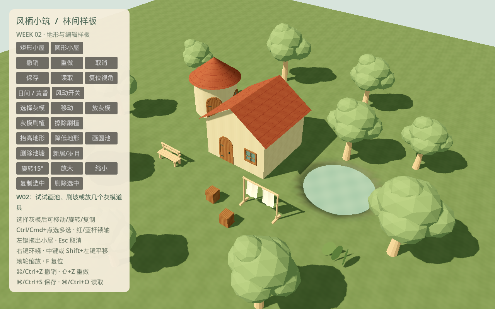
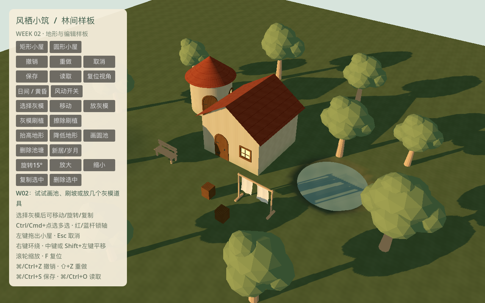
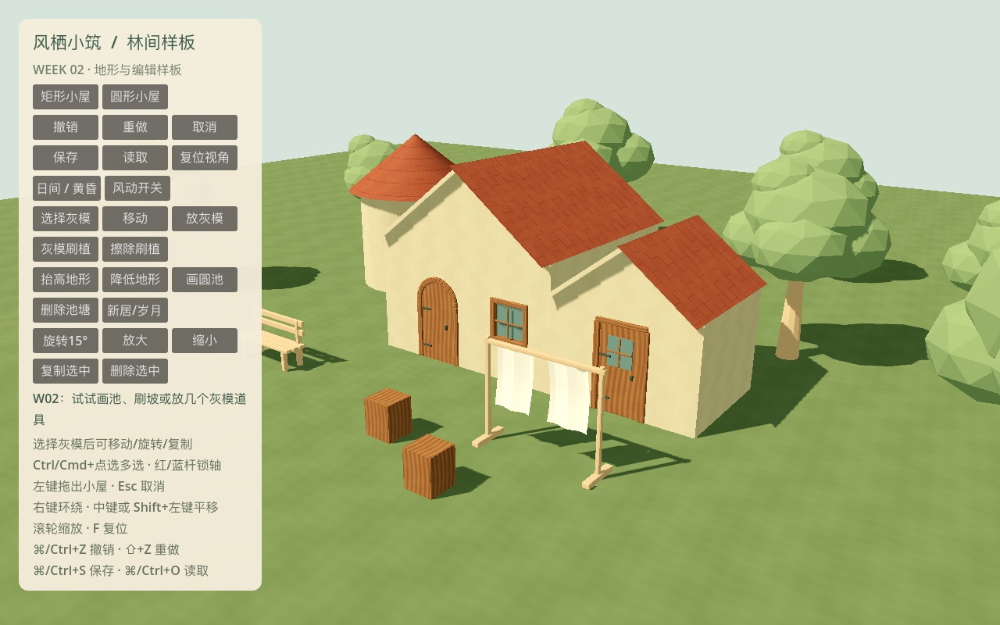
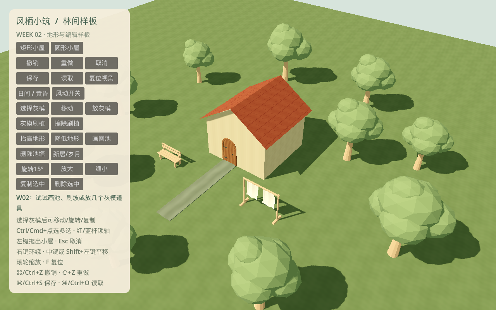

# W02 · 地形、编辑事务与资产初版验收

日期：2026-10-18。依据已批准开发计划的 T008/T009/T010 续项、T011–T016 与 T017 的 W02 部分。

**结论：本机 M1 风险样板通过，可进入 W03；Windows 目标机与完整 MVP 的最终平台/性能放行未完成。**
W01 的 42 项回归全部保留，W02 新增 46 项，累计 **88 项 / 1130 条断言、0 失败、0 跳过**。
实现和实际运行证据相互对应；圆池、灰模编辑和路径→门契约是风险样板，不能当作后续完整工具已经完成。

## 交付与任务状态

| 任务 | 本周交付 | 本周结论 / 后续边界 |
| --- | --- | --- |
| T008 | 平/曲墙真实洞口延续；同轴矩形完整/部分侧贴接触墙消隐、厚度端部封边、错高可见面保留；圆体相切规则；0.15m 洞边/间距护栏、非法预览 | 风险实现通过；正式局部屋檐、木石装饰收边和最终套件在 T019/T042/T046 继续 |
| T009 | 单笔预览/取消/提交屏障；后台准备后一次源数据+视图+历史发布；早期单容器存档、跨进程重载 | 完成其最小事务/存档样板；正式五槽/迁移/完整依附恢复不是本周交付 |
| T010 | 三门源模型继续使用；所有框体保持原尺寸，按平墙法向或圆墙弧长安装并内嵌；玻璃门在贴靠演示显示 | 本任务静态源件完成；正式材料/碰撞/套件整合仍需后续导入审计 |
| T011 | 灰泥、木、赤陶瓦、灰石四种 1K 原始纹理，Blender 材质库、Godot 实例；新居/岁月苔色和粗糙度切换 | 初版完成；程序笔触素材为可编辑的原创色彩基线，最终手工精修与整景审核继续后续美术任务 |
| T012 | 0.25/0.5m 测试；玩家高度与池域派生层分离；画池/改岸/删池/撤销；3m 基座整笔拒绝、双向 0.5m 安全带 | 风险样板通过；当前闭合域为圆形，完整自由岸线在 T032 |
| T014 | 统一手势状态、灰模放置/多选/移动/旋转/有限缩放/复制/删除、红 X/蓝 Z 锁轴手柄、稳定灰模刷植及保护擦除 | 灰模框架完成；选择工具当前针对灰模实例，不是完整建筑属性编辑器或正式植被笔刷 |
| T015 | BLD-08 方窗、BLD-09 圆窗 `.blend`+GLB；暗内衬、墙插槽、1K 窗光遮罩；日暮窗光和固定比例安装 | 源件与样板集成通过；全套正式材质/碰撞/批量统一包装留后续审计 |
| T013 | 草/土/湿岸三种 2K 纹理；全局坐标混合 shader，坡度控制土层、池岸控制湿润权重 | 初版完成；共享采样与全局 UV 避免块边色差；正式地形编辑/艺术精修继续 T028/T033 |
| T016 | WorkerThreadPool 单运行+单合并候选、token/epoch 淘汰、脏区合并、PendingCommit 串行、失败回滚；SP 风险报告 | 本机风险闭环通过；空间依赖图/增量 CPU 生成/逐帧预算化应用仍属 T040 |
| T017 | NAT-01/02/03 阔叶/针叶/果树 Blender 初稿、GLB、根权重与轮廓测试 | 仅完成 W02D5 开工部分；LOD、共享图集 UV、果实风权重/四向成品审核在 W03，不能标整项完成 |
| W01 遗留 T007 | Forward+ / Mobile 的水面、alpha-scissor 叶卡与日暮色实测；两路线各 1080p/60s | Mac 路线通过，继续 Forward+；Windows GPU/驱动/最低配置仍未验证 |

## 可运行样板与画面

默认入口现在是 `app/week_two_root.tscn`，复用 W01 组合根并保留旧根用于回归。
同一林间样板增加圆池、少量可编辑灰模物件和笔触基础材质。原有外围树/晾布/长凳仍是固定样板装饰，
不是正式手工物件系统已全部接入。三树新初稿在资产库中，未冒充最终场景树。

## 数据与算法决定

### ADR-W02-01：地形分层与共用约束

`TerrainField` 使用 64m 地块、48m 编辑核心，平坦基础场为 W02 的已知源高度，
`terrain.height_deltas` 保存稀疏玩家编辑，`pool` 保存独立圆域中心/半径/首次水位。
采样步长暂选 0.5m；8m 一块，共 64 块。0.25m 保留为实验选项，接缝测试在两档均使用真实隆起。

池中心首次水位为玩家地面减 0.15m；修改中心/半径保留原水位；池底约为水面减 0.45m，
边缘约 0.35m 内侧过渡至高于水面 0.1m，再用 0.75m 外岸带接回玩家地形。
普通高度刷跳过池域与岸带，源高度不被挖池写坏，删除池域直接恢复玩家高度。
验证原地面坡差≤0.6m、最窄 2m、池域离核心边界≥2m、漫溢/悬水，以及岸带外 0.5m 安全带。
建筑与池岸编辑使用同一接口；物件冲突保留手工内容并拒绝候选，不自动移物或删除。

固定建筑地坪不随刷坡漂移；在脚印范围采样支撑，超过 3m 或地面穿入地坪时拒绝整笔。
可见基座当前为简单石材包围体，正式地形贴合/入口短支撑与生成器仍是 T024。

共享边缘位置与法线从同一全局场采样，shader 使用世界坐标贴图，避免分块色带。
选择 0.5m 是风险阶段折中，不承诺最小池岸的最终艺术轮廓；后续 T028/T032 可局部细化。

### ADR-W02-02：后台队列与原子发布

重计算只接收深拷贝快照。worker 调用 `WorldRebuild.evaluate`，返回顶点/法线/索引等纯数组，
不创建 Node、Mesh、材质或碰撞；主线程才准备资源、更新场景树。随机使用对象/网格局部种子，
不依赖线程完成顺序或全场 RNG 调用次数。没有角色导航，本阶段无导航烘焙需求。

队列最多一个活动任务和一个合并候选。同手势的新预览取代旧预览，但其未发布脏区合并到下一候选。
旧版本或旧 epoch 的结果无法发布。松手后锁定 PendingCommit：不接收后续编辑，仍可操作相机；
Esc 是明确取消入口。失败保留旧源数据、旧视图和历史，已经显示的预览也会恢复。

W02 仍对完整小世界求值，并未实现 T040 的空间依赖图。主线程用完整数组比较确认内容一致后复用
网格资源与建筑节点；不是只信任可能碰撞的短哈希。源数据和生成缓存分离，缓存不进存档。
只变更地形时，无关建筑节点身份不变，变化地形块少于 8 个，相关回归验证实际资源身份。

发现并修复：提交前清空预览字典会清掉队列快照；准备失败时过早清除“显示预览”标记会漏回滚；
队列信号消费者重入时可能丢新脏区。以上均有独立回归，没有削弱断言掩盖问题。

### ADR-W02-03：灰模工具与后续工具边界

`WorldTools` 统一手势与选择，源编辑走 `EditSession`。灰模物件可 Ctrl/Cmd 多选，平移/锁轴、
15° 旋转、0.5–2 倍缩放、复制、删除；手工实例和手动调整后的实例受普通刷擦保护。
刷植采用带稳定种子的抖动网格，每笔访问格去重；取消不消耗正式分配序号。
W02 样板暂限 800 灰模实例以约束循环成本，这不是 MVP 最终植被容量指标。

路径→门是 `RiskEdits.road_to_door` 的窄范围 SP-04 契约：仅矩形正面，检查 0.6m 距离和 0.45m 高差，
在同一候选里写入一条测试路径和一个真实洞口；手放窗冲突时整笔拒绝。测试和 `--road-demo`
会实际生成墙洞、路径与门模型。它没有完整曲线路径 UI、去重/锁定/删路联动规则，不声称 T022/T026 完成。

同轴矩形按局部立面 u/y 区间消除接触面，保留高处外露墙并封闭端部厚度；不做通用 CSG。
发生接触的轴上暂把屋檐缩到墙线，避免檐口互插；精细局部檐口与装饰收边由正式生成器继续完善。
圆体仍只允许相切/分离。已有门窗碰到接触面会拒绝，不静默吞掉手工内容。

### ADR-W02-04：原创材质与资产真源

`tools/art/build_week_two_assets.py` 通过 Blender 5.1.2 生成可编辑窗源件、三树初稿、材质库与 PNG。
纹理为原创分层笔触式色块/瓦缝/木纹计算，没有照片拼贴或外部模型。保留生成脚本、原始 PNG
与 `.blend` 节点库，便于后续 Texture Paint 精修；不把程序纹理说成已经完成全部人工美术审核。

四个基础材质各 1024²；草/土/湿岸各 2048²；窗发光遮罩 1024²，共八张。
source/export 文件内容哈希一致，Godot 原生导入；模型米制、Y-up、UV0/COLOR_0、稳定插槽均测试。
平/曲墙框体沿法向旋转和内嵌，保持 scale=1，不随墙宽拉伸；根与挂点风权重延续 W01 规范。
Godot 运行包装统一覆盖材质，不直接编辑 GLB 导入场景。新居/岁月控制苔色/粗糙度，黄昏控制窗遮罩发光。

源资产：[模型清单](../../../art_source/week_02/manifest.json)、[材质清单](../../../art_source/week_02/material_manifest.json)。
未新增外部插件，继续锁定 Godot 4.7.2、Blender 5.1.2、GUT 9.7.1、gdtoolkit 4.5.0。

## SP-01～06 放行审计

| 风险 | 实际证据 | 本机结论 |
| --- | --- | --- |
| SP-01 墙顶与洞口 | 继承 W01 真实射线穿透；三门两窗源件、最小圆半径、固定框体与低角度图 | 限定样板通过，正式套件仍按计划生产 |
| SP-02 有限组合 | 四朝向/部分侧贴区间、隐藏面计数、端部封闭、洞口冲突、错高运行图 | 限定样板通过，不承诺任意布尔组合 |
| SP-03 地形池岸 | 两档真实隆起边界一致、源/派生恢复、3m 边界、坡差/保护/双向安全带、采样成本报告 | 风险样板通过，选 0.5m；正式池岸工具留后续 |
| SP-04 事务 | 50 笔混合编辑全部 undo/redo；单笔路→洞口→门、手窗冲突；刷坡与基座整笔拒绝 | 窄范围契约通过，不等同完整路径工具 |
| SP-05 异步 | 真 worker + Semaphore 故意阻塞旧任务、合并脏区、epoch、提交屏障；真实鼠标与 20 笔可见编辑 | 通过；增量 CPU 依赖图仍未实现 |
| SP-06 美术导出 | 源/GLB/UV/COLOR_0/插槽、纹理哈希/分辨率、重导入与干净检出回归 | 本机通过；Windows GPU/目标驱动仍待补验 |

## 测试与性能证据

命令：`python3 tools/quality/run_checks.py --week 2 --negative-control`。
顺序执行 W01/W02 两组 GUT、格式/lint、模型/纹理契约、两周独立进程保存重启、分辨率成本采样，
并验证故意失败断言的退出码为 1。正常门槛退出 0；失败文件自动清理。传 `--week 3` 仍应拒绝。

- [checks.json](checks.json)：88 项累计检查与分组计数。
- [W01 XML](gut_week_01.xml)、[W02 XML](gut_week_02.xml)：保留既有回归与新增用例。
- [地形采样](terrain_sampling.json)：两档 64 块完整场求值，计时为 CPU/headless，不是 GPU 帧时间。
- [GPU / 两渲染器](render_checks.json)：真实截图比较，1920×1080 各预热 2s、采样 60s。
- [优化前](edit_before_cache.json)、[优化后](edit_after_cache.json)：同一 20 笔可见异步编辑。
- [Blender 源审计](source_audit.json)：实际重开 11 个模型源和 8 个材质节点/纹理，确认不是只存在空文件。
- [导出与哈希](exports.json)、[干净 Git 检出](clean_checkout.json)：已完成，见报告。

性能和平台的最终数值、Git 提交记录见下方验证快照。全部性能数据限定本机小场景，
不能作为完整 PRD 的压力容量或最低配置承诺。CI 工作流已改为 W02 累计回归，尚无远程运行记录。

## 本次验证快照

| 检查 | 实际结果 |
| --- | --- |
| 引擎 / GPU | Godot 4.7.2 Standard / Metal 3.2，Apple M4 Pro 20 核 GPU，48GB macOS arm64 |
| 自动回归 | W01 42 项 + W02 46 项 = 88 项，1130 断言，0 失败，0 跳过 |
| 失败注入 | 退出码 1 且定位到故意失败断言；正常套件退出 0 |
| 两个独立进程 | W01/W02 写入后新进程读取均通过；W02 包含高度、池域、物件、路径、洞口、岁月 |
| 风效实际像素比较 | 风开 t=0/1：143624 字节变化；风零 / 减少动态：均 0 |
| forward_plus 1080p / 60s | 7198 帧，平均 8.335ms，P95 8.333ms |
| mobile 1080p / 60s | 6930 帧，平均 8.371ms，P95 8.333ms |
| 0.25m 完整场求值 | 131072 地形三角形，CPU 291.378ms，headless 资源准备 1.170ms |
| 0.5m 完整场求值 | 32768 地形三角形，CPU 77.175ms，headless 资源准备 0.568ms |
| 20 笔实际编辑，1280×800 | 主线程发布最大 / P95：优化前 7.377ms → 复用后 2.369ms |
| 导出 | Windows x86_64 PE 结构/打包通过；macOS ZIP 解压后从空目录可见启动/退出；GUT/两周测试源未入包 |
| Windows 真机 / 云端 CI | 未执行，不标记通过 |
| 干净检出 | 从 `b0b556d` Git 归档全新导入；无 `.godot/` 缓存，88 项和失败注入再次通过 |

GPU 帧间隔受垂直同步影响，不能当作独立 GPU 耗时；编辑发布计时包含资源准备和场景发布，
不包含 worker 等待时间。2.369ms 是本机 20 笔小样板结果，不是所有编辑、所有机器的硬上限。
基础场依然是平坦基线与局部玩家差量，不冒充已完成 T028 的最终分块地形生产系统。

## 下一阶段

W03 按原计划继续 T017 树 LOD/共享图集、T018 贴图图集、T019 正式建筑生成器、
T020 批量历史与依附恢复、T021 正式静水材质、T022 路径开工等相应排期。
W02 的圆域、灰模、直段风险路径需经正式工具替换，沿用相同源数据/事务契约。
Windows 真机、最终池岸最小尺寸观感、正式屋檐接缝和完整压力容量保留为后续门槛。

### 源文件重开审计补充

独立 Blender 进程重开源文件时发现：未被模型引用的材质库节点没有 Fake User，保存后未保留。
已修复生成器，为材质和图像设置保留标记；重建后逐一打开 11 份模型源，检查 UV/风权重/插槽/米制，
并重新打开材质库确认 8 个节点图及其源图像均可读。审计脚本为 `tools/art/audit_sources.py`，
报告独立于 GUT 的用例计数，避免“文件存在”冒充“可编辑源文件可用”。

新增地形还补充了相机防穿地回归：低俯仰/近距离时保持相机高于实际采样地面，并按真实高度拾取。

## 版本与复现范围

W02 实现提交：`b0b556d`，本地交付标签 `v0.2.0-w02`，最终证据另作提交。
干净检出从该实现提交的 `git archive HEAD` 创建，只复用锁定 Godot 与 lint 工具，
不复用任何导入缓存，88 项回归、两周跨进程往返与失败注入再次通过。
没有远程仓库和云端 CI 运行记录；Windows 可见运行仍未执行。

风效图像对照固定镜头、光线及水面相位，单独改变叶片/晾布的采样时间，以隔离变量。
“零风 / 减少动态变化 0 字节”是这一对照的实际结果，不声称水面独立动画会随风量参数自动停下；
减少动态开关会另外停止水面样板的时间项。两路线 60s 帧间隔采样保留了真实水面/风动画。
