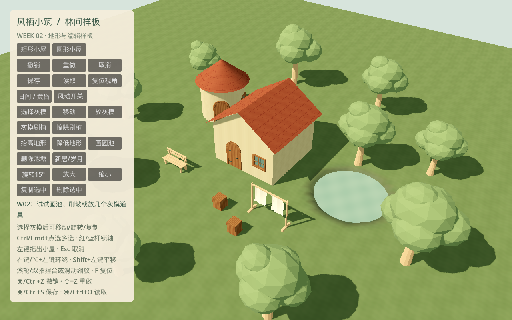

# W02 补充 · Mac 相机输入

日期：2026-10-18。保留 W02 原始验收快照，此目录记录后续输入改动及当前包。

- Option（⌥）+鼠标左键拖动：环绕视角；保留右键环绕。
- 双指张开：拉近；双指捏合：拉远。
- 双指上下滑动：连续缩放；高精度滚轮按事件幅度缩放。
- 保留中键 / Shift+左键平移，以及 F 复位。

相机使用 Godot 的 `alt_pressed`、`InputEventMagnifyGesture` 和 `InputEventPanGesture`。
Option 旋转优先于 Shift 平移，且不会触发建造、池塘、地形或灰模编辑。
先松开 Option、再在工具栏上松开鼠标也会结束旋转；工具栏上的双指手势不改变镜头。
缩放保留原有距离限制和防穿地逻辑。

## 验证

```bash
python3 tools/quality/run_checks.py --week 2 --negative-control
python3 tools/quality/export_smoke.py --week 2
```

新增 6 项视口事件路由测试，覆盖全部 10 种工具、修饰键优先级、捏合方向/极限/非法数值、
双指滚动/高精度滚轮、UI 隔离和跨 UI 松键。测试通过 `SubViewport.push_input` 注入事件，
实际经过输入分发、相机与编辑工具，不只是直接调用处理函数。

当前 W01 42 + W02 52 = **94 项 / 1191 条断言，0 失败、0 跳过**。
格式、lint、资源契约、两周跨进程存读档、风险采样和失败注入门槛均通过。
证据：[检查摘要](checks.json)、[W01 XML](gut_week_01.xml)、[W02 XML](gut_week_02.xml)。

Mac ZIP 已重建，并从空目录解压后可见启动/退出；Windows 包同步重建。
[导出记录与 SHA-256](exports.json)。上述手势由自动化注入验证，尚未进行实体触控板操作验收；
Windows 真机门槛仍待目标设备验证。未变更 W02 原始 Git 标签。



## 平台依据

[Godot MagnifyGesture 文档](https://docs.godotengine.org/en/stable/classes/class_inputeventmagnifygesture.html)
说明缩放因子以 1 为基准。
[锁定 Godot 4.7.2 的 macOS 输入实现](https://github.com/godotengine/godot/blob/4.7.2-stable/platform/macos/godot_content_view.mm)
将原生捏合映射为 MagnifyGesture，将带滚动阶段的触控板滚动映射为 PanGesture，
并为无阶段的精确滚动保留滚轮 factor；因此同时支持这些输入路径。
