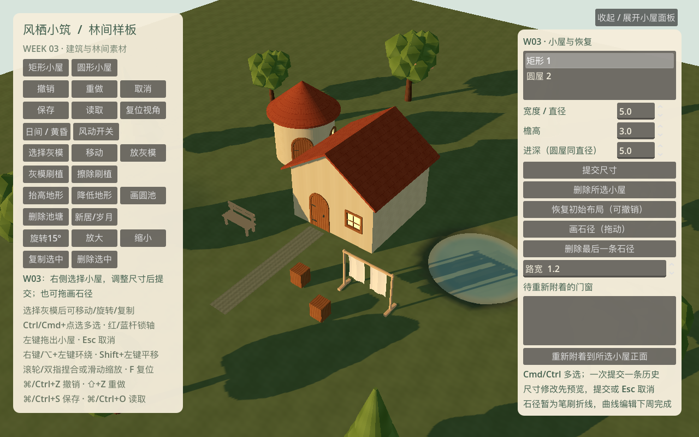
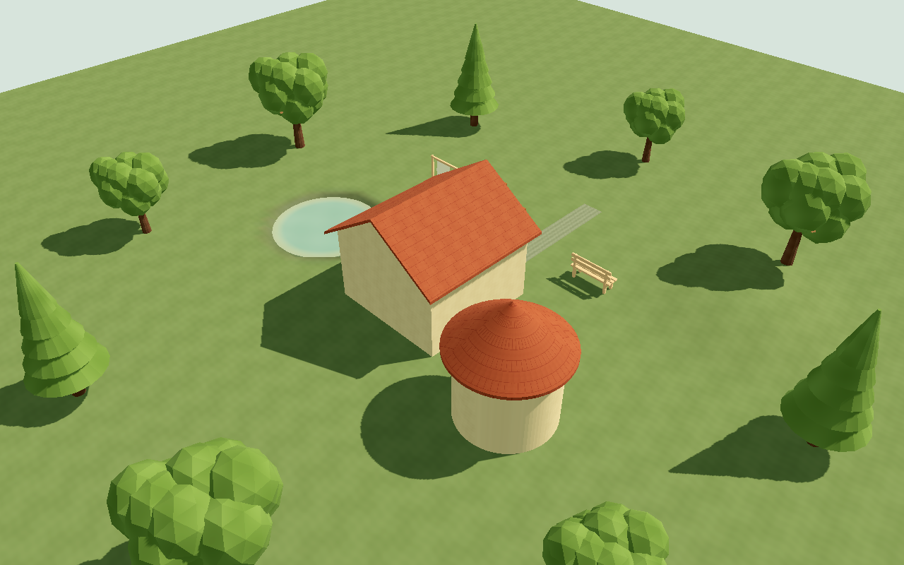
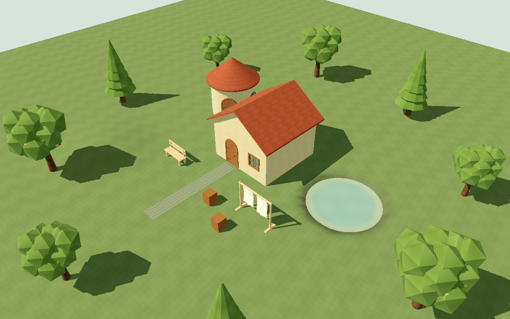
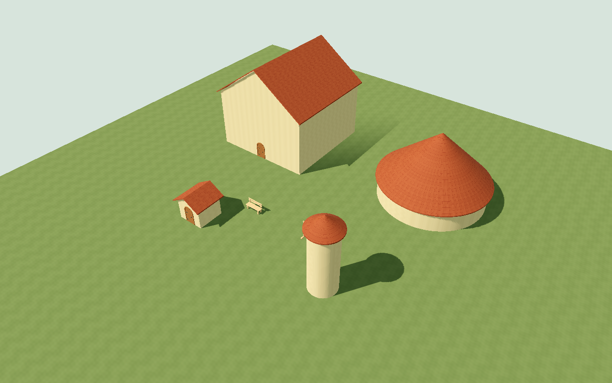
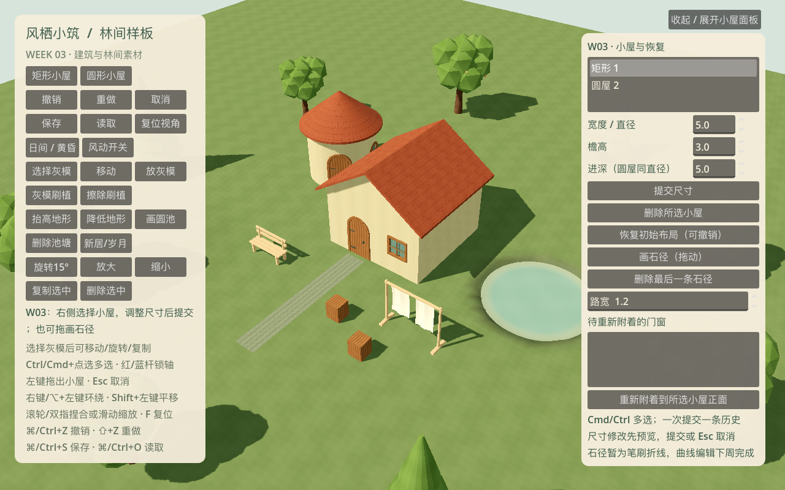

# W03 · 建筑参数、编辑恢复与自然资源

日期：2026-10-18。依据开发计划 T017–T021，以及 T022–T025 的 W03 部分。

W03 将第三周入口切到 `app/week_three_root.tscn`。完整周任务与跨周开工分别登记，原排期和 PRD 不改写。

## 交付范围

| 任务 | W03 交付 | 状态与后续 |
| --- | --- | --- |
| T017 | 阔叶/针叶/果树各 LOD0 + LOD1 的 `.blend` 与 GLB；根/树干固定、果实带风权重；实际四向图 | 源件与运行初版完成；最终手绘精修/整景继续后续美术审计 |
| T018 | 2K 叶/树皮/草/花共享图集；base/brush/alpha 分层 PNG + 浮点 NPZ + Blender 材质图；透明边 RGB 扩色 | 完成可编辑生产初版；运行时只共用一张纹理，GLB 不重复嵌图 |
| T019 | 矩/圆墙、山墙/圆锥顶生成器；墙厚上下封口、屋面底面/檐口厚度、实际几何法线、米制 UV；尺寸/檐高预览与提交 | 四生成器与参数场景完成；正式墙角木构和精细贴靠收边继续 T046；保留保守的接触立面檐口裁减 |
| T020 | 小屋多选批删、门窗待附着列表和重新附着、可撤销恢复初始布局；50 条历史与源快照容量约束；独立进程恢复 | 本周功能完成；完整存档产品界面/迁移、最终历史压力容量仍按后续任务 |
| T021 | 浅岸渐变、低饱和静水与全局轻涟漪；减少动态、固定相位和单层水面；显示/隐藏池水的帧时间对照 | 材质实现及本机可见验证完成；Metal 独立 GPU 计时不可用，不能声称透明 GPU 开销已精确测得 |
| T022 | 可拖画的有源 ID/种子的折线路径，0.5–3m 宽，贴地、格域交汇去重、建筑内部隐藏、水域止步；接入后台生成与事务 | W03 开工部分完成，W04 继续曲线控制点、碎石艺术边缘与局部依赖事件；当前不自动生门 |
| T023 | 蕨/野花/低灌木/苔石/扁石的 5 份 `.blend` 与 GLB 初稿 | W03 开工部分完成；轮廓精修、对应图集 UV、岩石材质接入与成品四向检查留 W04，未放入场景冒充最终资产 |
| T024 | worker 计算建筑周界 64 点地面支撑，W03 场景按逐段地面生成石基外壳；固定地坪与 3m 限制继续生效 | W03D5 开工完成；入口净空细节、木构/短支撑成品继续 W04 |
| T025 | 布/植物共享风向、风量，分材质摆幅；稳定对象相位、根/果实权重、零风与减少动态像素回归 | W03D5 开工完成，W04 继续全套灌草与晾布成品整合；无物理布料 |

## 试玩操作

左侧沿用矩形/圆形拖建、地形/圆池、灰模编辑、撤销重做、存读档、日暮/岁月/减少动态。
Option+左键环绕及双指捏合/滑动保留，右上可收起属性面板。

右侧列表选择小屋，Cmd/Ctrl 多选；连续调整宽度/直径、檐高、进深后点“提交尺寸”，一段预览只记一条历史。
圆屋进深随直径；门窗使用固定大小，不随墙拉伸。非法挤压、吞入手放物件/池岸或超过边界时拒绝整笔。

“删除所选小屋”将手放门窗连同参数和原世界位置存入待附着列表，清空活动父引用；未锁定自动门随父体删除。
选择待附着条目和目标小屋后点重新附着到正面；不自动挤走目标墙面原有门窗。撤销同时恢复墙洞、框体与待附着列表。
“恢复初始布局”作为普通事务可撤销；读取存档则清空当前历史，作为新的编辑会话。

石径为 W03 笔刷折线初版，拖动采样，松手提交，宽度在右侧设置；不是 T026 的完整路径生门产品。
源码保留 `--road-demo` 作为 W02 窄范围契约检查，不能把它和 W03 石径联动混为一谈。

## 数据、网格与内存

- `BuildingEdits` 只编辑源数据；删除生成稳定待附着 ID，重新附着后沿用该 ID。旧 W01/W02 存档无需新字段也可验证。
- 待附着项保存 `parent_id=""`、former_parent_id/shape/size、opening 参数、世界 position/yaw；有效父对象的开口仍在建筑记录内。
- `WorldDocument.validate` 检查待附着姿态、重复身份、非法父引用与开口；重附着失败不发布源/视图、不增加历史。
- `EditSession` 保留 50 条命令，分支提交移除 redo；replace_document 清历史，dispose 释放 UndoRedo 回调。
  每份源快照最多 1MiB JSON，超限拒绝；50 笔前后源快照约束到最多 100MiB 的序列化等价值。
  **这是源数据计量口径，不是整个进程/Dictionary 原生内存的硬上限**；网格、资源缓存不入历史，整进程内存继续后续压力验收。
- `BuildingGeometry` 以有厚度条带开真实洞；屋面有底面和封边。三角形法线由实际面计算，UV 按米投影，圆墙按弧长展开。
  参数场景 `app/building_parameter_gallery.tscn` 覆盖 3/12m、2.4/7.2m 的矩/圆体，附标准门；测试进一步覆盖多档尺寸和洞口。
- 石径 worker 将折线投到 0.25m 共享格域，交汇并为一次覆盖，网格创建仍在主线程的提交准备阶段。
  当前细格边界不是最终自然碎石轮廓；几何变体用世界种子与格坐标稳定取样，路径自身种子也保存，艺术化分布留 W04。
- 三树源 ID 通过 `_instance_views` / `_tree_views` 映射到运行节点，显示层级次序不写回源身份；按 ID 复用未删除的树/物件节点，附近编辑不重新创建远处节点。LOD 在 34m 切换，两层同相位、同材质。
  LOD 保留同一树冠团簇布局，只降低面数；切换图用于观察材质/大轮廓，不承诺最终完全无跳变。
- T024 周界样本是后台纯数组；小型石基装配在主线程。CPU 仍做全场求值，局部依赖图/预算化提交继续 T040。

## 验证与证据

```bash
python3 tools/quality/run_checks.py --week 3 --negative-control
python3 tools/quality/week_three_render_checks.py
python3 tools/quality/export_smoke.py --week 3
/Applications/Blender.app/Contents/MacOS/Blender --background --python-exit-code 1 --python tools/art/audit_sources.py -- --root "$PWD" --output "$PWD/reports/week_03_source_audit.json"
```

累计自动化检查、源文件重开、导出和渲染实测结果见下方最终快照。正常检查须退出 0，故意失败须退出 1；空套件、脚本错误或跳过关键测试不得放行。
Ubuntu/Windows CI 已升级到 W03 累计回归；没有远程仓库，未宣称 CI 已运行或 Windows 真机已通过。

Blender 审计重开三周 22 份模型源，检查 UV / COLOR_0 对应的 wind_mask / 米制 / 挂点，并重开 8 个基础材质图与共享图集节点。
分层源 PNG/NPZ 与生成脚本留在 `art_source/week_03/`，原 W02 资源未覆盖，清单显式标识替代关系。

视觉检查包括日/暮色、45/135/225/315°、强制 LOD1 与参数极值。
迎光池水曾出现强镜面泛白，已关闭镜面项、提高粗糙度，并增加固定角度池内像素检查。
水面固定采样相位，风动对照只改变植物/布的采样时间；零风/减少动态须像素完全不变。

水面开销使用同一 1080p 画面交替显示/隐藏水面，各预热 2s、采样 10s；结果是整视口帧时间，包含显示内容变化且开启 VSync。
尝试了 [Godot RenderingServer 的视口 GPU 计时](https://docs.godotengine.org/en/stable/classes/class_renderingserver.html#class-renderingserver-method-viewport-get-measured-render-time-gpu)，
本机 Metal 查询未得到正值，报告以 `gpu_timing_available=false` / null 记录。零样本不解释成零 GPU 耗时，帧时间代理不能放行独立透明 pass 预算。

## 后续门槛

W04 按 T022–T030 排期继续石径曲线/门联动、五自然资源精修、支撑与风场收尾、光照、正式地形后端、台阶和围栏开工。
完整池岸、正式属性卡/快捷键重绑、完整模板与最终性能/容量仍是后续任务。
Windows 可见交互、最低配置、独立透明 GPU 成本和实体 Mac 触控板操作手感保留为待验门槛。


## 自动化快照

W01 42 项 / 435 断言，W02 52 项 / 756 断言，W03 新增 42 项 / 865 断言；
累计 **136 项 / 2056 断言，0 失败、0 跳过**。格式、lint、三周资源契约、三周独立进程往返、风险采样均通过。
故意失败测试退出 1 并定位指定断言，正常 gate 退出 0；注入文件已删除。
证据：[检查摘要](checks.json)、[W01 XML](gut_week_01.xml)、[W02 XML](gut_week_02.xml)、[W03 XML](gut_week_03.xml)、[源审计](source_audit.json)。












## 模型预算快照

| 树种 | LOD0 三角形 | LOD1 三角形 |
| --- | ---: | ---: |
| NAT-01 | 1484 | 404 |
| NAT-02 | 384 | 224 |
| NAT-03 | 1724 | 644 |

低于建议上限；不为达到建议区间下界增加无效面数。全场植被压力、合批与最终显存预算仍按后续验收。


## 可见渲染与平台快照

设备：Apple M4 Pro / 20 核 GPU / 48GB RAM / macOS arm64，Godot 4.7.2，Forward+ / Metal 3.2。
[渲染汇总](render_checks.json)、[风像素结果](wind_pixels.json)、[水面过曝结果](water_highlights.json)。

| 检查 | 实际结果 |
| --- | --- |
| 四向 / LOD / 黄昏 / 极值场景 | 实际 GPU 视口图检查通过，无大片透明排序问题；属于当前初版人工检查，非最终美术签核 |
| 风开，相位 0/1 | 226971 字节发生变化 |
| 零风 / 减少动态 | 两组均 0 字节变化 |
| 迎光角度池内取样 | 170 个样本，泛白样本 0 |
| 1080p 水面显示 / 隐藏，交替各 2 次 | 每次预热 2s / 采样 10s；平均帧间隔约 8.33ms，各组 P95 约 8.33ms；VSync 开启 |
| 独立 GPU 计时 | 无有效样本；null / unavailable，不能解读为 0 开销 |
| Blender 源重开 | 三周 22 模型源 + 8 基础材质图 + 1 图集节点 / 9 图像通过 |
| Windows x86_64 | EXE 导出 / PE 结构检查通过，目标设备可见运行未执行 |
| macOS | ZIP 解压后从空目录可见启动 / 退出；测试源和 GUT 未入包；应用元数据 0.3.0 / org.windhaven.diorama.week03 |

[包哈希与启动报告](exports.json)。本地包在 `builds/week_03/`，未提交二进制包到 Git。
UI / 模板 / 性能最终门槛仍按后续排期；本机单池和九树场景不代表完整容量或最低配置。



连续 20 笔可见刷坡完成，主线程发布最大 / P95 为 4.293ms；
[实际报告](edit_metrics.json)。附近编辑不重建远处树节点，有源 ID 和运行节点身份回归。
本次发布略超建议 2–4ms 预算上沿；包含资源准备与场景发布，不含 worker 等待，
不承诺全部编辑或其他设备均在此范围。全场 CPU 求值和预算化发布继续 T040。


## Git 版本与干净检出

实现提交：`2f02d62`。使用 `python3 tools/quality/clean_checkout.py --week 3` 对该提交执行 Git archive，
在临时空目录全新导入；只复用锁定引擎和 lint venv，不复用 `.godot/`。累计 136 项、三周进程往返与失败注入再次通过。
[干净检出证据](clean_checkout.json)。归档证据另作提交，本地交付标签为 `v0.3.0-w03`。
没有配置 Git 远程，未推送或创建 PR。跨周 T022–T025 明确保留 W04 待办，未将其整体提前标完成。
