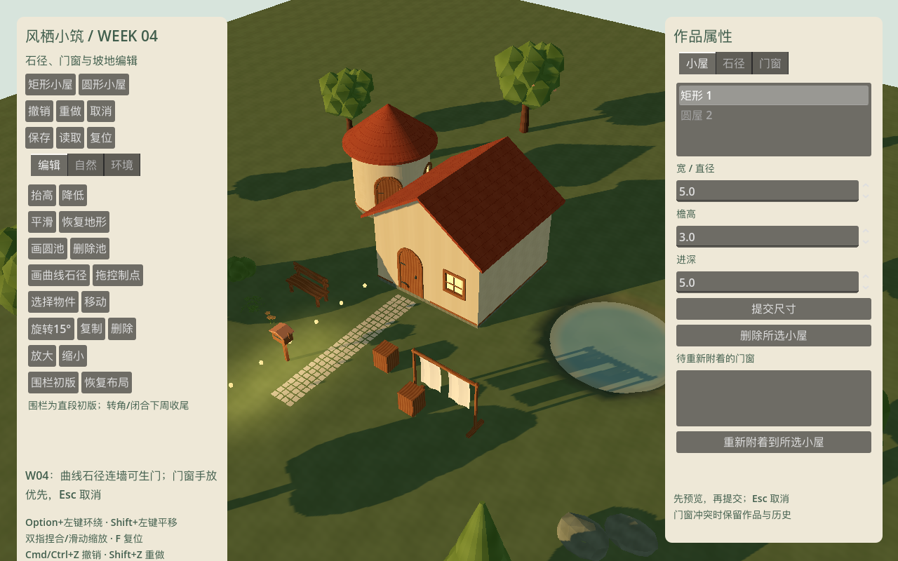
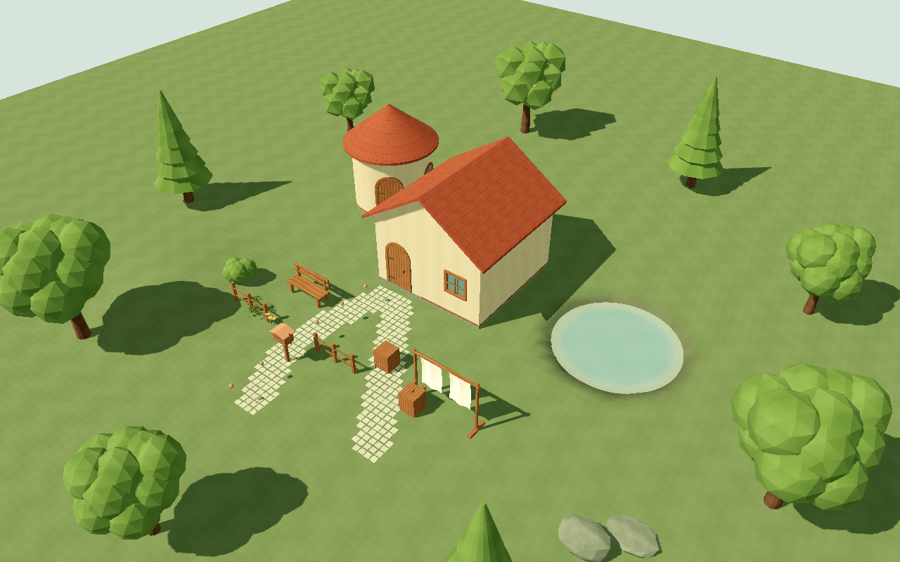
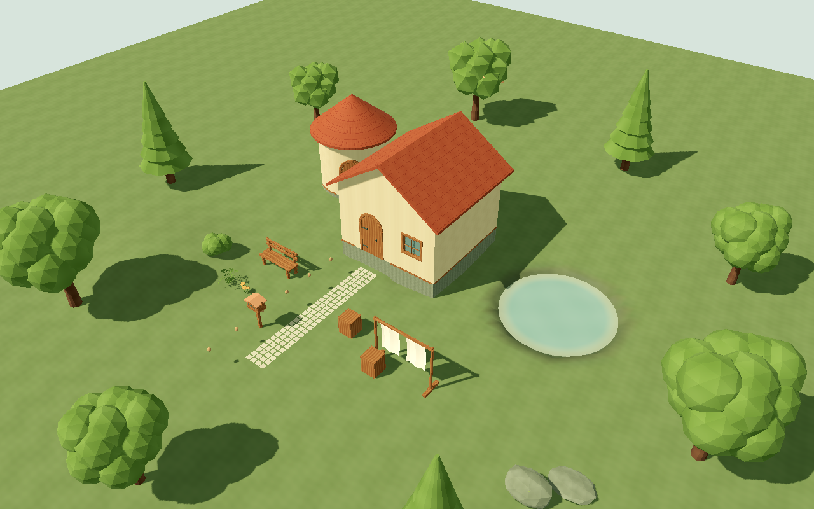
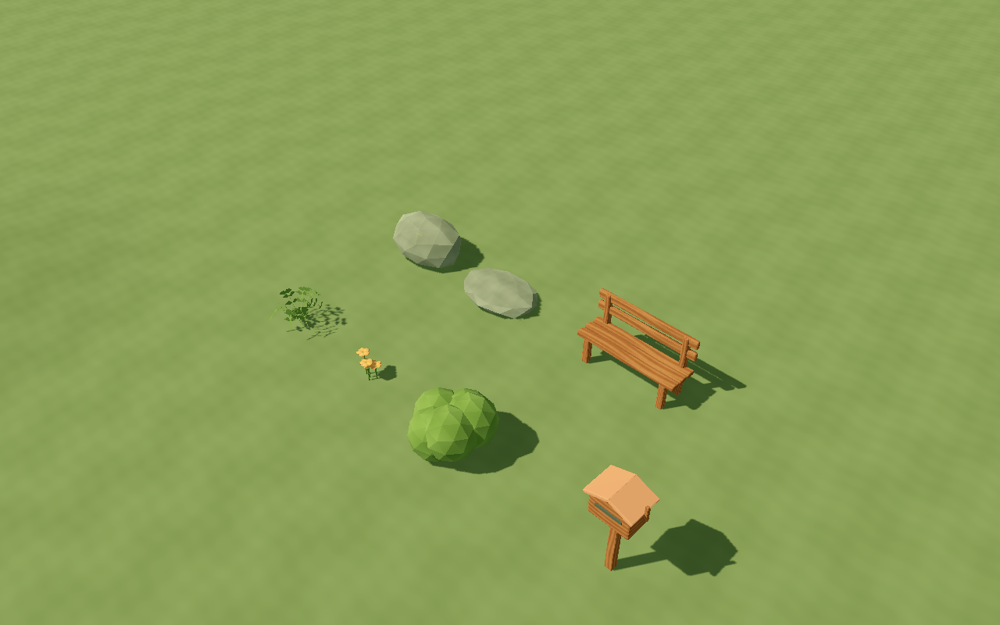
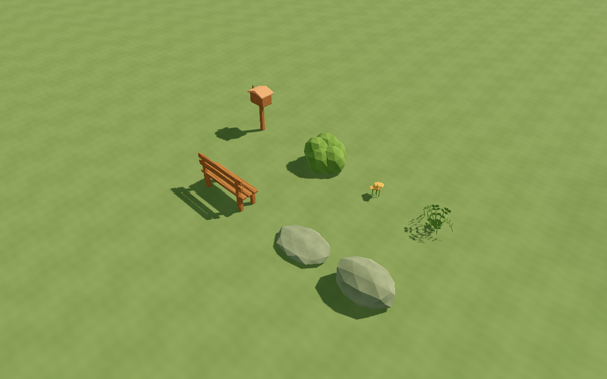
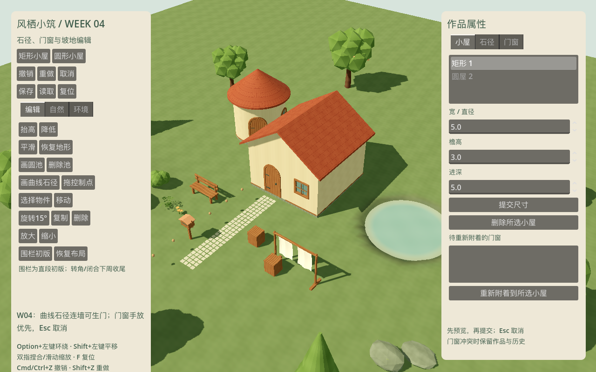

# W04 · 曲线石径、门窗联动与地形生产后端

日期：2026-10-18。依据已批准开发计划 T022–T029 收尾，以及 T030/T031 的 W04D5 开工部分。
默认入口 `app/week_four_root.tscn`；PRD 与排期基线保留，实际进度以 STATUS.md 为准。

## 任务与交付

| 任务 | 本周交付 | 状态 / 后续 |
| --- | --- | --- |
| T022 / ENV-03 | 有源控制点的平滑石径、路宽 0.5–3m、黄色控制点拖动、共享格域交汇去重、独立种子的石块轮廓/色差、坡面投影、室内隐藏/水域止步、路径局部依赖信号 | 本周功能完成；石块当前为小型四边碎石，最终自然艺术精修随整景继续 |
| T023 / NAT-04/05/06/08/09 | 蕨/野花/低灌木/苔石/扁石 5 份 .blend + GLB，复用图集/石材、根零权重、坡面朝向、实际四向近景 | 源件与运行初版完成；最终全场人工美术签核仍随后续整合 |
| T024 / BLD-19 | 周界贴地石基、短角柱与木边、门口净空留空；地坪水平、3m 整笔拒绝、撤销恢复 | 功能完成；不包含 T033 的短石阶成品 |
| T025 / FX-03 | 树/灌草/晾布统一风向/风量，分材质摆幅、稳定对象相位，根/挂点固定，零风/减少动态静止 | 风场接入完成；PROP-04 当前源初稿有审计与挂点回归，模型精修按 T031 延续 |
| T026 | 路端与穿屋入口候选、自动门复用/多路径供门/最后路径删除；三门两窗手放/移动/锁定，手放优先与冲突回退 | 本周功能完成；完整属性卡/重绑 UI 继续后续排期 |
| T027 / FX-01/02 | 日暮/窗光约 1.2s 过渡、暗部保色；按距离和稳定 ID 选最多四盏局部灯，其余仅发光 | 功能完成；当前小光点为 LightRig 模型适配探针，正式 PROP-08 提灯不是本周资产 |
| T028 / ENV-01 | 64m 分块高度场/48m 编辑核心、带种子的温和基础坡地、升降/平滑/恢复、池岸/入口/边界保护；独立主线程与 worker 精确源缓存，只重建受影响地形块 | 后端功能完成；所有实例仍需姿态校验遍历，全局空间依赖图和逐帧提交预算属于 T040 |
| T029 / PROP-01/02 | 木长凳与信箱独立源件、木材复用、地面/茶盘支撑点、六面检查及试玩放置 | 本周源件与运行初版完成 |
| T030 / BLD-11 | 两点直段围栏、地面柱杆、路径开口与源数据撤销 | W04 开工完成；转角/闭合交互、端头完整封边在 W05D1 收尾，不标整项完成 |
| T031 / PROP-03/04 | 盆栽/晾衣架源初稿；盆土封口、晾布挂点/权重、导入和放置 | W04 开工完成；成品精修与最终装配在 W05D1–D2 |

本周无新增外部插件；继续 Godot 4.7.2 / Blender 5.1.2 / GUT 9.7.1 / gdtoolkit 4.5.0。
Blender 是唯一模型主源，Three.js 不另设第二套真源。新运行资源可预载，避免放置操作中读取磁盘。

## 玩法与数据契约

左侧编辑/自然/环境与右侧小屋/石径/门窗均可切页、滚动。Option+左键环绕、Shift+左键平移、双指缩放保留。

- 石径落笔采样源点、松手单笔提交；选中路径后拖黄色控制点。可提交路宽与曲线开关。
- Catmull-Rom 纯数学采样，控制点最多 256；采样步长约 0.25m，单段最多 80 次；曲线被限制在地块核心。
  共用 0.25m 格域只输出一次覆盖，独立路径种子决定石块轮廓/色差；交汇按稳定路径 ID 决定所属种子。
- 每次路径候选在同一份源快照中协调门窗，先保留全部手放/锁定开口，再计算自动门。
  端点距墙≤0.6m、实际地面与建筑地坪高差≤0.45m 才生门；直/曲墙均可定位，穿屋仅保留外侧路面。
  路径可连接附近手放门；多个请求不足 1.2m 时复用最近门，source_paths 记录供门关系。
- 删最后供门路径时，同一事务移除未锁自动门；锁定或手动移动后转 manual，并清除路径依赖。
  自动门仍由路径维护，UI 删除入口提示先删除供门路径；手工开口可删除。
  手放/移动门窗会在约 0.6m 内预览最近合法墙段；新门不能挤掉手放窗；自动候选也尝试附近合法墙段，仍不可用时保留原内容并提示。
- 开口保持标准尺寸和框体 scale=1；候选无效时不发布非法网格，提交失败不占历史。圆墙展开接缝继续保留既有开口边距规则。
- 基础坡地由 world_seed 和 base_profile 决定，height_deltas 仍只保存玩家差量；恢复地形清差量，不抹掉基础坡地。
  平滑使用原快照邻域均值，避免迭代次序影响结果。普通刷跳过池域/岸带、入口净空与核心边缘。
- 基座按共享地面采样贴合，角柱不遮入口；地形会穿地坪或支撑超过 3m 时整笔拒绝。短阶仍在下一周。
- TerrainChunks 用完整局部源签名，包含法线采样 halo、基础场和池岸影响；没有仅用短哈希判等。
  每个串行 worker 拥有自己的数组缓存，主线程历史恢复使用另一份缓存；发布前只创建主线程资源。
  删除池域也正确使原岸线块失效。路径修改信号包含旧/新包围范围，供后续依赖图消费。
- 仍保留 Preview/PendingCommit 屏障、取消、准备失败回滚、50 条源历史与 1MiB/快照约束。
  空点选、无效控制点和零长度围栏不会消耗历史。

## 美术源件与运行装配

[源清单](../../../art_source/week_04/manifest.json)、[源件说明](../../../art_source/week_04/README.md)。
W04 新增/替换 9 份源件，三周旧件保留；资源族不把 LOD 或迭代版重复计数。
叶草花继续 MAT-03，木/石继续 MAT-02，无新增贴图族。苔石与扁石有封闭底面，根与刚性部分风权重为 0。
蕨叶在近景检查后改为用几何轮廓表达叶形，采样图集不透明内区，避免过碎的透明裁切。

长凳有 socket_tea_surface / socket_ground，信箱含投递口和旗形轮廓，无品牌地址。
盆栽/晾衣架作为跨周初稿明确标注；当前可验证统一风场、固定挂点和放置，不当作最终模型签核。

## 验证与复现

```bash
python3 tools/quality/run_checks.py --week 4 --negative-control
python3 tools/quality/week_four_render_checks.py
python3 tools/quality/export_smoke.py --week 4
python3 tools/quality/clean_checkout.py --week 4
/Applications/Blender.app/Contents/MacOS/Blender --background --python-exit-code 1 --python tools/art/audit_sources.py -- --root "$PWD" --output "$PWD/reports/week_04_source_audit.json"
```

每周套件全部累计运行。格式/lint/资源契约、四周独立进程存读档、故意失败退出控制均须通过。
源审计实际重开三周原件与本周九件，共 31 份模型源，检查 UV / wind_mask / 挂点 / 米制，
并重开 8 个基础材质图和 2K 图集节点。可见渲染与 headless 自动化分开，不以源件存在代替导入和运行检查。

可见检查有日暮/四向、资源四向近景、路径生门与基座演示、风开/零风/减少动态像素对照，
以及 1080p 日间/黄昏和连续 20 笔编辑。GPU 独立计时在本机 Metal 仍无有效值，null 不解释为零开销。
VSync 帧间隔和主线程提交耗时分开记录；Windows 导出不是 Windows 真机通过。

## 剩余门槛

W05 继续 T030/T031、自由池岸 T032、短阶 T033、木箱/浇水壶 T034、短桥 T035、绿篱 T036 和 M2 灰模闭环 T037。
当前光点是受控灯位功能探针，正式提灯/最终全场美术和多存档产品界面均未提前标成品。
完整压力容量、空间依赖图/逐帧预算、最低配置、Windows 真机与实体触控板手感仍需后续验收。


## 最终自动化与本机快照

| 分组 | 测试 | 断言 |
| --- | ---: | ---: |
| W01 | 42 | 435 |
| W02 | 52 | 756 |
| W03 | 42 | 865 |
| W04 新增 | 50 | 1526 |
| 累计 | **186** | **3582** |

0 失败、0 跳过；四周进程往返、格式、lint、资源契约均通过。故意失败退出 1，正常 gate 退出 0，注入文件已删除。
[检查摘要](checks.json)、[W01 XML](gut_week_01.xml)、[W02 XML](gut_week_02.xml)、[W03 XML](gut_week_03.xml)、[W04 XML](gut_week_04.xml)、[源文件审计](source_audit.json)。

设备：Apple M4 Pro / 20 核 GPU / 48GB RAM / macOS arm64，Godot 4.7.2 / Forward+ / Metal 3.2。

| 可见检查 | 实际结果 |
| --- | --- |
| 日暮 / 四向 / 资源近景 / 路门与基座演示 | 真实 GPU 视口检查通过；初版模型未见大片透明排序或明显十字片问题，非最终全场美术签核 |
| 风开 t=0/1 | 230559 字节变化 |
| 零风 / 减少动态 | 两组均 0 字节变化 |
| 日间 / 黄昏，1080p，各 10s | 各组 P95 帧间隔约 8.33ms，VSync 开启；黄昏启用局部灯 4 盏 |
| 20 笔可见编辑 | 全部完成；最后一笔 worker 重建 2 / 64 个地形块 |
| 主线程发布最大 / P95 | 5.861ms；**超过建议 2–4ms，继续 T040 优化，未标完整性能放行** |
| 独立 GPU 时间 | 本机无有效样本，null / unavailable；不称为 0 GPU 成本 |
| Windows x86_64 | 导出 / PE 结构通过，Windows 真机交互未执行 |
| macOS | ZIP 解压后从空目录可见启动/退出，GUT 与四周测试源未入包；0.4.0 / org.windhaven.diorama.week04 |

[渲染汇总](render_checks.json)、[风像素](wind_pixels.json)、[20 笔编辑](edit_metrics.json)、[包 SHA-256 与启动报告](exports.json)、[应用元数据](app_metadata.json)。
CPU 发布计时包括主线程资源准备/场景发布，不包括 worker 等待。地形局部缓存已接入，建筑/门/支撑仍按候选求值；
当前实例姿态和材质校验仍会遍历现有对象，未声称 T040 的完整依赖图/逐帧预算完成。小场景帧间隔不代替完整容量或最低配置。














## Git 与干净检出验证

实现提交 `fb3771b`，里程碑标签 `v0.4.0-w04` 指向随后仅归档证据的提交。
`python3 tools/quality/clean_checkout.py --week 4` 从该实现提交导出源码，在没有 `.godot` 缓存的临时目录重导入，
累计 186 项测试、四周进程存读档、质量门槛与故意失败负控全部通过。只复用锁定的宿主工具，不复用项目导入缓存。
[干净检出报告](clean_checkout.json)。本地 `main`，未配置远程或推送；构建包哈希已与导出报告复核一致。
