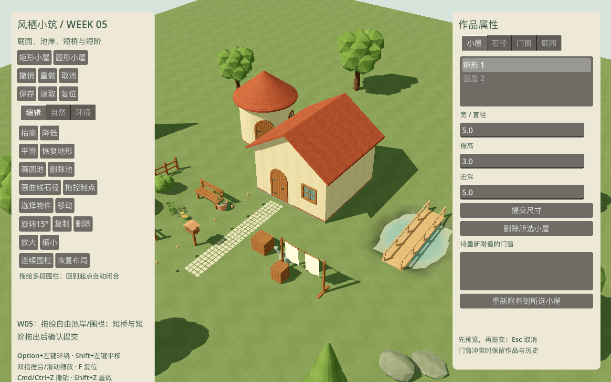
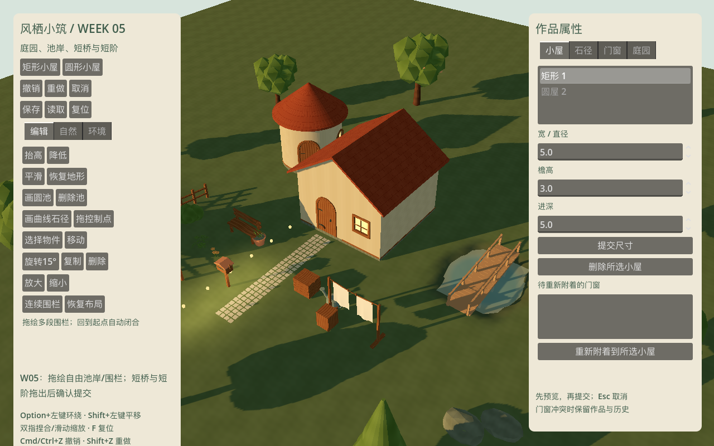
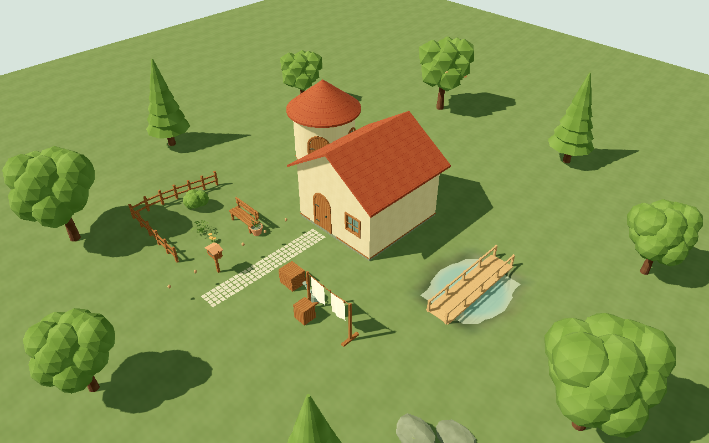
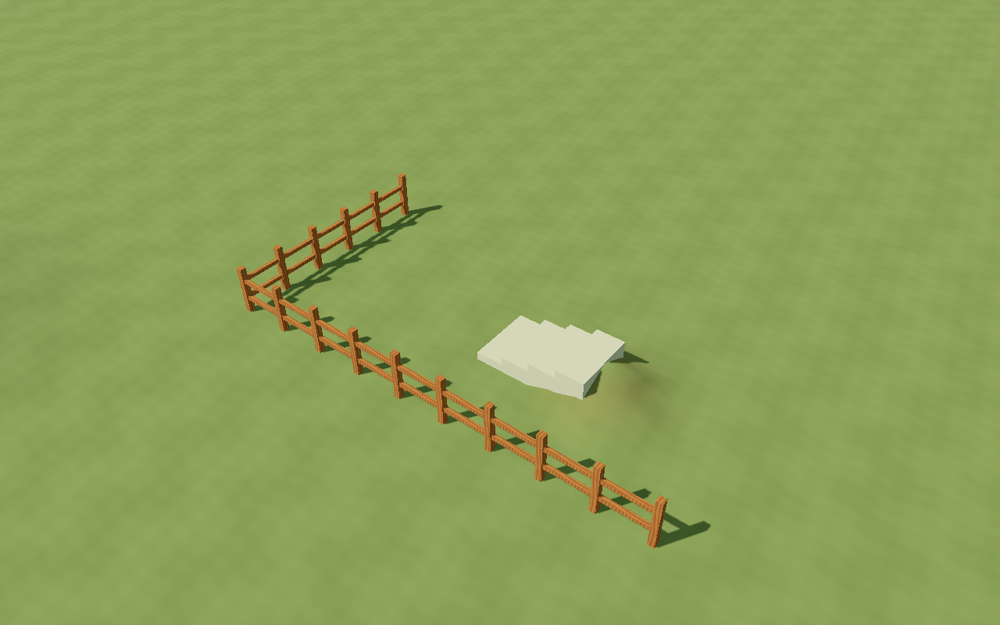
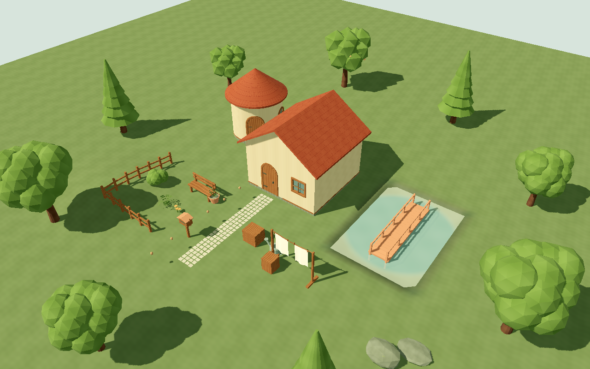
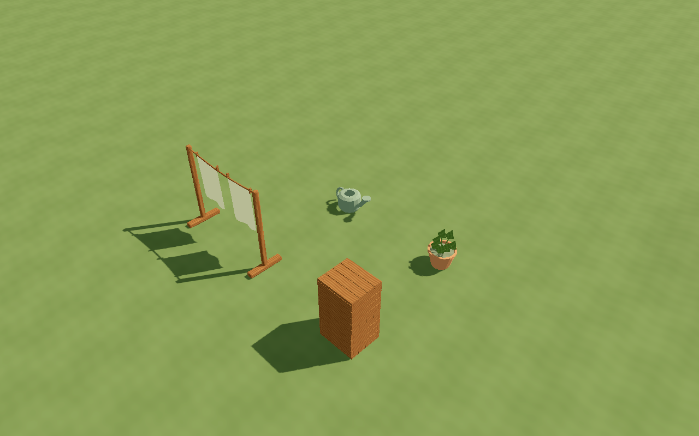

# W05 · 庭园、池岸与灰模建造回退闭环

本周按批准计划完成 T030/T031 收尾、T032–T037 的本周范围，T038 在 W05D5 开始源件制作并留 W06 收尾。
基线为 `v0.4.0-w04`；入口 `app/week_five_root.tscn`；版本 `0.5.0-w05`，Godot 4.7.2 Standard / Forward+。
这是 M2 建造与回退切片，分类植被、完整产品界面、全场艺术签核和性能/平台发布门槛继续后续阶段。

## 任务与交付

| 任务 | 本周交付 | 范围与后续 |
| --- | --- | --- |
| T030 | 连续拖绘多段围栏、靠起点闭合、端头封闭、共享角柱、贴地、路径开口、选点拖动/删除/撤销 | 参数与历史仍使用原控制点源；非任意装饰栏杆系统 |
| T031 | 厚盆沿/内壁和封闭土面、植物组合；带绳/夹子与两布的晾衣架 | 顶部挂点零权重、下摆可动，无实时布模拟；最终全场艺术签核后验 |
| T032 | 一个非自交闭合自由轮廓、旧圆池兼容、固定水位、池底和 0.75m 岸带、共用距离查询 | 最窄 2m、离可编辑边界 2m、原坡差≤0.6m；非法整笔拒绝；不模拟流体 |
| T033 | 0.15–0.9m 高差短阶、宽 0.8–2m，手放门口上端吸附水平地坪、高差提示 | 长 0.6–3m；越界保留原合法作品并提示调地形；非长阶/多层楼梯 |
| T034 | 六面完整木箱与支撑面、可读壶嘴把手的粗糙金属浇水壶 | 支撑引用有循环/深度/丢失保护；移动上层可解除支撑；T045 继续统一八道具界面 |
| T035 | 1.5–6m 短直木桥、两端接地过渡、最多 0.5m 桥头高差、明确确认按钮 | 改岸或删池失效仍保留并标记，支持调端点/删除/撤销；非多跨桥 |
| T036 | 共用池岸安全带对建筑/改池双向校验、手工内容优先、桥/阶与屋体冲突检查 | 沿用待附着门窗 ID/参数/世界变换和恢复入口；不移动或隐藏手工物件来避冲突 |
| T037 | 固定混合动作样本、50 条历史全部撤销重做、非法拒绝、20 手放内容保护、可重启灰模包 | 正式分类刷植在 W06；本周复用灰模刷植验证数据闭环 |
| T038 | 茶盘/壶/两杯组合与带底座/挂点/光源锚点提灯源初稿 | W05D5 开工完成，W06 完成近景、亮灭与装配；当前 UI 不作为最终资源开放 |

## 数据与实现

`features/ponds/pond_shape.gd` 提供旧圆池/自由岸线统一有符号距离、边界/自交/最窄校验、安全带与水面三角化。
岸线是原始点数组，不把节点、网格或岸带雕刻写入源地形。水位在首次落笔取玩家地面减 0.15m，后续保持；
水深约 0.45m，向岸带过渡至水面以上 0.1m。四种普通地形笔刷保护池域和岸带；删池恢复源差量。
为控制 MVP 轮廓复杂度，拖绘每约 2.1m 留一个转折点，最多 64 点，闭合并验证；拒绝窄颈和交叉，不实现任意多岛/孔洞。

`features/structures/garden_structures.gd` 只保存桥/阶 ID、端点、宽和采样高度。
新建或改端点必须合法才能提交；环境/池岸变化可使已有结构失效，仍按保存端点显示为暖红色并在列表提示。
撤销恢复整个源快照，岸线和桥有效状态同步恢复。结构网格由 worker 产生原始数组，资源与节点在主线程发布。

`FenceGeometry` 将角点柱去重，轨杆向柱内缩且六面封闭，地形采样与路径开口复用既有查询。
`InstanceEdits` 通过 `support_id` 保存有限支撑，检查父件类别、落点、循环与深度。删除仍被依赖的底箱会拒绝，先移动上层物件即可解除引用。
不以静默删除上层内容的方式完成编辑。完整八道具产品交互按 T045 继续。

本周跨进程验证发现默认 JSON 浮点输出会截断桥头采样高度，`SaveCodec` 改用完整精度序列化；
1MiB 源快照预算也按同一完整精度计算；容器魔数/版本/备份规则保持兼容。新增精度测试并保留全部旧周存档回归。
可见检查还发现了自由水面背面剔除问题，已通过统一网格构建函数修复，并补上朝向和显示/隐藏像素对照。

## 模型源与预算

| 资源 | 三角形 | 建议预算 | 阶段 |
| --- | ---: | ---: | --- |
| PROP-03 盆栽 | 506 | 1800 | W05 源件与运行集成 |
| PROP-04 晾衣架 | 1388 | 2500 | W05 源件与运行集成 |
| PROP-05 木箱 | 336 | 1200 | W05 源件与运行集成 |
| PROP-06 浇水壶 | 696 | 1800 | W05 源件与运行集成 |
| PROP-07 茶具组合 | 936 | 2600 | 跨 W06 源初稿 |
| PROP-08 提灯 | 960 | 2000 | 跨 W06 源初稿 |

源：`art_source/week_05/`；导出与导入预设：`assets/week_05/`；作者脚本 `tools/art/build_week_five_assets.py`。
共享既有木材/植物图集/建筑材质实例，不新增贴图家族。Blender 重开五周 37 模型、8 基础材质图和共享图集，检查 UV、权重、挂点、预算与上沿固定。
本地引擎/插件版本仍锁定；没有为本周引入 Three.js、Terrain3D 或实时布物理依赖。

## 重复验证

```bash
python3 tools/quality/run_checks.py --week 5 --negative-control
python3 tools/quality/week_five_render_checks.py
python3 tools/quality/export_smoke.py --week 5
python3 tools/quality/clean_checkout.py --week 5
```

质量命令依次检查引擎导入、格式、lint、五周资源契约、GUT、五周独立进程存读档及故意失败负控。
可见图形验收、导出、重导入保持串行。源件改变后须在 Blender 实际重开审计；GLB 解析不代替源审计。
结果与剩余门槛在文末归档；Windows 导出不等于 Windows 真机通过。


## 自动化结果

| 分组 | 测试 | 断言 |
| --- | ---: | ---: |
| W01 | 42 | 435 |
| W02 | 52 | 756 |
| W03 | 42 | 865 |
| W04 | 50 | 1526 |
| W05 新增 | 45 | 315 |
| 累计 | **231** | **3897** |

0 失败、0 跳过。格式、lint、资源契约、五周独立进程存读档全部通过。
故意失败负控退出 1，正常 gate 退出 0；注入文件已清理。
[检查摘要](checks.json)、[W01](gut_week_01.xml)、[W02](gut_week_02.xml)、[W03](gut_week_03.xml)、[W04](gut_week_04.xml)、[W05 XML](gut_week_05.xml)、[Blender 源审计](source_audit.json)。

本周用例还覆盖串行 PendingCommit 的取消、实际鼠标松手后仍待确认、Option+左键不误画池，以及拒绝畸形池域包围信息和退化围栏。
50 笔混合测试逐步撤销与重做，比较除会话递增 revision 外的全部源字段，包含刷植、桥池状态和删父重新附着。


## 可见与性能结果

设备：Apple M4 Pro / 20 核 GPU / 48GB RAM / macOS arm64；Godot 4.7.2 / Forward+ / Metal 3.2。

| 检查 | 实际结果 |
| --- | --- |
| 日暮、四向、资源近景、短阶与转角围栏、失效桥 | GPU 视口检查通过；源件/生成器初版集成，非最终全场艺术签核 |
| 水面显示/隐藏 | **7371 像素变化**，确认水面确实绘制；未用概念图代替运行证据 |
| 风开 t=0/1 | **12942 字节变化** |
| 零风 / 减少动态 | 两组均 **0 字节变化** |
| 1080p 日间 / 黄昏，各 10s | P95 帧间隔约 6.94 / 8.33ms；VSync 开启，不能当独立 GPU 时间 |
| 黄昏局部灯 | 最近最多 4 盏，仍使用 W04 功能探针；正式提灯待后续装配 |
| 20 笔可见编辑 | 全部完成；最后一笔 worker 重建 2/64 地形块 |
| 主线程发布最大 / P95 | **11.652ms**，超过建议 2–4ms；继续 W06 T040 局部失效图/资源复用/逐帧预算，未标完整性能放行 |
| 独立 GPU 计时 | Metal 无有效样本，null / unavailable；不表示零 GPU 成本 |

发布计时包含主线程网格资源准备及节点发布，不包含 worker 等待。W05 桥/阶/水面目前随候选准备资源，
全部局部失效与按帧预算尚未实现。小样本 VSync 帧间隔不代表完整容量、最低配置或 Windows 设备性能。
截图工具改为显式请求一次绘制后读图，避免 macOS 批量切窗时等待下一次 frame_post_draw 悬停；截图仍来自实际视口。

[渲染汇总](render_checks.json)、[风像素](wind_pixels.json)、[水像素](water_pixels.json)、[20 笔编辑](edit_metrics.json)。














## 导出与本机包

Windows x86_64 PE 与打包成功；macOS ZIP 从空目录解压后可见启动、采样并正常退出。
Mac 元数据 `0.5.0 / org.windhaven.diorama.week05`；GUT 与五周测试源码未入包。
[导出步骤与包 SHA-256](exports.json)、[应用元数据](app_metadata.json)。
试玩包保留在 `builds/week_05/macos/windhaven_week_05.zip` 与 `builds/week_05/windows/windhaven_week_05.exe`，
构建包不入 Git；哈希已复核一致。本地开发包未公证；Windows 真机可见交互与云端 CI 未执行。


