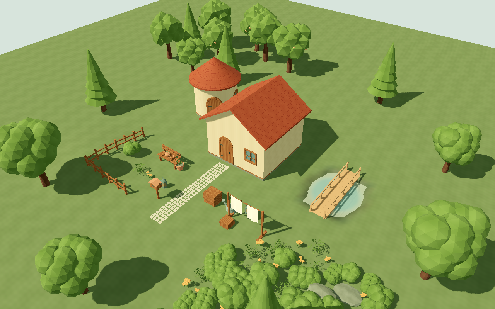
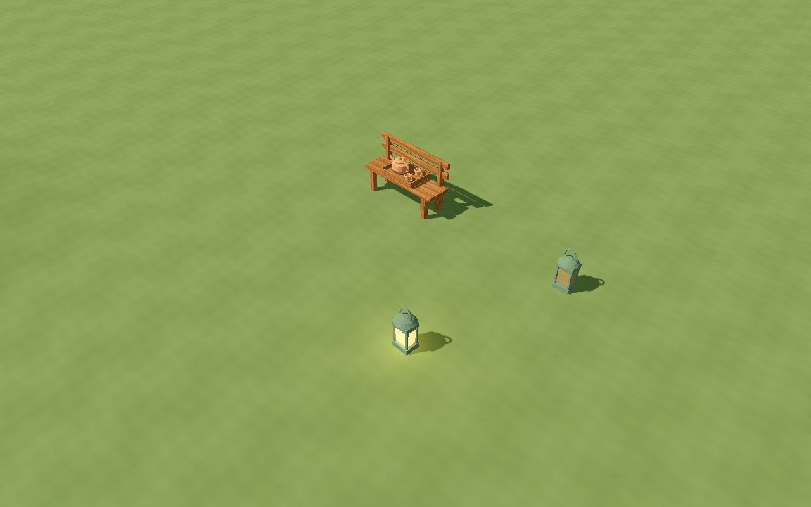
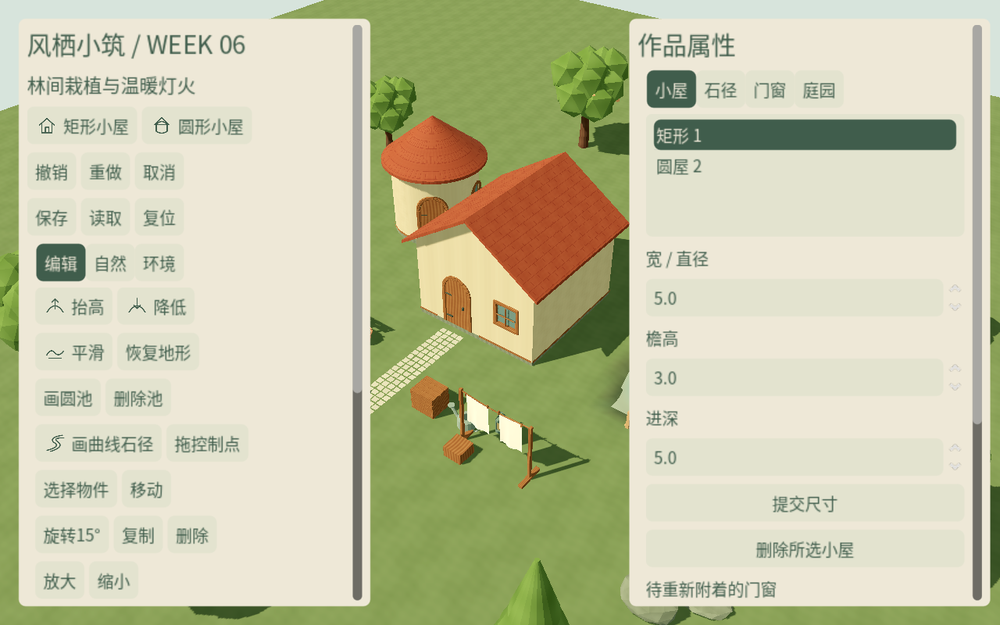
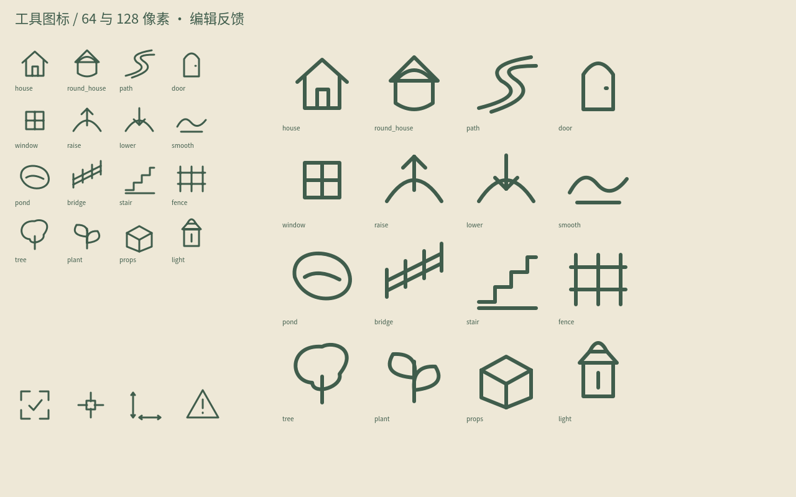

# W06 · 分类植被与局部发布

日期：2026-10-18；Godot 4.7.2 Standard / Forward+；版本 `0.6.0-w06`。
本周完成 W06 排期切片；T044/045/046 按批准计划延续到 W07，未宣布整个 MVP 完成。
批准的 PRD、开发计划与 backlog CSV 保持原文，实际状态在本报告与 STATUS 中维护。

## 任务交付

| 任务 | 本周可运行/可检查结果 | 后续边界 |
| --- | --- | --- |
| T038 | 茶盘/厚壶/两杯，杯内壁；提灯四玻璃面/底座/挂点/光锚/发光遮罩；真实模型代替小光点 | 全场艺术签核继续场景集成 |
| T039 | 三树、四灌草、两岩石目录；单株/分类刷/分类擦；三类独立密度、半径、稳定 ID/种子/尺度/朝向；自动避入口/路/池/桥阶；整笔撤销 | NAT-07 当前为复用灌木的紧凑闭口段；拉伸/转角生成器是 T048 |
| T040 | 精确局部失效签名、64 地形块与邻接 halo、按对象缓存；worker 纯数组；主线程按帧准备资源后原子发布；旧结果令牌淘汰、PendingCommit/取消保护 | W08 T054 继续压力容量与批次成本优化 |
| T041 | 授权中文字体、奶油/深绿主题、悬停/选中/焦点规范；100/125/150% 比例与双侧滚动面板 | 完整底栏/存档/摄影界面继续产品排期 |
| T042 | 六木石源片、米制端点/截面规范，接入基座/围栏/短阶参数 | 正式 GLB 装配与曲墙/檐口精修继续 T046 |
| T043 | 六声音族共 17 段原创 PCM、源脚本、循环预设、响度与接缝审计、许可登记 | T063 W10 接播放器/混音/笔刷限频/音乐开关及人工听感签核 |
| T044 | 16 工具 + 4 反馈 SVG 源/运行副本；64/128 实机图；按钮与状态行初步集成 | W07 完成工具布局、手柄与反馈组合签核 |
| T045 | W06D5 开工：八道具可选；茶盘可置长凳/木箱，跟地/锁高；提灯开/关/自动、发光面与最近四灯分离 | W07 收尾完整属性卡与道具全流程 |
| T046 | W06D5 开工：共用 KitProfiles 截面输入基座/围栏/短阶，复用五种开口和原有洞口逻辑 | W07 完成正式源片装配及极值/曲墙/接触收边视觉回归 |

## 结构和数据约定

`VegetationBrush` 使用稳定格点和三类间距/密度；同手势重复经过不重复刷入。
自动植被受地形与新结构影响时重算；手放/锁定内容不会被分类擦除或自动避让删除，
冲突整笔拒绝。移动/旋转批量实例会保留源 ID 并提升为手放对象。
自动实例按 8m 空间单元与资产分组，单元中心作为 MultiMesh 原点，树 LOD 与逐实例风相位保留。
142 实例样例有 20 个空间/资产批组；GLB 多子网格会分别产生渲染实例，该数字不等于总 draw call。

`LocalRebuild` 分别在 worker 与同步路径持有私有缓存，不共享可写字典；
`DirtyGraph` 计入变更前后范围、局部地形采样、支撑引用、池岸及邻居建筑。
`ViewPlan` 只在主线程创建资源，`ResourceStage` 用约 1.8ms 的帧内目标拆分 job，
核心视图全部准备成功才由 `EditSession.finish_prepared` 发布源和单条历史。
预览可淘汰；已提交屏障串行，不因新输入被替换；取消释放未发布资源，保留原作品。
未改变的节点和网格复用。原生资源创建调用不可抢占，因此帧内目标不是硬实时上限。

独立进程测试暴露 Godot JSON 解码对部分 float32 派生 double 产生一 ULP 差异。
`ExactFloatJson` 在 schema-1 容器内部保存经过验证的字段路径及 IEEE754 位串，
重载恢复精确浮点；旧的普通 JSON 根仍可读取。容器魔数、校验、备份和 schema 号不变。
非法位串/路径/NaN 拒绝；元数据不进入源快照。历史源预算仍为 1MiB，实例上限 800。
没有放宽测试精度来绕过问题。

## 测试和源审计

```bash
python3 tools/quality/run_checks.py --week 6 --negative-control
python3 tools/quality/week_six_render_checks.py
python3 tools/quality/export_smoke.py --week 6
python3 tools/quality/clean_checkout.py --week 6
```

导入、渲染、导出必须串行运行。GUT 新增 **68 项 / 1585 断言**，
六周累计 **299 项 / 5482 断言**，0 失败、0 跳过。
包含刷植保护与确定性、局部/全量几何一致、陈旧 worker、分帧取消/失败/连续提交、
真实鼠标/UI/Mac 手势隔离、批量选择映射、支撑/锁高、灯模式、中文布局与音频/字体/模型契约。
每周独立进程写入/重启读回全部通过；负控故意失败退出 1，正常 gate 退出 0。

Blender 实际重开六周 **45 模型源、8 基础材质图和 1 图集 / 9 图像**；
预算/UV/风权重/插槽通过。茶具 1908/2600、提灯 1028/2000 三角面。
六份源片各 108 三角面，是既有资产族组件，不能按六个新增资产族计数。
生成和审计命令见 [源交付说明](../../../art_source/week_06/README.md)。

17 WAV 为原创 DSP 合成：林间 1、风 2、水 1、木/石/草各 3、UI 3、稀疏器乐 1。
48kHz mono PCM16，环境 8s 循环、音乐 24s；普通 RMS -30dBFS，音乐 -36dBFS，峰值低于 -6dBFS。
环境接缝最大 44 个 PCM16 计数，无削波；源/导出字节一致，Godot 实际循环属性已测试。
声音不是现场录音，波形检查不替代最终播放/混音听感验收。
中文 Noto Sans SC 未修改，固定来源/哈希与 OFL 全文保留；
[许可与来源](../../../THIRD_PARTY.md)。图标与音频不包含第三方模型/音效采样。

## 实际画面与性能

已查看日间、黄昏、四向茶具/提灯、100/150% UI、64/128 图标、批量草木与水面。
风像素对照：开启变化 **429228 字节**；零风 / 减少动态均 **0**。
各截图为实际视口，不是概念图或最终美术签核。

采样设备 Apple M4 Pro / 20 核 GPU / 48GB / macOS arm64，Forward+ / Metal 3.2，
1920×1080、VSync、每组 10 秒。日间/黄昏/编辑 P95 帧间隔均约 8.33ms；
142 实例草木样例约 8.35ms。黄昏两盏局部光；控制器硬限最多四盏。

| 20 笔可见编辑 | 本周测量 |
| --- | --- |
| 成功完成 / 末笔地形重建 | 20/20；2/64 块 |
| 主线程原子发布最大 / P95 | 1.389 / 1.389ms；W05 同设备为 11.652ms |
| 分帧资源准备最大切片 | 0.239ms，20 个切片 |
| 末笔 worker 计算 | 14.899ms |
| 提交到显示最大 / P95 | 90.107 / 90.107ms |
| GPU 计时 | null / unavailable；0 有效样本 |

这是固定小场景基准，各阶段耗时不可混称“整体编辑成本”。
142 实例静态样例不代表最终大笔刷延迟或 PRD 压力容量；
GPU 查询不可用、最低配置与最终场景成本在后续门槛继续验证。






## 交付证据

- [六周质量门槛](checks.json)、[W06 GUT XML](gut_week_06.xml)、[干净 Git 检出](clean_checkout.json)
- [源审计](source_audit.json)、[媒体审计](media.json)、[渲染与性能](render_checks.json)
- [编辑指标](editing_metrics.json)、[导出步骤及 SHA256](exports.json)、[Mac 导出可见启动](exported_macos.png)

Mac ZIP 已在空工作目录可见启动/退出，包内含中文字体许可证及声音资源，GUT 与六周测试源不入包。
Windows x86_64 PE 及打包通过；Windows 真机显示/输入与物理触控板手感、云端 CI 尚未执行。
Git 源码与证据提交、`v0.6.0-w06` 标记见根目录 STATUS；下载工具、缓存、试玩包不入 Git。
