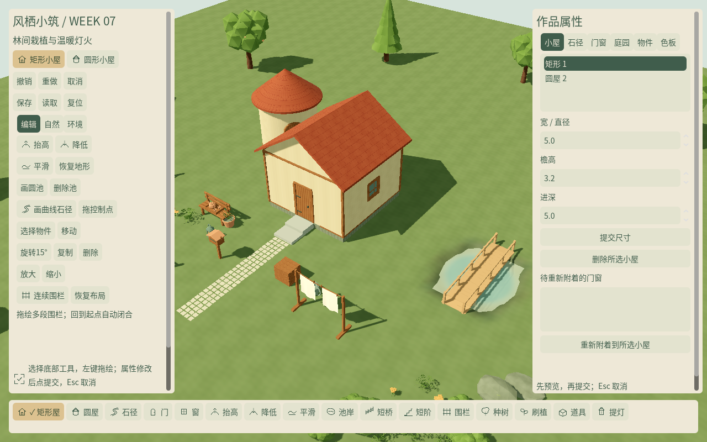
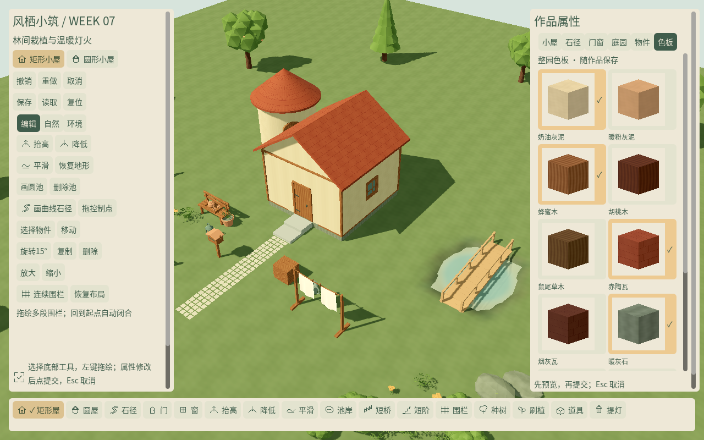
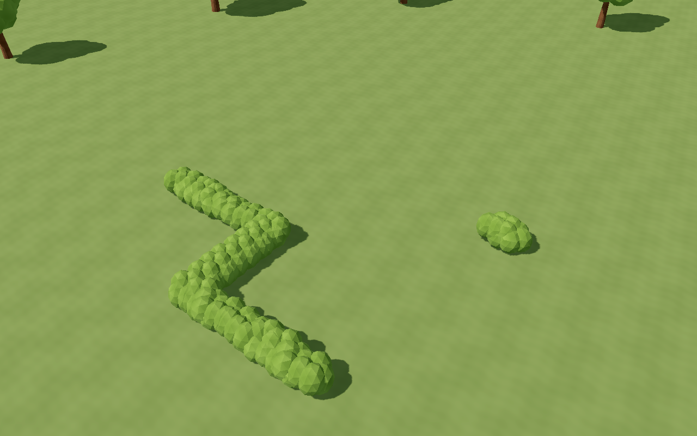
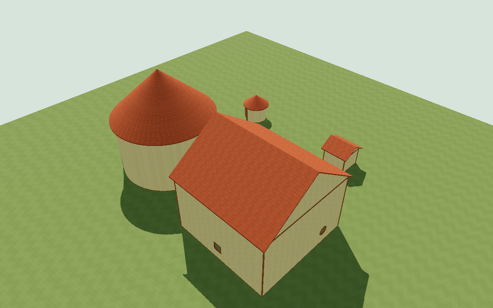
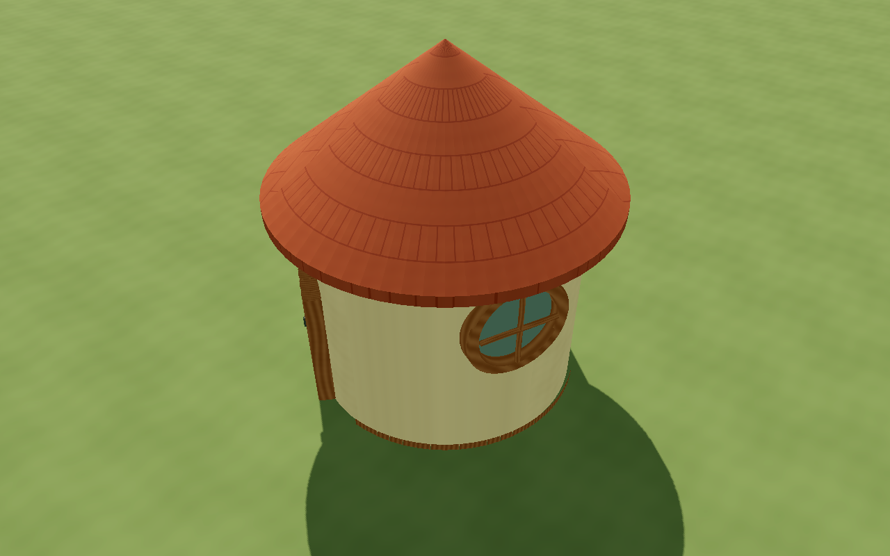
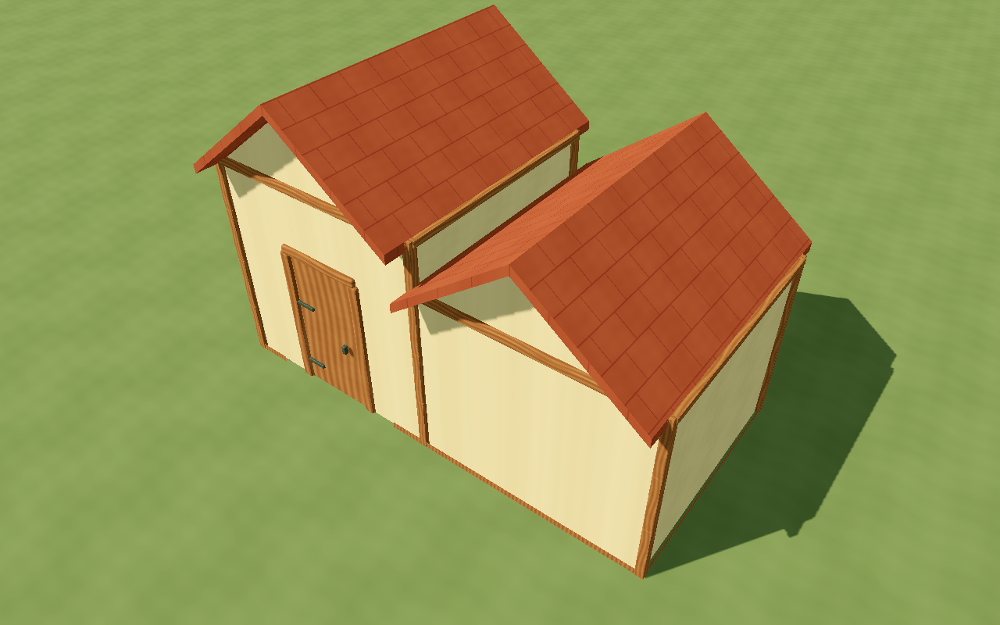

# W07 · 工具与正式资源整合

日期：2026-10-19；Godot 4.7.2 Standard / Forward+；版本 `0.7.0-w07`。
本周完成 T044–T050 的本周排期；T051 / T052 按计划开工，在 W08 完成可靠性和场景视觉收尾。
批准 PRD、开发计划与 backlog CSV 保持原文，实际进度在 STATUS 和本报告维护。

## 实现范围

| 任务 | 本周实际交付 |
| --- | --- |
| T044 收尾 | 16 图标接入底部工具 Dock；选中有 ✓，悬停/焦点/状态图形与文字；100–150% 滚动可访问，不靠颜色独立表达 |
| T045 收尾 | 八道具统一对象列表/属性卡；XZ、朝向、比例、多选差量、复制/删除；长凳/木箱支撑、跟地/锁高、提灯开/关/自动及最多四灯 |
| T046 收尾 | 五种正式开口统一 `OpeningAssembly`，门框保持原尺寸不随墙拉伸；木构 GLB 立柱/檐口、共用木石截面；贴靠边隐藏檐口和共享角柱；极值/圆墙/贴靠样例 |
| T047 | 十二个固定 ID，覆盖灰泥 2 / 木 3 / 瓦 2 / 石 3 / 植被 2；可编辑 SVG/清单、原生 96px 缩略图、当前选择 ✓；调色复用材质而非新资产族 |
| T048 | 可拖绘长度/转角/短段闭口，选中可拖控制点与调宽；原始网格 UV 不拉伸；共享子网格 MultiMesh、稳定种子/相位；分类擦除、移动复制、整笔历史和保存 |
| T049 | 17 个继承包装场景、应用拥有的拾取盒与地面/支撑/灯锚；按当前源/导出/哈希核对 24 模型含 LOD 的预算台账；导入重建后交互仍由应用包装持有 |
| T050 | 底部工具 Dock、左右属性页、物件卡/色板、中文错误原因、取消/撤销入口；X/Z 字母与形状手柄、绿篱控制点；不展示 P1 或未制作入口 |
| T051 开工 | WGLADE02 单容器 DTO、元信息/版本边界、压缩源高度/手工覆盖、精确数值与类型、旧容器兼容、引用验证；未知版本拒绝读取/覆盖；一次备份沿用 |
| T052 开工 | SCN-01 可编辑布局草案：两屋/五开口、浅池桥阶、围栏、三树四灌草两岩石、八道具及茶盘支撑；同地形与外围树的空布局数据、两个推荐构图 |

T051 的完整迁移/中断恢复与 T055 五槽、轮替备份、自动保存/退出提示在 W08；
T052 的全场艺术与推荐镜头最终签核在 W08，示范/空白双入口与提示按 T062 在 W09 接入。
本周默认直接进入可编辑草案，没有把未完成的产品入口放到界面上。
音频仍是 W06 资源交付，完整播放/混音继续 T063；摄影与快捷键重绑维持原排期。

## 数据与模块

绿篱仍是一条实例源记录，`hedge.points` 保存本地 XZ 折线，统一使用实例的位移/朝向/比例。
允许宽 0.5–1.6m、每段 0.25–16m、总长≤40m、最多 32 点；非法整笔拒绝。
重复闭合灌木覆盖端头和折角，约每 0.45m 一个采样，复用原始 mesh/UV；
按子网格 MultiMesh 合批，实例数据继续独立种子，相位不依赖遍历顺序。
选点编辑/手动变换将其转为手放并受保护；未调整的自动绿篱可从任意一段附近分类擦除。
脏区覆盖整条折线和宽度；地形改动逐采样跟地，锁高保持整条高度，远处实例保持稳定。

包装层使用简化盒和 collision layer 2；水面不参与物件选中。
权威拾取仍按最近已发布源快照与资产尺寸查询，避免异步视图/碰撞尚未发布时命中旧内容。
原始 GLB 不被包装脚本写回；材质由场景注入，树与自动草木保留空间批组及 LOD。
修复复制丢失提灯模式/绿篱参数、锁高父支撑未计绝对高度、属性提交前取消预览重置输入的问题。

旧圆窗是 4048 三角面，预算审计查出超过 PRD 建议 1600；本周另存连续闭合倒角框，
运行入口切换为 **1360 三角面**，暗衬和窗光遮罩保留。不是调高预算或删除旧回归资产。
原生木构源的底部原点用于分段立柱，檐口按全高对齐；贴靠共享角柱只由稳定 ID 的一个对象生成。

`SceneSave` 的格式 2 与源 schema 1 分离。元信息、源参数、高度差量和构图一起压缩并校验；
兼容 WGLADE01。`ExactFloatJson` 扩展可选 `integer_paths`，同时保留 double 位串及 int64 类型，
旧浮点封装仍可读；非法路径、超范围整数、未来格式和无效引用不进入源状态。
可丢弃的 `generated_cache` 不参与权威重建。当前坏档保护会拒绝直接覆盖，恢复产品流程在 W08 完善。

## 验证

```bash
python3 tools/quality/run_checks.py --week 7 --negative-control
python3 tools/quality/week_seven_render_checks.py
python3 tools/quality/export_smoke.py --week 7
python3 tools/quality/clean_checkout.py --week 7
```

W07 新增 **51 项 / 455 断言**，与 W01–W06 累计 **350 项 / 5937 断言**，0 失败、0 跳过。
自动测试包含绿篱短段/转角/端头、变换/擦除/保护/坡面、源网格复用、包围范围/局部失效，
17 包装/挂点/拾取、12 色板/类型约束、五开口/最小最大/共享角柱，物件卡/多选/灯光/锁高，
真实鼠标 Dock/绿篱、Option 隔离、150% 面板，以及源数据回滚/撤销重做/未来存档保护和 int64。
七周独立进程重启保存全部执行；负控故意失败退出 1，正常检查退出 0。
Blender 实际重开 **46 模型源、8 材质图和 1 图集 / 9 图像**；新增圆框拓扑/预算与遮罩检查通过。
源件/图标重建命令见 [美术源说明](../../../art_source/week_07/README.md)。

headless Dummy 渲染器不能读回实际 MultiMesh transform buffer；坡面测试分别验证纯数据布局和
原生 Metal 进程的实际变换/截图，不以 Dummy 返回的零向量宣称跟地通过。

## 画面与采样范围

实际查看日间/黄昏、100/150% 界面、物件/材质卡、绿篱短段/转角/坡面、两形建筑极值四向。
风对照：开启变化 **132537 字节**，零风 / 减少动态均 **0**。

Apple M4 Pro / 20 核 GPU / 48GB / macOS arm64，Forward+ / Metal 3.2，1920×1080，VSync，
每组 10 秒。当前 51 实例示范草案，日间/黄昏/编辑 P95 帧间隔约 **8.33ms**；黄昏一盏局部光。

| 20 笔可见编辑 | 本周实测 |
| --- | --- |
| 完成 / 末笔地形重建 | 20/20，2/64 块 |
| 主线程发布最大 / P95 | 5.385 / 5.385ms |
| 资源准备最大切片 / 数量 | 7.584ms / 108 |
| 提交到显示最大 / P95 | 157.247 / 157.247ms |
| 末笔 worker | 12.527ms |
| GPU 计时 | null / unavailable，0 有效样本 |

发布和准备峰值超过建议帧内目标，总延迟略高 150ms 暂定目标，**未作性能放行**；
场景比 W06 的 25 实例样例更丰富，不能直接用不同内容作优化对比。
W08 T054 继续批量资源创建、视图/UI 发布和压力样例剖析；单个原生调用不可抢占。
本地采样不代替完整容量、最低配置或 Windows 真机门槛。








## 证据与交付

- [累计质量门槛](checks.json)、[W07 XML](gut_week_07.xml)、[干净检出](clean_checkout.json)
- [源审计](source_audit.json)、[资源/包装/缩略图审计](assets.json)、[预算台账](../../../assets/week_07/asset_ledger.json)
- [可见检查与性能](render_checks.json)、[编辑分解](editing_metrics.json)、[坡面原生变换](hedge_slope.json)
- [导出步骤与 SHA256](exports.json)、[Mac 解压启动](exported_macos.png)

本地未公证 Mac ZIP 和 Windows x86_64 EXE 分别导出；Mac 从空工作目录解压可见启动/退出。
测试框架/七周测试源排除，字体许可证随包。Windows 真机和远程 CI 尚未执行。
Git 提交与 `v0.7.0-w07` 里程碑见 STATUS。下载的工具、缓存、试玩包和用户存档不入 Git。
