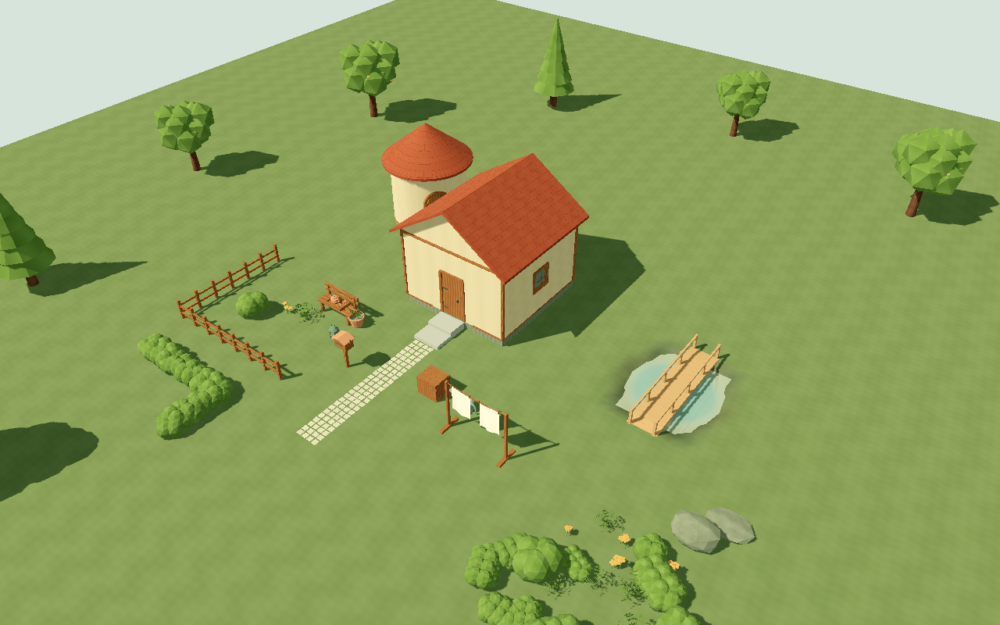
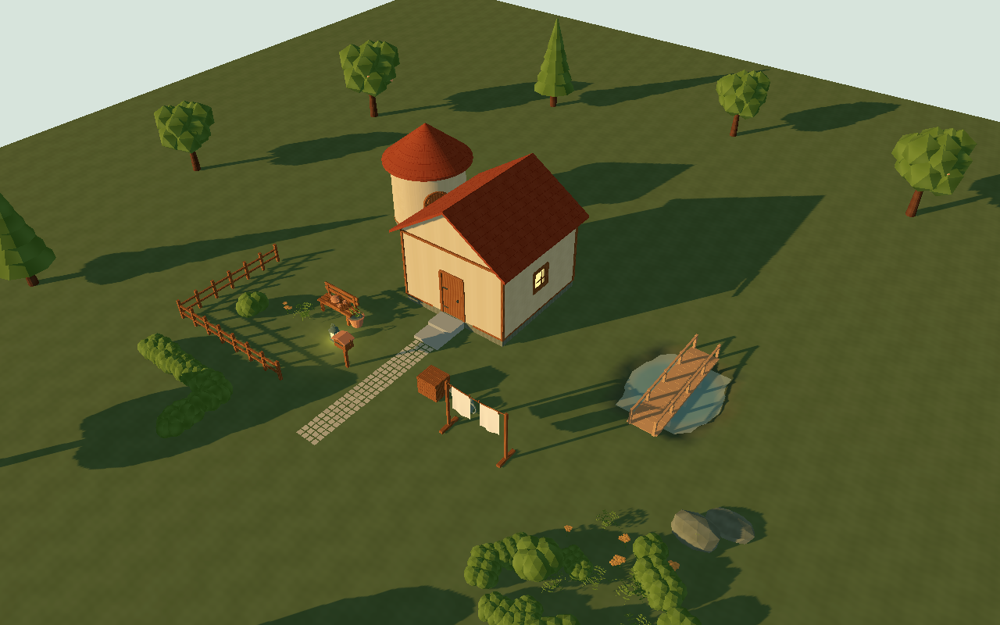
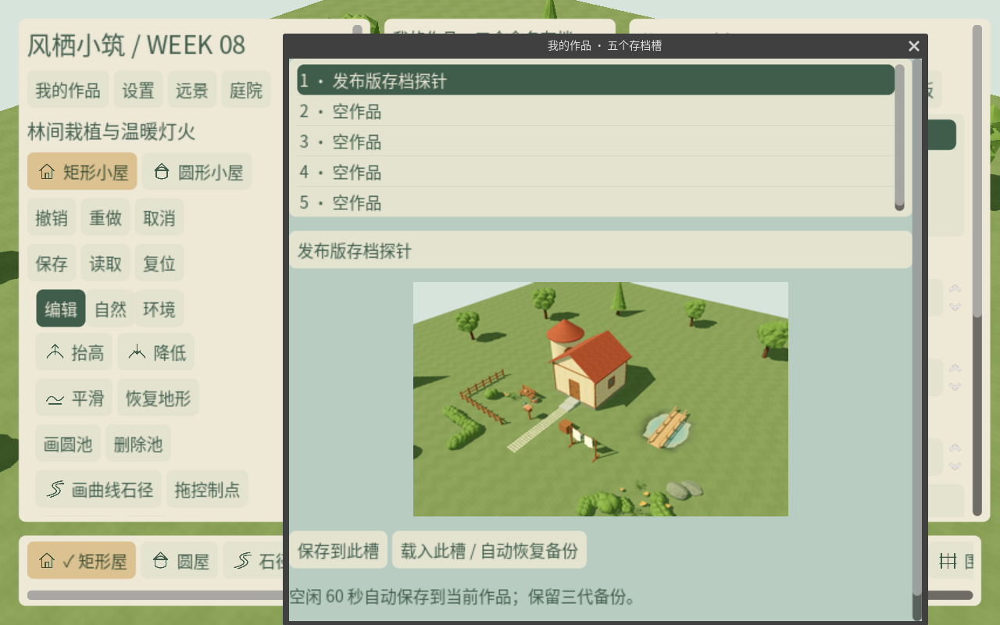
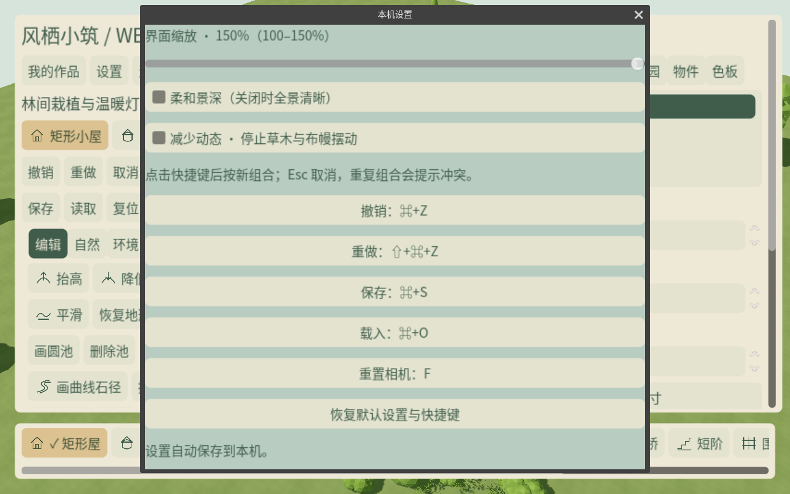

# W08 · 持久化、本机设置与可环绕视觉切片

2026-10-20，Godot 4.7.2 Standard，版本 `0.8.0-w08`。本周完成 T051/T052 收尾与 T053–T057，
累计回归、发布包可见验证与无缓存干净检出均已归档。批准 PRD / 计划 / backlog / 资产 CSV 保留基线。

## 可试玩交付

- **作品库**：五个命名槽，当前实机缩略图、标题与构图，同容器保存氛围、材质和精确高度。
  主文件写入临时容器、flush、校验，轮替 `.bak1`–`.bak3` 后原子替换；后台线程执行编码/IO。
- **自动保存与退出**：60s 无输入/相机/源修改后保存；预览和 PendingCommit 不抢存。
  新示范只预约空槽，满槽不覆盖既有作品。载入未存内容/关闭窗口可选保存、放弃、取消；
  确认框等待期间不会由自动保存替玩家选择退出。
- **安全载入**：先校验、再后台生成纯数据，主线程分帧准备，成功后一次替换并清空旧历史。
  损坏校验/文件头可恢复最新有效备份，原文件保留；未来容器/DTO/生成器拒绝并保护原件。
- **本机设置**：100–150% 缩放、五组快捷键重绑/冲突检查/恢复默认（先按修饰键再按主键可正常捕获）、关闭景深与减少动态，
  独立于作品源数据保存。草木与晾布的静止偏好覆盖场景预设并作用于新生成材质。
- **SCN-01**：示范和空布局均为 `.tres` 源数据，ExactFloatJson 保留 double 与 int64；
  两者复用坡地、12 棵外围树与两个推荐镜头，不存派生网格。示范含 51 个源实例和核心庭园组件。

纯鼠标入口位于左上“我的作品”“设置”“远景”“庭院”。常驻反馈独立于滚动工具面板，
缩放至 150% 时仍可见；对话框与工具 Dock 支持滚动。Mac Option+左键与双指缩放保留。
用户缩略图不是 W09 的 UI-06 模板资源；空布局数据也不提前计为 W09 双入口/首次体验完成。

## 格式与迁移边界

| 输入 | 处理 |
| --- | --- |
| WGLADE01 旧容器 | 保留源状态，补“旧版作品”元信息；重存为 WGLADE02，原代进入备份 |
| W07 format 2，无 presentation | 默认空展示元信息，保留源 schema 1 与 generator w01.1 |
| W08 format 2 | metadata.presentation 含相机、PNG Base64 与保存时间；SHA256 覆盖同一压缩载荷 |
| 未来 magic / DTO / generator | 不静默回退旧档，不覆盖原件 |
| 校验/文件头损坏 | 按 bak1→bak3 读取，忽略未完成 `.tmp`；恢复进内存后另存空槽 |
| 临时写后、替换前中断 | 注入失败保持主文件字节不变；不把模拟中断宣称为物理断电测试 |

源引用、待附着开口、构图边界、PNG 类型/尺寸与容器体积均校验，非法文件不发布。
源 schema/generator 未为展示元信息强行升级；派生缓存始终不权威。
W08 起固定用户目录 `WindhavenDiorama`；旧周文件不自动搬走，可关闭游戏后复制到空槽文件名。

## 模块与性能改动

`SlotStore` 负责五槽/备份/原子文件边界，`SaveService` 负责单 IO worker，
`UserPreferences` 负责本机设置，`ForestLayout` 负责精确源布局。
`WeekEightRoot` 只编排保存意图、空闲计时和准备后发布，场景拥有 HUD 与服务，无全局事件总线。

`ViewPlan` 按场景缓存批次原型的网格/变换/材质描述；批次复用相同 shader 参数的材质，
同树子网格共享材质而不同树保留种子隔离。属性卡按内容变化刷新，提灯发光窗格在配置时索引，
减少发布和每帧节点遍历。取消测试等待真实 detached Node 分配后取消，重复八轮核对释放和源状态。

Apple M4 Pro / 20 核 GPU / 48GB / macOS arm64，Forward+ / Metal 3.2，1920×1080，VSync。
同一 51 实例场景，局部探针均 20 笔；W07/W08 原生运行使用相同编辑器可执行文件，发布模板另测。

| CPU / 编辑指标 | W07 原生 | W08 原生 | W08 发布包 |
| --- | ---: | ---: | ---: |
| 主线程发布最大 | 5.385ms | 3.378ms | 3.079ms |
| 准备切片最大 | 7.584ms | 2.773ms | 2.245ms |
| 提交到显示最大 | 157.247ms | 109.170ms | 107.398ms |
| 末笔 worker | 12.527ms | 11.963ms | 9.318ms |
| 末笔地形重建 | 2/64 | 2/64 | 2/64 |
| 风效材质引用 | 1078 | 189 | 189 |

发布包大刷：半径 9m、8 笔，源数据构建最大 **3.020ms**（发生在提交计时前），
提交到显示最大 **88.385ms**，末笔 worker **32.926ms**，
准备切片最大 **2.484ms**、发布最大 **3.784ms**，仅重建 **11/64** 地形块。
当前样例满足暂定 150ms / 500ms 提交目标；这不替代 W09 完整容量/内存与最低配置。

日/暮/局部/大刷 10s 窗口 P95 帧间隔均约 8.33ms，但热身后窗口含大量空闲帧，
不能据此宣称编辑帧或 GPU 达标。GPU 计时为 null、0 有效样本。
原生准备峰值 2.773ms 仍高于 1.8ms 调度预算，单个原生调用不能被抢占，M4 继续监测。
完整 [原始对照](performance_comparison.json) 保留不同构建方式与原始指标。

## 测试与源件审核

新增 **62 项**，累计 **412 项 / 6732 次断言**，八周测试与每周独立进程重启、负控全部通过。
新增范围包括五槽隔离、三代轮替/中断/坏头/坏校验、旧容器迁移、PNG/氛围/精确高度/构图、
空闲边界/满槽保护/退出提示、设置重启/冲突/重置、DOF、全材质静止、150% UI、真实分配后的取消与缓存共享。

累计 46 份 `.blend` 与九张材质图重新打开；当前预算台账 24 项模型（含三个 LOD1）
另核对法线、UV、正缩放、预算和 GLB 哈希。透明图集中 1,805,283 个透明像素含扩色，白色透明像素为 0。
本周新增手工模型/资源族为 **0**，包装和程序化实例不重复计数。

## 实机视觉

21 张发布包核心截图覆盖两推荐镜头日/暮、100/150% UI、作品 PNG、岁月/提灯/DOF，
近/远 45° / 135° / 225° / 315°；六张整场景动态对照固定水面时间，仅改变风采样。
正常风效两次采样有 120,030 个差异字节；零风、本机减少动态均为 0。
图像与 180 帧 / 6s / 1280×800 H.264 自由环绕录像来自运行场景，不使用概念图替代。
已检查所采镜头的接地、建筑背面/圆窗、桥栏、树 LOD 与图集边缘，未发现阻塞性漏面或白边。

[自由相机录像 · 6 秒](orbit.mp4)

## 证据、版本与剩余门槛

- [累计 gate](checks.json)、[W08 GUT XML](gut_week_08.xml) / [控制台](gut_week_08.log)、[独立重启与断言摘要](test_summary.json)
- [累计源审计](source_audit_all.json)、[当前预算/法线/UV/扩色](source_audit.json)
- [发布包可见检查/性能/录像哈希](render_checks.json)、[导出步骤与 SHA256](exports.json)
- [干净检出](clean_checkout.json)、[实机逐镜检查记录](visual_review.json)

Mac 包从空工作目录解压可见启动，并在后台生成与保存实机 PNG；测试源/框架排除，字体许可证和音频源随包。
Windows 仅验证 PE x86_64 与导出，不计为 Windows 真机或远程 CI 通过。
GPU 硬件计时保留 unavailable/null、0 样本；VSync 帧间隔不等于 GPU 时间或最低配置表现。
W09 满容量 60s/内存与摄影、M4 全资源、W10 混合编辑/音频和 Windows 目标机仍独立待验。

实现提交 `e879782`，输入顺序/弹窗活动修复 `e8abdba`；从 `e8abdba` 的 Git 归档建立
无 `.godot` 的临时检出，412 项、八周独立进程重启与失败负控全部通过。
仅复用锁定宿主引擎和 gdtoolkit，不复用导入缓存。最终证据归档随 `v0.8.0-w08` 标记。
本地未配置远程或推送；导出包、运行时、缓存和用户文件不进入 Git。
