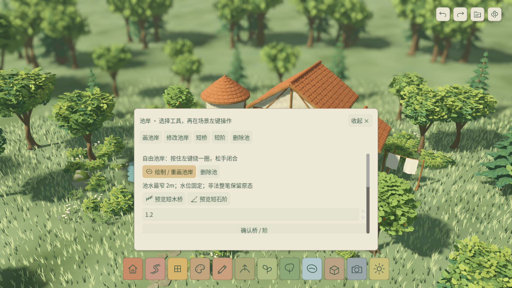
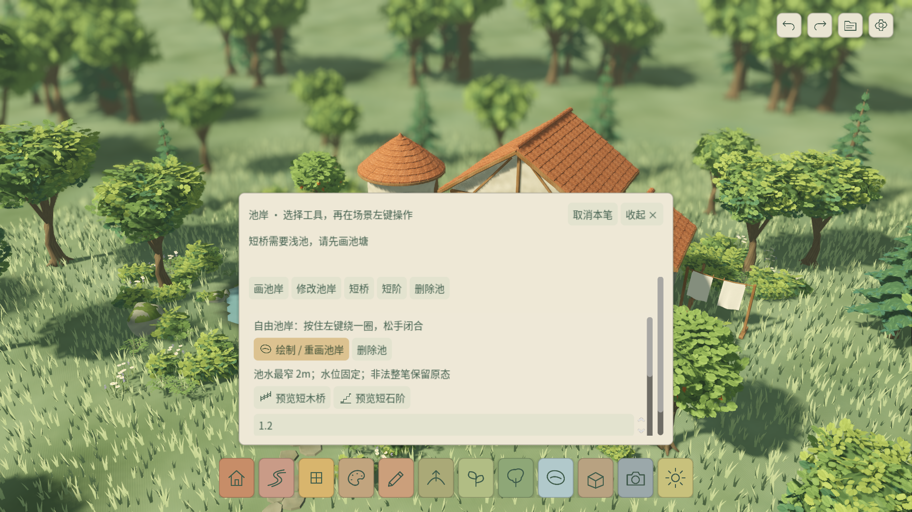

# W11 · 试玩前修复与验收准备

2026-10-22，版本 `0.11.0-w11`。沿用已确认的艺术方向和底栏/动态草；本周不新增美术族、玩法或插件。

**完成本机可复现修复与测试准备，未完成正式十人试玩，M4/M5暂不放行。** 当前实际首次玩家0/10；尚未进行外部联系。T067正式观察需要T066/M4冻结，原有150ms编辑与首次启动、Windows/最低配置门槛继续保留。

| 计划 | 本次实际结果 |
| --- | --- |
| T067 首次试玩 | 校正计时协议，提供匿名JSON/证据格式、严格汇总器和测试；实际记录仍为空。正式十人观察待冻结 |
| T068 遮挡/视觉 | 本机发现并修复卡片展开时反馈被隐藏；提供同镜头前后截图。未把本机审查冒充玩家反馈，也不再扩充美术 |
| T069 核心阻塞 | 修复鼠标取消入口；验证待提交取消、迟到结果、下一笔、源和历史。实际反馈批次尚未发生 |
| T065/T066结转 | 修复远处地形笔画导致池岸装饰无关重建；重新测量完整容量编辑，性能未达标项继续开放 |

## 缺陷与回归

| 编号 / 来源 | 复现与影响 | 修复及证据 |
| --- | --- | --- |
| W11-001 / 本机检查 | 打开池岸卡片后触发桥缺池；旧状态栏和面包屑都隐藏，无法读到失败原因 | 卡片顶部固定反馈/取消区，滚动参数不移走；可换行及完整悬浮提示，收起时保留底栏提示；150%、摄影往返与源不变回归 |
| W11-002 / 本机检查 | 预览或后台计算中想放弃，只显示Esc，鼠标无法取消当前笔画 | 卡片标题内「取消本笔」复用现有取消事务；排队结果不会迟到提交，下一笔可继续 |
| W11-003 / 代码及实机审查 | 在(18,18)远离池塘刷坡，池岸所有装饰节点仍重建 | 按池形外扩1.1m及两格插值halo计算地形依赖，池/种子/桥/局部地形变化正常失效；圆/多边形新鲜几何精确比较 |
| W11-004 / 协议审查 | W10脚本先让玩家探索3分钟，后面明确要求截图，无法测量原PRD三分钟建屋/十五分钟主动截图 | 新协议从开场计时建带门/屋顶/路径的小屋，前15分钟不提示摄影；汇总器拒绝提示/超时计为成功 |

代码保持现有场景和事务结构，生成网格不进入权威存档；草密度、柔焦、Mac手势与源资产保持原功能。池岸优化使用保守范围，不跳过权威源验证。未修改Blender模型或贴图源。

测试命令和契约见 [TEST_PLAN.md](TEST_PLAN.md)，正式试玩流程见 [PLAYTEST_PROTOCOL.md](PLAYTEST_PROTOCOL.md)。运行结果与提交版本见 `delivery.json`、`evidence/`（本周完成验证后归档）。

原生看图曾发现150%提示初始换行撑高卡片，已用固定高度反馈区隔离容器最小尺寸传播；补全卡片/提示/按钮屏幕内检查，修复后的实拍复核后归档。

## 已确认的自动验证

运行实现 `7372231791d8cdca05f848cbb51bb4699ffaaab7` 经Git archive、空 `.godot` 的累计门禁通过：**553项Godot测试 / 15922次断言，另6项Python测试**，0失败、0跳过；故意失败负控制有效。新增9项Godot/128断言，原544项保留。格式/lint、资产契约、逐周保存跨进程读回、UI/Meadow偏好重启通过。

原始证据在 `evidence/clean/`，干净检出回执在 `evidence/week_11_clean_checkout.json`。`playtest_records.json` 仍为空；自动化通过不改变T067人数和M4/M5判断。

## 原生性能与试玩包

Apple M4 Pro / macOS / Metal，实际1920×1080，各60秒，草默认45%。

| 场景 | 帧p95 | 提交p95 / 最大 | 主回调最大 | RSS峰值 |
| --- | --- | --- | --- | --- |
| 示范20笔 | 9.091ms | 172.058ms | 15.203ms | 847.05MiB |
| 满容量24屋/1000源实例20笔 | 11.667ms | 239.271ms | 45.274ms | 930.03MiB |
| 满容量大笔刷8笔 | 11.667ms | 411.277ms | 48.827ms | 949.62MiB |

当前小样本提交p95实现取保守索引，与最大值相同；保留所有原始样本。帧、主回调、大笔刷和内存目标通过，**局部150ms仍失败**。W10性能基线早于动态草接入，不将跨版本数字当严格A/B；池岸复用由节点身份与精确几何回归验证，没有宣称此次整体提交延迟改善。GPU计时不可用；高配Mac不代表最低配置通过。

Windows EXE导出与PE x86_64结构通过；Mac ZIP解压独立目录实际运行、保存、缩略图、资源/许可证及不含测试包验证通过。图像已看图复核。本机本次导出后首帧2.813秒、整段冒烟5.713秒；已有系统/驱动缓存，不能据此关闭历史约36秒的新环境首次启动问题。真实Windows和最低配置仍未测。

本地试玩包：`builds/week_11/macos/windhaven_week_11.zip` 与 `builds/week_11/windows/windhaven_week_11.exe`。哈希、大小见 `delivery.json`，不提交大体积导出到Git。实现提交为 `7372231`，最终文档/证据与标签 `v0.11.0-w11` 共同归档；此标签是开发候选版本，非M5放行。

完整已知项见 [KNOWN_ISSUES.md](KNOWN_ISSUES.md)。正式试玩与W12放行相应顺延，冻结日期待开放门槛收齐后重排。
