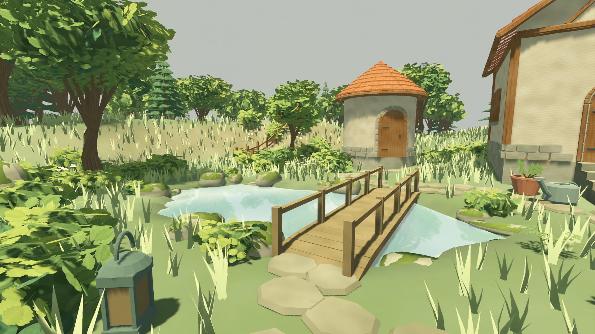

# 摄影中的林间漫步

2026-10-24，按用户明确要求加入第一人称漫步。这是摄影功能的范围补充，不覆盖原批准PRD；不改建造规则、作品数据格式、美术源或锁定引擎/插件版本。

## 如何使用

F5运行当前 `app/living_root.tscn`，点击底部相机卡片，再点击“林间漫步 · 第一人称”。自动在当前构图附近寻找安全落脚点，以1.65m视高观看庭园。

| 操作 | 效果 |
| --- | --- |
| WASD / 方向键 | 向前后左右行走，斜向速度归一化 |
| Shift + 行走 | 从2m/s加快至3.5m/s；有短暂加减速 |
| 按住右键拖动 | 环顾；松开恢复鼠标，可继续操作摄影面板 |
| Mac双指上下左右移动 | 环顾；原俯瞰旋转/平移/捏合设置保持 |
| 隐藏摄影面板 | 保留漫步，只显示庭园 |
| 导出 PNG | 导出当前第一人称构图，不带界面 |
| 返回俯瞰视角 | 返回进入漫步前的摄影构图 |
| Esc / 返回编辑 | 退出摄影，恢复进入摄影前的编辑构图 |

漫步默认恢复草木、水波、天气和游戏时间流逝，让庭园保持动态；仍可主动勾选冻结。退出漫步恢复原冻结选择，退出摄影恢复编辑状态。减少动态偏好始终有效。

第一人称暂时关闭原俯瞰景深，避免眼前草木被过度虚化；FOV为65°、近裁剪0.06m。返回俯瞰时精确恢复相机变换、FOV、裁剪、景深和输入开关。没有新增呼吸晃动或镜头摇摆。

## 行走边界

贴着实际地形高度行走，可通过有效桥梁和室外阶梯。避开屋体、树干、围栏、较大岩石/灌木/摆件和池水；围栏上的道路缺口仍可通行。陡坡、超过0.4m的台阶、边缘缺少脚下支撑及地图外缘不能继续前进。碰墙保留沿墙方向移动。

当前是室外游园，不提供房屋内部、跳跃、飞行或游泳。建筑作为实体边界，示范屋门前的外侧台阶可接近，门口仍不可穿墙。桥面采用实际梁顶高度，阶梯采用实际踏步顶面，避免悬空或沿一条假斜坡走。

保存构图仍沿用俯瞰相机记录，漫步时该按钮置灰；可直接导出照片，或返回俯瞰再保存构图。应用已有构图会先结束漫步。没有把第一人称姿态写进旧俯瞰构图格式。

## 模块与生命周期

- `features/first_person_walk/first_person_walk.gd`：只负责相机和输入；复用现有 Camera3D，摄影导出和池塘反射继续读取同一相机。按住右键时临时捕获鼠标，松手、失焦或退出均释放。
- `features/first_person_walk/walk_surface.gd`：从源快照建立地形与障碍查询，实例采用支撑相对高度；2m障碍空间索引、半径0.22m/高度1.75m的净空检查、最大0.10m移动子步。查询不修改源，不生成逐物体物理节点。
- `features/living_world/living_playground.gd` / `living_hud.gd`：管理摄影切换、原冻结状态与原相机恢复。摄影本来禁止编辑，漫步也不新增建造事务、撤销记录或自动保存变化。

输入目录或选择构图列表时停止行走；切出窗口清除按键，避免返回后继续走。PNG导出短暂冻结动态，清空移动并拦截环顾，保持导出相机与水面反射一致；完成后恢复之前的动态状态。导出忙碌时不允许退出或切换模式。

## 复验

```bash
# 累计W01–W13、格式/lint、资源、存档重启与失败注入
python3 tools/quality/week_thirteen_checks.py
# 下列原生命令串行执行，不与导入或其他Godot测试并行
python3 tools/quality/walk_native_checks.py
python3 tools/quality/pond_water_native_checks.py
python3 tools/quality/week_thirteen_native_checks.py
python3 tools/quality/walk_performance_checks.py
```

新增18项自动回归：控制器8项、地面/障碍10项，包含真实示范桥往返、可达阶梯与生成网格顶面相符、斜向速度、长帧限制、沿墙滑动、池塘/边缘/陡坡、打字/失焦/导出输入隔离、精确相机恢复、书签与源/历史隔离。

原生探针实际点击摄影/漫步按钮，投递键盘、鼠标和PanGesture，验证照片1920×1080及界面标记只在游戏窗口出现、不进入导出PNG。忙碌导出期间另投递环顾，验证构图不会被改变。合成事件验证接线，物理触控板手感仍待人工确认。

最初探针遗漏Node常量前缀，失败日志保留。随后真实按钮点击发现容器尚未完成布局时取到了旧矩形，修为等待布局再取可见按钮位置；没有用直接调用代替按钮检查，也没有删除失败门禁。最终证据与源码收据见[evidence/first_person_walk/](evidence/first_person_walk/)。

## 结果与实拍

累计 **718项Godot / 22,159断言 + 28项Python**，0失败/0跳过、负控通过；本轮新增18项/359断言，W13共62项/2915断言。原生漫步18项、水面9项及既有界面22项分别验证；不以单元测试替代桌面GPU摄影验证。

源码`70a1516223efab4c9080dcd20eb2a7d3ad4cf880`。满容量漫步保留3587帧、帧p95为9.155ms、最大21.436ms，20ms p95目标通过；反射捕获227次。全部性能数字与源码提交见[交付收据](evidence/first_person_walk/delivery.json)。性能使用24屋/1000源、1920×1080、默认草密度，进入漫步后持续前进/环顾30秒；保留全部帧间隔。它只验证漫步阶段，不替代冷启动、编辑延迟、其他天气组合或最低配置验收。



[第一人称照片](evidence/first_person_walk/native/walk_export.png) · [原生输入报告](evidence/first_person_walk/walk_native_checks.json) · [性能原始帧间隔](evidence/first_person_walk/walk_performance.json)。

本轮交付当前源码，旧W12安装包未重导出。原生使用Dummy，不计物理听感；Windows/低配/冷启动/物理触控板/远端CI/十位首次玩家、旧编辑尖峰及M4/M5门槛继续开放。
