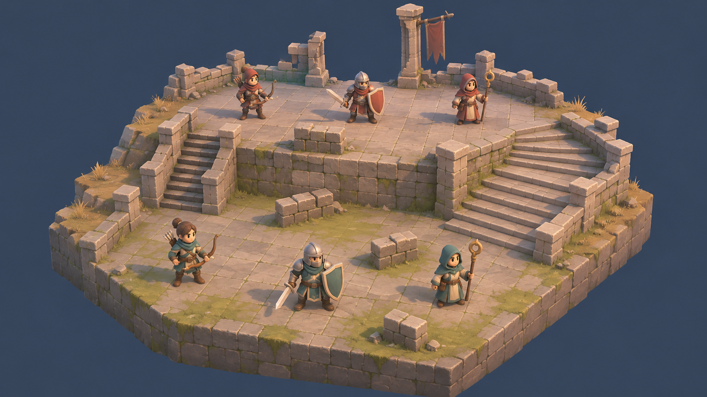
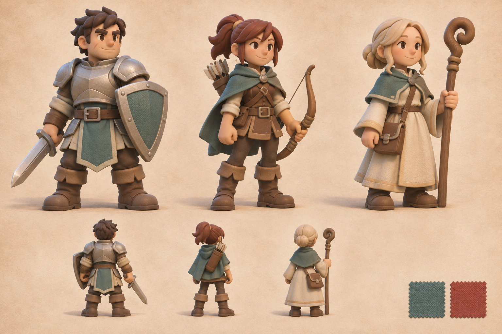

# 灰桥前哨｜项目策划文档

基于《最终幻想战略版》案例，使用 Godot 制作风格化全 3D 高差小队战棋。当前阶段为首个可运行灰盒，实际状态见 [开发进度](development_status.md)。原始策划，首版以“一张地图、3 对 3、完整胜败与重开”为范围。设计数值、工期和画面均为待验证目标。

## 阅读顺序

| 文档 | 用途 |
| --- | --- |
| [PRD](prd.md) | 产品定位、复刻与改编边界、P0 范围、CT／移动／攻击／治疗完整规则、精确关卡与验收条件；唯一规则基线 |
| [开发计划](development_plan.md) | M0–M5 任务、依赖、交付与退出门禁、模块职责、验证及人日估算 |
| [美术与交互概念](concept_design.md) | 战场、角色、关卡与 HUD 四图，镜头、视觉语言、动画及资产交付要求 |
| [概念图生成记录](concepts/generation_prompts.md) | 两张 AI 概念图的完整提示词、工具与来源说明 |

## 概念预览

精确格子、通路和部署见 [关卡图](concepts/level_layout.svg)；界面信息层级见 [HUD 图](concepts/battle_hud.svg)。PNG 为美术方向，SVG 为可编辑设计示意；生成图中的自由构图不覆盖 PRD 的规则和格子数据。

## 当前状态与下一步

| 项目 | 状态 |
| --- | --- |
| 资料阅读、经验迁移、PRD、计划、概念图 | 本次已形成文档；设计仍待实现与试玩验证 |
| Godot 工程与规则代码 | 灰盒已建立，见开发进度；正式模型、完整动画和音频未完成 |
| 验证 | 18项规则检查、自动对战及启动截图已有结果；完整实机、性能、导出及玩家体验待验收 |

P0 暂按 1 名主开发配合 AI，含基础自制美术与风险余量估算 31–49 人日；不是工期承诺，详见开发计划。后续从 M0 开始：登记实际引擎与目标机环境，验证四向棋盘读数，再推进规则和玩家操作闭环。

本套文档依据用户指定的知识库首页、最终幻想战略版案例及相关角色经验编写。原始资料与采用边界集中列在 [PRD 第 13 节](prd.md#13-资料依据与经验应用)。本次没有修改外部知识库，没有将概念图当作实机，也没有把历史案例性能写成本项目结果。

本次已检查文档本地引用与图片文件、SVG 语法与渲染，以及关卡数据：80 个可站格连通，六个出生点合法。上述检查只覆盖设计文档与图件，不代表 Godot 规则、AI、画面或性能验收。
