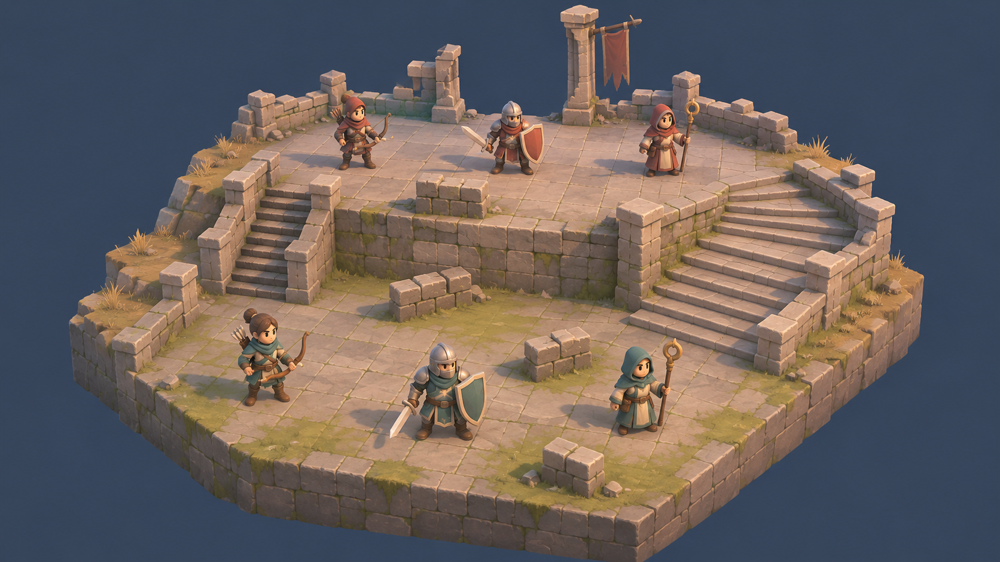
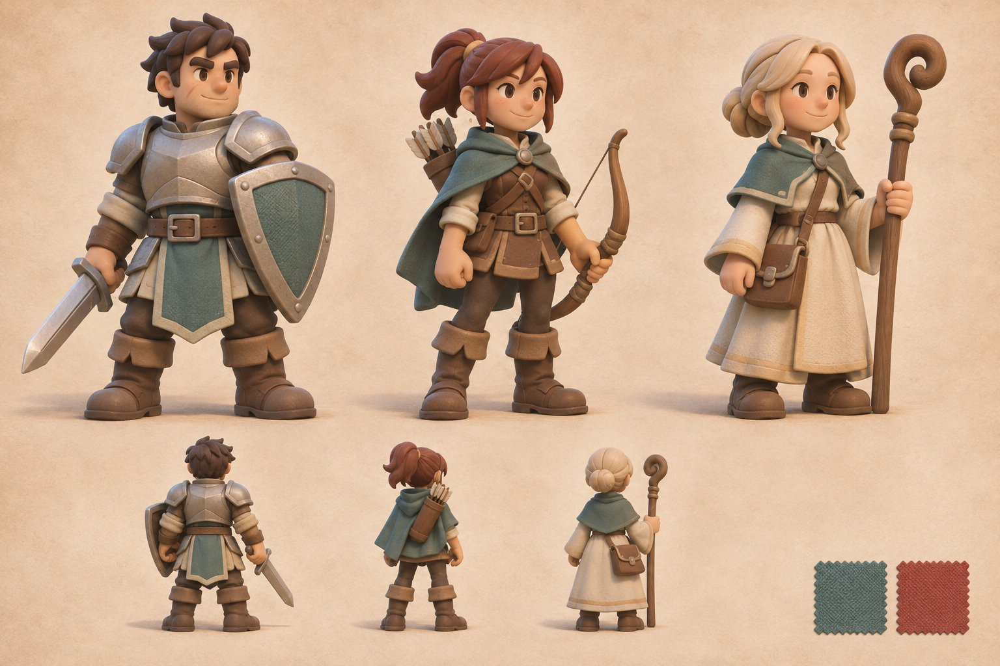
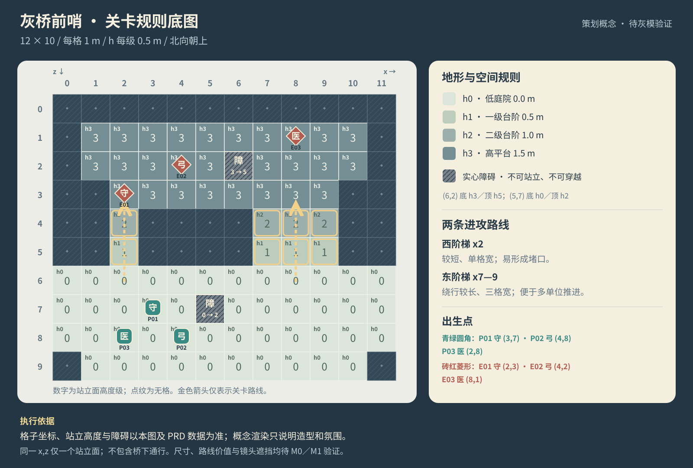
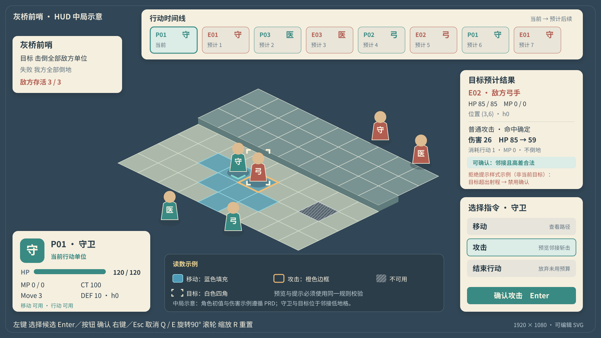

# 美术与交互概念说明｜灰桥前哨

版本：v0.1 · 2026-11-12 · 状态：制作目标与候选规格，尚未进入 Godot 实机验收。

本项目借鉴《最终幻想战略版》的高差棋盘、小队分工与战术读数，将人物改编为风格化三维角色。首版围绕一张 3v3 战场建立可玩的代表切片。概念设计服务于玩家判断路线、距离、行动顺序和结果，制作时先保证这些信息可读，再增加环境细节。

配套文档：[PRD](prd.md) · [开发计划](development_plan.md)。下述尺寸、色板、面数与镜头均为本项目候选，不是原作内部参数，也不代表已达到的实机效果。

## 1. 概念图与执行依据

### 战场氛围与造型

本图由 AI 生成，用来对齐石砌微缩战台、低庭院与高平台、双侧台阶、简化角色轮廓以及暖光冷影。它不是 Godot 截图、可操作关卡或可直接导入的三维资产。

应保留：石块有厚度、顶面与侧面明度分开、角色和武器轮廓突出、装饰成簇留白。可简化：石块裂痕、苔藓、布料织纹、皮革划痕与金属微反射。图上的石缝不等于战棋格边；生成图的台阶宽度、人物站位、障碍数量和格数存在自由表现，实施以规则底图和 PRD 为准。

### 三职业角色语言

本图由 AI 生成，提供正面主造型与背面意向。以剑盾、长弓箭袋、曲头杖区分守卫、弓手和医师；我方用青绿布色，敌方在同一骨架与材质体系中替换为砖红布色。背面图用于提示披风、箭袋与背包的结构，不能直接视为经过三维校验的设计转面。

角色落地时以约三头身、总高 1.4 m 为候选，先统一骨架、脚底原点和武器连接点，再校正生成图中的比例差异。头部、盾面、弓弧和杖头比布料纹理更值得保留。面部在目标战斗镜头下不要求复现宣传图细节。

图像来源与完整生成提示词统一保存在 [生成记录](concepts/generation_prompts.md)，本页不重复维护提示词。

### 精确关卡规则底图

底图为原创可编辑 SVG。坐标为 x=0…11、z=0…9，北向在图上方；每格 1 m，每级 h 为 0.5 m。h0 低庭院、h1／h2 台阶、h3 高平台形成可观察的高差。西侧 x2 是短窄路线，东侧 x7…9 是较长的三格宽路线；这两条路线能否产生不同战术，要通过实际移动成本与试玩验证。

每个 x,z 仅一个站立面。点纹区域无格；实心障碍不参与站立或通行，(6,2) 的底高 h3、顶高 h5，(5,7) 的底高 h0、顶高 h2。图中的金色箭头表示关卡路线意图，不是游戏运行时的可达范围。美术不得用装饰石台、台阶或草皮暗示额外可走面。

### 战斗 HUD 与操作读数

此图为原创可编辑 SVG，演示信息层级与布局。中景棋盘为抽象布局，本图是中局布局示意；守卫当前卡使用 PRD 的 HP120、MP0、DEF10、Move3 与激活态 CT100，目标卡用守卫近战对弓手伤害26、HP85→59的规则示例。画面中的守卫与目标弓手位于邻接低地格，与合法近战预览一致；其余站位与时间线顺序仅供布局，不能作为真实战斗状态或平衡结论，实际状态和结果必须读取运行时规则数据。

| 区域 | 玩家要知道什么 | 实施要求 |
| --- | --- | --- |
| 左上目标 | 当前胜利目标、失败条件、敌方存活数 | 常驻且简短；剧情对白不覆盖目标 |
| 顶部八位时间线 | 当前是谁，之后预计谁行动 | 当前位有额外边框和文字；预期顺序随已确认行动更新，重复单位允许再次出现 |
| 左下当前单位 | 职业、HP、MP、CT、Move、站立高度 | 数值附名称，并显示移动／行动是否可用；不用头像代替文字读数 |
| 右侧目标预览 | 目标、合法性、预计结果和资源消耗 | 合法时显示具体 HP 变化；非法时给出可理解的原因并禁用确认 |
| 右下指令 | 移动、攻击、治疗、结束行动 | 治疗仅在当前单位为医师时出现；行动预算或 MP 不足时显示原因；结束行动有明确文字 |
| 底部帮助 | 选择、取消、旋转、缩放、重置 | 与实际输入映射同步更新；可在熟悉后收起 |

## 2. 风格约定

| 维度 | 候选规范 | 检查方式 |
| --- | --- | --- |
| 大形 | 有厚度的石砌地块、圆润角色、克制的破损；石墙和台阶按可编辑模块拆分 | 缩略图先读出高低台、入口和六个单位 |
| 比例 | 格宽 1 m，高差级 0.5 m；人物约 1.4 m／三头身；人物脚底位于站立面 | 在同一格中检查站姿、移动、受击与倒地；武器不遮邻格读数 |
| 材质 | 石／布／皮革以粗糙漫反射为主；金属保留宽而弱的高光 | 固定受光样板比较角色和场景，不依赖纹理噪点区分材质 |
| 色彩 | 灰蓝背景、奶油白面板、低饱和石地与苔绿；强调色用于阵营和操作 | 彩色与灰度截图均可区分单位、地块侧面和提示边界 |
| 光影 | 一盏稳定主光配环境补光；暖顶面、冷侧面，暗部保留形体 | 关闭装饰特效仍能辨认台阶与角色；避免自动曝光导致读数变化 |
| 细节 | 路径和角色附近减少草簇与碎石；断墙靠边，旗帜不遮目标 | 旋转与缩放过程中检查轮廓和遮挡，不能只过主视角 |
| 后期 | 首版关闭强景深、浓雾和大面积辉光；描边在代表样板验证后决定 | 开关效果对照，不产生密集黑缝、闪烁或范围提示丢失 |

候选色板：背景 `#243543`、面板 `#F5EFDF`、正文 `#283B47`、我方 `#398A83`、敌方 `#B15D50`、移动 `#4C9AB7`、攻击 `#F3BD74`。这些是设计显示色，不要求直接作为三维材质的线性基色；应在 Godot 的最终光照和曝光下校准。

## 3. 镜头、选择与遮挡

采用正交相机作为首选，四个主朝向相差 90°，俯角以 35°—45°测试。候选交互为 Q／E 旋转、滚轮缩放、R 重置；最小／最大缩放和棋盘取景边界在 M0 的真实视口中确定。

四个朝向都要看到高平台的站立面和台阶入口。相机不得改变格子、单位或目标的规则身份；拾取应返回同一格子坐标。建筑遮挡时优先隐藏或裁切不透明遮挡件，让单位与地格可选；避免将整场景变成大量半透明物体。若只显示单位轮廓仍无法判断脚下格子，应继续调整遮挡件或镜头，不能视为通过。

蓝色填充表示可移动格，橙色边框表示攻击候选，白色四角表示当前目标，斜线表示不可用。不同含义同时使用颜色和形状，不以红绿差别承担全部判断。移动路径用连续线和终点标记表示，悬停时显示目标高度；无效格提示“无可站立面”等具体原因。

## 4. 动作与声音如何服务规则

先完成待机、移动、近战攻击、远程攻击、治疗、受击和倒地的代表动作。动作要求记录片段名、时长、循环、位移方式、接触时点以及音效／特效时点；绑定源和导出文件可以互相定位。移动按规则路径驱动，脚底贴合每级站立高度，角色转向与路段一致。

伤害、治疗、扣资源与倒地由规则层确定一次，表现层在约定时点反馈。重复点击或重开不应重复结算；P0 不承诺跳过或倍速演出。治疗先让人看见目标和生命恢复，再考虑粒子数量；攻击命中、非法操作、确认和取消的声音应能区分。声音资源与模型同样记录来源及使用许可。

## 5. 资产交付约定

按功能组织 `battlefield`、`units`、`battle_ui` 等模块；文件用 `snake_case`，节点用 `PascalCase`。可编辑源、生成配置与运行资产保存在项目内，源资产目录设置 `.gdignore`。源文件不得只留在生成工具缓存中。

每项资产记录：资产标识、对应职业或地块、尺寸、模型正面／向上轴、枢轴、材质分区、骨架与武器挂点、源路径、GLB／glTF 导出路径、引用场景、来源及许可。角色根枢轴置于脚底中心；单角色总高、脚底高度和格子边界在引擎内统一校验。

先交一名角色、一组三级台阶和一块石墙作为样板，校验比例、法线、色彩、动画、投影和重导；通过后再扩展三职业与阵营变体。单角色可先以约 3k—8k 三角面、有限材质槽作为估算起点，最终预算由六单位同屏、实际镜头和设备测量决定。低面数不自动代表低开销，阴影、透明特效和描边也计入测量。

修改源文件后重新导出并打开工程，检查角色脚底、武器连接、动画片段、实例摆放、材质覆盖和引用仍有效。草、石、旗帜等装饰要保留独立对象或可重建分布规则，便于关卡改线。

## 6. 读数与美术验收任务

以下是开发阶段的验收任务，目前均为待验证。

| 场景／输入 | 应见结果 | 留证条件 |
| --- | --- | --- |
| 初始棋盘缩至目标战斗尺寸 | 六单位阵营和职业可辨，两个入口可辨，高平台明显高于低庭院 | 固定 1920×1080 主镜头，并补最小窗口截图 |
| 切换四个镜头朝向 | 单位、格子、时间线身份不变；遮挡后的单位和落脚格可定位与选择 | 每朝向一张截图及一次点击检查 |
| 同一格轮流显示移动／攻击／目标／不可用 | 四种状态靠形状与颜色均能区别，不与石缝或阴影混淆 | 彩色与灰度对照 |
| 预览移动后取消 | 实际位置和资源不变，预览路径退出，取消反馈清楚 | 提交前后状态与截图 |
| 合法攻击或治疗，再连续点击确认 | 目标、预计变化、实际结果一致；动作时点可辨，规则只结算一次 | 短录屏和状态记录 |
| 非法距离／高度／遮挡／无站立面 | 给出相应原因；不播放成功演出，不提前扣资源 | 每类至少一例 |
| 修改代表资产再重导 | 比例、脚底、材质与动作仍一致，其他模块未被意外覆盖 | 源文件版本和前后引擎截图 |
| 六单位同时存在并旋转镜头／播放动作 | 不出现明显闪烁、黑缝、穿地与读数丢失；记录实际帧时 | 机器、Godot 版本、后端、分辨率、阴影／后期配置齐全 |

先修相机与大形，再修色块与明暗，最后修微细节。每轮记录问题位置、原因判断、修改和复验；生成概念图只作为视觉目标，不作为已通过的测试证据。

## 7. 经验依据及边界

本页采用知识库中的 [核心循环与首版范围](/Users/tongmeng/Desktop/docs/ai_game/ai_game/策划/设计方法/核心循环与首版范围.md)、[规则与反馈](/Users/tongmeng/Desktop/docs/ai_game/ai_game/策划/设计方法/规则与反馈.md)、[风格化场景](/Users/tongmeng/Desktop/docs/ai_game/ai_game/美术/风格/风格化场景.md)、[构图与视觉层次](/Users/tongmeng/Desktop/docs/ai_game/ai_game/美术/技法/构图与视觉层次.md)、[资产制作与交付](/Users/tongmeng/Desktop/docs/ai_game/ai_game/美术/技法/资产制作与交付.md)和[动画](/Users/tongmeng/Desktop/docs/ai_game/ai_game/动画/动画.md)的方法。

[治愈风格小岛实践](/Users/tongmeng/Desktop/docs/ai_game/ai_game/案例/场景案例/治愈风格小岛/治愈风格小岛_复刻实践.md)与[三渲二街道实践](/Users/tongmeng/Desktop/docs/ai_game/ai_game/案例/场景案例/三渲二街道/三渲二街道_复刻实践.md)说明了先锁相机和大形、代表样板、侧视检查、重导及记录条件的重要性。其有限环绕、反射技巧、相机参数与历史性能只适用于原案例；本战棋的四向可操作性和六单位开销需要独立验证。
