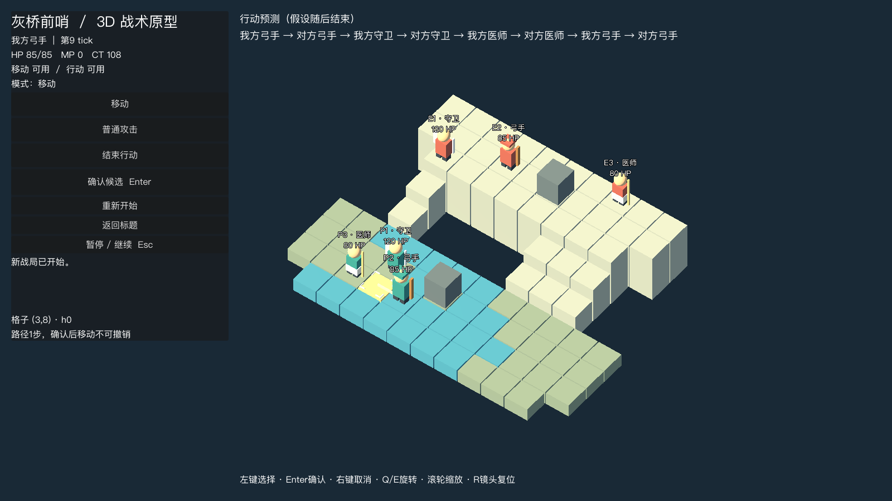
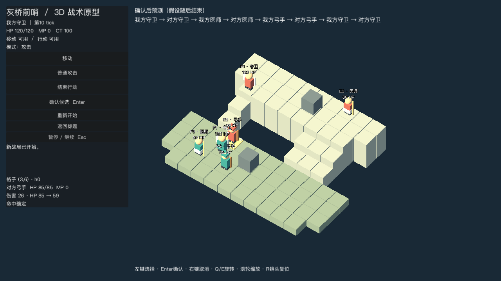

# 开发进度与验证

2026-11-12。当前：灰盒战斗操作与完整激活AI规划已接通，正式表现阶段尚未完成。PRD为目标，本文记录实际实现边界。

## 运行环境

Godot 4.7.stable.official.5b4e0cb0f；macOS 15.1；Apple M4 Pro，48GB；Compatibility后端，窗口报告OpenGL 4.1 Metal。本轮检查1600×900及1280×720；无正式1920×1080导出性能报告。

## 已实现

- 固定高差地图与部署、四邻路径与占用、CT及八次激活预测。
- 普攻、治疗、弓箭视线、确定伤害、倒地与胜败；状态版本、战局身份和行动者校验。
- AI在独立快照枚举先移动后行动／先行动后移动的完整方案；按击倒、危急治疗、伤害、普通治疗与接敌距离排序。弓手可后退寻找射程，不修改真实状态进行推演。逐条执行前重验，失效时结束激活。
- 移动路径连线、目标角标、落点高度、移后可攻击目标提示、目标HP／MP与预计变化、确认后时间线预测；预览只读，取消不扣资源。
- 标题→战前规则→战斗→胜败结算→重开／返回标题；进行中重开或返回需防误触确认，弹窗期间冻结战斗。
- 连续确认锁、暂停冻结演出、暂停中重开取消旧演出、旧战局命令拒绝。
- 正交四向镜头、缩放、职业替身模型与生命标注、移动插值。尚无正式攻击／受击／倒地动作及音效。

## 本轮验证结果

所有下列检查均使用真实Godot运行，未用Python替代游戏规则。

| 检查 | 实际结果与范围 |
| --- | --- |
| tests/test_rules.gd | 27项通过：CT、占用、预览、过期／跨战局命令、独立快照、伤害与治疗、擦角视线、高地射程、胜利与终态拒绝 |
| tests/test_planner.gd | 12项通过：规划不改真实状态、确定性、有界合法方案、贴身弓手后退射击、危急友方治疗 |
| AI单点耗时 | 本机初始局面约10ms、24个候选；只是一次调试采样，不代表全局性能验收 |
| tests/test_lifecycle.gd | 10项通过：标题／战前／开战、连续确认、暂停冻结、暂停演出中重开、旧命令隔离、胜利结算及回到标题重新开始 |
| tests/test_integration.gd | AI驱动双方，96条命令后我方失败，进入结算；随后重开状态检查通过 |
| tests/test_viewport.gd | 实际窗口渲染；四朝向各6/6初始单位脚下格拾取正确；攻击预览HP85→59且真实数据未改变；保存720p截图 |
| 目视检查 | 已查看标题、路径预览、反向镜头及720p目标卡截图；HUD主要信息可见 |

测试命令见根目录README。自动对战与脚本夹具不能代替人工游玩、完整关卡平衡、所有可走格遮挡及玩家易用性验收。

## 当前实机

四向证据：[方向0](validation/view_0.png) · [方向1](validation/view_1.png) · [方向2](validation/view_2.png) · [方向3](validation/view_3.png)。[标题界面](validation/title_runtime.png)。截图包含程序生成替身，不是最终美术。

## 里程碑状态与剩余工作

- M0：工程、样板、初始单位四向拾取与720p截图已检查；仍需全部关键格、缩放边界和复杂遮挡的操作覆盖。
- M1：规则及49项规则／AI／生命周期检查已建立；尚需完整A01–A20映射与更多移动阻断、治疗跨墙、同次双灭夹具，不能宣称PRD全部规则已验收。
- M2：基本预览、路径、目标卡、流程、取消和确认已实现；仍需统一视觉样式、全范围形状提示、悬停信息、首次引导与演出异常超时收口。
- M3：完整激活方案规划和独立快照已实现，自动对战及重开通过；尚未完成三场含胜败的人工整局验收、全场AI耗时采样及策略体验评估。
- M4：未完成。需正式角色与场景模块、攻击／受击／倒地动作、特效、音频、正式HUD和遮挡处理。
- M5：未开始。无导出包、正式性能报告及外部玩家试玩。

下一步先完成M2剩余输入／提示与演出收口，再制作一名代表角色和一组石阶场景样板，校准到概念方向后扩展其余职业。当前不标记任何尚缺退出门禁的里程碑为全部完成。
