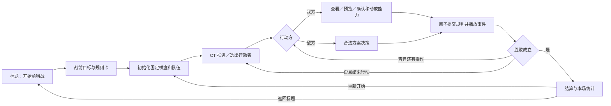
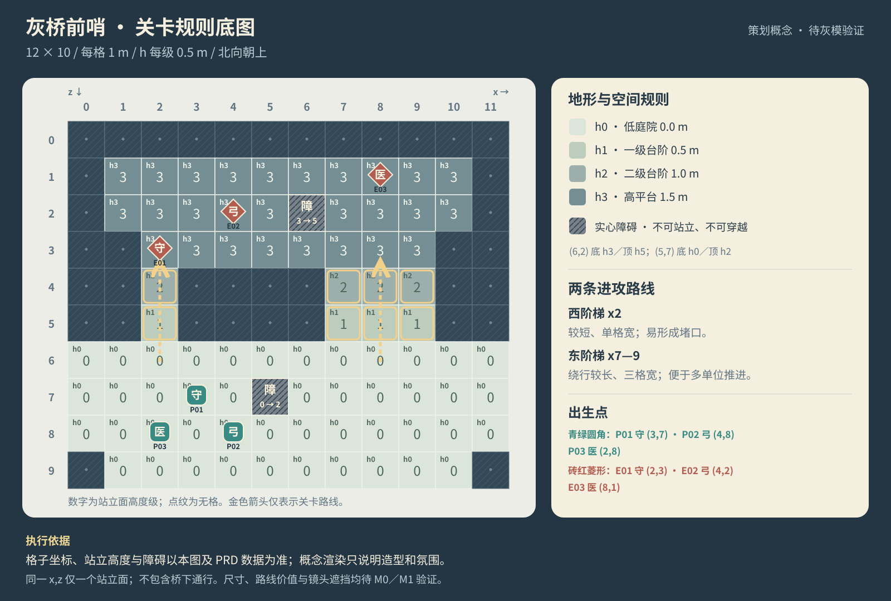
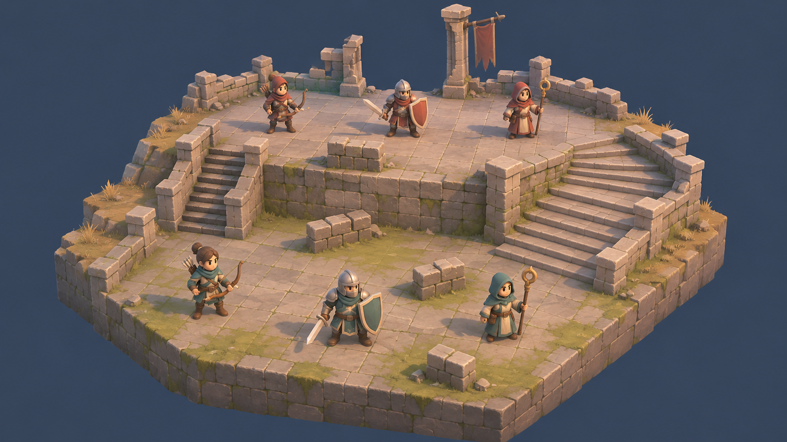

# PRD｜灰桥前哨：Godot 高差战棋学习项目

版本：0.1 策划基线 · 日期：2026-11-12 · 状态：设计待实机验证。原始设计时工程为空；现已建立可运行灰盒，实际实现与未完成项见 [开发进度](development_status.md)，无正式性能验收结果。工作名“灰桥前哨”用于本轮原创切片；仓库名保留 `final_fantasy_tactic`。

本文件是 P0 玩法、数值和验收的唯一基线。[开发计划](development_plan.md)规定实施顺序，[概念设计](concept_design.md)规定视觉目标；发生冲突时先修订本文件，再同步实现与提示。本文的首版范围属于当前策划方案，并非用户已逐项验收的结果。

## 1. 产品定义

玩家为了夺回山道前哨，指挥三名分工不同的队员，反复查看行动顺序、规划路线、移动和使用能力，改变敌我血量与空间优势，再据此决定下一名单位的行动。首版交付一场可反复游玩的完整战斗，验证“站哪里、先做什么、为谁保留资源”是否形成有效选择。

| 项目 | 策划基线 |
| --- | --- |
| 类型 | 单人、回合制、小队战术 RPG 学习切片 |
| 参考 | 《FINAL FANTASY TACTICS – The Ivalice Chronicles》案例中关于高差战场、职业分工、行动顺序、镜头读数的观察 |
| 表现 | 风格化三维角色＋三维棋盘，微缩舞台构图；无像素滤镜 |
| 引擎 | Godot 4.x；M0 锁定本机可用小版本、渲染器和导出模板，不在本文件宣称“最新版” |
| 平台 | 首验本机 macOS 桌面；鼠标键盘；Windows 导出为后续验证项，移动端和 Web 不纳入 P0 |
| 语言与分辨率 | 简体中文；以 1920×1080 设计、1280×720 验证缩放；窗口可调整 |
| 玩家 | 愿意在单场短战斗中思考站位的新手及战棋爱好者，无需了解原作剧情 |
| 单局目标 | 8–15 分钟，不含长时间停留；这是待试玩验证的目标 |
| 内容预算 | 1 张固定地图、双方各 3 人、3 类职业模板、固定部署、1 套规则、胜败结算和重开 |

### 1.1 三个体验支柱

1. **位置改变选择。** 西侧窄梯便于快速接战，东侧宽梯允许并进；高位弓手的射程优势必须能被预览解释。
2. **下一步可以预判。** 时间线可见，攻击与治疗显示确定结果，非法操作说明具体原因。
3. **每个职业影响行动。** 守卫承受近战压力，弓手利用距离与高度，医师用有限 MP 换取队伍存活时间。

### 1.2 参考边界与主动改编

案例指出原作参考为“三维战场＋二维精灵”；本轮采用全三维角色，是自主改编。案例尚未核实完整 CT、伤害、射程等公式，因此以下所有公式和数值均为本项目初始设计，不能称为原作精确规则。

保留：高差棋盘、小队行动、职业职责、战前目标交代、行动时间线、可读的预览确认。简化：固定三职业、确定命中、无朝向加成、无吟唱、无跨职业装备、无永久损失。使用原创工作名、角色、地图和对白，不把原作素材作为运行资产。

## 2. 范围与成功标准

| 优先级 | 包含内容 | 退出条件 |
| --- | --- | --- |
| P0 必须 | 完整 3v3、单地图高差、CT、移动／普通攻击／治疗／结束行动、合法敌方 AI、可读镜头 HUD、基础角色动作与声音、结算重开 | 第 12 节所有 P0 条目有证据，体验检查没有阻断问题 |
| P1 条件扩展 | 每职业增加 1 个可选主动技能、战前固定队员的少量能力槽选择 | P0 通过后另写规则与验收，不默认计入首版工期 |
| P2 后续候选 | 第二关、更多职业、简短关卡串联、战后成长 | 单独立项估量 |
| 本轮省略 | 世界地图、完整职业树、装备经济、任务系统、多人、随机地图、多层桥下、自由视角、复活／永久死亡、随机命中／暴击、战中存读档、召唤与长篇剧情 | 不以占位按钮或空系统暗示已有能力 |

P0 仅提供本场重开；退出游戏后不承诺保存进度。不存在成长奖励和长期编成，因此不为首版增加通用存档系统。

产品层面希望玩家在提示后能完成一次合法行动，能解释至少一次“为了射程或治疗而改变站位”的决定。M5 以至少 3 位首次接触本切片的试玩者检查，记录任务完成与困惑点；样本只用于定性修正，不宣传为统计结论。若暂时无法获得试玩者，功能自测可继续，但体验可用性保持待验证。

## 3. 玩家流程与交互状态



图中的“还有操作”指当前激活尚未结束；敌方执行其既定方案后主动结束。所有行动者均受同一套预算与合法性规则约束。

### 3.1 输入与焦点

| 输入 | 行为 |
| --- | --- |
| 鼠标悬停 | 查看地块高度、单位状态；不改变战斗数据 |
| 左键 | 选择地块／单位／菜单；在预览状态选候选，不因双击自动提交 |
| 确认按钮／Enter | 只在当前预览有效且轮到我方时提交；提交后立即锁定重复输入 |
| 右键／Esc | 取消当前预览；无预览时打开暂停菜单 |
| Q／E | 相机左右各旋转 90° |
| 滚轮 | 在限定范围缩放；UI 面板上的滚轮优先由 UI 消费 |
| R | 恢复默认镜头；不改变棋盘与行动状态 |

暂停菜单提供继续、重新开始、返回标题、音量设置。正在进行的战斗选择重开／返回标题时弹一次防误触确认；结算后的重开直接执行。战前说明可跳过。无手柄和完整键盘格子导航承诺。

### 3.2 交互状态边界

状态至少区分：`Inspect`、`MovePreview`、`AbilityPreview`、`Resolving`、`EnemyThinking`、`Result`、`Paused`。预览可随意取消；确认后进入 `Resolving`，禁止再次下达战斗命令。相机操作与查看状态可用，但不得使菜单点击穿透到棋盘。暂停需冻结演出、AI 决策与两者的超时计时，恢复时继续原事件；全部超时预算只计非暂停耗时。重开则丢弃旧事件。

## 4. 棋盘、移动与占用

### 4.1 坐标与地形

- 格坐标为 `(x,z)`；`x=0…11` 自西向东，`z=0…9` 自北向南。三维位置为格心 `(x+0.5, h×0.5, z+0.5)` 米。
- 每格水平尺寸 1m；逻辑高度 `h=0…3`，每级 0.5m。同一 `(x,z)` 最多一个可站面，无重叠楼层。
- 可站格保存地面高度与通行标记；实心障碍另保存顶高。装饰不得改变规则或暗示不存在的通路。
- 地图外与空格均不可站。障碍不可站、不可穿越。首版无水、可破坏地形、陷阱和地形伤害。

### 4.2 移动规则

仅沿四邻格移动，无斜走。相邻两格须可站且 `|目标h−当前h|≤1`；向上、向下均花费 1 步，不存在跳崖与额外攀爬消耗。一次移动可沿合法路径走不超过本职业 `Move` 步；所有存活单位均阻挡经过与落点，双方规则一致，无借道、推挤、交换和控制区。

可达范围与路径从同一份逻辑棋盘计算；最短路径相同长度时按北、东、南、西遍历顺序固定选路。移动是一次完整命令，不可拆为走 1 步后再走 2 步。落点等于原位不提交、不耗预算。剩余步数不跨激活积累。

预览显示路径、步数、落点高度和到达后的能力范围。取消后位置、占用、预算完全不变。确认时重新校验；成功后原子改变逻辑落点和移动预算，角色沿已记录路径表现，演出期间不接收新战斗命令。非法确认保留当前有效战局，提示“地块不可走／高度差过大／路径被占用／超过移动步数”。

## 5. CT 行动调度与行动预算

### 5.1 离散 CT 基线

1. 所有单位初始 `CT=0`。只有没有当前行动者、且不存在就绪单位时，推进一个逻辑 tick：全体存活单位 `CT += Speed`。
2. `CT≥100` 的单位就绪。多个单位同时就绪时，先选 CT 最大者，再按固定 `deployment_order` 从小到大处理。不能使用场景树或字典迭代顺序作为规则。
3. 激活期间与全部演出期间 CT 不推进；玩家思考不吃真实时间。结束激活时仅该单位 `CT -= 100`，保留溢出；再次检查就绪集合，再决定是否推进 tick。
4. 等待、只移动、只行动、两者都用，CT 消耗均相同，无等待返还、速度增益或额外延迟。只点结束行动也能合法交回控制。
5. 倒地者立即移出调度。固定顺序为：我守卫 0、敌守卫 1、我弓手 2、敌弓手 3、我医师 4、敌医师 5。

例：第 9 tick 两名弓手 CT=108，其余守卫=90、医师=81；我方弓手先激活，结束后 CT=8，敌弓手随后激活。两者都结束后才继续 tick。该示例必须能被自动规则检查重现。

时间线显示当前与之后共 8 次激活，允许同一单位重复出现。预测假设之后各单位结束激活、无单位倒地、无速度变化；预览导致倒地时展示预测队列更新。当前和预测使用同一调度规则，不能把时间线误写成双方整队轮流。

### 5.2 一次激活可做什么

最多使用 **1 次移动＋1 次行动**，先后任意；普通攻击和治疗共用行动预算。已确认移动或行动均不可撤销。玩家始终用“结束行动”提交结束，不因一次攻击自动失去移动机会；两项都用完时只突出显示“结束行动”，并允许查看状态和相机。结束后清空未用预算。无需选择最终朝向，角色自动面向最后移动／能力方向，纯表现无加成。

## 6. 单位、能力与结算

### 6.1 初始数值表

双方使用同一职业模板。无等级、装备、被动、反击或隐藏减伤。以下数值均为待平衡的项目初值；调整后同步预览、用例与关卡证据。

| 职业 | HP | MP | ATK | DEF | Speed | Move | 普通攻击 | 角色职责 |
| --- | ---: | ---: | ---: | ---: | ---: | ---: | --- | --- |
| 守卫 | 120 | 0 | 32 | 10 | 10 | 3 | 邻接斩击 | 较高生存，压住窄口；盾牌无额外格挡判定 |
| 弓手 | 85 | 0 | 28 | 6 | 12 | 4 | 弓箭 | 先行动、远程、从高处延长射程 |
| 医师 | 80 | 24 | 20 | 5 | 9 | 3 | 邻接杖击 | 有限次数治疗，MP 用尽后仍可近战 |

### 6.2 通用攻击

攻击仅指向存活敌方单体，不能攻击空格、友军或障碍。水平距离 `d=|Δx|+|Δz|`，高度不计入水平距离。合法攻击固定命中，无暴击、闪避、格挡与朝向修正。

近战：`d=1` 且 `|Δh|≤1`，无额外视线测试。弓箭：`2≤d≤4`；攻击者比目标高至少 1 级时上限改为 5；同时要求 `|Δh|≤3` 且通过第 6.3 节视线。相邻敌人不能被弓箭攻击，弓手无替代近战。

公式伤害 `max(1, 攻击者ATK−目标DEF+弓箭高差修正)`。近战修正恒为 0；弓箭高于目标时 +4、低于目标时 −4、同高 0，不按高度级数叠加。例：我方弓手高于敌守卫，公式伤害 `28−10+4=22`；医师杖击守卫为 10。`new_hp=max(0, old_hp−公式伤害)`；AI 评分、预计伤害及浮字采用实际扣血 `min(old_hp,公式伤害)`，不将过量伤害计入收益。普通攻击不耗 MP，耗 1 次行动。

预览显示来源、目标、射程、高差、命中“确定”、预计伤害、HP 前后和是否倒地；无法使用时显示最先失败的具体条件：非敌方／已倒地→行动已使用→距离→高度→遮挡。取消不改变 HP 与预算。

### 6.3 弓箭视线的规则定义

视线由棋盘数据计算，不由可视 Mesh 的碰撞射线决定。起终点为格心，逻辑眼高为地面 `h+2`（即脚底上 1m）；连成三维直线。

采用覆盖所有触及格的网格遍历（supercover）；格角擦过也包含相邻格，忽略起点与目标格。普通地形为从底部延伸到 `solid_top=h` 的实心体；障碍 `solid_top=base_h+2`；空格没有实体。对经过格的线段区间，若任一点射线高度 `≤solid_top`，视为遮挡，边界接触也算遮挡；实现统一采用小量浮点容差并测试边界。单位不挡箭，没有半掩体或弧线弹道。

箭矢轨迹只表现该确定结果，不再次做物理命中。需要验证高处向下、低处向上、同高、墙边和斜穿格角，旋转镜头不应改变结果。

### 6.4 治疗

仅医师可用；目标为存活友方，包含自身。`d≤3`、`|Δh|≤2`，消耗 MP 6 与 1 次行动，恢复 `min(36, 目标缺失HP)`。没有自动回蓝、药物和复活。治疗是魔法，**不检查视线，可跨障碍**；目标仍须为合法站立格上的单位。满血、MP 不足、倒地、敌方与空格均拒绝，不扣资源。初始 MP 最多支持四次施放；没有技能选项列表和未定义的吟唱过程。

预览显示“恢复 36（或实际值）、消耗 6 MP、治疗后 HP、施法后 MP”。例：医师 MP=5 时提示“MP 不足：需要 6”；目标缺 10 HP 时只恢复 10，仍消耗 6 MP。

### 6.5 提交、演出与倒地

所有命令执行：检查当前战局版本及行动者→校验合法性→**一次性原子提交坐标／HP／MP／预算／倒地／胜败**→生成一次事件序列→播放并解锁。预览只读；规则提交失败不产生部分扣费。每条命令带唯一 ID，重复提交不得重复结算。

伤害浮字、音效、受击在演出的指定命中点出现，但不靠动画回调再次改 HP。结算期间 HUD 可显示提交前值到提交后值的过渡，交互锁定；状态查询和日志明确区分权威结果与表现进度。若表现缺失或超时，直接恢复到已提交终态，不重跑命令。

HP 降至 0 时立即失去行动、移出占用与时间线；演出先倒地，再淡出／隐藏，不产生可复活尸体。该角色本场不可返回，无永久损失承诺。胜败在提交后确定，结算面板在最后一段必要演出结束后出现；表现失败也必须能进入结算。

重开生成新的 `battle_instance_id`，旧延时、动画或 AI 回调不得写入新战局。初始部署、HP／MP／CT、预算、镜头、UI 与暂停状态一并重置。

## 7. 关卡｜灰桥前哨

### 7.1 战术意图

下方平地是接敌准备区；西梯短但单列，守卫可堵口，友军不能穿越促使玩家安排顺序。东梯三列较宽，需要绕路，但能给弓手和医师更灵活的侧向落点。上层横向平台允许换线，中央障碍切断部分射线，地形优势不等同于无条件命中。

本关没有桥面和桥下两个通行层；“灰桥”是地名。夺回前哨以清除敌方为规则目标，不存在占旗、护送或隐形倒计时。



### 7.2 权威格子布局

每行对应一个 z，字符序号即 x；`.` 无地块、数字是可站面高度、`#` 是不可站的实心障碍。两障碍基础高度另列。美术图中的细台阶不构成额外逻辑格；每个逻辑台阶格可用多个细踏步表现，停靠点仍只有一个。

```text
        x=012345678901
z=0       ............
z=1       .3333333333.
z=2       .33333#3333.
z=3       ..33333333..
z=4       ..2....222..
z=5       ..1....111..
z=6       000000000000
z=7       00000#000000
z=8       000000000000
z=9       .0000000000.
```

| 固定对象 | 坐标 | 高度／顺序 |
| --- | --- | --- |
| 我守卫 P01 | (3,7) | h0；deployment_order=0 |
| 敌守卫 E01 | (2,3) | h3；deployment_order=1 |
| 我弓手 P02 | (4,8) | h0；deployment_order=2 |
| 敌弓手 E02 | (4,2) | h3；deployment_order=3 |
| 我医师 P03 | (2,8) | h0；deployment_order=4 |
| 敌医师 E03 | (8,1) | h3；deployment_order=5 |
| 上层石障 | (6,2) | base_h=3，solid_top=5 |
| 下层石障 | (5,7) | base_h=0，solid_top=2 |

外围门柱、旗帜与残墙只置于不可交互边界，须通过四向遮挡检查。任何进入棋盘并影响视线的实心物都需登记规则数据，不能用看得见的厚墙假装可穿透装饰。

### 7.3 叙事与引导

战前交代（可跳过）：“山道的最后一处前哨被截断。三人巡逻队必须夺回院落，让撤离的村民安全通过。”守卫：“我去堵住窄梯。你们找机会从侧面上去。”弓手：“高处射得更远，但先看清石墙。”医师：“我的药力有限，别让队伍散得太远。”

引导不强制固定解法：第一次我方激活说明蓝格与路径；第一次选择能力说明预计结果；第一次治疗说明 MP 与范围；首次结束行动提示保留的操作会被放弃。提示可关闭。敌方操作显示“正在行动”及目标说明，不能让玩家误认为输入失效。

胜利文本：“前哨已夺回。队员在门边点亮引路灯，山道重新连通。”失败文本：“巡逻队未能守住阵线。重新规划路线，再试一次。”结算只列胜败、双方倒地数、总激活次数、实际游玩时长，不发经验、金币与装备。

## 8. 敌方 AI 与胜败

AI 不作弊，使用与玩家相同的移动、预算、伤害、治疗和遮挡接口。枚举当前合法的“不移动／移动一次”与“不行动／行动一次”方案，兼容先攻后移；只在预测状态中评估，确认后按同样命令接口提交。

方案按确定优先级选择：①能击倒敌人；②医师能治疗 HP≤50% 且缺失≥18 的友方；③能造成伤害，优先实际伤害更高；④能有效治疗，优先实际恢复更高；⑤不能行动时，向最近存活敌方的可攻击站位靠近。类别内先比较实际击倒数／恢复／伤害，再比较移动后到最近可攻击站位的合法路径距离，偏好较短距离与较少移动；仍相同则按目标 deployment_order、落点 `(z,x)`、固定命令顺序打破平局。

“可攻击站位”指空格或自身原位中，满足该职业普通攻击的距离、高差与视线条件的格子集合；求集合时忽略本激活剩余预算，其他单位仍阻挡寻路，不把被敌方占据的目标格当作终点。取从当前位置到该集合的最小路径长度，所有目标集合都不可达时才记无穷。弓手贴身不能射击时应寻找射程环内的格子，可向后退，不因“接敌”一词只向敌人靠拢。距离没有改善且无有效行动时直接结束激活。P0 不作多回合搜索与复杂威胁模拟，不能声称已具有人类战术水平。

每次敌方决策必须在有限候选中结束，无目标也能等待。目标机上决策到开始演出的目标时间≤1秒（待测）；超时保底结束该激活并记错误，不能卡住战斗。镜头轻微跟随行动者，但不擅自旋转，且提供手动恢复。

每次成功命令提交后检查：我方全部倒地→失败；否则敌方全部倒地→胜利。若未来某命令造成双灭，失败优先。无回合数限制，无逃跑和战斗中胜利触发器。全体存活但缺乏有效行动时可等待，玩家可从暂停菜单重开；本图必须通过无永久隔离的连通性检查。

## 9. 画面、界面与声音需求



### 9.1 画面目标

微缩石砌前哨、暖灰石材、低饱和青绿我方与砖红敌方、暖主光冷补光。角色约 3 头身、总高候选 1.4m、脚底为原点；职业主要靠盾、弓、长杖和轮廓区分。生成图用于比例、材质与氛围沟通，运行模型可降低纹理细节，以目标镜头中的读数为准。美术与动画规格见[概念设计](concept_design.md)。

相机采用正交候选，俯角 35–45°，四向 90°旋转与受限缩放，不开放连续自由环绕。M0 实测确定默认值与缩放边界；所有默认角度均须能点中远侧单位。高墙遮挡优先隐藏／裁切指定遮挡件，配合单位轮廓与格子提示；不把大量透明叠层作为默认方案。缩放或旋转不改变规则、鼠标格子对应或屏幕血条跟随。

### 9.2 信息层级

HUD 必须同时回答：轮到谁、还能做什么、目标是否合法、确认后发生什么。时间线显示 8 次激活；目标卡显示职业、HP／MP、位置高度与预计变化；当前单位卡显示 CT 与本次移动／行动预算。菜单仅在需要时显示治疗，技能不足时显示原因。

移动：蓝色浅填充＋路径节点；攻击：橙色边框＋剑／弓图标；目标：白色角标；不可用：斜线纹理＋文字。阵营用颜色、底座形状和单位名称共同识别，避免只有颜色区别。高度数字只在悬停与预览时突出，避免全屏文字。

目标窗口覆盖关键单位时换边摆放；UI 点击不穿透，动态数值不抖动布局。在 1280×720 中关键状态与按钮不截断、不依赖悬停才知道能否确认。无有效目标时禁用确认并显示原因。

### 9.3 动画、特效与音频预算

最低动作：共享待机、移动、受击、倒地，职业专用斩击／射箭／杖击／治疗。移动脚底贴合各级平台，转向沿路径；命中和反馈与一次提交事件对应。单次普通攻击演出目标≤1.2秒、治疗≤1.5秒、移动≤2秒；可配置，待实机校准。P0 不承诺跳过或倍速，避免事件与规则脱节。

特效仅剑击闪光、箭矢、治疗环、倒地淡出；不遮盖落点和数字。暂停／重开能正确终止与恢复对应事件。

音频为 1 首 60–90 秒可循环战斗曲、1 段稀疏风声、选格／确认／取消／非法／移动／挥击／弓弦／受击／治疗／倒地／胜利／失败 12 类短音（同类可复用）。界面反馈居中，场内事件轻量空间化；暂停淡出／衰减，结算停止战斗循环并播放一次结果提示。提供总音量、音乐、音效三个设置。运行资产需记录来源、授权与导出路径；概念 PNG 不视为可交付模型或音频。

## 10. 数据与工程约束（面向交付）

- **规则所有权：** BattleState 拥有地块、占用、单位运行值、CT、预算、胜败与版本；角色节点和 HUD 订阅显示，不从动画反推规则。
- **配置／状态分离：** 职业、能力、地图模板可配置；每局创建独立运行状态，共享 Resource 不可被战斗直接改写。
- **统一执行：** 玩家与 AI 都请求合法命令；预览与执行调用同源规则，执行前检查 state_revision。非法、过期、重复命令均返回原因且不改状态。
- **生命周期：** 一场战斗拥有其临时对象、信号和任务；离开／重开释放与失效化，场景树不保存跨局权威状态。
- **验证入口：** 能构造固定小局面复现路径、视线、CT、预览和倒地，不依赖点完整战斗才能测每条公式。
- **工程组织：** 按战斗、关卡、界面等功能分组，文件 `snake_case`、节点 `PascalCase`；详细职责与顺序见[开发计划](development_plan.md)。这里只约束交付行为，不在本次策划任务初始化游戏工程。

## 11. 预算、假设与风险

性能目标为登记的目标 Mac 上 1920×1080、6 名角色、常用阴影、移动／治疗特效与四向旋转条件下，常态目标 60 FPS，p95 帧时间≤20ms；在固定回放中记录 CPU／GPU 与异常峰值。该目标不是现有测试结果，未登记机器／版本／渲染器时不能验收。先降低阴影、透明和装饰成本，不牺牲规则反馈；详细取样办法由开发计划规定。

| 风险／假设 | 提前检查 | 可接受取舍 |
| --- | --- | --- |
| 两条路可能只是长短区别 | M1 灰模分别走西／东，记录可接敌格、被射格、医师覆盖；M5 观察玩家选择 | 调整出生点、障碍与长度，不增加新系统掩盖问题 |
| 高地弓手过强或治疗拖长战斗 | 记录击倒所需攻击数、治疗次数、每方激活数和单局时长 | 先调 HP／伤害／MP／高度修正，每次同步预览用例 |
| CT 与镜头信息负担过高 | 首次行动任务、8 次时间线解读、四向选格 | 减少同时显示的信息与装饰，不隐藏合法性理由 |
| 全 3D 资产制作成本 | 一名代表角色与三级地块的导入、动作、重导样板 | 统一骨架与材质、敌方换色，纹理细节后置 |
| 原作规则未完整试玩核实 | 维护本文件的改编边界；未来获得试玩证据再对照 | 不补写来源没有证明的原作公式 |
| 规则更改引发提示漂移 | 每条验收检查预览、执行、AI、音画反馈 | 同一规则数据计算，不另维护一套 UI 公式 |

## 12. P0 验收矩阵

以下均为**待执行**，写出预期不代表已经通过。规则例用独立夹具；整局与视觉项用真实构建录屏／截图。证据保存版本、环境、输入、预期、实际与结论。

| ID | 初态／操作 | 预期 |
| --- | --- | --- |
| A01 | 新启动→开始战斗 | 正确地图、固定 6 人满 HP／MP、CT=0；可查看并开始首个弓手激活 |
| A02 | Δh=1 台阶与 Δh=2 边界分别试走 | 前者按步数可达，后者拒绝；上下规则一致，镜头旋转不改变结果 |
| A03 | 路径经过单位、障碍或越界 | 不可经过／落点；给出具体原因，无占用或预算残留 |
| A04 | 路径预览后取消；原地确认 | 坐标、占用和预算不变；原地不消耗移动 |
| A05 | 移动→攻击；攻击→移动；两项用完 | 均合法，每项最多一次，已确认不能撤回，最后手动结束 |
| A06 | 只等待；连续查看状态 | 结束时 CT 只减 100，查看不消耗预算，无真实时间偷跑 |
| A07 | 初始状态推进 9 tick 并结束两名弓手 | CT 与第 5.1 节例一致；同速固定顺序，时间线可复现 |
| A08 | 弓手距 1／2／4／5，高／同／低地组合 | 最小射程和高处 +1 上限准确；高差伤害±4，预览与 HP 差完全一致 |
| A09 | 视线同高墙、高低坡、擦角与单位阻挡夹具 | 只由地形规则挡箭；触碰实心顶算挡，单位不挡，旋转不改判定 |
| A10 | MP=5、MP=6、满血、缺10、自疗、跨墙治疗 | 不足／满血拒绝；成功准确扣6，缺10只回10；自疗及跨墙符合规则 |
| A11 | 攻击／治疗确认快速连点；用过期预览提交 | 只成功结算一次或明确拒绝过期请求，无重复扣费与伤害 |
| A12 | 行动演出中暂停继续；模拟演出失败 | 不重复提交；恢复或超时能到终态并解锁，HUD 与权威状态最终一致 |
| A13 | 击倒普通单位与最后一名敌／我单位 | 倒地立即移出占用／CT；最后单位触发正确胜败，结果只出现一次 |
| A14 | AI 无合法目标、弓手贴身、MP不足、路径封闭 | 不选非法动作；弓手可退到射程环，接敌距离不以敌方占用格为终点；无方案有界结束 |
| A15 | 演出／AI 延迟中重开、结算后连重开3次 | 固定部署和资源、CT、锁、UI、镜头全部复位；旧回调不污染新局 |
| A16 | 四向旋转＋最远／最近缩放逐格检查 | 可走台阶、远侧单位、目标血条和拾取始终对应；墙后有处理 |
| A17 | 720p 与 1080p；点击 UI 与格子交界 | 无关键信息截断、菜单不穿透，取消和拒绝文案可读 |
| A18 | 固定初态分别尝试西梯／东梯并完成整局 | 均有合法抵达上层的路线，无永久隔离；至少一次站位改变能力选择 |
| A19 | 一次胜利与一次失败→重开 | 目标、行动、AI、结算、重开完整，不需重启编辑器恢复 |
| A20 | 目标机固定回放、操作音与循环试听、代表资产重导 | 性能按记录条件判断；声音触发次数正确，无循环断口；重导后脚底／材质／引用正常 |

## 13. 资料依据与经验应用

本次阅读知识库是方案输入，没有修改外部知识库，也未重跑旧项目。案例说明中的公开机制／画面观察与本文的自主规则分开记录。官方网页链接在案例中提供，本次未进行原作实机试玩或新增官方事实核验。

| 已读资料（本地知识库） | 本项目采用的结论 | 保留的边界 |
| --- | --- | --- |
| [ai_game.md](/Users/tongmeng/Desktop/docs/ai_game/ai_game/ai_game.md)、[游戏创作分工](/Users/tongmeng/Desktop/docs/ai_game/ai_game/游戏创作分工.md) | 先选体验范围，再按六角色协作；项目计划留在工程 | 不因查过知识库就宣称经验迁移已成功 |
| [最终幻想战略版案例说明](/Users/tongmeng/Desktop/docs/ai_game/ai_game/案例/游戏案例/最终幻想战略版/最终幻想战略版_案例说明.md) | 高差、小队、时间线、全3D改编、3v3切片 | 原作精确公式仍未核实；本文件数值自主设定 |
| [核心循环与首版范围](/Users/tongmeng/Desktop/docs/ai_game/ai_game/策划/设计方法/核心循环与首版范围.md)、[规则与反馈](/Users/tongmeng/Desktop/docs/ai_game/ai_game/策划/设计方法/规则与反馈.md) | 按完整操作链交付；逐项定义预览、提交、取消、拒绝 | 灰模只验证规则，美术另做代表样板 |
| [世界数据与存档](/Users/tongmeng/Desktop/docs/ai_game/ai_game/开发/功能实现/世界数据与存档.md)、[地形与空间约束](/Users/tongmeng/Desktop/docs/ai_game/ai_game/开发/功能实现/地形与空间约束.md)、[地图与角色生命周期](/Users/tongmeng/Desktop/docs/ai_game/ai_game/开发/功能实现/地图与角色生命周期.md) | 权威状态、空间合法性、配置与实例分离、重开清理 | 不照搬农事日历、开放建造和通用存档协议 |
| [工具接入与验证](/Users/tongmeng/Desktop/docs/ai_game/ai_game/开发/功能实现/工具接入与验证.md) | 连接／实现存在不等于验证通过，证据带运行环境 | 未执行的游戏用例保持待执行 |
| [风格化场景](/Users/tongmeng/Desktop/docs/ai_game/ai_game/美术/风格/风格化场景.md)、[构图与视觉层次](/Users/tongmeng/Desktop/docs/ai_game/ai_game/美术/技法/构图与视觉层次.md)、[灯光与色彩](/Users/tongmeng/Desktop/docs/ai_game/ai_game/美术/技法/灯光与色彩.md) | 锁相机、大形、明暗后细化；读数优先 | 固定机位参数不能直接作为四向战棋参数 |
| [资产制作与交付](/Users/tongmeng/Desktop/docs/ai_game/ai_game/美术/技法/资产制作与交付.md)、[动画](/Users/tongmeng/Desktop/docs/ai_game/ai_game/动画/动画.md) | 保留源文件／运行资产关系、脚底枢轴与关键时点、重导验证 | 生成PNG只供方向参考，不算可运行资产 |
| [剧情](/Users/tongmeng/Desktop/docs/ai_game/ai_game/剧情/剧情.md)、[音乐](/Users/tongmeng/Desktop/docs/ai_game/ai_game/音乐/音乐.md) | 用动机连接战斗目标，声音定义触发与循环条件 | 首版不扩展长篇叙事与复杂自适应音乐 |
| [治愈风格小岛复刻实践](/Users/tongmeng/Desktop/docs/ai_game/ai_game/案例/场景案例/治愈风格小岛/治愈风格小岛_复刻实践.md)、[三渲二街道复刻实践](/Users/tongmeng/Desktop/docs/ai_game/ai_game/案例/场景案例/三渲二街道/三渲二街道_复刻实践.md) | 先代表切片、固定条件对照画面、检查重导与动镜头 | 不移植历史设备性能、镜像水面或固定镜头结论 |
| [经验沉淀与知识维护指南](/Users/tongmeng/Desktop/docs/ai_game/ai_game/经验沉淀与知识维护指南.md) | 原作观察、自主方案、实测结论分开；完成后再提炼实践 | 本次为策划阶段，不创建虚假的复刻实践记录 |

外部本地链接依赖原知识库路径，随工程迁移可能失效；项目内设计与图片均已独立保存在 `docs`，可继续阅读与实施。
