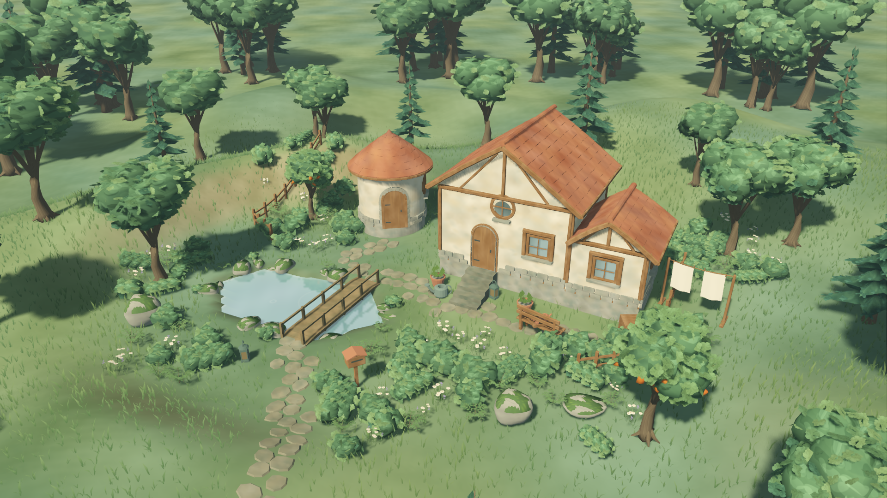
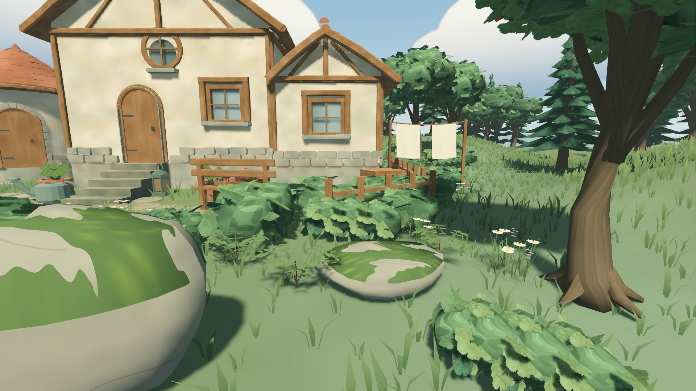

# G0 · 环境恢复与旧草基线

日期：2026-10-25（Asia/Shanghai）。工具修复提交：`b710fb7`。本轮只恢复工具与验证迁移、采集旧草基线；新草未导出/导入，默认游戏场景与美术源件未改。

**G0已完成**：工具恢复、迁移回归、提交后的空缓存累计验证、11机位与两场60秒旧草基线均有证据。首次原生稳定等待失败保留，冷启动与旧产品外部门槛不计通过。

## 环境与修复

项目根为 `tiny_glade/`，Git根为上层 `ai_game/`。恢复项目本地Godot **4.7.2.stable.official.ed1daf0bf**、gdtoolkit4.5.0，以及`tools/requirements-dev.lock.txt`中的全部固定依赖。系统Godot4.7未替换。新恢复的工具、下载缓存与`.venv`均被Git忽略。

GitHub API达到403限流时，bootstrap改用同一固定版本的官方`SHA512-SUMS.txt`验证下载包；不接受缺失/格式无效的摘要，也不把其他HTTP错误静默当作成功。Godot可执行文件的SHA256还与项目已有锁记录一致。[工具恢复记录](evidence/painterly_grass/g0/tool_restore.json)。

`clean_checkout.py`现在归档指定提交中的工程子树，独立仓库和monorepo子目录都能在检出根得到正确`project.godot`，不会归档其他项目或混入未提交文件。外层检查真实子进程退出、Godot错误日志、非零测试数、失败/跳过计数与负控状态；失败运行先移除旧成功收据。

W14 G0有独立累计入口，保留W13及历史负控并新增9项Python工具回归；`clean_checkout.py --week 14`已注册当前G0，不代表G1–G5实现。游戏版本保持`0.13.0-w13`，不将质量批次编号强行当作游戏版本。

## 自动回归与空缓存检出

| 实际执行 | 结果 | 证据 |
| --- | --- | --- |
| W13累计回归 | 745项Godot / 30,967断言 + 28项Python；0失败/0跳过，历史负控通过 | [工作区累计日志](evidence/painterly_grass/g0/cumulative.log) |
| G0工具回归 | 新增9项Python，0失败/0错误/0跳过 | [结果](evidence/painterly_grass/g0/python_checks.json) |
| `clean_checkout.py --week 14` | 从提交`b710fb7`的`tiny_glade`子树解出空导入缓存，累计745项Godot + 37项Python通过；负控通过 | [空缓存收据](evidence/painterly_grass/g0/clean_checkout.json)、[完整XML/日志](evidence/painterly_grass/g0/clean_evidence) |
| 独立W01–W09指定命令 | 446项Godot，0失败/0跳过；注入1项指定失败，确认负控能拒绝 | [日志](evidence/painterly_grass/g0/week_09_explicit.log)、[结果](evidence/painterly_grass/g0/week_09_checks.json) |

446项属于745项的子集，不额外累计；37项Python包含原28项与本轮9项。没有减少已有用例或将空测试视为通过。空检出复用固定的宿主工具，未复用Godot导入缓存，未导出Windows包。

## 当前旧草原生基线

本机Apple M4 Pro，14核CPU、20核GPU、48GiB统一内存；Godot日志确认Metal3.2 / Forward+。实际帧缓冲1920×1080、默认45%草、夏日中午晴天，音频显式Dummy；GPU计时未采集，以下是帧间隔而非GPU耗时。[硬件与电源配置](evidence/painterly_grass/g0/hardware.json)。

11个固定机位复用既有相机脚本，绑定工具提交，覆盖默认/无景深、房屋、池岸、树林、草近景、夏日、秋天、冬天、暮色和夜景。源状态/历史不变，均为真实1920×1080视口捕获；人工查看全景与草近景确认画面完整、仍为旧草。

| 60秒持续漫步/环顾 | 帧数 | 帧p95 | 最大帧 | RSS峰值 | 源/历史 |
| --- | ---: | ---: | ---: | ---: | --- |
| 示范：3屋/170源实例 | 7,202 | 9.570ms | 15.317ms | 854.25MiB | 未变 |
| 满容量：24屋/1000源实例 | 7,200 | 9.149ms | 20.311ms | 929.59MiB | 未变 |

两场帧p95≤20ms、RSS≤2GiB。派生草候选分别37,556/34,006，源实例数量不包含这些地表草。每场保存全部帧间隔、1Hz脚位置轨迹、世界种子/源状态哈希、首尾截图和命令，用于后续同条件比较；45%不是GPU实际可见三角数。保持W键并以0.3rad/s水平环顾的协议与既有漫步探针一致。

成功的原生基线前后正式文件集合及SHA256一致；当前正式目录发现1份文件，保存其哈希而不提交其内容。没有真实用户作品被复制进证据。进入QA目录的输出与正式作品分开。[原生总收据](evidence/painterly_grass/g0/native_baseline.json)。

## 失败证据与边界

- 初次沙箱内累计检查因macOS编辑器缓存/证书权限报错而正确失败；切到正常macOS权限后通过，没有删除错误扫描门槛。
- 首次可见渲染在既有15秒稳定等待处超时，原生检查正确失败。保留原日志，以相同门槛重跑，11机位约7.19秒完成后再顺序采集两场60秒基线。**冷启动门槛仍开放**，本轮不以重跑成功声称冷启动通过，也未提高等待门槛。
- 这里的60秒基线不含编辑动作，不关闭原首笔/密集拖拽尖峰；音频Dummy不计物理听感。Windows、其他Mac/低配和最终M4/M5放行仍未验证。

## 资产输入

重新核对桌面原包16份`.blend`的SHA256，均与初步分析一致。暂选`Basic_Grass_Card_01`、`Basic_Grass_Card_03`、`Basic_Grass_Floor_04`作为G1候选，分别8个基础三角、单材质槽；只是按低成本筛选，尚未做单体视觉验收、应用修改器成本或GLB导出。原包来源/授权记录继续作为正式入库和分发待办。[原文件哈希与候选记录](evidence/painterly_grass/g0/asset_inputs.json)。

## 复验与打开场景

在项目根执行，GPU命令串行；运行正常macOS终端，不将沙箱权限错误忽略：

```bash
.tools/godot/Godot.app/Contents/MacOS/Godot --version
python3 tools/quality/painterly_grass_g0_checks.py
python3 tools/quality/painterly_grass_g0_checks.py --native-only
# 验证提交后的源码；复用固定工具，不复用Godot导入缓存
python3 tools/quality/clean_checkout.py --week 14
```

只看工具回归可运行`python3 tests/week_14/run_python_checks.py`。G0累计保留W01–W09负控；底层指定命令仍是`python3 tools/quality/run_checks.py --week 9 --negative-control`，后续周次由各自累计入口扩展。

用锁定编辑器打开当前旧草场景：

```bash
.tools/godot/Godot.app/Contents/MacOS/Godot --editor --path . res://app/living_root.tscn
```

交付时已打开项目本地锁定编辑器，并核对窗口标题为`living_root.tscn - 风栖小筑 · 手绘林间 - Godot Engine`。在Godot文件系统双击`app/living_root.tscn`，按F6。底部相机卡片进入“林间漫步”，WASD/方向键行走、Shift稍快，右键或Mac双指环顾，Esc返回俯视。这是正常游戏入口，按正常规则管理作品；自动检查则显式启用QA隔离。本轮没有新增新草预览入口。




