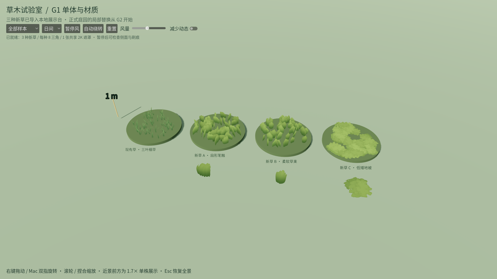
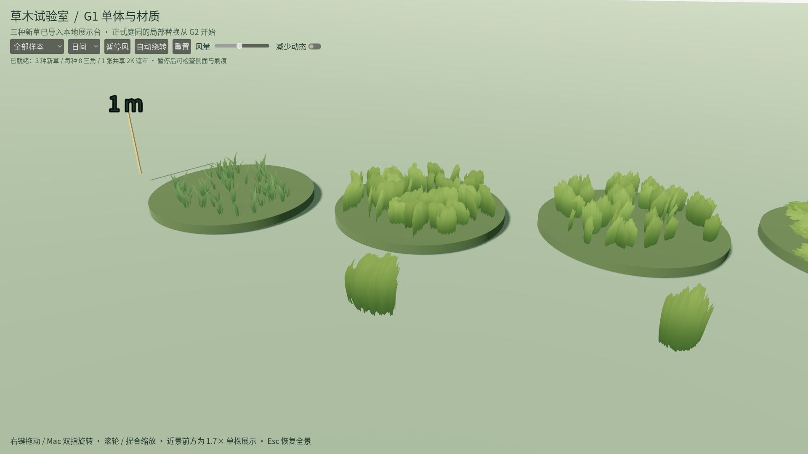

# G1 · 新草单体与材质展示台

日期：2026-10-25（Asia/Shanghai）。实现提交：`304de9d`。本轮交付独立的新草展示台、提取脚本和本地派生素材；正式庭园的局部替换属于G2，未在本轮提前执行。

## 怎么看新草

用项目本地Godot4.7.2打开 **`app/painterly_grass_preview.tscn`**，按F6；也可以直接运行：

```bash
.tools/godot/Godot.app/Contents/MacOS/Godot --path . res://app/painterly_grass_preview.tscn
```

交付时已直接运行新入口，并从实际窗口核对三种新草均已加载；窗口标题为“G1 · 新草单体展示 | 风栖小筑 (DEBUG)”。从左到右是现有三叶细草、扇形笔触草A、柔软草束B和低矮地被C。A/B/C三种新资产是真实导入GLB，不是替换成旧草后改标签。

- 下拉选择全部样本、新草A/B、地被、低机位或背面。右键拖动/Mac双指旋转，滚轮/捏合缩放。
- 切日间、树荫和逆光，观察刷痕边缘、颜色和背面；1m标尺用于对照真实尺度。
- 拨风量，暂停后检查轮廓；自动绕转和“减少动态”可以对照，减少动态也停止自动绕转。
- 重置或Esc恢复全景。圆台是原尺寸草簇，前方单株明确放大1.7倍，便于查看刷痕。

展示台不实例化正常游戏根、WorldDocument或存档/偏好服务，从启动到退出均不加载或保存正式作品；所有调节只存在于当前预览进程，退出即丢弃。无需先加QA命令行参数才能获得隔离。

## 实际接入的资产

| 样本 | 原包对象 | 实际GLB成本 | 派生尺寸 X×Y×Z（米） |
| --- | --- | --- | --- |
| A | Basic_Grass_Card_01 | 8三角 / 16导出顶点 / 1表面 | 0.3563×0.4169×0.0990 |
| B | Basic_Grass_Card_03 | 8三角 / 16导出顶点 / 1表面 | 0.2483×0.4254×0.0990 |
| C | Basic_Grass_Floor_04 | 8三角 / 16导出顶点 / 1表面 | 0.7374×0.0439×0.7979 |

原包打开只读，原始库SHA256仍为`9d86f760b3ec2834d0726bb39ffe58607702a8789df46d1a7b6804e7fe5f920e`。三份派生源保存在`art_source/painterly_grass/local/*.blend`，GLB和PNG在`assets/painterly_grass/local/`，原件和派生源都保留。单位统一为米、缩放应用到顶点、原点接地居中；Z-up→Y-up只由glTF转换一次。`COLOR_0`明确导出`wind_mask`，R为根部固定/高度权重。

这三份GLB没有材质、内嵌图或原作者节点；只有网格、UV、风权重与接地插槽。Godot包装层用共享材质和一张2048×2048遮罩，开启mipmap、裁切透明和双面受光。当前草不投射逐卡阴影；展示台接收日光，避免草卡堆叠黑线。没有引入GeoScatter、原演示地形或相机依赖的billboard。

### 对JPG的进一步确认

初步报告确认“JPG没有alpha”，本轮进一步追到真实材质连接：**Atlas C的黑白RGB就是刷痕/轮廓遮罩，原EEVEE材质将其Color接到Alpha输入。** 因此可以从其线性RGB强度整理出PNG alpha，保留原刷痕，不需要臆造轮廓或把整块矩形当作草。

颜色、根梢渐变、低幅风动和薄叶受光在Godot重建，并未承诺完整复制原EEVEE演示的灯光/节点。三种选件的UVMap、UVRandom、UVAniso实际相同；覆盖使用TEXCOORD_0，随机变化改用INSTANCE_CUSTOM，风权重不被颜色占用。

## 验证与范围

**本地技术交付通过，视觉待用户体验；素材入库和Git完整素材复现仍待验。**

| 验证 | 实际结果 | 证据 |
| --- | --- | --- |
| 全部累计 | 753项Godot / 31,097断言 + 37项Python；0失败/0跳过，历史负控通过 | [累计收据](evidence/painterly_grass/g1/checks.json)、[JUnit](evidence/painterly_grass/g1/cumulative_junit) |
| G1新增 | 8项Godot / 130断言；GLB/PNG实际字节校验通过 | [G1 XML](evidence/painterly_grass/g1/tests.xml)、[资产校验](evidence/painterly_grass/g1/asset_validation.json) |
| 原生窗口 | 12项检查，GUI、风动/减少动态、1920×1080截图与正常退出通过 | [原生收据](evidence/painterly_grass/g1/native_checks.json) |
| 可复现提取 | 两次三个GLB和PNG哈希/尺寸一致 | [记录](evidence/painterly_grass/g1/determinism.json) |
| 源件重开 | 46份历史模型 + 11份现有植物 + 3份新派生源通过 | [Blender审计](evidence/painterly_grass/g1/source_audit.json) |
| 独立本地副本 | 空缓存，仅供应派生件，8项G1全部通过；没有复制原包 | [记录](evidence/painterly_grass/g1/portable_checks.json) |

风动像素平均差约0.00659，减少动态后改变时间相位的像素差为0。成功的原生运行没有脚本错误或退出泄漏，正式文件集合及哈希前后相同。以上截图/小场景检查不计容量性能通过。用户视觉评价保持“待体验”，不由自动测试代替。

已完成的专项验证包含：

- 从实际GLB二进制核对8三角/16顶点/1表面、有限坐标、非退化三角、真实Y-up包围盒、UV和COLOR_0；PNG与源/导出哈希相符。
- 两次提取的三个GLB、共享PNG和尺寸完全一致；不把带保存元数据的`.blend`二进制声明为确定性输出。
- Blender5.1.2重开46份历史源、11份现有植物源及3份新增派生源，检查单位、UV、wind_mask、尺度和socket_ground。不是只测GLB。
- 8项GUT回归覆盖模型/根权重、尺度、透明刷痕/mipmap、确定性实例/独立材质、暂停和减少动态、光照/近景、重置与缺素材明确失败。
- 原生GUI使用视口按下/松开事件操作暂停、继续、风量、绕转、减少动态和重置；实际新网格加载、1920×1080输出、源文件隔离与退出错误检查独立验证。
- 风动/静止像素对照在两组控制中一致关闭TAA，以隔离时间抖动；正常样本截图保留TAA。静止阈值未放宽。
- 先前并发异步加载曾触发无显示渲染器RID错误；改为每次异步准备一个资源，后续GUT与原生运行均严格检查日志，不忽略错误或退出泄漏。

### 本地可运行与素材入库分开

原包的项目内源资产管理/分发条款仍未归档。按计划，派生`.blend`/GLB/PNG及其导入sidecar本地保存、暂不纳入Git；代码、提取配方、哈希清单和测试证据提交。已有授权记录待办不妨碍此次本地技术样板，但**Git单独检出即含完整素材**和正式分发不计通过。

另建立一个不带`.godot`、不复制桌面原包的独立工程副本，只显式补入清单绑定的本地派生件，重新导入并通过8项G1测试。因此运行不依赖桌面原包路径。缺素材时展示台明确报告未准备，不加载旧草假作新资产。

G2屋前8×8m对照、全场可编辑新草、容量帧率、LOD、正式默认切换与用户最终风格接受均未通过本轮推定。G0首次冷启动超时、原编辑尖峰、Windows/低配/物理触控板与听感等缺口保持。

## 可重复命令

```bash
# 提取命令和源件重开审计详见 art_source/painterly_grass/README.md
python3 tools/quality/validate_painterly_grass.py
# 仅G1专项，不声称累计通过
python3 tools/quality/painterly_grass_checks.py --stage 1 --local-only
# W13 + G0 + 负控 + G1
python3 tools/quality/painterly_grass_checks.py --stage 1
# 真实Metal截图、GUI和像素对照，GPU检查串行
python3 tools/quality/painterly_grass_checks.py --stage 1 --native-only
# 从当前提交复制工程，并显式供应本地派生件；不是Git素材分发证明
python3 tools/quality/painterly_grass_portable_checks.py
```

Godot4.7.2 / Blender5.1.2 / GUT9.7.1 / gdtoolkit4.5.0继续锁定；G1累计先保留W13与G0门禁，再验证新用例。任何空测试、断言失败、脚本错误、关键跳过和异常退出均拒绝；专项成功不冒充新资产容量性能通过。


## 实机截图





[新草B](evidence/painterly_grass/g1/native/grass_b.png) · [地被](evidence/painterly_grass/g1/native/ground_cover.png) · [背面](evidence/painterly_grass/g1/native/back.png) · [树荫](evidence/painterly_grass/g1/native/shade.png) · [逆光](evidence/painterly_grass/g1/native/backlit.png)。
