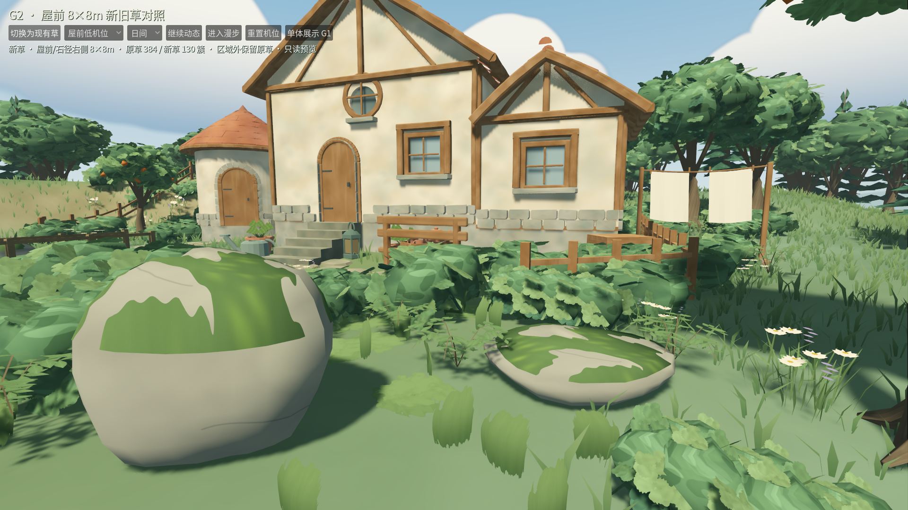

# G2 · 屋前新旧草局部对照

2026-10-25。实现提交：`04ae506`，漫步返回修正：`44fbffd`。范围为既有庭园中 x=0…8、z=2…10 的8×8m试验区。**本地技术验收结果见下；用户视觉节点V2仍为未评审。** 本轮没有进入G3或改变主游戏F5入口。

## 打开体验

在Godot打开 `app/painterly_grass_patch.tscn` 后按F6，默认显示新草。也可打开统一入口 `app/painterly_grass_preview.tscn`，点击“庭园对照 G2”；G2内有“单体展示 G1”返回按钮。切换经过异步资源加载，旧场景释放后进入目标场景。

- “切换为现有草 / 新草”：同一个庭园、同一机位立即对照。状态行显示当前变体及实例数量；试验区外保留现有草。
- 五个预设机位：俯视、屋前低机位、路径边缘、树荫、逆光构图。日间/黄昏独立可选；截图中的逆光组使用黄昏。
- “暂停动态”固定风、天空与气候相位，便于观察刷痕和草根；“继续动态”恢复。
- 俯视支持项目原有旋转、缩放和平移；“进入漫步”后用WASD/方向键行走、按住右键环顾，Esc回到俯视。“重置机位”恢复局部全景。
- 这是只读预览。直接F6已经进入QA隔离，不需要另加启动参数。隐藏编辑HUD、阻断编辑/保存动作，禁止读取正式偏好及请求正式存档目录；本地服务目录为 `user://qa_painterly_grass/g2`，active_slot=-1。

## 集成方式与视觉取舍

复用既有Living庭园的建筑、植物、地形、道路、池水、光照和天空。没有复制整套世界逻辑，也没有通过修改整场曝光突出新草；五组对照均关闭景深，保留TAA并等待48帧收敛，风和天气相位相同。

新草沿用G1的两种直立草卡与一种贴地低草，实际每簇8三角。按世界空间低频色群、0.75–1.10缩放和路径/区域边缘渐疏重新选择确定性候选；45%设置继续保留，但新旧实例数量及覆盖不同。直立叶片有刷痕轮廓，地被让部分裸地过渡更柔和；目前簇间仍留有空隙，密度、贴纸感及与树石的协调由V2体验决定，未由测试代替接受。

三个共享材质MultiMesh挂在原Meadow节点下，沿用池面反射的排除规则、不投射草阴影。原草只在试验区内部由默认关闭的预览遮罩裁去，边缘渐变过渡；其缓冲区与区外草保留。**G2仍提交原草批次的顶点**，另加3个新批次；不以局部样板推定全场GPU成本或LOD方案。

宽草卡使用保守圆形覆盖包络，并增加风摆余量，检查整个区域边界、建筑/入口、路径、桥头、池岸、道具、树干和石头。不是只检查实例原点。129×129单通道RF地形图覆盖10×10m，顶点着色器按每个顶点的世界XZ贴合地形；根权重为0，风不会移动根。地形图是派生状态，世界源数据、revision和撤销/重做栈保持不变。本轮不提供编辑后动态重建，留到G3。

## 验证结果

运行收据、统计和十张全分辨率图位于 [G2证据目录](evidence/painterly_grass/g2/)。最终数字由该目录中的 `checks.json`、`native_checks.json`、`portable_checks.json`、`root_errors.json`提供。

| 检查 | 实际结果 |
| --- | --- |
| 最终累计 | 761项Godot + 37项Python，0失败/0跳过，历史负控通过；代码`44fbffd` |
| G1/G2专项 | 16项、2,435项JUnit用例断言（另2项准备断言）；G2新增8项/2,305项用例断言 |
| 空缓存本地副本 | 16项通过；未复制桌面原包、未复用Godot缓存，显式补入本地派生件 |
| 原生GUI与截图 | 30项通过，五组1920×1080 A/B；工具栏返回修正另4项真实按钮检查通过 |
| 实例成本 | 原草区内实际可见实例原点384；新草130簇、3批次、1,040三角，边缘另保留渐变原草 |
| 草根采样最大误差 | 平地0；起伏0.050mm；刷坡2.446mm，均低于20mm |
| 局部旧草60秒 | 7,200帧，p95 9.583ms / p99 10.159ms / max 14.983ms，>50ms帧0 |
| 局部新草60秒 | 7,200帧，p95 9.405ms / p99 10.060ms / max 16.836ms，>50ms帧0 |
| 进程RSS峰值 | 1,050.89MiB，涵盖准备、两段轨迹与场景往返；不作为新草单独内存成本 |
| 数据隔离 | 源/历史及正式文件前后哈希一致；无脚本错误或退出泄漏 |

八项新增GUT测试覆盖确定性和密度梯度、实际网格/风包络、矩形/线段/圆形/池岸反例、全部实际根顶点的地形图采样误差、同源A/B、F6只读与保存阻断、漫步/暂停/五机位以及共享材质默认值和反射层。专项入口必须实际找到G1和G2两个测试套件，空跑或关键跳过拒绝。

初次专项测试曾把无显示渲染器未设置的shader参数读回值当成布尔false断言，三处得到null而失败；保留首次日志。改为同时核对“没有true覆盖”和着色器默认false声明，后续专项/累计验证通过。复核还发现工具栏退出漫步时提前stop会绕过暂停恢复，已统一交给机位恢复处理，回归覆盖按钮逻辑并单独通过原生按钮点击。最终累计收据对应修正后的`44fbffd`。未放宽贴地、避让、帧预算或日志错误规则。30项原生及60秒采样对应`04ae506`的渲染；`44fbffd`仅修正返回分支，另用真实GUI按钮补验4项，渲染和采样配方未变。首轮原生轨迹本身通过，后为新增入口往返检查及精确旧草计数重新采样，初轮收据也保留。

G1派生GLB/PNG及源文件没有重生成或修改；本轮真实资产哈希验证继续通过，G1 Blender重开源审计沿用原收据。本轮只修改Godot派生渲染和检查工具，未修改Blender源或生成器。素材项目管理/分发条款仍未归档，因此派生源、GLB、PNG及导入设置继续留本地；独立空缓存副本显式供应本地派生件，不复制桌面原包。不宣称Git单独检出即含完整素材。

## 五组同机位对照

| 视角 | 现有草 | 新草 |
| --- | --- | --- |
| 屋前俯视 | [原图](evidence/painterly_grass/g2/native/overview_old.png) | [原图](evidence/painterly_grass/g2/native/overview_new.png) |
| 屋前低机位 | [原图](evidence/painterly_grass/g2/native/house_low_old.png) | [原图](evidence/painterly_grass/g2/native/house_low_new.png) |
| 路径边缘 | [原图](evidence/painterly_grass/g2/native/path_edge_old.png) | [原图](evidence/painterly_grass/g2/native/path_edge_new.png) |
| 树荫/石旁 | [原图](evidence/painterly_grass/g2/native/shade_old.png) | [原图](evidence/painterly_grass/g2/native/shade_new.png) |
| 黄昏逆光 | [原图](evidence/painterly_grass/g2/native/backlit_old.png) | [原图](evidence/painterly_grass/g2/native/backlit_new.png) |



## 可重复命令

```bash
# W13 + G0/历史负控 + G1 + G2累计
python3 tools/quality/painterly_grass_checks.py --stage 2
# 只检查当前样板，不声称累计通过
python3 tools/quality/painterly_grass_checks.py --stage 2 --local-only
# 可见Metal窗口，五组图、实际GUI输入、新旧草各60秒，GPU检查串行
python3 tools/quality/painterly_grass_checks.py --stage 2 --native-only
# 当前Git提交的独立空缓存副本，显式供应本地派生件
python3 tools/quality/painterly_grass_portable_checks.py --stage 2
# 返回按钮修正的原生复验（截图/收据输出到reports/week_14/g2）
.tools/godot/Godot.app/Contents/MacOS/Godot --path . --resolution 1920x1080 \
  -s docs/weekly/week_14/evidence/painterly_grass/g2/button_return_probe.gd -- --g2-fhd
# 契约指定的W01–W09入口仍保留，累计入口已包含历史负控
python3 tools/quality/run_checks.py --week 9 --negative-control
```

Godot4.7.2 / GUT9.7.1 / gdtoolkit4.5.0保持锁定，原生环境为本机M4 Pro、Metal Forward+、1920×1080逻辑视口。Dummy音频、合成GUI输入不代表物理听感或触控板验收。记录的是墙钟帧间隔与进程RSS，不是GPU计时；局部轨迹不代替满容量、编辑时延或冷启动验证。原Windows/低配/M4/M5、旧冷启动和编辑尖峰等缺口保持。

下一节点为V2：用户体验后记录“接受方向 / 需调整”；目前为“未评审”。按计划，接受方向后再进入G3编辑联动。
