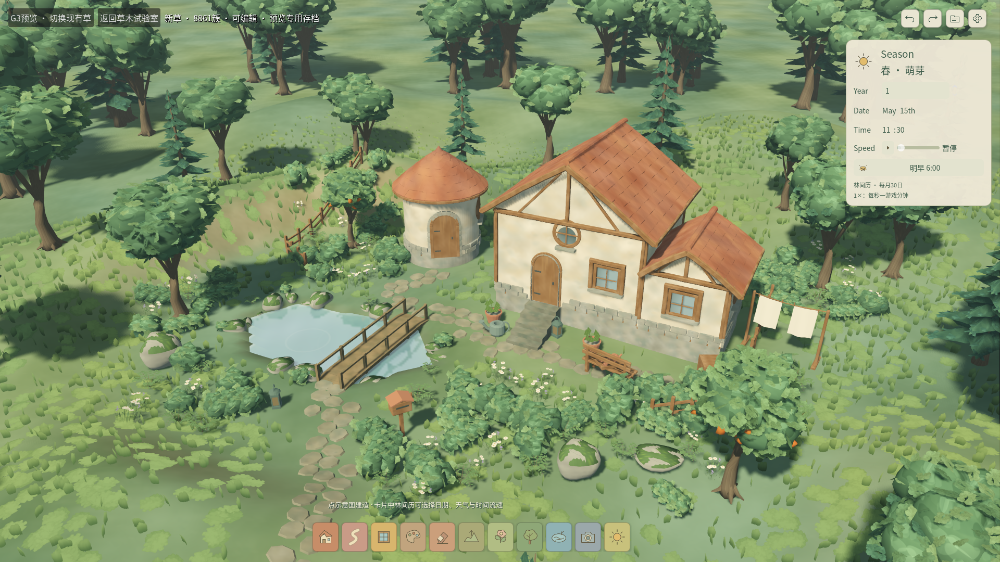

# G3 · 新草可编辑庭园副本

2026-10-25。实现提交：`d1a7911`；独立测试目录修正：`06e5bf9`。用户在G2交付后要求“继续后续任务”，本轮据此推进G3；没有据此代填具体的V2美术评价。G3使用现有庭园和编辑系统，主游戏F5入口、源存档格式与下载的Blender源件保持。

## 打开与体验

打开 `app/painterly_grass_garden.tscn` 按F6，进入默认使用新草的完整可编辑庭园。统一入口 `app/painterly_grass_preview.tscn` 的“编辑庭园 G3”和G2的同名按钮也可进入；左上角标识“G3预览”。

1. 沿用底部工具建房、调整房屋、画路径、抬低地形、刷植/擦除；右上角撤销/重做。
2. 左上角“切换现有草 / 新草”只切派生显示，后台重建中可继续转动相机。它不进入作品源或历史。
3. 右侧林间历切四季、晴阴雨雪和时间流速；设置内调整草密度与减少动态。
4. 底部摄影图标进入摄影，漫步沿用WASD/方向键、右键或双指环顾；摄影可冻结、导出1080p/2K无UI图片，再返回编辑。
5. 右上角“我的作品”提供独立五槽存档，下次从此预览中载入。预览的存档、偏好和默认照片目录均在 `user://qa_painterly_grass/g3/` 下，直接F6即生效，不需命令行参数。
6. “返回草木试验室”会在作品未保存时显示保存/放弃/取消决定，不静默丢弃修改。

**本机工程路径**：`/Users/tongmeng/Desktop/codes/ai_game/tiny_glade/`。派生草素材仍由本机G1目录供应；独立副本的复验方式见下文。默认F5继续运行既有正式游戏，G3是可编辑的预览副本。

## 实现与边界

在既有GardenPlayground增加一个默认返回原MeadowRenderer的工厂方法，G3覆盖它创建PainterlyGardenGrassRenderer。沿用MeadowData的确定性候选与缓存、MeadowRenderer的单后台任务/版本淘汰/0%密度/退出等待机制，以及原FoliageBatches和事务/存档系统。运行时世界编辑通过现有事务发布，地表草没有新增源实例ID、字段或格式迁移。

新渲染器按8m分块、三个草网格生成批量缓冲。块内容哈希和地形签名不受revision变化影响，局部编辑只替换实际变化的块；其他块保留节点、种子、姿态、草种和缓冲。正在准备的块在主线程按约2ms工作片创建，整个代次准备完后统一提交节点及地形层。取消或新代次会清理未发布节点，已在使用的块和地形层不会被旧任务覆盖。缓存只由唯一后台任务访问，主线程接收不再修改的结果。

草卡使用完整横向包络加上**100%风强度**余量，空间索引避让房屋/入口、路径、池岸、桥头、道具、树干和石头。36层129×129 RF纹理数组保存每块含1m边缘的10×10m地形采样；宽草卡的每个顶点按世界XZ贴地，根风权重为0。缓存签名包括世界种子、地貌、0.25/0.5m间距、1.5m采样边缘内的高度修改及附近池形，防止载入其他种子的作品或在块外改坡后继续使用旧高度。

全场使用一个新草材质；回退旧草另有一个材质。两者接入现有风、方向、减少动态、摄影冻结、调色板和季节/云影接口。新草沿用现有地表草的`living_up=0`含义，冬季由场景/地面处理积雪，草卡不会整面挂成白片；地表草继续排除池面反射层、不投射草阴影。手放及刷植的既有植物仍由原FoliageBatches管理，源ID和锁定内容保留。

默认45%密度下，本机示范庭园显示新草8,861簇、36块/108批次。与G2局部样板的原点数不可直接比较；边界/树石包络和密度排序已按全庭园重新计算。继承的42–58m淡出暂时保留，LOD、密度覆盖和容量预算留到G4，不把此阶段帧画面或RSS写成满容量通过。

## 验收结果

| 项目 | 实际结果 |
| --- | --- |
| 最终累计 | 773项Godot + 37项Python，0失败/0跳过，历史负控通过；代码`06e5bf9` |
| W14专项 | G1/G2/G3共28项，22,976项JUnit用例断言；G3新增12项/20,541项用例断言 |
| 空缓存本地副本 | `06e5bf9`的28项通过；无Godot缓存，不复制桌面原包，显式供应本地派生件 |
| 50笔混合编辑 | 每笔均提交成功；逐笔撤销50次和重做50次，源/派生块版本恢复一致 |
| 地表贴合 | 全庭园实际根顶点最大1.047mm；平地/起伏/刷坡采样分别0/0.093/1.330mm，均小于20mm |
| 原生功能 | 40项通过，包含实际编辑/撤销/保存/摄影/漫步和场景往返 |
| 原生显示 | 8张四季晴阴图、雨/雪及6秒天气重定向轨迹、1080p与2K无UI导出 |
| 动态像素 | 风动平均差0.000519；减少动态后改变相位平均差0，阈值未放宽 |
| 内存观测 | 原生流程RSS峰值1,171.63MiB，含准备/编辑/两档摄影和场景往返，不作容量签核 |
| 数据保护 | 正式文件哈希不变；无脚本错误或退出泄漏 |

新增12项GUT覆盖直接F6隔离及偏好读回、0/45/100%密度、空块恢复、远块复用、房屋/路径/树/池岸/桥头变化、刷植擦除与锁定ID、连续变体切换/更新/取消、50笔混合编辑逐笔撤销重做、实际存读档、季节/冻结/减少动态/反射层、所有实际网格根部和整风包络，以及不同种子/0.25m采样边缘的缓存失效。50笔采用坡地、建筑高度/圆屋尺寸、路径宽度和树位置等合法变化，撤销和重做后同时比较源状态（除单调revision）及派生块版本。

原生检查在实现提交前完成，渲染/场景/probe源码与`d1a7911`相同，随后`06e5bf9`只修正测试输出目录；Git基点与源码哈希均在收据中保留。原生40项通过实际视口鼠标输入操作新旧切换、抬地、撤销/重做、作品库保存、摄影/漫步、未保存返回决定及G1↔G3往返。8张四季×晴阴代表图、雨/雪图及6秒中途改变目标的天气轨迹独立保存；摄影实际创建1920×1080和2560×1440的无UI图片。风动/减少动态的两侧像素检查一致关闭TAA隔离抖动，普通代表图及摄影保留TAA。正式文件集合及SHA256在检查开始/结束一致。

### 过程中发现并修复的问题

- 首次后台数据生成使用条件表达式初始化带类型的嵌套数组，在运行时被判为普通Array。改为显式`assign`，最终运行无该脚本错误。首次日志保留摘要与原始文件哈希。
- 原编辑系统发布后会更新风材质列表，G3最初只在ready添加旧草材质，导致编辑后旧草不参加摄影冻结。改为在每次同步风时确保两个材质都在列表；自动测试和原生冻结/减少动态均通过。
- 地形缓存补入世界种子及完整采样边缘依赖，避免跨作品和0.25m地形边缘的旧贴地图；新增反例验证。
- 测试夹具最初尝试扩大紧贴侧屋的主屋、仅缩小带多边形池的包围半径，以及使用不存在的`overcast`天气键，正确被现有约束拒绝。改为合法的圆屋/池岸顶点编辑和`cloudy`，未改变产品约束。
- 原生测试最初直接向嵌入弹窗视口投鼠标坐标，保存和离开确认没有触发。改为把弹窗位置换算到根窗口后投递真实GUI事件，两个窗口按钮均通过；未用直接发`pressed`信号代替。
- 首次空缓存组合运行发现G2的根误差报告假定旧目录已存在，导致文件打开为空；各测试现在自行创建输出目录，`06e5bf9`独立副本及累计回归通过，未忽略脚本错误。

未修改Blender生成器/源件，G1实际GLB/PNG及源哈希验证继续通过；源重开审计沿用G1收据。源素材项目管理/分发条款仍待归档，因此派生资产继续本地保留，不宣称Git单独检出即拥有所有运行素材。用户没有具体美术评价，V2/V3保持待体验；Windows、低配、物理触控板/听感、冷启动、旧编辑尖峰和产品M4/M5等外部门槛保持。

## 实机图与记录



[现有草同机位](evidence/painterly_grass/g3/native/editor_old.png) · [实际抬坡后](evidence/painterly_grass/g3/native/edited_slope.png) · [1080p无UI照片](evidence/painterly_grass/g3/native/photo_1080.png) · [2K无UI照片](evidence/painterly_grass/g3/native/photo_2k.png)。

| 季节 | 晴 | 阴 |
| --- | --- | --- |
| 春 | [图](evidence/painterly_grass/g3/native/season_4_clear.png) | [图](evidence/painterly_grass/g3/native/season_4_cloudy.png) |
| 夏 | [图](evidence/painterly_grass/g3/native/season_7_clear.png) | [图](evidence/painterly_grass/g3/native/season_7_cloudy.png) |
| 秋 | [图](evidence/painterly_grass/g3/native/season_10_clear.png) | [图](evidence/painterly_grass/g3/native/season_10_cloudy.png) |
| 冬 | [图](evidence/painterly_grass/g3/native/season_1_clear.png) | [图](evidence/painterly_grass/g3/native/season_1_cloudy.png) |

[雨](evidence/painterly_grass/g3/native/rain.png) · [雪](evidence/painterly_grass/g3/native/snow.png) · [中途重定向](evidence/painterly_grass/g3/native/weather_redirect.png)。完整运行收据及源/证据哈希见[G3证据目录](evidence/painterly_grass/g3/)。

## 可重复验证

```bash
# W13 + G0/历史负控 + G1/G2/G3累计
python3 tools/quality/painterly_grass_checks.py --stage 3
# 仅当前已完成的G1/G2/G3专项；不声称累计通过
python3 tools/quality/painterly_grass_checks.py --stage 3 --local-only
# 原生Metal窗口与GUI/环境/导出检查，串行运行
python3 tools/quality/painterly_grass_checks.py --stage 3 --native-only
# 从当前提交建立无缓存副本，显式补入本地派生件，不复制桌面原包
python3 tools/quality/painterly_grass_portable_checks.py --stage 3
# 开发契约指定的底层入口仍保留；累计包含历史负控
python3 tools/quality/run_checks.py --week 9 --negative-control
```

Godot4.7.2 / GUT9.7.1 / gdtoolkit4.5.0继续锁定；所有阶段按明确套件清单运行，空跑、消失套件、失败断言、关键跳过、脚本错误和退出泄漏均拒绝。G1/G2命令只运行各自已注册的阶段，不因G3目录出现而悄悄扩展结果。

下一阶段G4将单独签核24屋/1000源布局、LOD与覆盖、新旧各组60秒性能、内存和编辑时延。本报告不提前认定G4或最终美术接受。
