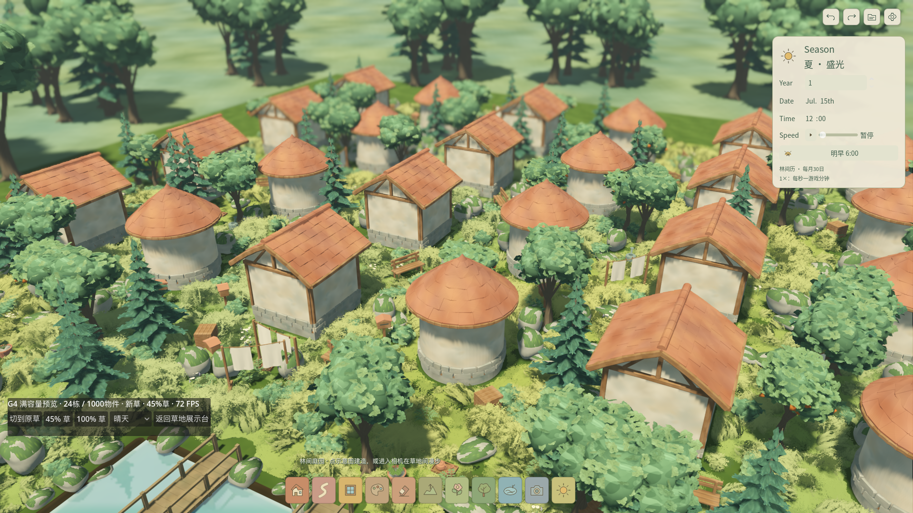

# G4 · 满容量体验与首轮性能诊断

2026-10-26。**容量体验入口已交付，性能验收未通过。** 用户已接受正式四层草的常规美术风格，冬季新增雪地另见[专项报告](WINTER_COVER.md)。本轮保留获认可的完整草外观，未采用导致远景明显变平的缩簇/地面替代试验。正式草网格、贴图、散布、材质与源Blender保持冬季修复提交`a257d7e`的状态。

## 可以直接体验

打开`app/grass_capacity.tscn`按F6，或从`app/painterly_grass_preview.tscn`点“满容量体验 G4”。主游戏F5仍进入正式庭园。容量入口包含24栋房屋、1000个源物件：80树、534灌草、266岩石、120道具；派生地表草另计。

工具栏可切新草/原草、45%/100%草量，以及晴天、暴风雨、暴风雪、沙尘暴；继承原建造、相机、漫步与摄影操作，提供返回展示台。新旧对照逐次重载同一个容量场景，沿用相同TerrainField和Terrain3D，不并行运行两个庭园。两边各自的实例总数不同，45%设置不能当作等量植株。

QA隔离从`_init`起生效，作品使用`user://qa_painterly_grass/g4/saves`，照片放该预览目录，偏好只保留在当前预览会话。原游戏的作品和偏好未改。



## 当前硬件上的实际结果

锁定Godot4.7.2、Metal Forward+、1920×1080真实帧缓冲、4×MSAA和TAA；测试进程明确关闭VSync。Apple M4 Pro / 48GiB，电池供电，系统报告`powermode 0`，没有记录到热警告。GPU测试串行；除测试进程外只有既有编辑器，没有另一个游戏实例。每边独立进程，加载稳定后热机5秒，执行相同解析相机轨迹60秒。时间为进程帧间隔，**不称为GPU耗时**。

| 45%草、晴天、满容量 | p50 | p95 | p99 | 最大帧间隔 | RSS峰值 |
| --- | --- | --- | --- | --- | --- |
| 原草 | 14.355ms | 15.826ms | 16.381ms | 18.687ms | 1006.8MiB |
| 四层新草 | 26.819ms | **29.366ms** | 30.070ms | 32.992ms | 1210.6MiB |

新草p95相对本次原草高85.6%，超过15%诊断线和20ms正式门槛；60秒进程内存峰值低于2GiB，但不能代替20分钟内存稳定性。结果为**真实预算失败**，性能命令返回非零。运行文件哈希与收据中5份运行代码哈希一致，不把试验版本的较快结果记给最终外观。[测量汇总](evidence/painterly_grass/g4/pilot.json)、[预算失败日志](evidence/painterly_grass/g4/pilot_gate.log)。

首轮晴天默认档已失败，尚未执行后续3轮×天气/密度完整矩阵。默认验证脚本会在失败的对照组后保留结果并停止，不继续把失败前置条件下的长测量包装为阶段完成。缩小远景草簇会损失已认可的体积与笔触，相关试验已撤回；[拒绝的试验画面](evidence/painterly_grass/g4/rejected_far_shrink.png)仅作美术决策记录，不是已采用方案。

## 功能验收

- 本轮规定W01–W09：446项，0失败/跳过，负控按预期失败并被门禁验证。
- 正式庭园和容量场景：11项、556断言，含新增3项容量隔离、密度/天气不改源、新旧使用相同源/地形；0失败/跳过。
- Metal真实输入：11项，覆盖100%/45%按钮、新→旧→新切换、源不变、工具栏在屏幕内、返回展示台及入口存在。无脚本错误或退出泄漏。
- 正式作品/偏好哈希一致；没有改Blender源或导入设置。没有新增Windows真机通过结论。

[功能收据](evidence/painterly_grass/g4/functional_checks.json)本轮使用`--native-only`，故其中不重复记headless计数；11项headless结果单独保存在[正式场景收据](evidence/painterly_grass/g4/landscape_checks.json)和JUnit中。本轮没有重跑历史789项全套，不能声称已全量累计通过792项。

```sh
# 容量与既有正式场景功能、真实UI往返
python3 tools/quality/grass_capacity_checks.py
# 首轮容量帧预算；当前外观下预期非零并保留失败证据
python3 tools/quality/painterly_grass_performance.py --pilot
# 完整矩阵入口；前置组失败即停止，修复后才继续后续组
python3 tools/quality/painterly_grass_performance.py
python3 tools/quality/run_checks.py --week 9 --negative-control
```

G4仍进行中：首先需要能保留笔触和轮廓的远景表示；随后完成默认档四种天气各3组新旧对照、100%晴天/最重天气、编辑时延、20分钟混合编辑/存读档、2K摄影峰值和LOD人工复核。当前数据不能批准G5收口。资产分发条款、Windows/其他Mac与原M4/M5外部门槛继续独立待验。
