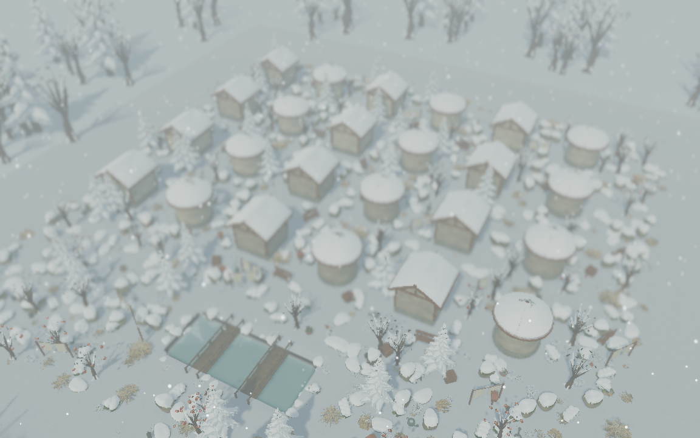

# G4 · 当前云雪配置性能与冬草快速路径

2026-10-28。当前正式画面采用Terrain3D、四层草、SunshineClouds2及Blanket雪壳；本轮重新测量满容量场景，并尝试在保持外观的前提下优化完全埋雪的草。**本轮为诊断与局部优化，G4尚未通过。**

## 测量与验收边界

锁定Godot4.7.2，Apple M4 Pro / 48GiB，Metal Forward+，1920×1080，TAA、无MSAA、关闭VSync；交流电供电且电池正在充电，本轮各组启动记录的电量约9%–27%，完整环境记录在收据中；未控制GPU频率，不能排除系统运行状态差异。24屋、1000源物件、45%草量；每种草单独进程，等待建筑/地形/草/雪队列完成，热机5秒，再执行相同60秒解析环绕轨迹。保留既有编辑器，GPU测试串行，不同时运行其他游戏、回归或Git打包。RSS包含启动及雪壳生成；帧间隔不是GPU计时。

性能工具新增当前渲染设置和插件实际启用断言、厚雪就绪断言、退出泄漏检查、运行文件哈希防漂移，以及`--pilot --weather blizzard`独立诊断入口。输出改放`reports/week_14/g4_weather/`，避免覆盖旧MSAA基线。单组超过20ms或2GiB时命令仍返回非零，保留收据；独立冬景诊断不代表越过默认档的失败门槛。

首轮晴天启动与Git推送打包短暂重叠，保留在[初始记录](evidence/g4_current/initial_clear_during_push/pilot_clear.json)，不作为本轮正式对比。推送结束后的重测、优化前冬景见[晴天基线](evidence/g4_current/before/pilot_clear.json)及[暴风雪基线](evidence/g4_current/before/pilot_blizzard.json)。旧2026-10-26的4×MSAA/电池供电结果仍为历史记录，不能与本轮直接相减。

| 配置 | 草 | p50 | p95 | p99 | 最大帧 | RSS峰值 |
| --- | --- | --- | --- | --- | --- | --- |
| 优化前·晴天 | 原草 | 12.375ms | 14.132ms | 15.029ms | 15.717ms | 1080.3MiB |
| 优化前·晴天 | 四层草 | 23.193ms | 26.113ms | 26.938ms | 28.993ms | 1281.2MiB |
| 优化前·暴风雪 | 原草 | 19.038ms | 22.971ms | 23.808ms | 26.395ms | 1124.7MiB |
| 优化前·暴风雪 | 四层草 | 30.424ms | 35.608ms | 36.974ms | 37.864ms | 1304.4MiB |
| 优化后·晴天 | 原草 | 6.905ms | 7.509ms | 13.403ms | 17.494ms | 1071.9MiB |
| 优化后·晴天 | 四层草 | 6.906ms | 7.288ms | 7.455ms | 24.703ms | 1317.6MiB |
| 优化后·暴风雪 | 原草 | 19.098ms | 23.009ms | 23.573ms | 24.637ms | 1139.5MiB |
| 优化后·暴风雪 | 四层草 | 23.314ms | 28.415ms | 29.622ms | 31.090ms | 1314.9MiB |

最终晴天单组通过20ms，暴风雪仍未通过，冬景性能命令按预期非零。四层草冬景本次采样35.608→28.415ms；但晴天原草对照也出现14.132→7.509ms的明显波动，且无雪路径没有同等算法变化，因此不能把所有前后差值归因于优化。当前只能确认跳过了不可见工作、八组画面相同；稳定收益和原因仍需重复采样/性能分析。最终[晴天结果](evidence/g4_current/pilot_clear.json)、[冬景结果](evidence/g4_current/pilot_blizzard.json)、[冬景预算失败日志](evidence/g4_current/winter_budget_failure.log)。

各配置仅一组独立60秒样本，尚未做每档三次重复，不宣称稳定吞吐或跨硬件收益。满容量冬景为1,412个雪覆盖视图、384份烘焙缓存；视图含部件/LOD，不等于独立源物件数。短时RSS低于2GiB不代替20分钟稳定性。

## 实际改动与画面核对

原草着色器在片元阶段把埋雪草簇的alpha降至零，但这些完全透明簇仍逐顶点执行贴地采样、矩阵逆、风及接触计算。本轮把相同的积雪可见性公式提取为共享函数；仅当整个实例可见性严格等于零时，提前将三角形退化并跳过上述计算。仍在淡入淡出的草以及零星枯草沿用原计算，未减草密度、缩远景、换网格/贴图或修改作者源数据。无雪时直接绕过雪可见性判定。

新增可重复Metal像素对照：远景与低角度近景，覆盖率0/0.4/0.65/0.98，共8组。固定时刻，暂关TAA与体积云排除时序噪声，只切`winter_cull_enabled`；全部重复噪声与优化前后平均像素差均为**0**，源文档、历史及草实例数不变。[门禁收据](evidence/g4_current/pixel_checks.json)、[逐组结果](evidence/g4_current/pixel_result.json)、[原生日志](evidence/g4_current/pixel_native.log)。像素证明与正式TAA/体积云开启的性能采样分开进行。



首版探针未给天气同步留出帧，雪队列尚未启动便检查烘焙数，触发断言；该次失败未计通过，保留[失败日志](evidence/g4_current/pixel_probe_initial_wait_failure.log)。补上天气同步帧后，正式门禁通过。没有把测试等待错误当作游戏功能修复。

## 回归与复验

最终着色器上，规定W01–W09 **446项与失败负控**、定向 **36项/2,807断言**通过，0失败/跳过；309份GDScript格式/静态检查通过。八组Metal像素对照通过，无退出泄漏，正式作品/偏好哈希不变。[累计与定向收据](evidence/g4_current/regressions.json)、[W09收据](evidence/g4_current/week_09_checks.json)、[执行日志](evidence/g4_current/regression_gate.log)。本轮未重跑历史789项全套或此前74项漫步原生流程，未新增Windows通过结论。

```sh
python3 tools/quality/winter_grass_cull_checks.py
python3 tools/quality/painterly_grass_performance.py --pilot
python3 tools/quality/painterly_grass_performance.py --pilot --weather blizzard
python3 tools/quality/weather_adoption_checks.py --cumulative --headless-only
```

性能命令若仍超预算应返回非零，不能据此写为功能回归失败，也不能忽略预算失败宣布G4通过。当前暴风雪预算、全天气/密度各三轮、编辑时延、20分钟混合编辑/存读档、2K摄影峰值及LOD美术复核仍开放；Windows/低配真机、素材分发与G5候选包独立待验。PainterlyGrass派生素材仍按既定策略本地供应，未将原下载包上传GitHub；Git单独检出的素材可用性尚未签核。没有改Blender源、导入设置或插件固定版本。
