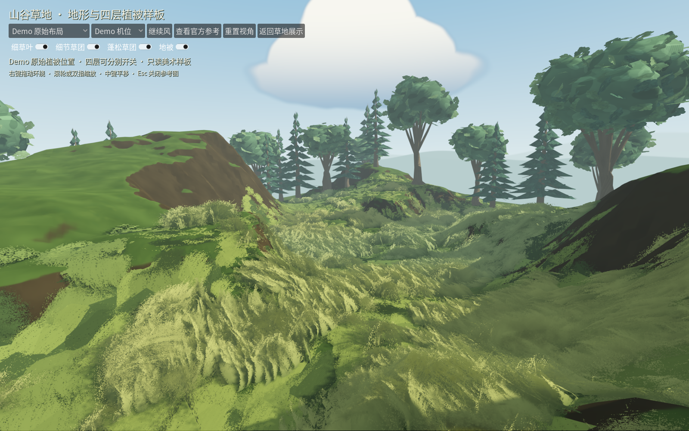
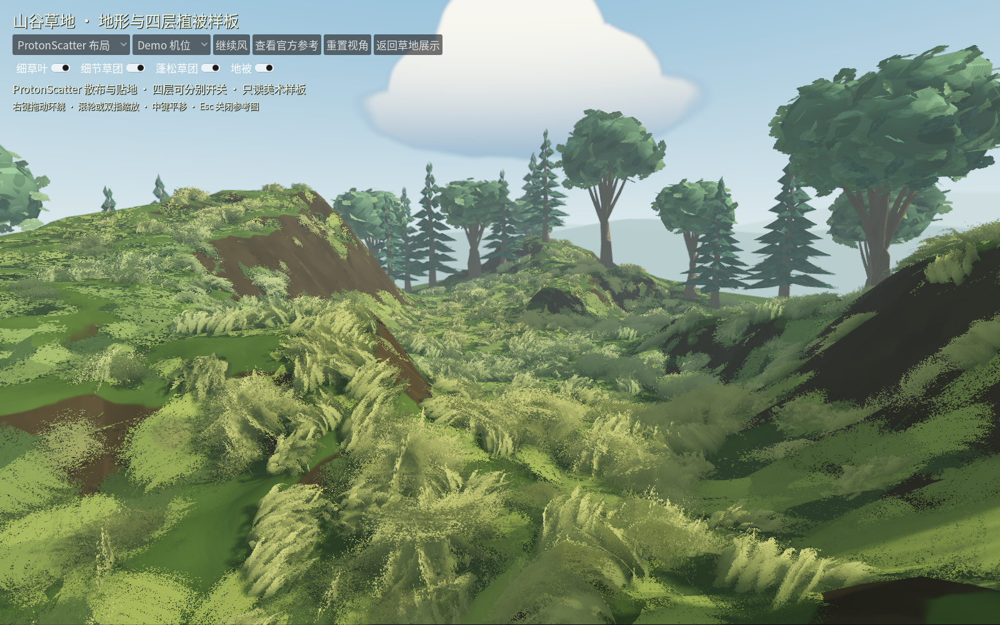
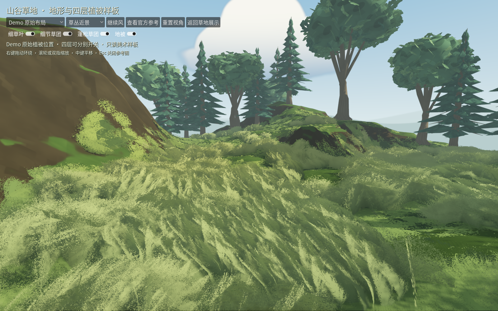
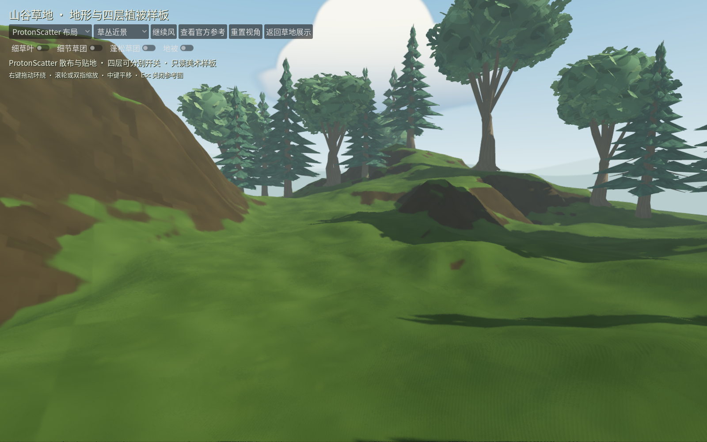

# W14 · Terrain3D × ProtonScatter 山谷草地样板

2026-10-25（Asia/Shanghai）。已完成本地插件接入、美术样板和功能验证；用户视觉接受、正式可编辑庭园迁移、性能验收保持开放。

用户要求使用成熟插件改善地形和草坪，并优先对齐demo美术。本轮直接使用Terrain3D显示作者真实山谷高度场，使用ProtonScatter生成独立四层草布局，恢复真实草模型与连续透明笔触。[插件评估与来源](../../art/LANDSCAPE_PLUGIN_ASSESSMENT.md)。

## 体验入口

在Godot打开`app/landscape_lab.tscn`，按F6。也可从`app/painterly_grass_preview.tscn`的“山谷地形与草地样板”进入。默认F5仍进入正式庭园，本轮新效果在样板中查看。

- 布局菜单：Demo原始布局 / ProtonScatter布局；相机、地形、材质保持一致。
- 三个镜头：Demo机位、山谷俯瞰、草丛近景。
- 四层独立开关、风暂停/继续、官方参考图、返回草地展示。
- 右键环绕、滚轮/双指缩放、中键平移；Esc关闭参考图。

## 实际画面与判断

Demo原始布局，使用真实Terrain3D地形和四种模型：



ProtonScatter按四层各自源区域、数量、尺度生成，再投射到原生Terrain3D高度与法线：



近景与地形检查：





草地已从三种8三角互斥卡片恢复为真实四层重叠：24/2,288/28/8三角，原实例366/305/161/2,445，共3,277。细节草团保留原细分；全4K灰度笔触作为连续透明覆盖，使用alpha hash、侧向淡出、原法线与柔化受光、根梢色、透光和风。原实例位置、朝向、尺度、埋根偏移保留，根平面贴合曲面时扣除已有倾斜，避免重复加坡。

本轮恢复了连贯草团体积与地被覆盖。还不能称官方整图对齐：局部透明抖动、裸地与地面笔触融合仍需调整；树使用项目现有植物，岩壁及官方天空没有迁移。插件承担成熟工具能力，美术构图与材质仍需继续打磨。最终方向由用户实际体验判断。

## 验收节点

| 节点 | 可验收交付 | 结果 |
| --- | --- | --- |
| L0 来源与固定依赖 | 两个插件固定版本、MIT许可、逐文件哈希；原资产不改 | 通过；四份新Blender源重开审计通过 |
| L1 地形与四层美术 | 实际Terrain3D地形、四个真实草模型、4K遮罩、原始3,277实例 | 本机Metal渲染通过；美术接受待用户 |
| L2 可交互对照 | 两种布局、三镜头、独立草层、风、参考图、场景往返 | 自动及原生检查通过，真实GUI已操作布局/草层/暂停/参考/返回 |
| L3 功能与存储边界 | 确定性、贴地、坡度/保护区、相机有限值、正式文件隔离 | 新增8项通过；累计781项Godot/37项Python，0失败/跳过；负控通过 |
| L4 用户美术评审 | 草团体积、覆盖、边缘和地形符合方向 | 待用户体验，不由测试数代签 |
| L5 正式迁移与性能 | 事务/池岸/路径/保存联动，再测Mac容量与编辑开销 | 未开始；Windows真实设备未验 |

原生严格日志门禁通过，共34项检查、12张截图，6张为两布局×三同机位；另含四层单独显示、纯地形和参考图。Demo镜头按17mm/36mm水平视角还原，不随窗口比例误用固定垂直FOV；三种视角矩阵均有限。实际Metal MultiMesh原点与发布数据最大误差0m。参考图仅留本地，不重复归档完整供应商图片。

真实GUI点击已确认布局、细节草层、暂停、官方参考图和返回G1；原生探针进一步调用实际按钮回调，验证G1→山谷重新准备Terrain3D。GUI自动化后续出现窗口定位错误，因此场景往返完成情况以探针日志和结果为证，不把该工具错误记为游戏崩溃。截图探针在窗口被遮挡时不再无限等待绘制信号，改为显式绘制本场景视口；最终严格门禁无错误和退出泄漏。

## 验证与复验

```sh
python3 tools/quality/run_checks.py --week 9 --negative-control
python3 tools/quality/painterly_grass_checks.py --stage 3
python3 tools/quality/landscape_lab_checks.py
python3 tools/quality/landscape_lab_checks.py --native-only
```

也可使用`python3 tools/quality/landscape_lab_checks.py --cumulative`重复既有累计加本轮测试。不得让空测试、脚本错误或失败断言通过。实测为既有773项Godot/37项Python加本轮8项；本轮365项JUnit testcase断言，GUT另计2项准备断言。Headless Dummy不保存服务器MultiMesh变换，Headless检查发布缓存，Metal探针检查实际GPU变换，两者分别保留。

新增测试覆盖插件种子复现、世界坐标与临时节点释放、原生地形投射和坡度/保护区过滤、四层真实几何、来源不变、源埋根偏移、独立草层及切换、16组边界低机位环绕的有限坐标。原始高度图以64/255m间距采样，导入时重采样到Terrain3D对齐的0.25m全局格点，避免半像素偏移。

当前未发现脚本错误、资源或RID退出泄漏，正式作品与偏好前后哈希一致。固定Terrain3D仍有`instance_reset_physics_interpolation()`弃用警告，不计为错误，也未为消除警告升级引擎。未运行本轮FPS/RSS、容量或编辑性能门槛；本机Metal验证不能外推其他Mac和Windows。

## 依赖、源件与证据

Terrain3D **1.0.2-stable / 0077405**，ProtonScatter **4.2.0 / 7198cc0**，Godot4.7.2、Blender5.1.2。插件已在项目中启用。Terrain3D上游编辑器移除Dock时没有释放该节点，补入一行`queue_free()`；保留原始哈希、修改后哈希、补丁和隔离前后日志，未弱化质量检查。运行时动态纹理保留在内存，避免空资源路径重载；区域尺寸在进入世界后设置。

原`.blend`哈希未变；4份派生`.blend`、GLB、PNG、原布局和高度图保留在本地忽略目录。许可证允许的插件源码/二进制依赖已入项目，供应商植物派生件仍待分发条款归档，Git单独检出尚不提供该本地素材。

证据：

- [汇总](evidence/landscape_lab/summary.json)、[新增检查](evidence/landscape_lab/checks.json)、[JUnit](evidence/landscape_lab/tests.xml)、[新增日志](evidence/landscape_lab/tests.log)。
- [既有完整累计](evidence/landscape_lab/existing_cumulative.json)、[W09负控](evidence/landscape_lab/w09_negative_control.json)。
- [原生结果](evidence/landscape_lab/native/result.json)、[原生日志](evidence/landscape_lab/native/native.log)、[Headless边界](evidence/landscape_lab/HEADLESS_VALIDATION.md)。
- [编辑器Dock修正验证](evidence/landscape_lab/plugin_editor_cleanup.json)、[Blender重开审计](evidence/painterly_grass/valley_sources/audit.json)、[源哈希核对](evidence/painterly_grass/valley_sources/verification.json)。

正式庭园迁移将继续使用WorldDocument和事务为源，覆盖地形编辑、池岸、道路、建筑支撑、漫步、撤销/重做与旧档重建；本轮不会把插件的渲染缓存变成另一份作品数据库。

插件依赖里程碑：`a34e39e`；场景、源提取、测试与证据作为后续独立提交保存。
