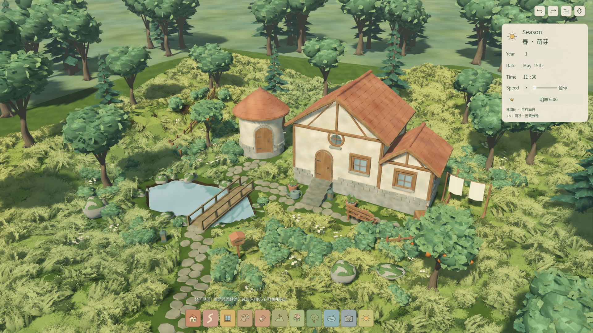
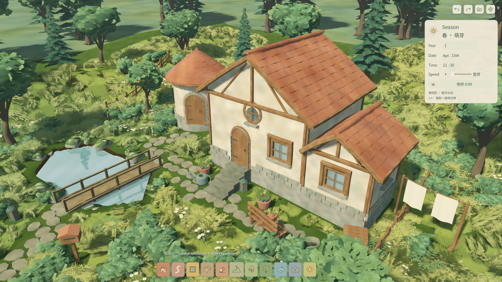
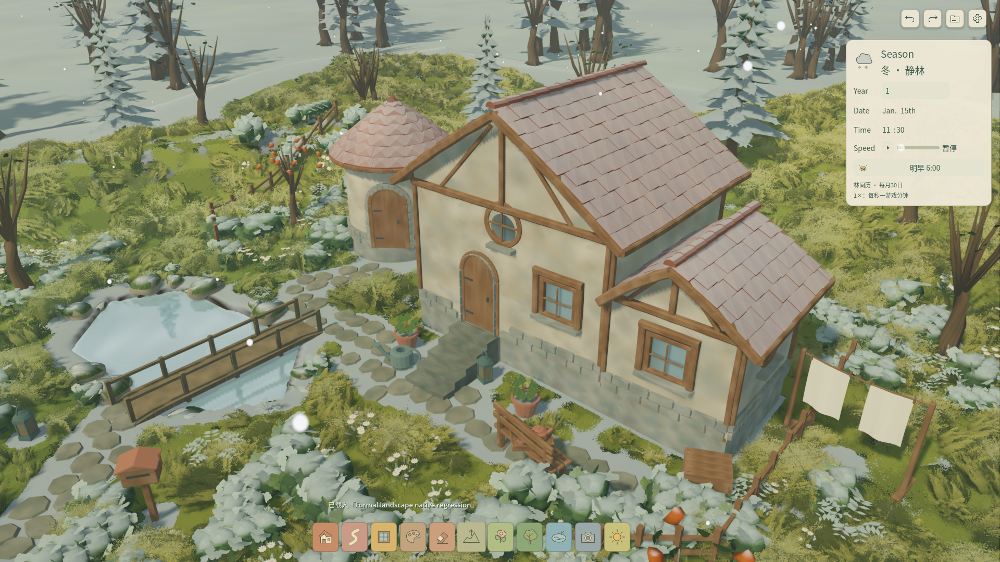

# W14 · 四层草与Terrain3D应用到正式庭园

2026-10-26（Asia/Shanghai）。用户认可山谷样板，并明确要求应用到正式场景。本轮已完成默认入口切换，性能优化继续后置。

## 当前入口与画面

直接F5运行项目，或F6运行`app/living_root.tscn`。正式根脚本为`features/landscape/production_playground.gd`，继续使用原来的工具、时历、作品与摄影界面。无需进入G1或山谷样板。普通默认入口已实际打开并核对新草及正式工具；开始面板缩略图同步为本轮实机。





## 接入方式

Terrain3D接收当前作品的`TerrainField`高度场，包含玩家刷坡和池岸派生地形。沿用原有地貌、房屋位置与保存数据，不把样板山谷的10m高差覆盖到已有作品。0.25m对齐网格由后台生成，原生地形只发布最新版本；刷坡预览、取消、提交、撤销和读档都会更新。最新原生图完成前保留事务准备的地形网格，发布时立即切换显示。

草地实际使用样板的四个模型及4K笔触：24/2,288/28/8三角；保留作者尺度、埋根偏移和四层叠加。ProtonScatter按作品种子生成稳定候选，后台按当前地形投射并避让房屋、道路、池塘和树石。分块高度与保护遮罩处理草团边缘，局部修改复用远处块，过期结果不发布。默认示范庭园在45%密度下为23,207候选、10,376可见簇、144批次；此处是资产统计，不是容量性能通过。

材质参与风向、减少动态、摄影冻结、四季、积雪和云影；Terrain3D地面还响应雨湿与调色。草和地形继续排除在池面反射捕获之外。建造源、事务、存档格式与版本没有改变，生成网格和原生区域均可丢弃后重建。旧G1/G2/G3及山谷样板保留作为对照。

## 验证结果

累计 **789项Godot + 37项Python**，0失败/跳过，规定W01–W09负控通过。本轮新增8项，最终522项JUnit testcase断言。完整累计后，针对地形发布可见性补测最终8项；新增用例还覆盖真实刷坡预览发布后取消恢复。

| 检查 | 结果 |
| --- | --- |
| F5入口、四种真实网格与4K透明图 | 通过 |
| 地形刷坡预览、取消、提交及池域高度采样 | 通过；与当前TerrainField一致 |
| 50笔地形/房屋/道路/植物/桥混合提交，50次撤销及50次重做 | 通过；最终源和草块版本还原 |
| 道路/房屋/池岸保护、源埋根偏移、局部块复用 | 通过 |
| 隐藏草后编辑、快速过期请求及恢复密度 | 通过；仅最新源发布 |
| 隔离存档、读取后地形与四层草重建 | 通过 |
| 四季、摄影冻结、减少动态及源/历史不变 | 通过 |

Metal原生 **50项检查**通过，生成9张场景截图与2份无UI照片。实际指针刷坡、GUI撤销重做、GUI保存及读档、漫步切换、摄影均通过；实际GPU实例原点相对发布数据最大误差0m。风相位改变的平均像素差0.003541，减少动态时为0。无脚本错误、资源或RID退出泄漏，仅固定Terrain3D版本的物理插值弃用警告。



1080p及2K照片尺寸与哈希保存在[照片完整性记录](evidence/production_landscape/photo_export_integrity.json)，原图留在忽略的`reports/`。QA在ready前启用隔离目录，自动检查期间正式作品和偏好哈希不变；随后普通入口体验沿用游戏既有保存行为。

原生检查曾将读档后字典字段的插入顺序误认为数据变化。独立编解码证明整个源与实例语义完全相同后，字段改为比较排序后的集合；手放实例仍做精确比较，未放宽作品保存要求。[证明](evidence/production_landscape/codec_order_proof.json)。

## 复验与证据

```sh
python3 tools/quality/production_landscape_checks.py --cumulative
python3 tools/quality/production_landscape_checks.py --native-only
```

已有导入时可用`--skip-import`只跑本轮8项。门禁拒绝空测试、失败断言、脚本错误、退出泄漏和旧结果；原生先用固定Godot进行脚本解析检查。开始缩略图通过现有`build_art_thumbnail.gd`从本轮实机照片生成，UI-06尺寸/PNG CRC/哈希契约通过。

- [验证汇总](evidence/production_landscape/summary.json)、[最终新增测试](evidence/production_landscape/checks.json)、[JUnit](evidence/production_landscape/tests.xml)、[测试日志](evidence/production_landscape/tests.log)。
- [既有781项累计](evidence/production_landscape/existing_cumulative.json)、[累计执行日志](evidence/production_landscape/cumulative.log)、[W09负控](evidence/production_landscape/w09_negative_control.json)。
- [原生结果](evidence/production_landscape/native_checks.json)、[原生日志](evidence/production_landscape/native/native.log)、[刷坡实机](evidence/production_landscape/native/formal_edited_slope.png)、[漫步实机](evidence/production_landscape/native/formal_eye_level.png)。

用户已接受样板风格并授权正式采用；本轮正式构图仍可继续按体验调色、密度和边缘。未做FPS/RSS、低配或Windows真实设备门槛，不把Mac本机功能通过写成这些门槛完成。植物源和导入设置未改，沿用已重开审计的派生件；下载植物素材的分发条款仍在既有资产台账待归档。
