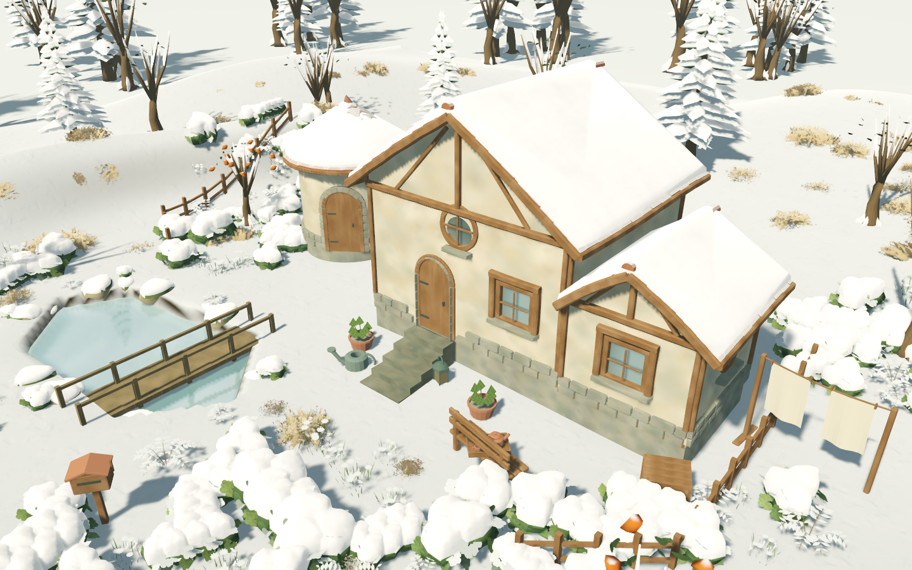
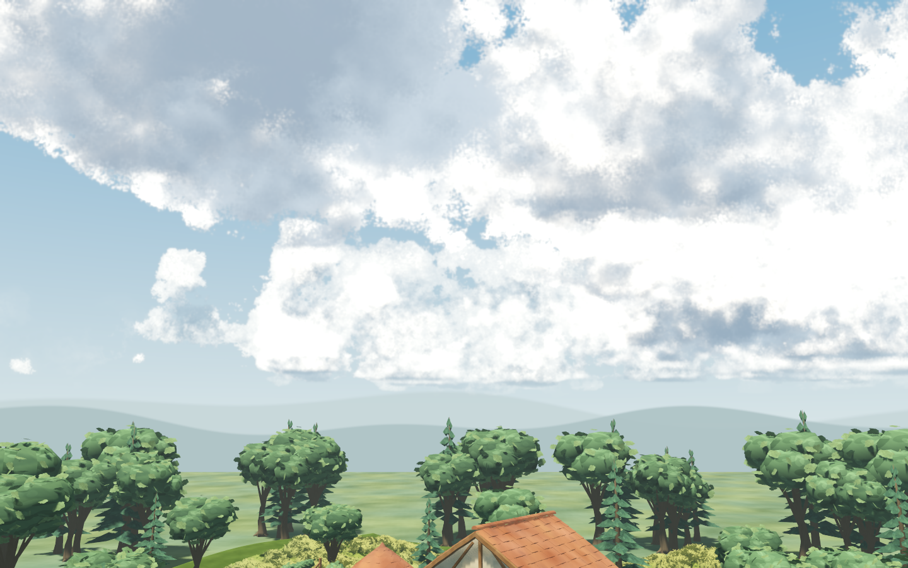

# 正式庭园 · 体积云与积雪采用

2026-10-27。用户认可样板效果并要求直接应用主场景、继续未完成项。本轮保持 `app/living_root.tscn` 为F5入口，正式采用云层，并补入屋檐、岩石、松枝与灌木的真实雪壳。原批准PRD和Blender源没有修改。

## 当前可体验的效果

- 主场景默认使用已认可的SunshineClouds2参数；跟随原日历、太阳、天气、摄影冻结和减少动态。主相机、池面反射和摄影导出各自拥有云资源及历史缓冲，使用相同云相位，避免导出改变主画面缓存。
- Metal采用与样板相同的TAA方案，关闭上游不兼容的MSAA写入路径。正式草的四层几何、密度与笔触不变；这次AA调整不代表性能门槛通过。
- 屋顶采用约34cm参数深度的Blanket雪壳；岩石、松枝、灌木及裸枝采用约20cm参数深度，植物实例缩放会相应缩放雪壳。插件有圆边、折边与封闭侧面，不是原表面染白。没有把透明叶片喷片变成实心白板，也没有给冬季已落叶的树冠补出不存在的雪团。
- 地面保留Terrain3D连续表面，接入原版puchik雪纹理、法线和粗糙度输入；按雪盖强度产生最多14cm的显示位移，冬季98%雪盖时为13.72cm。漫步视高与脚印投射中心同样补偿该显示高度，作者地形和行走支撑数据保持原值。
- 雪完全埋住低矮石径时可留下脚印；裸露石径、桥面与楼梯继续排除。脚印仍在10秒后渐淡、24秒消失，是法线/颜色表面压痕，**没有动态压低雪网格的物理变形**。
- 季节连续混合仍沿用原18秒过渡；春季隐藏雪壳、撤回地面位移。屋顶编辑、预览与撤销继续通过原发布事务更新显示，不把雪壳写入作品源或存档。

直接F5体验；右侧林间历切到1月看冬景，切4月看恢复。云与雪材质样板仍保留，展示板是原材质参考，不等于地面或屋顶的雪壳。

## 插件复用与兼容边界

[Blanket固定源码](https://github.com/1hue/Blanket/tree/7b1166a9f03135098c80fc0aba3a19e7e0909b9f)上游仍要求4.8/Vulkan。本轮没有升级引擎，而是对其**有界物件计算子集**制作独立4.7.2/Metal兼容桥：从4.7公开网格接口上传自有storage buffer，运行原版选面、圆边、边裙、挤出、平滑和法线compute，再读回为派生ArrayMesh。GLSL算法保持逐字节不变；没有改源物件网格，也不启用编辑器插件或全局启动autoload。

改动限于缓冲获取、延迟shader服务、可选debug移除、资源释放和大输出保护；原MIT许可、README、固定commit、逐文件哈希和兼容diff保留于 `addons/blanket/`、`features/weather_plugins/blanket.lock.json` 与 `compat/blanket_4_7.patch`。下载归档中的原文件已按Git blob哈希核对。**该兼容桥不等于宣称上游已支持Metal，也不支持任意尺寸网格**：生成顶点超过65,536时跳过。当前正式示范物件均在有界路径内，地面由Terrain3D负责。

SunshineClouds2仍固定 `a73a80b`，原插件代码未变；适配器从共享WorldEnvironment效果改为相机私有效果。摄影相机会继承启用状态、复制相位、等待32帧收敛，并在释放时销毁自己的GPU资源。puchik仍固定 `515900a`，原shader与CC0纹理保持；其材质输入被适配到Terrain3D，非直接替换整套地形shader。详见[原选型记录](../../art/WINTER_SKY_PLUGIN_ASSESSMENT.md)，其中“尚未采用”的条目为本轮实施前状态，本报告更新其落地结论。

## 实机与回归

```bash
python3 tools/quality/weather_adoption_checks.py --cumulative
```

可分别加 `--headless-only` 或 `--native-only`；原生测试串行。外层拒绝脚本错误、空/漏项测试、失败断言、跳过和RID/ObjectDB泄漏，并核对正式作品/偏好哈希与插件哈希。

最终通过：W01–W09 **446项及故意失败负控**；既有27项/1,262断言加新增9项/1,545断言，共 **36项/2,807断言**，0失败/0跳过；有界雪壳兼容检查通过，正式云雪 **36项**与漫步 **74项**Metal检查通过。308份项目GDScript格式/lint、插件哈希、正式作品/偏好前后哈希检查通过，无脚本错误或退出泄漏。[机器收据](evidence/weather_adoption/checks.json)、[源哈希](evidence/weather_adoption/tested_sources.json)。没有把历史789项全量说成本轮重跑。原生验证包括：

- 有界兼容桥生成的方盒雪壳，实际引用顶点位于原顶面以上，具备额外裙边三角形；不存在只检查白色像素便宣称厚度的通过项。
- 正式云在主画面、480×270池面倒影、1080p/2K照片中绘制；三类相机资源独立。冻结时执行照片与反射后，主图像素差为0；解除冻结后云动恢复。倒影云开关图有实际像素差，非仅检查调用次数。
- 三个屋顶雪壳、570个自然物件部件（含LOD）的雪壳视图，复用84份烘焙几何；它们不是570个新增源物件。雪层准备完成后采图，实际地面位移开关产生像素差，编辑屋高后雪壳更新，撤销恢复，春季隐藏。
- 真实键盘漫步重验拨草、雪面脚印、冻结、淡化和退出；检查打印层不污染屋顶/物件。正常TAA图与关闭TAA的功能对照图分别命名。

倒影云像素差0.017018、2K云像素差0.081064，摄影后主图差0，雪面位移像素差0.018434。原生指标是同机位功能差异，不是帧时间或视觉接受打分。

本机为Apple M4 Pro / Godot4.7.2 / Metal Forward+。未测本轮FPS、编辑时延或Windows实机；旧G4的29.366ms帧p95失败继续开放。当前新增冬景由本轮实机验证，最终美术接受仍由用户体验反馈决定。

## 默认画质证据





[2K摄影](evidence/weather_adoption/photo_2k_clouds.png) · [屋檐近景](evidence/weather_adoption/winter_eaves.png) · [池面插件云](evidence/weather_adoption/reflection_clouds.png) · [池面原云对照](evidence/weather_adoption/reflection_original.png) · [漫步回望脚印](evidence/weather_adoption/winter_first_person_look_back.png)。功能截图中的TAA关闭仅用于稳定像素，不代表默认体验画质。

## 实施中发现并排除的问题

最初把完整64m地面也送入Blanket，触发了大输出索引和异常尖片；该路线已移除，不把存在几何的结果当成正确。最终只将原版算法用于有界物件，地面通过Terrain3D自身连续网格接材质与显示位移；没有保留尖片或用雾遮挡。

初次headless新增用例试图反射native shader uniform，得到空值；改为headless核对资产与源契约、Metal核对真实绑定/位移像素。几何包围盒的约1e-6浮点误差按近似比较，未放宽厘米级贴地门槛。兼容桥首轮误将CUSTOM0浮点数组改为字节数组，已恢复上游格式；读取结果时也移除了未被三角形引用的预分配顶点。首次失败摘要和最终原始日志均保留，兼容桥与资源释放通过后才进入正式采用。

后续仍需容量/性能及Windows真实设备验收；全场遮挡感知雪量、风吹雪堆与动态几何压雪不在本轮完成声明内。当前物件雪壳按朝向生成，仍沿用上游的局部覆盖能力，不把它描述为物理积雪模拟。
