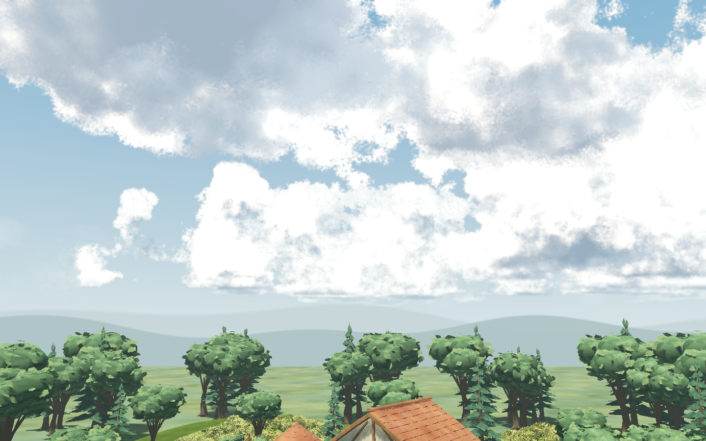
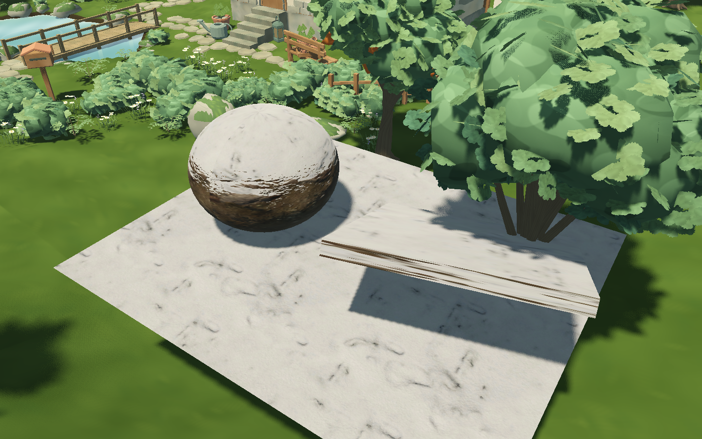
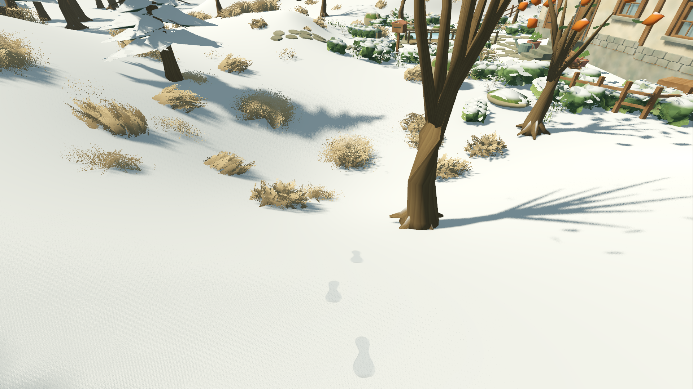

# 云雪插件样板与沉浸漫步交互

2026-10-27，Godot 4.7.2 / macOS Apple M4 Pro / Metal Forward+。本轮是用户明确新增的美术和沉浸交互范围，批准PRD保持原文。草地已接受的四层结构保留；性能仍后置，G4的29.366ms帧p95失败没有关闭。

## 交付与体验

正式F5场景 `app/living_root.tscn` 已接入两项交互。进入相机卡片的“林间漫步”，WASD走动、按住右键或双指环顾：近身高草向两侧弯曲，草根保留，离开约1秒回弹。冬季有积雪时，按0.65m步距留下左右交替脚印；10秒后开始变淡，24秒消失。暂停摄影同时暂停接触场和脚印计时，返回俯瞰清理临时脚印。

脚印使用Godot内置Decal与自制鞋底遮罩/法线；支持实际Terrain3D坡面，避开房屋、道路、池水、桥梯，最多96枚复用。它是表面压痕，**没有压低真实地形，也没有厚雪边唇**。草接触仅传4个共享点到GPU，闲置时跳过形变循环；不逐实例更新CPU、不重建草或地形。房屋、地形、围栏等障碍的提交/预览/取消都刷新脚印支撑查询；仅天气发布不清空足迹。

`app/weather_plugin_lab.tscn` 可直接F6，或从 `app/painterly_grass_preview.tscn` 点“云与雪材质样板”。同一庭园可切原云/插件云、晴/阴/黄昏/夜/雪、庭园/云层/雪材质近景，另有草地/冬日漫步按钮。样板的作品、照片、偏好隔离，不占正式存档槽。

| 项目 | 本轮结果 | 尚未通过的节点 |
| --- | --- | --- |
| SunshineClouds2 | 固定2.7及4.7相机修复 `a73a80b`，采用真实体积云；接现有太阳、天气混合和时钟 | 晴云颗粒/高光、黄昏过暗仍需调色与用户视觉接受；共享时序缓存的多视口质量、水面云倒影待复核；正式天空未默认切换 |
| puchik snow material | 原版shader、原纹理与导入参数固定；平面/球/坡板有纹理和法线受光 | 仅材质参考，未接正式Terrain3D/屋顶/树冠；不具备厚积雪 |
| 正式漫步交互 | 草拨开/回弹、交替脚印生成/冻结/淡化/清理 | 足印压实凹陷和边缘雪唇视觉较弱，仍待用户体验；没有雪几何变形 |
| 厚雪插件 | Blanket、TerraBrush等已核实接口与版本限制 | 当前4.7.2/Metal/Terrain3D/MultiMesh没有直接适配的全场厚雪方案；屋檐/树冠挂雪和“银装素裹”未完成 |

[选型依据、许可与官方源码](../../art/WINTER_SKY_PLUGIN_ASSESSMENT.md)。Blanket要求4.8和Vulkan，TerraBrush雪层依附自己的地形数据，不能只装插件就覆盖现有场景。本轮未升级引擎、迁移地形或另写厚雪生成器。

Metal实测中上游MSAA写入路径失败，样板只关闭MSAA、保留TAA；正式场景4×MSAA/TAA保持。插件原代码未改，适配器显式清理其GPU资源；不启用会改写插件头文件的编辑器Dock。固定版本、文件哈希、许可和Godot归一化的导入设置保存在两个 `features/weather_plugins/*.lock.json`。

## 自动与原生验证

```bash
python3 tools/quality/weather_immersion_checks.py --cumulative --headless-only
python3 tools/quality/weather_immersion_checks.py --native-only
```

也可用 `--cumulative` 一次顺序执行。底层规定命令 `python3 tools/quality/run_checks.py --week 9 --negative-control` 本轮实际执行，W01–W09 **446项和故意失败负控通过**。定向 **27项/1,262断言**、0失败/0跳过：7项拨草/44断言、8项脚印/641断言，加正式地形/容量12项/577断言（含新增围栏发布/取消回归）。最终全部项目代码303份格式/lint通过。没有把历史789项全套写成本轮重跑。

原生测试串行运行，未与其他GPU测试重叠：

- 天气/雪材质 **44项**：四条compute管线实际有效；晴阴/暮夜/雪；冻结和减少动态时云状态与像素零差；恢复后移动；原云/插件云2K摄影像素不同且主视口恢复；雪法线0/0.8产生可见差，朝上平板采样100%为雪，几何AABB不变。
- 正式交互 **73项**：真实W键夏季2.73m、冬季2.92m连续行走，4个草接触点/4个脚印；草弯曲像素变化，冻结重复图零差；18秒变淡、25秒与无印雪面零差；退出清理。检查3栋实际房屋、3组瓦顶及全部子网格、草批次均不接受脚印，只有Terrain3D/事务地形后备网格有接收层18。
- 两组均检查源、历史、草与地形版本/签名稳定；前后正式作品/偏好文件哈希一致。外层拒绝空/漏项测试、失败断言、脚本错误与RID/ObjectDB泄漏；原生日志没有这些错误。保留已有Terrain3D弃用警告，不把它混为错误或隐藏。
- 2K摄影已实际输出插件云；反射视口实际更新11次，**尚未证明倒影云像素正确或多相机时序无伪影**。这两个布尔门槛保留false，不能用调用成功代替视觉通过。

当前功能对照为了获得稳定像素，关掉TAA和水面反射；**归档草地图中的强颗粒不代表正式默认AA画质**。样板常规体验保留TAA，正式体验另保留4×MSAA。功能像素结果不代替最终画风或性能验收。

## 画面证据

云体有冷灰云底与体积层次，但高亮偏白、云边噪点明显，黄昏云层偏暗；当前只记技术样板。



原版雪材质现在有粉雪纹理和法线起伏；平板、球体轮廓没有新增雪厚度。展示板整体抬高以免被丘陵穿出，不是正式地面的积雪。



实际第一人称回望可见交替脚印。脚印仍偏淡、凹陷感较弱，后续应与厚雪方案一并提升。



[新鲜脚印](evidence/weather_immersion/winter_footprints_fresh.png) · [18秒淡化](evidence/weather_immersion/winter_footprints_faded_18s.png) · [25秒消失](evidence/weather_immersion/winter_footprints_gone_25s.png) · [草接触关闭](evidence/weather_immersion/grass_contact_off.png) · [草接触开启](evidence/weather_immersion/grass_contact_on.png)。草图为关闭TAA的诊断近景。

## 修复记录与后续门槛

首次云MSAA路径的Metal编译失败、雪面测试失败与房屋检查失败日志均保留在证据目录。雪材质第一次漏带上游VRAM法线压缩与mipmap导入参数，出现覆雪方向错误；恢复原参数后材质正确。随后平板边缘被山坡遮住导致采样44.4%，修正展示板高度覆盖全包络后100%，未降低原>65%门槛。房屋检查最初读了已废弃的W02 `_building_views` 空表；改为检查正式 `_live_units` 中3栋 `building:*` 根与全部后代，并加房屋/瓦顶数量覆盖断言后通过。

收尾审查另修两处交互边界：脚印支撑签名原本漏掉围栏，现将围栏独立纳入，真实围栏提交/移除预览/取消都有回归。草接触原本在返回已冻结的摄影时也停止衰减，现仅在“仍在漫步且冻结”时保持形状；退出后仍约1秒回弹，风和摄影时间继续冻结。原生探针改为真实冻结摄影后进入/离开漫步，不再用手动解除冻结掩盖该路径。

下一节点优先是厚雪兼容路线与云的多相机/风格收敛，再决定正式云默认替换。厚雪、用户美术接受、完整云反射、G4帧预算、Windows实机等保持开放。本轮没有Blender源或生成器改动，也没有新增性能/Windows通过声明。

原始收据：[headless checks](evidence/weather_immersion/checks.json)、[native checks](evidence/weather_immersion/native_checks.json)、[JUnit](evidence/weather_immersion/tests.xml)、[测试源哈希清单](evidence/weather_immersion/tested_sources.json)。清单在本轮最终检查后采集，报告中的Git revision是测试开始时的基线，不能代替该工作区内容清单。
