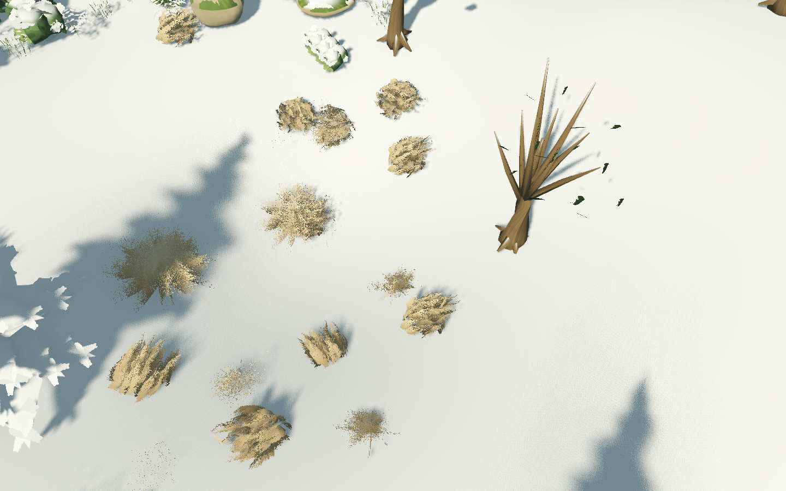

# W14 · 冬季积雪与枯草修复

2026-10-26，用户反馈冬季草地无变化，要求白雪覆盖、只有零星枯黄草。随后用户确认常规草地美术基本符合要求，授权继续后续任务；冬季修复仍需用户体验。

原因：冬季晴天只有28%积雪，四层新草密度未随覆盖变化，仅少量叶尖染白，绿色草层遮住了地面。现将冬季积雪目标提升至98%，保留18秒过渡与冻结；晴冬也有积雪。低矮地被埋入雪下，利用每簇稳定空间种子留下约5%高草并染为枯黄，少量叶尖挂雪。春季融雪后恢复原草，源数据、草簇位置与地形不重建。其他季节外观不变；屋顶/树梢沿用同一积雪信号。

## 正式场景实机对照

固定相机，Metal Forward+，1440×900，关闭景深与TAA，分别捕获草显示/隐藏的成对画面。像素统计区域固定为(240,200)至(1200,800)，每2像素采样。积雪像素为RGB最小值>0.45且红蓝差<0.16；草像素为显示/隐藏时RGB绝对差之和>0.06，包含草的影子。统计是同机位回归指标，不是全地图雪面积或准确植株计数。

| 条件 | 修复前雪像素 | 修复后雪像素 | 修复后草影响像素 |
| --- | --- | --- | --- |
| 晴冬 | 0.27% | 约87% | 约16% |
| 降雪冬季 | 0.55% | 约88% | 约16% |
| 夏季 | 4.63% | 约5% | 约87% |
| 回到春季 | — | 约3% | 约87% |



修复前探针实际返回6项失败（晴冬/降雪各3项），证据保留在[修复前收据](evidence/winter_cover/before/result.json)，不是将旧图人工标为失败。修复后9项天气测试与31项原生检查通过，覆盖晴冬、降雪、春季恢复及每次切换源数据/派生版本不变。QA前后正式作品/偏好哈希一致。[修复后收据](evidence/winter_cover/after/checks.json)。没有改Blender源或导入设置，没有新增Windows或性能通过结论。

```sh
python3 tools/quality/winter_cover_checks.py
python3 tools/quality/run_checks.py --week 9 --negative-control
```

体验：重启游戏，在林间历选择1月；晴天也有雪地，选择降雪能看到雪花。再切4月，积雪在18秒内消退并恢复草地。摄影冻结期间按现有规则冻结过渡，解除冻结后继续。G4容量与Mac性能是下一阶段，常规美术已获用户接受，冬季新增效果待用户复核。
