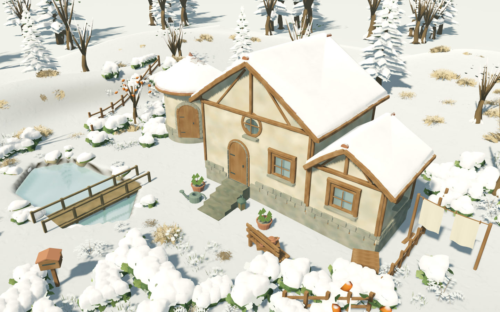

# 冬景保真优化尝试完成 · G4性能风险后置

2026-10-28。已完成本轮限定的保真优化尝试，采用雪壳有限合批、完全积雪材质路径与埋雪地被整批隐藏。三次独立进程中，原配置帧p95中位数**28.200ms**，优化后**26.496ms**，约改善**6.04%**。**20ms预算仍失败；G4后置，不记通过。**

这是项目阶段取舍，不是证明硬件或算法已达绝对极限。剩余约6.50ms需要更深入的逐实例LOD/提交、材质或渲染架构工作；本轮不再无限追加优化、也不以关闭雪/草或明显减画质换成绩。依据用户允许跳过G4并继续后续工作的授权，保留风险与严格失败结果，进入G5本地候选收口；最终发行的性能、Windows和素材门槛不自动通过。

## 采用的变化

- 仅将无距离可见性限制、共用烘焙网格且处于同一8m空间块的自然物雪壳合为MultiMesh。屋顶和带距离范围的部件保留独立物件、原可见性原点及范围。满容量仍是**1,412个源雪壳**，实际绘制视图降至**1,137个**；不改源模型、雪壳三角形、实例位姿、阴影或倒影图层。
- 雪壳alpha已完全为1时走不透明材质路径；覆盖率低于0.9时恢复原alpha hash渐隐和独立物件。未关闭次表面散射、双层法线或改变雪纹理。
- 覆盖率达到0.65后，地被floor层原shader的alpha严格为零，直接隐藏整批；融雪、密度修改和重新发布时恢复正确可见性。候选、实例缓冲、源数据和历史均不变，零星高草仍按原规则保留。

## 保真与功能验证

新增6项GUT、40断言，覆盖合批的网格/实例数/图层、空间隔离、原距离可见性、融雪恢复、源刷新清理、地被阈值与密度/缓冲恢复。规定W01–W09 **446项及失败负控**、既有36项定向/2,807断言通过；本轮定向合计**42项/2,847断言**。313份GDScript格式/静态检查通过。正式多视口/云雪**36项**、实际漫步/脚印**74项**Metal检查通过，无脚本错误/退出泄漏，正式作品/偏好哈希一致。未重跑历史789项全套，未新增Windows通过结论。

另外在关闭TAA、景深和体积云以排除模糊/时序掩盖的条件下，对8/28/48m机位及0/0.4/0.65/0.899/0.9/0.98覆盖率比较两种候选，共**36组**。每个源雪壳的实际渲染矩阵逐一匹配，源/历史/实例数不变；屋顶、距离可见性和反射图层保留。

合批与地被方案最大归一化平均像素差0.00010467，加入不透明路径后0.00013185；超过8个RGB色阶的像素最多约**0.087%**。这不是零像素差；保留不同提交路径带来的微小数值差异，自动近/中/远景对照通过，人工复看归档远景及正式场景未见明显轮廓或风格变化。门槛预设为平均差≤重复噪声+0.00025、显著差异像素≤0.3%；逐组噪声为0，结果均通过。首次景深开启的探索图不作为最终证明。

[功能总收据](evidence/winter_render_optimization/checks.json) · [GUT XML](evidence/winter_render_optimization/tests.xml) · [逐组像素记录](evidence/winter_render_optimization/result.json) · [正式原生检查](evidence/winter_render_optimization/formal_weather.json) · [漫步检查](evidence/winter_render_optimization/immersion.json)。



首轮headless的MultiMesh变换读回为dummy数据，已将矩阵核对移至真实Metal；诊断脚本另修复格式器输出的lambda解析问题及帧缓冲RGB8/RGBA8假设。各次失败日志保留在本证据目录，未计通过。外层检查脚本错误，不只依赖进程退出码。

## 完整动态轨迹的实际结果

锁定Godot4.7.2、Metal Forward+、1920×1080、TAA、无MSAA、关闭VSync、不限帧，24屋/1000源物件、45%草、动态暴风雪。三次独立进程，每次两种配置各热机5秒、按相同轨迹运行60秒，第二次倒序；等待地形/草/全部雪壳完成，不同时运行其他游戏或回归。原配置通过QA开关复现原独立雪壳、alpha hash及地被提交；两边保留全部画面功能与相同源哈希。

| 组 | 原配置p95 | 优化配置p95 | 进程RSS峰值 |
| --- | --- | --- | --- |
| 1 | 28.101ms | 26.375ms | 1304.2MiB |
| 2 | 28.603ms | 26.496ms | 1309.2MiB |
| 3 | 28.200ms | 26.525ms | 1307.7MiB |

所有优化样本均超过20ms，命令非零并保留[失败日志](evidence/winter_render_optimization/performance_budget_failure.log)和[完整收据](evidence/winter_render_optimization/performance/checks.json)。内存峰值低于2GiB，仅代表本次短时测试，不替代20分钟长测。数字是进程帧间隔，不是GPU时间。末帧draw call包含倒影更新和不同材质通道，可能高于原配置；不能把视图减少数当作全场绘制调用或GPU耗时的等比例下降。

```sh
python3 tools/quality/winter_render_optimization_checks.py
# 当前20ms预算仍失败，预期非零并保留全部三组证据
python3 tools/quality/winter_render_performance.py
```

## 阶段决定与剩余边界

G4作为本轮推进的性能阻塞后置，保留未通过事实及其未做的完整天气/密度矩阵、编辑时延、20分钟稳定性、2K峰值与LOD人工复核；不是永久取消这些风险。G5仅推进本地技术候选、素材供应与空缓存验证，不能据此批准商业分发、Git-only素材供应或Windows运行。

原Blender源、导入设置、插件固定版本与存档格式未改，不新增源生成审计通过声明。正常F5主场景已采用这些渲染优化，QA开关用于复验原配置，不暴露为玩家设置。
