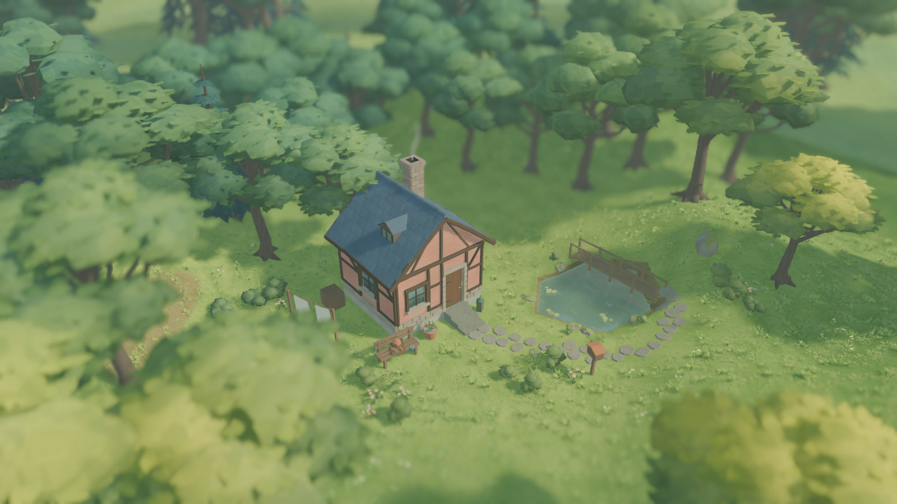

# 微缩景深与森林晨雾

默认相机的视角始终为 43°。此前“远景柔焦”仍启用，但只在焦点后 6 米开始缓慢虚化，强度为 0.045，前景虚化关闭，因此远近层次更接近全景清晰。当前把开关改名为“微缩景深”，同时启用前后景柔焦。

焦点随相机缩放距离移动。清晰区保留在焦点前后约 3 米，模糊强度为 0.085，过渡宽度随距离调整。玩家的关闭选择继续生效。第一人称漫步会临时停用该相机属性，返回俯瞰后恢复，导出照片继承对应镜头。

晨雾使用覆盖林地的低层 FogVolume，雾层中心高 0.9 米、总高度 5.2 米，边缘和高度方向平滑衰减，使用冷白散射色补出清晨低层水汽。季节系数为春 0.34、夏 0.12、秋 0.86、冬 1.0。从凌晨四点半到六点形成，六点半之后逐渐减弱，十点半完全消散。原有天气雾继续由天气控制。晨雾只修改表现参数，日期推进和摄影暂停都使用原来的场景时钟。

复验可在项目根目录执行。

```sh
python3 tools/quality/run_checks.py --week 9 --negative-control
python3 tools/quality/woodland_checks.py --native
```

专项覆盖前后景深开关、缩放跟焦、漫步相机还原，以及秋冬晨雾的季节差异和日照消散曲线。Metal 实拍包含秋日 6:30、8:30、10:30 和冬日 7:30。单帧晨雾实拍包含当时的太阳角度变化。



[秋日 6:30](evidence/focus_mist/autumn_mist_6.jpg) · [8:30](evidence/focus_mist/autumn_mist_8.jpg) · [10:30](evidence/focus_mist/autumn_mist_10.jpg) · [冬日 7:30](evidence/focus_mist/winter_mist.jpg)

94 项专项和 446 项累计回归通过，失败负控生效。正式主场景的晨雾开关在冻结时刻的像素对照、上午雾体消失、冬晨启用、相机及摄影等检查均通过。实拍仍使用 Metal，晨雾新增的全场性能成本和 Windows 实机尚待测量。[专项收据](evidence/focus_mist/checks.json) · [累计收据](evidence/focus_mist/week_09_checks.json)
