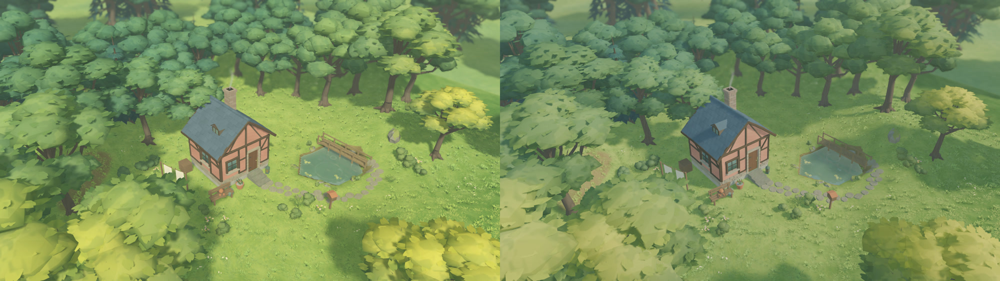

# 温馨林中小屋 · 光照与界面

正式入口为 `app/living_root.tscn`。在默认的五月晴天机位观察山墙、檐下侧墙和两侧树冠，再点底栏的建筑或太阳按钮查看工具与天气。光照和美术参数作用于实际编辑、漫步和摄影场景。



| 《美术.md》的技巧 | 在这片庭园里的处理 |
| --- | --- |
| 侧向日光 | 原先上午十点半太阳和相机的水平方向几乎重合。将太阳移到相机侧面约 75°，春日太阳高度由约 44° 调到 39°。共享太阳角度同时驱动实际照明和程序天空的日轮。 |
| 天空环境光与曝光 | 原创天空为环境贴图提供上半球光色，下半球使用较暗的林地颜色。天空贡献设为 0.48，保留日历控制的环境填充。AgX 的曝光设为 1.55，再用轻微饱和度调整保住青瓦、暖墙与黄叶的区别。池面反射相机在正式环境配置完毕后创建。 |
| 接触阴影与树冠法线 | 将 SSAO 半径缩小至 0.52 米并调整细节和直射光影响，收紧阴影偏移。阔叶树和果树的近远两档模型将叶面法线向同一树冠体积的外法线混合，保留小枝团的起伏。调整只涉及生成时的法线。 |
| 草、抗锯齿与雾 | 草丛已由 MultiMesh 分块绘制，主视口已有 TAA，日历已有随天气过渡的距离雾。本轮沿用这三项，摄影导出继承主视口的抗锯齿配置。 |
| SDFGI | 对同一冻结机位做关、开、再关三段对照。开启后树下更暗，细小草花在暗处更突出。当前默认选择较连贯的林下明暗。 |

SDFGI 对照采用 Apple M4 Pro／Metal、1600 × 900，每段先画 64 帧，再采样 24 次强制绘制并同步回读整张图。三段的回读耗时中位数依次为 22.03、24.18、21.89 毫秒。这组值用于比较该机位的绘制及读回开销，游戏帧率和冬景容量预算另测。[同机位 SDFGI 对比，左关右开](evidence/lighting_hud/gi_comparison.jpg)

默认机位两块暖墙原先接近同一明度，现在朝阳山墙仍明亮，左侧墙处于阴影。将春日原始帧等比缩至 900 × 506，在山墙 (429,252) 取 4 × 5 像素、侧墙 (348,271) 取 6 × 4 像素，两处 RGB 通道中位数的显示亮度差从 9.2 增到 46.5（0–255 标尺）。该取样只描述此机位的两块墙面。[冬景](evidence/lighting_hud/winter.jpg) · [黄昏](evidence/lighting_hud/evening.jpg)

## 界面

工具栏使用原创木纹边框。按钮采用纸色底、墨色轮廓，选中的工具带苔绿底色，键盘焦点有独立描边。林间历、天气滑轨、设置、工具面板和漫步摄影面板共同使用木色、羊皮纸、苔绿与黄铜色。日期、天气和工具仍连接原有控件与编辑动作。

建造面板按实际按钮宽度收拢，七项在桌面同一行显示。天气设置在 1280 × 800、150% 缩放下给日历与工具栏保留了独立点击区域。[建造面板](evidence/lighting_hud/build_tools.jpg) · [150% 天气面板](evidence/lighting_hud/scaled_weather.jpg) · [正式编辑界面](evidence/lighting_hud/editor.jpg)

## 复验

```sh
python3 tools/quality/run_checks.py --week 9 --negative-control
python3 tools/quality/woodland_checks.py --native
python3 tools/quality/week_thirteen_native_checks.py
```

第一条验证历史玩法、存档与失败负控。第二条运行正式场景定向回归，并在真实 GPU 拍摄日间、黄昏、冬季、第一人称以及展开的界面，另外调用正式摄影导出生成无 UI 的 1080p 照片。第三条实际点击工具、通过键盘改变月份、拖动时间与天气滑轨。以上命令均从项目根目录执行。

W01–W09 共 446 项及故意失败的负控通过。专项共 78 项、3,317 个断言。正式场景通过 43 项 Metal 检查，另有 22 项日历、天气及实际输入检查通过。正式存档和偏好的哈希在验收前后一致。本轮性能采样限于上述静态春景的 SDFGI 对照，冬景满容量预算和 Windows 真机仍待验收。[累计记录](evidence/lighting_hud/week_09_checks.json) · [正式场景实拍记录](evidence/lighting_hud/checks.json) · [实际输入记录](evidence/lighting_hud/week_13_native_checks.json)
