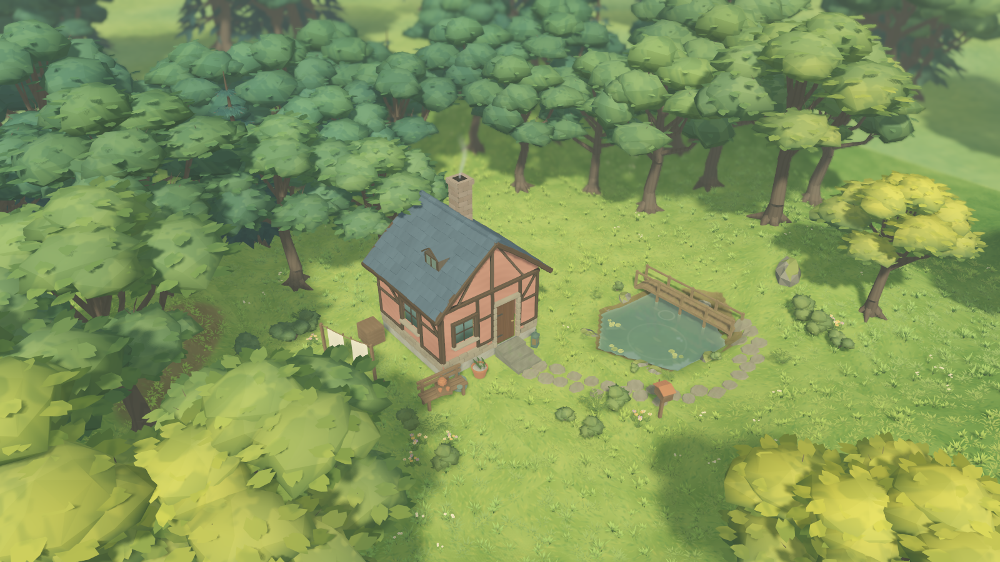

# W15 · 温馨林中小屋

在 Godot 4.7.2 打开项目后按 **F5**。沿用正式入口 `app/living_root.tscn`。新示范从晚春晴天开始。池塘在屋右，门前有茶、长凳和一盏提灯。把林间历调到接近 18 时，可以看见窗光和门灯渐亮。底部相机的「林间漫步」可进入草地，Esc 返回编辑。



[编辑界面](evidence/editor.png) · [黄昏](evidence/evening.png) · [冬天](evidence/winter.png) · [门前漫步](evidence/walk.png)

## 美术与玩法

参考《温馨林中小屋》的青灰屋面、赭粉抹灰、前侧黄叶和屋后冷绿林缘。正式游戏使用可环绕、可行走的透视镜头。石径、短桥和右侧浅池都能编辑，空白模板只保留外围树木。参考中的两个人物没有加入玩法。门前的茶和提灯承担生活细节。

| 画面 | 生成与编辑 |
| --- | --- |
| 半木小屋 | 随建筑尺寸生成错缝板瓦、屋顶窗、梁柱、斜撑和砖石烟囱。门窗服从实际墙洞和圆墙弧面。调整屋顶或切换平顶会重建相应细节。 |
| 林缘 | 固定种子生成弯折树干、根脚、分叉、错层冠团与叶簇。手放、笔刷、绿篱和地块外林幕共用模型。秋叶变色，落叶树在冬季显枝。 |
| 草地与雪面 | 四层原创几何分别表现细草、莎草、小花和低草。地表、风积雪的颜色及法线由 Python 标准库生成。冬季积雪覆盖地面，漫步仍有拨草和逐渐消退的足印。 |
| 浅池与天空 | 浮叶位置取自实际池岸，避开桥头。水面保留实时倒影。体积云使用原创覆盖场、噪声、扰动和高度剖面，主相机、倒影与摄影各自维护渲染状态。 |
| 声音与作品 | 沿用玩家指定的八首音乐、季节选曲和风声混音。作品仍由原有存档、撤销重做和编辑事务管理。 |

地形显示继续使用 Terrain3D，ProtonScatter 提供候选位置，SunshineClouds2 和 Blanket 分别计算云层与雪壳。正式场景已更换旧外部模型和纹理。参考工程的 GLB、截图、材质与下载的 Blender 资产均未拷入场景。生活道具沿用本项目早期自制的模型。旧实验和源文件保存在原位置。

## 复验

```sh
python3 tools/quality/run_checks.py --week 9 --negative-control
python3 tools/quality/woodland_checks.py --native
```

- W01–W09 回归在工作区及隔离用户目录的定稿副本各通过 446 项，故意失败的负控均被正确识别。以下记录来自定稿副本。[累计记录](evidence/week_09_checks.json) · [负控日志](evidence/negative_control.log)
- 定稿专项 74 项、3,283 个断言全部通过。覆盖两类庭园和旧数据往返、五种洞口样式、草木拾取与散布、50 次混合编辑及撤销重做、存读档、融雪、拨草和足印。[JUnit](evidence/tests.xml)
- Apple M4 Pro / Metal 在真实主场景采集五张 1600 × 900 画面。24 项检查覆盖白天与傍晚门灯、七个原创云输入、冬季雪量和第一人称进退。复验前后正式存档与偏好哈希相同。[实拍收据](evidence/checks.json)
- 另从空 Godot 导入缓存启动正常主入口，未供应旧 PainterlyGrass 和 Valley 本地目录。验证以独立的 QA 用户目录运行。[冷启动收据](evidence/cold_start.json)

`tools/art/build_woodland_ground.py`、`tools/art/build_woodland_timber.py`、`tools/art/build_woodland_clouds.py` 可直接用 Python 3 重建对应贴图。树、草、小屋、浮叶的几何从 GDScript 构建，无需 Blender。实际画面保留了游戏里的短桥、可调整的屋型及透视取景，林冠密度和轮廓与参考图有差异。W15 尚未测新美术的性能预算或 Windows 真机。W14 的性能结果只对应此前候选。
