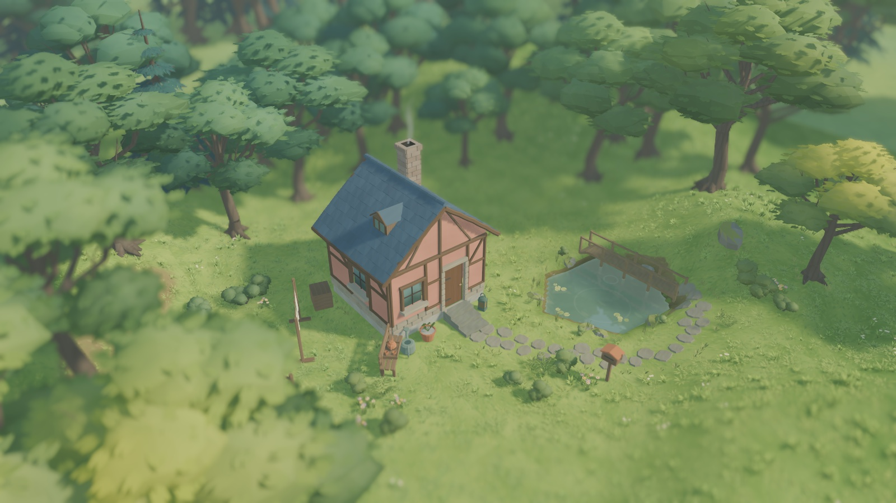

# W16 · 小屋、草甸与接触区域精修

对应 [实施计划](ART_REFINEMENT_PLAN.md)。本轮继续使用原创温馨林中小屋方向，精修现有建筑与景观表现。玩法、音乐、源数据格式、工具范围和插件固定版本沿用。

## 已实施的画面变化

建筑的梁木采用更宽的倒角、小幅稳定弯曲与断面变化，颜色减轻了深色线框感。窗台增加前伸和厚度，地面门洞下补低门槛；灰泥减少高频条纹，加入浅抹灰法线。门洞、贴靠剔除和主体参数继续使用原生成规则。

墙脚、树根、石径边缘和池岸根据实际文档记录派生地被。生成在后台计算普通数组，主线程经现有 ResourceStage 分批构建、原子发布；过期任务与取消沿用已有资源回收规则。地被合并为一个网格表面，最多 1,600 簇，使用独立对象种子。门口、路径、桥阶、摆件和水面保留安全区，植株根部及坡面补偿跟随 TerrainField。删除源物件会删除对应衔接，装饰不写入存档。

池岸补疏密不同的莎草；Terrain3D 多一张从实际岸线生成的 R8 湿润遮罩，以变化的宽度压低岸边亮黄土色。只改变材质，不改变池形、水位或地形高度。遮罩随池塘和地形的最新版本一起发布。低矮地被随积雪下沉并隐藏，沿用现有冬季零星枯草；风量、减少动态和摄影冻结均接入现有材质管理。

树冠降低部分下层枝叶、细化外缘并柔化内部碎斑，保持两级 LOD。草甸使用连续大尺度变化调整长草与莎草的大小，保留候选顺序、密度排名和四个草层。示范林缘减少规则行列，扩大树木高低变化，前景树让开小屋，推荐俯瞰从 29.5 米靠近到 27 米。旧作品里的树和道具不会自动挪位；新的示范庭园采用新布局。微缩景深和秋冬晨雾继续保留。

## 验证与证据

```sh
python3 tools/quality/run_checks.py --week 9 --negative-control
python3 tools/quality/woodland_checks.py --native
```

新增 W16 专项覆盖确定性、不改源/存档、四类接触区域、门口桥面避让、依赖失效、移除与恢复、坡地接地、草甸连续变化及池岸遮罩。正式场景的 50 次混合编辑及完整撤销重做还检查衔接网格恢复；既有开口、圆屋/平屋顶、存读档、拨草、雪脚印、天气、摄影和界面专项继续运行。

正式 Metal 捕获额外检查衔接网格已发布、合并表面、加入风与摄影材质管理，并保存地被开启/关闭实拍。最终结果与测试计数见本目录 `evidence/checks.json`、`evidence/tests.xml`、`evidence/week_09_checks.json` 和 `evidence/capture.json`。

101 项专项、JUnit 3,631 个断言、59 项 Metal 检查通过；GUT 控制台汇总为 3,635 个断言，文档统一采用 JUnit 明细之和，未混加不同运行次数。累计 W01–W09 446 项及失败负控通过，正式作品和偏好文件摘要不变。313 份 GDScript 格式与静态检查通过。Godot 无脚本错误或退出泄漏；Terrain3D 既有物理插值弃用提示保留在日志中。

池岸首次专项测试误把多边形池塘的 `center` 当作几何中心，实际该字段保存首个作者岸点；失败被验证命令正确拦截。已改为在实际轮廓内部取样，并保留 [首次失败收据](evidence/first_run/bank_probe_tests.xml)。没有放宽湿润程度断言。

## 画面验收

下列为正式主场景实拍，未重绘或替换物件。图片副本仅转为 JPEG 保存；源 PNG 在可再生成的 `reports/week_15/woodland/`。



[小屋与池岸近景](evidence/cottage_detail.jpg) · [原机位复拍](evidence/spring_baseline_camera.jpg) · [修改前](evidence/before/spring.jpg) · [黄昏](evidence/evening.jpg) · [秋晨雾](evidence/autumn_mist_6.jpg) · [冬景](evidence/winter.jpg) · [编辑界面](evidence/editor.jpg)

F5 打开正式主场景。新建示范庭园看新构图，使用推荐庭园镜头查看门窗、墙脚与池岸，进入漫步观察接地。现有存档直接获得新模型和衔接表现，源物件摆放保持。

## 边界

本轮达到的是计划内美术精修与技术回归，不宣称已达到 Tiny Glade 的整体商业美术品质。墙面形体、建筑组合语言和更丰富的树种轮廓仍有继续精修空间。新增过渡植物属于低矮装饰，不承担独立拾取或碰撞；原动态草层继续负责拨草交互。

没有改 Blender 源或 Blender 生成器，无需新增源文件审计；未引入外部资产、插件升级或音乐替换。新增材质采样及装饰的完整容量性能未验；Windows 真机、原有性能和发行门槛继续开放。用户的主观美术验收由实际体验决定。
